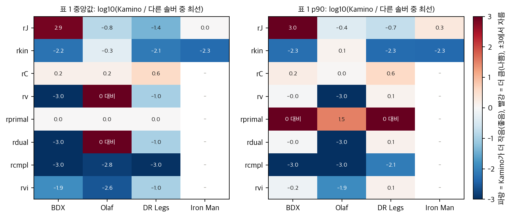
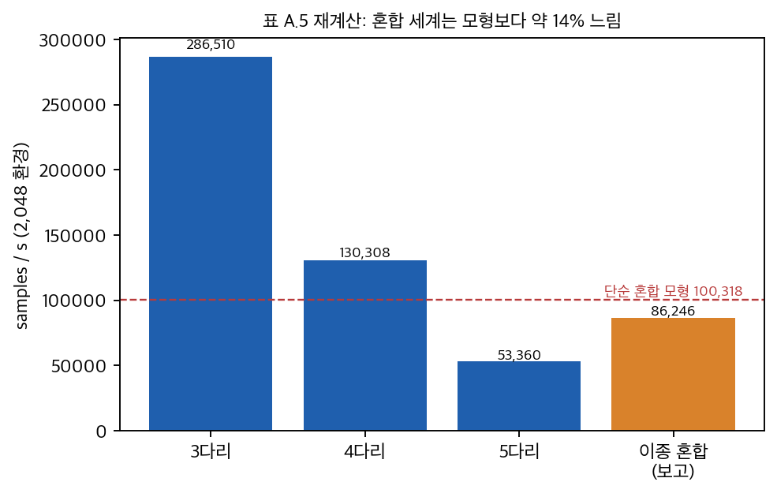
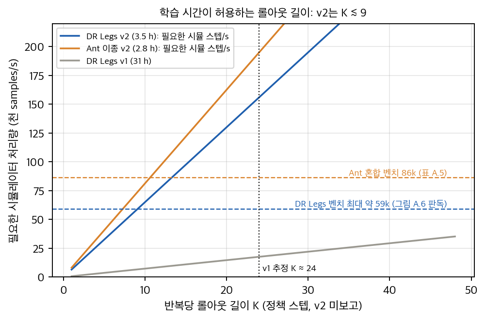
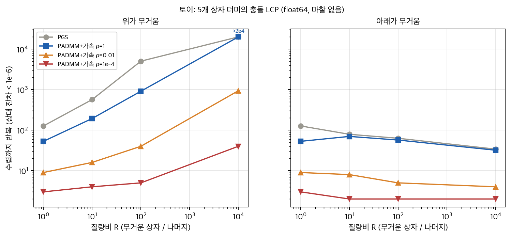

# 03. 수치 재계산, 일관성 검사, 토이

논문이 보고한 수치를 다시 계산하고, 표와 본문 사이의 일관성을 검사하고, 핵심 주장 하나(전역 선형 풀이를 쓰는 PADMM이 질량비에 덜 민감하다)를 작은 CPU 토이로 확인했습니다. **공식 코드는 실행하지 않았고, 재현 실험은 하지 않았습니다.** 스크립트는 `analysis/recompute.py`(수 초)와 `analysis/toy_padmm_stack.py`(약 7초)이고 결과는 `*_results.json`에 있습니다. 쪽, 절, 표는 v2 기준입니다. 그림에서 읽은 값은 "판독"이라고 적었고 판독 오차는 약 ±5%입니다.

검사 번호: **V** = 보고 수치 재계산, **K** = 표·본문·버전 사이 일관성 검사, **T** = 토이. 코드와의 차이는 `04`의 D 항목입니다.

## 1. 표 1 재계산 (V1)

표 1은 4개 모델 × 지표 × (중앙값, p90) × 솔버 4개이고, 한 칸당 한 개의 숫자입니다. 반복 시행, 신뢰구간, 검정은 없습니다(시간에 걸친 요약이고 서로 독립인 시행이 아닙니다). 그래서 검정 대신 **칸별 순위와 비율**을 계산했습니다. Kamino 값을 "다른 세 솔버 중 최선"과 비교합니다(MuJoCo CPU는 접촉력 지표 rprimal, rcmpl, rvi가 없어 그 칸에서 제외).

| 요약 | 칸 수 | Kamino 최선 | 최선의 2배 이내 | 2배 초과 |
|---|---|---|---|---|
| 중앙값 | 26 | 19 | 3 | 4 |
| p90 | 26 | 14 | 6 | 6 |
| 구성 수준(rJ, rC) 중앙값 | 7 | 2 | 3 | 2 |
| 구성 수준 p90 | 7 | 2 | 2 | 3 |
| 속도 수준(rkin, rv) 중앙값 | 7 | 6 | 0 | 1 |
| 속도 수준 p90 | 7 | 5 | 2 | 0 |
| NCP(rprimal, rdual, rcmpl, rvi) 중앙값 | 12 | 11 | 0 | 1 |
| NCP p90 | 12 | 7 | 2 | 3 |

(Kamino가 최선이 아닌 칸. 중앙값: BDX rJ 757배 나쁨(MuJoCo 1.48e-7 대 1.12e-4), BDX·Olaf·DR Legs의 rC는 XPBD가 1.4–3.7배 더 작음, Olaf rv·rdual은 MJWarp의 중앙값이 0이라 비교 불가(Kamino 6e-7 수준), Iron Man rJ는 XPBD 4.24e-3 대 4.43e-3으로 4% 차. p90: BDX rJ 2,860배, rC 전 모델에서 XPBD 우세, DR Legs rv·rdual·rvi는 XPBD가 1.3배 작고 Kamino가 최하위, Olaf rkin은 MuJoCo 5.23e-2 대 6.51e-2.)

- **본문 주장과의 대조.** "best or near-best throughout, 특히 속도 수준 지표 rkin, rvi"(§3.1)는 **중앙값에서는 맞고 p90에서는 약합니다.** rkin은 중앙값 4개 모델 중 3개에서 두 자릿수 이상 낮지만 Olaf 중앙값은 Kamino 4.66e-3 대 MJWarp 9.42e-3으로 2배 차이이고 p90은 최하위에서 둘째(MuJoCo보다 1.24배 큼). rvi는 DR Legs p90에서 XPBD(3.38e-1)가 Kamino(4.43e-1)보다 낮습니다.
- **구성 수준 지표는 Kamino의 약점입니다.** rJ는 트리 구조 BDX에서 MJWarp·MuJoCo(최소 좌표라 관절이 거의 정확)가 3자리 낮고, rC(관통)는 접촉이 있는 세 모델 모두 XPBD가 최선입니다. 본문 "(rJ, rC)는 일관되게 낮다"는 절대값(1e-4–1e-3)으로는 맞으나 최선은 아닙니다. 논문도 BDX의 rJ에 대해서는 그렇게 씁니다.
- **NCP 잔차(rcmpl, rvi)의 압도적 우위는 BDX, Olaf에서 크고(최대 3자리), DR Legs p90에서는 사라집니다.** DR Legs p90 rv와 rdual은 네 솔버가 모두 0.4–0.8로 사실상 같습니다. 충돌 직후 프레임이 p90에 들어온다는 캡션 설명과 맞습니다.
- **꼬리가 두껍습니다.** Kamino의 p90/중앙값은 BDX rv 6.0e5배, rdual 5.9e5배, DR Legs rv 1.1e3배입니다. 중앙값만 보면 "기계 정밀도 수준"이고 p90은 0.1–0.8로 다른 솔버와 같습니다. 중앙값의 큰 이득은 대부분의 프레임이 비접촉·정상 상태에 가깝다는 사실을 반영할 수 있어서 접촉이 있는 프레임만 따로 요약해야 비교가 의미가 있습니다(논문에 없음).



## 2. 위상과 크기 일관성 (V2)

연결된 기구 그래프의 독립 루프 수는 관절 수 − 몸체 수 + 1입니다(고정 베이스는 월드를 몸체로 세어 1을 뺍니다).

| 모델 (v2 표 A.1) | 몸체 | 관절 = 구동 + 수동 | 보고 루프 | 공식값 |
|---|---|---|---|---|
| DR Legs | 31 | 36 | 6 | 6 |
| BDX | 15 | 14 | 0 | 0 |
| Olaf | 27 | 29 | 3 | 3 |
| Iron Man (고정 베이스) | 67 | 80 | 13 | 13 (월드 포함) |
| Hoberman 구 | 240 | 421 | 182 | 182 |
| Ant-3 / 4 / 5 | 7 / 9 / 11 | 6 / 8 / 10 | 0 | 0 |

**v2의 표 A.1은 모두 위상 항등식과 맞습니다.** v1 표 1은 맞지 않는 칸이 있습니다: BDX는 몸체 21, 관절 14라서 공식값이 −6입니다(고정 몸체를 센 것으로 추정). DR Legs 6, Olaf 5, Iron Man 45(고정 베이스 가정)는 맞습니다.

최소 Delassus 차원(그림 3 x축)은 회전 관절 한 개당 구속 5행으로 보면 BDX 70(보고 70), DR Legs 180(보고 180)에 맞습니다. Olaf는 145 대 148, Iron Man은 400 대 377이라 모든 관절이 회전 관절이 아니라는 뜻입니다(관절 종류 목록이 없어 검증 불가). v1의 값(84, 192)은 구동 관절당 1행을 더한 것과 맞고(BDX 70 + 14, DR Legs 180 + 12), v2는 그 행을 뺀 정의로 바뀌었습니다.

## 3. 처리량 (V3, V5)

**V3. 이종 Ant (표 A.5).** 2,048개 환경에서 3다리 286,510, 4다리 130,308, 5다리 53,360, 이종 혼합 86,246 samples/s입니다. 샘플당 비용이 더해지고 세 종류가 같은 비율로 섞인다고 가정하면 혼합의 기대 처리량은 세 값의 조화평균 100,318입니다. 보고값은 그보다 **14% 낮습니다.** 서술(5다리보다 빠르고 4다리보다 느림)은 맞습니다. 모두 5다리 크기로 패딩했다면 53,360 근처였을 텐데 86,246이므로 세계별 조기 종료 마스크가 실제로 이득을 준 것으로 읽을 수 있습니다. 14%는 이질성 오버헤드로 해석하되 세계 수 비율(1/3씩)은 본문에 없어 가정입니다.



**V5. BDX 비교와 시간 간격.** Kamino 2.4e5 대 XPBD 5.8e5(2.4배), 대 MJWarp 6.1e6(25.4배)이며 Kamino 값은 그림 A.6(약 2.4e5)과 맞습니다. 같은 시뮬레이션 시간을 계산하면 Kamino는 큰 Δt를 쓰므로(DR Legs 1.25 ms 대 XPBD 0.2 ms = 6.25배, Iron Man 5 ms 대 0.2 ms = 25배) 스텝당 속도 비가 6.25배(25배)보다 작으면 시뮬레이션 시간당 속도는 Kamino가 빠릅니다. BDX의 비가 25배이므로 Iron Man에서 MJWarp의 스텝당 속도 이점이 BDX와 비슷하다면 손익분기입니다. **논문은 BDX 외 모델에서 MJWarp, XPBD의 처리량을 보고하지 않아 이 비교를 닫을 수 없습니다.**

**V5b. Iron Man의 CR.** 그림 A.6 판독: CR은 약 1,800 세계에서 최대 약 19,000, 이후 약 10,500으로 떨어지고, LLT 희소는 4,000 세계 이상에서 약 16,700입니다. "CR이 큰 시스템에서 낫다"(§3.2)는 최대 처리량 기준으로 약 14%이고 세계 수가 많으면 반대입니다. 그림 3은 최대값만 그립니다.

## 4. 이항·시드 통계 (V4)

- **조작 100회 중 100회.** Wilson 95% 구간 [96.3%, 100%], Clopper–Pearson [96.4%, 100%]입니다. 즉 "실패율이 3.7% 이상은 아니다" 정도의 주장이고 "완벽하다"는 증거는 아닙니다. 비교 솔버의 같은 과제 결과는 없습니다.
- **DR Legs 10시드 생존율 98.5 ± 0.4%.** ±가 SD인지 SE인지 본문에 없습니다. SD라면 평균의 95% t 구간은 98.2–98.8%, SE라면 97.6–99.4%입니다(t₀.₉₇₅(9) = 2.262). 에피소드 수도 없어 정수 가능성 검사는 할 수 없습니다. 본문 "보상 변동 2% 미만"의 분모도 없습니다. 그림 A.9는 곡선이 하나뿐이라 10시드 수렴을 시각적으로 보여 주지는 않습니다.

## 5. 학습 시간과 과제 산술 (V6, V7)

**V6. 학습 시간.** v1은 반복당 환경 스텝 약 24(390M ÷ (4,000 × 4,096) = 23.8, 환경 스텝 3,600/s × 31 h = 402M으로 맞음), 시뮬 스텝은 정책 스텝의 5배입니다. v2는 같은 4,000 반복, 4,096 환경을 **3.5 h**에 끝냅니다(8.9배 빠름, RTX 5090). 반복당 롤아웃 길이 K가 v1과 같은 24라면 필요한 시뮬레이터 처리량은 약 156,000 samples/s로, 그림 A.6의 DR Legs 최대 약 59,000(RTX 5090과 Pro 6000이 비슷함, 그림 A.7)의 **약 2.6배**입니다. 이종 Ant도 24라면 195,000 대 표 A.5의 86,246(2.3배)입니다. 모든 시간이 시뮬레이션이라고 가정해도 K ≤ 9(DR Legs), K ≤ 10.6(Ant)이어야 합니다. 따라서 v2의 학습 설정(롤아웃 길이, 정밀도, 반복 수 등)이 v1에서 바뀌었거나 보고 시간이 같은 설정이 아닐 가능성이 큽니다. **어느 쪽인지는 본문으로 알 수 없습니다(미확인).**



**V7. 과제 설정 산술.**
- 걸음 주기 2π√(L/g) = 1.033 s (L = 0.265 m): 본문 "≈ 1 s"와 맞습니다. 정책 50 Hz = 4 ms × 5도 맞습니다. 10 s 에피소드는 500 정책 스텝입니다.
- 기준 접촉 신호 ĉ_f = 1[ĥ_f < 1e-4], ĥ_f = 0.05·max(sin(2π(θ − δ_f)), 0), δ_L = 0.5, δ_R = 0: 접촉 비율은 한 발당 0.5006입니다(0.5 + asin(1e-4/0.05)/π). 두 발이 0.5씩 어긋나므로 이중 지지 구간이 없는 기준 걸음입니다.
- 관측 식 (28)의 항목을 더하면 3 + 3 + 2 + 1 + 2 + 12 + 12 + 12 = **47**입니다. v1 본문은 94차원이라고 쓰고, 공개 코드의 DR Legs 관측도 94입니다(`04` D11). 식 (28)이 설명하는 관측으로는 94가 나오지 않습니다.
- 보상 표 A.3의 한 스텝 최대합은 56(추종 5 + 2 + 2 + 20 + 10 + 2 + 5 + 10, 규칙 항은 0 이하). 그림 A.9의 수렴값 약 40은 스텝당 평균이어야 앞뒤가 맞습니다(최대의 71%). "episode reward"가 에피소드 합이면 최대는 약 28,000입니다. Ant는 최대 20 중 약 16.5(82%)입니다.

## 6. 4절 링크 표 A.2 (V9)

링크 길이 약 6 cm 기준 비율(단위가 m와 rad인 구속이 섞여 있어 근사)입니다.

| 설정 | 400 Hz | 1000 Hz |
|---|---|---|
| Kamino soft (α = 0.01) / stiff (α = 0.1) | 6.0e-3 (10%) / 1.8e-3 (3.0%) | 1.6e-3 (2.7%) / 3.6e-4 (0.6%) |
| MJWarp soft / medium / stiff | 3.7e-3 / 9.4e-3 / 1.1e-2 | 1.5e-3 / 1.8e-3 / 1.0e-4 |
| XPBD | 1.4e-3 | 2.2e-4 |

- 본문 서술("400 Hz에서는 XPBD, 1000 Hz에서는 MJWarp가 가장 조밀")은 표와 맞습니다. 1 mm 미만인 설정은 1000 Hz에서만 Kamino stiff, MJWarp stiff, XPBD 세 개입니다. 400 Hz에서는 모두 1 mm 이상입니다.
- 이 예제에서 Kamino는 **구속 만족으로는 3등**입니다(400 Hz 2등, 1000 Hz 3등). 장점은 에너지가 "합리적으로 소산"이라는 그림 A.5 근거인데 수치 표는 없습니다.
- 유일하게 조정한 파라미터가 이 예제의 α라고 §3.1이 씁니다(0.01, 0.1). α를 10배 올리면 잔차가 3.3–4.4배 줄어듭니다.

## 7. 토이 T1: 쌓인 상자 LCP에서 PGS 대 PADMM

`analysis/toy_padmm_stack.py`(numpy, 단일 프로세스, 약 7초). 5개 상자를 쌓고 모두 −1 m/s로 떨어지는 비탄성 충돌 한 스텝을 임펄스 LCP로 푼 뒤(해석해: 위쪽 질량의 합), 상대 잔차 max(r_primal, r_dual, r_cmpl)/(1 + |λ|∞) < 1e-6까지 반복 수를 셉니다. PADMM은 알고리즘 1(Jacobi 전처리, η = 1e-5, Nesterov 가속과 재시작, 분해는 한 번)입니다. 논문이 ρ를 적지 않아(코드 기본 rho_0 = 1.0) ρ = 1, 1e-2, 1e-4를 다 돌렸습니다. 마찰은 없고 모든 접촉이 활성이어서 "전역 선형 풀이가 쉬운" 경우입니다.

| 질량 분포 | R | PGS | PADMM+가속 ρ=1 | ρ=1e-2 | ρ=1e-4 |
|---|---|---|---|---|---|
| 위가 무거움 | 1 | 127 | 53 | 9 | 3 |
| 위가 무거움 | 10 | 569 | 194 | 16 | 4 |
| 위가 무거움 | 100 | 5,042 | 914 | 40 | 5 |
| 위가 무거움 | 10⁴ | > 2e4 | > 2e4 | 938 | 40 |
| 아래가 무거움 | 100 | 63 | 57 | 5 | 2 |
| 아래가 무거움 | 10⁴ | 34 | 32 | 4 | 2 |



- **PGS는 위가 무거운 더미에서 질량비에 따라 급격히 느려집니다(R = 100에서 5,042회).** 아래가 무거운 경우에는 오히려 쉽습니다. 논문의 "XPBD는 질량 분포에 의존하고 heavy-bottom이 가장 유리"(부록 A.4)와 방향이 같습니다.
- **PADMM도 ρ = 1에서는 위가 무거운 더미에서 반복이 질량비에 따라 늘어납니다**(53 → 194 → 914). 이 경우 "전역 선형 풀이라 질량비에 무관하다"는 직관은 성립하지 않습니다. 선형 풀이는 정확해도 ADMM 외부 반복의 수렴은 ρ와 D의 조건수에 좌우됩니다.
- **ρ를 작게 하면 반복이 급감합니다**(R = 100에서 914 → 40 → 5). 이 토이에서는 모든 접촉이 활성이라 작은 ρ가 사실상 등식 구속 풀이가 되기 때문입니다. 접촉이 켜졌다 꺼지는 실제 문제에서 같은 ρ가 통하는지는 이 토이로 알 수 없습니다.
- **함의.** 논문이 반복 수와 η, ρ를 적지 않은 채 "최소 튜닝"이라고 주장하는 부분은 ρ(와 가속 재시작 규칙)의 선택에 숨은 튜닝이 있을 수 있다는 뜻입니다. 코드는 관절 행에 ρ를 아예 적용하지 않는 기본값을 씁니다(`04` D5).
- float32(ρ = 1e-2)는 R = 100에서 수렴하지 못했습니다(1e-6 상대 잔차 한계). 논문이 단정밀도를 쓰므로 관련 있으나 이 토이의 크기로 일반화하지는 않습니다.
- 한계: 5개 상자, 1차원, 마찰·de Saxcé·접촉 변화 없음, 반복당 비용 비교 없음(PGS는 O(n), PADMM은 분해 후 O(n²) 풀이). 반복 수만 비교했으므로 시간 비교가 아닙니다.

## 8. 일관성 검사 (K)

| 번호 | 검사 | 결과 |
|---|---|---|
| K1 | v1 BDX 21 몸체·14 관절(루프 0)과 v1 그림 4 캡션("Iron Man은 트리")이 같은 쪽 표 1(Iron Man 루프 45)과 맞는가 | 맞지 않음. 위상 항등식으로 BDX는 −6, 캡션은 표와 모순. v2에서 수정됨 (§2) |
| K2 | 표 1 XPBD의 rC 중앙값이 BDX와 Olaf에서 같음(2.06e-4, 2.06e-4), Kamino도 거의 같음(2.95e-4, 2.97e-4) | 다른 로봇인데 같은 값이라 솔버 고유의 정확도가 아니라 접촉 마진, 충돌 감지 한계, 기하(바닥 평면 접촉 허용치)에 지배되는 값일 가능성. 해석은 가설이고 코드로 확인하지 못함 (`04` D9) |
| K3 | DR Legs에서 rdual과 rvi가 네 솔버 모두 완전히 같은 값(Kamino 6.83e-4/4.43e-1 등)인데 BDX와 Olaf에서는 다름 | DR Legs에서 두 지표의 정의가 사실상 같은 항으로 줄었을 가능성. 본문에 설명이 없어 저자 확인이 필요함 |
| K4 | 표 1 캡션 "기준 궤적의 구성 잔차 p90 최대 3e-4": 표의 Kamino rJ p90은 BDX 5.7e-4, Olaf 8.3e-4, DR Legs 1.4e-3, Iron Man 1.9e-2 | 기준 궤적(Kamino 10 kHz)과 표의 궤적(각 솔버의 Δt)이 다른 양이라 모순은 아님. 다만 표의 Δt가 모델별로 적혀 있지 않음 |
| K5 | 표 1은 어떤 Δt에서 평가했나 | 본문에 없음. DR Legs는 §3.3에서 1.25 ms, RL은 4 ms, Iron Man은 5 ms |
| K6 | 처리량은 PADMM 100회·CR 15회 고정이고 표 1의 정확도는 PADMM 200회 | 처리량과 정확도가 같은 운영점이 아님. 200회면 처리량은 낮아짐(분해는 한 번이므로 비례하지는 않음). 검증 불가 |
| K7 | BDX 비교에서 XPBD 반복 수 | 정확도 표는 20회, 처리량 표기 없음. XPBD 기본은 2회(부록 A.4). 처리량 5.8e5가 2회 기준이면 정확도 기준(20회)에서는 더 느림 |
| K8 | 본문 "§1 (iv) 오픈소스"와 코드 | Newton에 있으나 솔버 README는 BETA 1, 사용 비권장, 기여 거절. BDX, Olaf, Iron Man 자산은 비공개 (`04` D1, D12) |
| K9 | A.7 "4,000 반복 3.5 h"와 v1 "31 h" | 8.9배 차이를 설명하는 설정 변경이 본문에 없음 (§5 V6) |
| K10 | 식 (28) 관측 차원 47 대 v1 94, 공개 코드 94 | §5 V7. 코드는 수동 관절 24개의 위치도 관측에 넣음(`04` D11) |
| K11 | 그림 A.9는 곡선 하나, 본문은 10시드 | 시드 분포를 곡선으로 확인할 수 없음 |
| K12 | 조작과 BDX, Olaf sim-to-real 성공 | 100/100은 비교 솔버 없음. sim-to-real은 영상만, 수치와 시도 수 없음 |
| K13 | Table A.1 루프 수 | 위상 항등식과 모두 일치 (§2) |
| K14 | 이종 Ant 서술 | 표 A.5와 일치. 이론 모형 대비 14% 느림 (§3) |
| K15 | 표 1 각주: MuJoCo CPU는 "접촉력을 쓸 수 없어" rprimal, rcmpl, rvi를 못 잰다 | MuJoCo는 `mj_contactForce`로 접촉 프레임의 힘을 제공하므로 이 설명은 Newton 래퍼 쪽 제약이거나 MuJoCo의 완화된(소프트) 접촉 모델이 NCP 잔차와 정의가 맞지 않기 때문일 수 있음. 어느 쪽인지 본문에 없음(미확인) |

## 9. 판정 요약

- **재계산으로 확인된 것:** 표 A.1 위상(V2), 처리량 서술과 그림 A.6(BDX), Ant 서술의 방향(V3), 4절 링크 서술과 표 A.2(V9), 걸음 주기 1.033 s(V7), 조작 100/100의 구간(V4).
- **본문 서술이 과한 곳:** "표 1에서 best or near-best"는 p90과 구성 수준 지표에서 약하고(V1), "큰 시스템에서 CR이 낫다"는 최대 처리량 한 점 기준이며(V5b), "최소 튜닝"은 ρ·반복·η가 비공개인 채로 남아 있습니다(§7).
- **검증할 수 없는 것:** 해석해 비교 네 예제(곡선만), DR Legs 걸음과 Iron Man 안정성(영상), sim-to-real(영상), 10시드 분포, v2의 3.5 h(V6).
- **버전 사이 불일치:** 학습 시간 31 h → 3.5 h, 시스템 크기 표, PADMM 반복 예산, 최소 Delassus 차원의 정의(K9, §2).

## 10. 재실행

```bash
python3 analysis/recompute.py          # recompute_results.json (수 초)
python3 analysis/toy_padmm_stack.py    # toy_padmm_stack_results.json (약 7초)
python3 analysis/plot_figures.py       # report/figures/own_*.png
```
