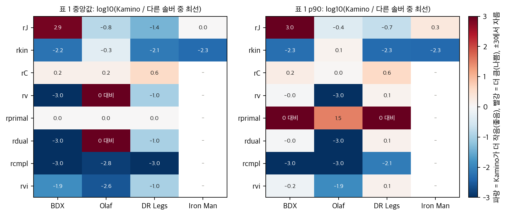
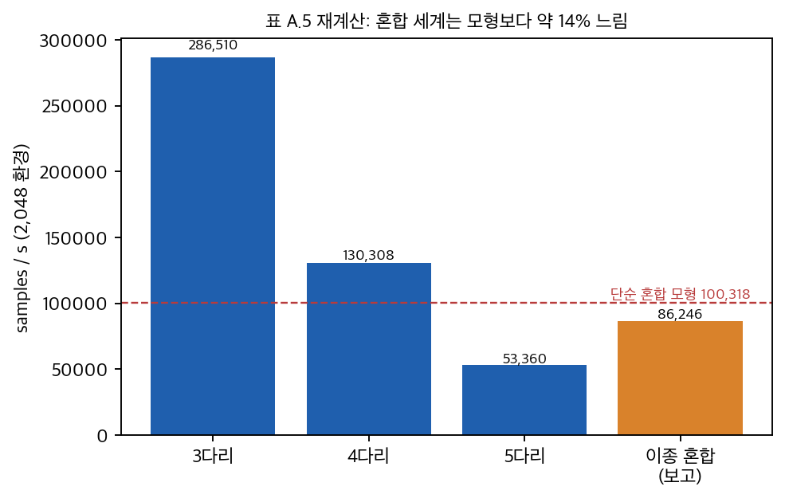
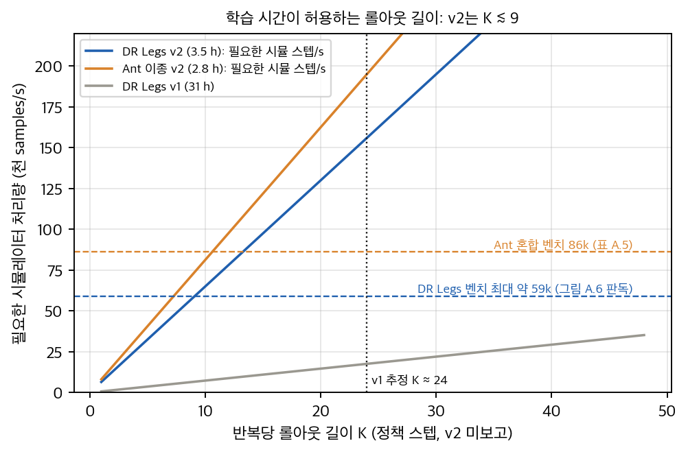
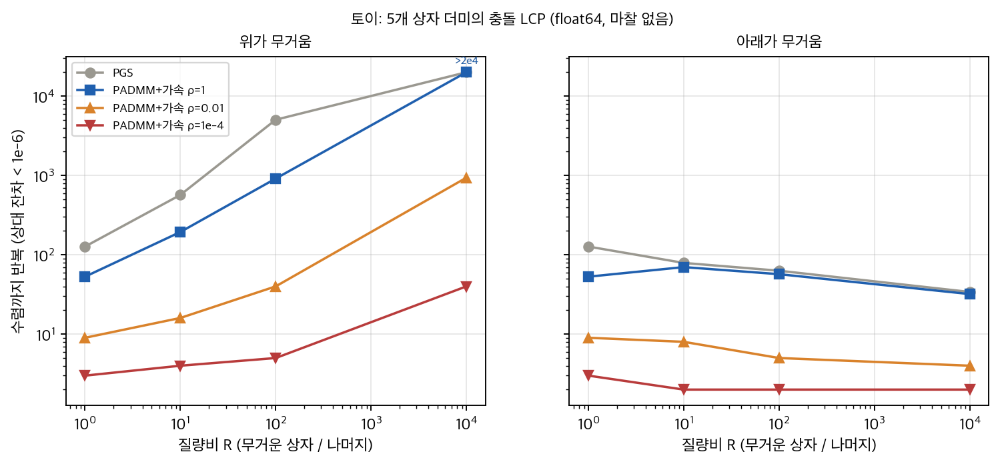

> **논문:** Vassilios Tsounis, Guirec Maloisel, Christian Schumacher 외. *Kamino: GPU-based Simulation of Rigid Multi-Body Physics with Kinematic Loops.* CoRL 2026 Spotlight, arXiv:2603.16536 (v2, 2026-10-20).
> 공식 구현은 NVIDIA Newton 저장소 안(Apache-2.0)에 있고 현재 BETA 1입니다. 이 글의 그래프는 모두 우리가 표 값으로 그린 것이고, 논문 그림은 쓰지 않았습니다(arXiv 라이선스가 non-exclusive).

## 논문이 풀려는 문제

대부분의 GPU 시뮬레이터는 최소 좌표의 트리 구조를 가정해서 네 마디 링크 같은 닫힌 기구 사슬을 별도 구속이나 mimic joint로 근사합니다. 그러면 어느 관절을 트리에 두고 어느 관절을 구속으로 보낼지에 임의성이 생기고, 구속 파라미터를 직접 맞춰야 합니다. Kamino는 이 가정을 버립니다. 몸체마다 자세와 트위스트를 두는 최대 좌표로 관절, 관절 한계, 접촉을 하나의 이중 문제로 묶고, 근위 ADMM(PADMM)으로 비선형 상보성 문제를 직접 풉니다. de Saxcé 보정으로 슬라이딩 접촉이 떨어지거나 파고들지 않게 하고, 세계마다 다른 로봇을 한 GPU에서 돌리는 이종 세계도 지원합니다.

## 이 글에서 확인한 것

**1. 정확도 표의 우위는 중앙값에서 강하고, p90과 구성 지표에서는 약합니다.** 표 1(BDX, Olaf, DR Legs, Iron Man)을 칸마다 "Kamino 값 / 다른 솔버 중 최선"으로 바꿨습니다. 26칸 중 중앙값에서는 19칸, p90에서는 14칸이 Kamino 최선입니다. 속도 수준 지표(rkin, rv)는 중앙값에서 7칸 중 6칸으로 강하지만, 구성 수준 지표 중 관통(rC)은 접촉이 있는 세 모델 모두 XPBD가 가장 작고, 트리 구조 BDX의 관절 오차(rJ)는 MuJoCo가 세 자릿수 낮습니다. 표는 시간에 걸친 한 궤적의 요약이라 반복과 신뢰구간이 없습니다.

*그래프 (우리가 그림). 값 = log10(Kamino / 다른 솔버 중 최선). 파랑은 Kamino가 더 작음(좋음), 빨강은 더 큼입니다. 최선 값이 0인 칸은 "0 대비"로 표시했습니다.*

**2. 처리량 비교는 한 점뿐이고, 시간 간격 보정이 빠져 있습니다.** BDX에서 Kamino 2.4e5, XPBD 5.8e5, MJWarp 6.1e6 samples/s로 MJWarp보다 25배 느립니다(그림 A.6과 일치). 다른 모델에서는 MJWarp와 XPBD의 처리량이 없습니다. 반면 안정하게 돌릴 수 있는 시간 간격은 Kamino가 6.25배(DR Legs, 대 XPBD), 25배(Iron Man, 대 MJWarp와 XPBD) 큽니다. 같은 시뮬레이션 시간을 계산하면 Kamino는 그만큼 스텝이 적으므로, 스텝당 속도 비가 그 값보다 작으면 시뮬레이션 시간당으로는 Kamino가 빠릅니다. 이 비교를 닫을 자료가 본문에 없습니다.

**3. 이종 세계의 오버헤드는 약 14%입니다.** 표 A.5(2,048 환경)에서 3다리 286,510, 4다리 130,308, 5다리 53,360, 혼합 86,246 samples/s입니다. 세 종류가 같은 비율로 섞이고 비용이 더해진다고 가정한 기대값 100,318보다 14% 낮습니다. 본문의 서술(5다리보다 빠르고 4다리보다 느림)은 맞습니다.

*그래프 (우리가 그림). 표 A.5의 값과 조화평균 혼합 모형입니다. 세 종류가 같은 비율이라는 가정은 본문에 없는 가정입니다.*

**4. DR Legs 학습 시간이 v1과 v2 사이에 8.9배 줄었는데 설정이 적혀 있지 않습니다.** v1은 4,000 반복, 약 3.9억 전이를 31시간에 학습했습니다(반복당 환경 스텝 약 24). v2는 같은 4,000 반복, 4,096 환경을 3.5시간에 끝냅니다(RTX 5090). 반복당 24스텝이라면 시뮬레이터가 156k samples/s로 돌아야 하지만 그림 A.6과 A.7의 DR Legs 최대 처리량은 약 59k입니다. 시간이 모두 시뮬레이션이라고 가정해도 반복당 롤아웃 길이가 9 이하여야 합니다. 설정이 바뀌었거나 보고 시간이 같은 설정이 아닐 가능성이 크지만 본문으로는 알 수 없습니다.

*그래프 (우리가 그림). 학습 시간에서 필요한 시뮬레이터 처리량을 롤아웃 길이 K의 함수로 그렸습니다. 점선은 그림 A.6의 DR Legs 최대치(약 59k, 판독)와 표 A.5의 혼합 Ant(86k)입니다.*

**5. 표와 본문의 다른 수치는 대체로 일관됩니다.** 표 A.1의 루프 수는 "관절 수 − 몸체 수 + 1"과 여덟 모델 모두 맞습니다(고정 베이스는 월드를 몸체로 셈). v1은 BDX 몸체 수(21)와 Iron Man 그림 캡션("트리 구조")이 같은 쪽 표와 맞지 않았는데 v2에서 수정됐습니다. 4절 링크(표 A.2)의 "400 Hz에서는 XPBD, 1000 Hz에서는 MJWarp가 가장 조밀"과 "1 mm 미만은 1000 Hz의 stiff 설정에서만"은 표와 맞고, 이 예제에서 Kamino의 구속 만족은 3등입니다. 조작 100회 100% 성공의 Clopper–Pearson 하한은 96.4%입니다. 10시드 98.5 ± 0.4%는 ±의 정의와 에피소드 수가 없습니다.

## 작은 토이: 질량비가 크면 PADMM도 느려집니다

논문은 국소 PGS 계열이 큰 질량비에서 느리고 전역 선형 풀이를 쓰는 PADMM은 덜 민감하다고 말합니다. 5개 상자를 쌓고 충돌 임펄스 LCP를 PGS와 알고리즘 1 형태의 PADMM(Jacobi 전처리, Nesterov 가속과 재시작)으로 풀어 반복 횟수를 셌습니다(numpy, 약 7초).

위가 무거운 더미에서 질량비를 1에서 100으로 올리면 PGS는 127회에서 5,042회로 늘고, ρ = 1인 PADMM도 53회에서 914회로 늡니다. 질량비 10⁴에서는 둘 다 2만 회 안에 수렴하지 못했습니다. ρ를 0.01로 줄이면 9회에서 40회로, 1e-4로 줄이면 3회에서 5회로 줄었습니다. 이 토이에서는 모든 접촉이 활성이어서 작은 ρ가 등식 구속 풀이에 가까워지는 효과가 있고, 접촉이 켜졌다 꺼지는 실제 문제로 일반화되지는 않습니다. 다만 "최소 튜닝"이라는 서술 안에 ρ의 선택이 숨어 있을 수 있다는 점은 분명합니다. 논문은 ρ와 η 값을 적지 않았습니다.

*그래프 (우리가 그림). 5개 상자 더미, float64, 마찰 없음, 상대 잔차 < 1e-6까지 반복. 위가 무거운 경우(왼쪽)와 아래가 무거운 경우(오른쪽). 2만 회 안에 수렴하지 못한 점은 ">2e4"로 표시했습니다.*

## 공식 코드와 논문

코드는 Newton 저장소의 kamino 솔버 디렉터리(커밋 f39d819, 2026-11-21, 논문보다 약 한 달 뒤)를 정적으로만 읽었습니다. 실행하거나 설치하지 않았습니다.

- **알고리즘 1의 핵심 갱신식과 지표 정의는 코드와 맞습니다.** x-갱신, 쌍 갱신, de Saxcé 보정, Nesterov 점화식, 자연 사상 잔차까지 같습니다.
- **기본 PADMM은 알고리즘 1 그대로가 아닙니다.** 쌍방 관절 행에는 벌칙 ρ를 적용하지 않고(`unpenalized_bilateral_rows`), 닫힌 루프 모델에서는 수치적으로 잉여인 관절 행을 제거하며(`detect_redundant_kinematics`), 웜 스타트에 0.9를 곱하고, Jacobi 전처리를 [1/50, 50]으로 자릅니다. 모두 논문 방법 절에 없습니다. 정지 검사의 이중 잔차도 부록의 NCP 이중 잔차와 다른 양입니다.
- **DR Legs 설정이 파일마다 다릅니다.** 공개 예제는 PADMM의 목표 Δt가 10 ms이고(논문은 걸음 1.25 ms, RL 4 ms), PD 이득도 예제 모드마다 다릅니다. 재생용 코드의 관측은 94차원(수동 관절 포함)이고 걸음 주기 0.6 s인데, v2 부록의 식은 47차원과 1 s입니다.
- **논문 이후 코드가 자랐습니다.** SCC와 LOX 솔버, 컴플라이언스 옵션, 관절 마찰이 들어와 논문 한계 절("관절 정지 마찰은 아직 없음")과 어긋납니다.
- **재현 가능한 범위가 좁습니다.** BDX, Olaf, Iron Man 모델은 공개되지 않았고, RL 학습 코드와 표 1을 만드는 평가 스크립트는 저장소에 없습니다. README는 BETA 1이고 외부 기여를 받지 않는다고 적습니다.

## 읽는 법

- 정확도 우위를 일반 결론으로 인용하기보다, "속도 수준 잔차와 NCP 잔차가 중앙값에서 크게 낮다"로 읽는 것이 맞습니다. p90과 구성 지표에서는 XPBD나 MuJoCo가 낫습니다.
- "최소 튜닝"은 기본 설정의 암묵적 선택(관절 행 벌칙 제거, 잉여 구속 제거, ρ)을 포함한 말입니다. 논문 설명만으로 재구현하면 같은 이득이 나오지 않을 수 있습니다.
- 처리량은 시간 간격과 함께 읽어야 합니다. 이 논문은 그 정보를 BDX 한 점 외에는 주지 않습니다.
- 학습 시간 3.5시간은 v1의 31시간과 크게 다르고 설정 설명이 없어서, 학습 예산 추정에 그대로 쓰기 어렵습니다.
- 확인하지 못한 것: 해석해 비교 네 예제(곡선만), DR Legs 걸음과 Iron Man 안정성(영상), sim-to-real(영상), 10시드 분포, 표 1의 시간 간격과 비교 솔버 설정.

## 자료

- [통합 리포트 PDF](report/report_public.pdf)
- [01. 논문 분석: Kamino (arXiv:2603.16536)](analysis/01_paper_analysis.md)
- [02. 선행연구와 관련 저장소](analysis/02_prior_work.md)
- [03. 수치 재계산, 일관성 검사, 토이](analysis/03_analysis.md)
- [04. 공식 코드 대조와 구현 가능성](analysis/04_code_verification.md)
