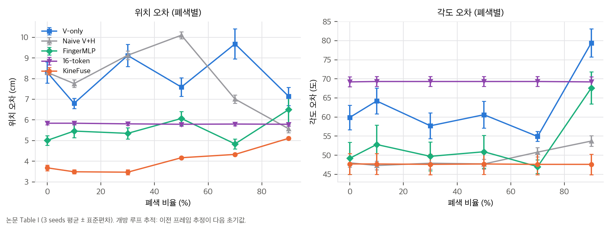
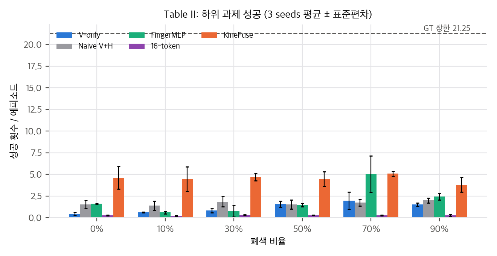
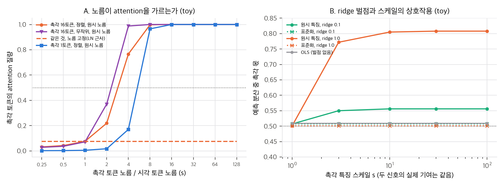
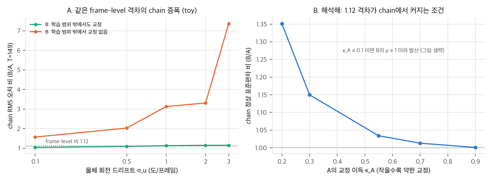

# 03. 재계산과 유도

모든 수치는 `analysis/table_check.py`(표 값 재계산, 결과 `table_check_results.json`), `analysis/norm_dominance_toy.py`(`norm_dominance_toy_results.json`), `analysis/drift_toy.py`(`drift_toy_results.json`)로 CPU, 단일 스레드에서 다시 만들었습니다. 논문 표 값은 `paper/paper.txt`와 PDF 렌더링을 눈으로 대조했습니다. 표준편차는 표본 표준편차(ddof=1)로 보았고, ddof=0일 때도 결론이 같은지 확인했습니다.

## 1. Table I: 개방 루프 추적 다시 읽기

논문 Table I 값으로 그린 그래프. 점은 3 seeds 평균, 막대는 표준편차.

### 1.1 평균과 본문 수치

| 설계 | 위치 평균 (cm) | 각도 평균 (도) |
|---|---|---|
| V-only | 8.11 | 62.8 (54.9–79.4) |
| Naive V+H | 7.98 | 49.2 (47.3–53.7) |
| FingerMLP | 5.54 | 52.9 (47.0–67.6) |
| 16-token | 5.81 | 69.3 (69.2–69.3) |
| KineFuse | **4.04** | 47.7 (47.6–47.7) |

- 본문 "4.04 cm"와 "8.11 cm": 재계산과 일치합니다(4.042, 8.105).
- 본문 "2배 낮다": V-only/KineFuse = 2.01. 맞습니다. Naive/KineFuse도 1.97입니다.
- "47.6도 ± 0.1": 여섯 가림 수준 평균은 47.65입니다. "± 0.1"은 가림 수준 사이의 흔들림이고, 표의 seed 표준편차는 2.7입니다. 두 값을 섞으면 안 됩니다.

### 1.2 본문 주장과 맞지 않는 부분

1. **"KineFuse만 각도 오차가 일정하다"는 맞지 않습니다.** 16-token은 69.2–69.3도로 더 일정합니다(변동계수 0.0007, KineFuse는 0.0011). Naive도 47.3–53.7도로 거의 일정합니다. 차이는 "일정함"이 아니라 **KineFuse의 각도 수준이 가장 낮다**는 쪽입니다.
2. **"격차가 높은 가림에서 벌어진다"는 맞지 않습니다.** 0%와 90%의 위치 격차(기준 KineFuse)를 보면 모든 기준선에서 격차가 **줄어듭니다**.

| 기준선 | 0% 격차 (cm) | 90% 격차 (cm) |
|---|---|---|
| V-only | 4.62 | 2.03 |
| Naive V+H | 4.62 | 0.46 |
| 16-token | 2.16 | 0.68 |
| FingerMLP | 1.33 | 1.39 (사실상 같음) |

3. **"낮은 가림(0–20%)에서는 모든 모델이 비슷하다"는 맞지 않습니다.** 0%에서 V-only는 8.30 cm, KineFuse는 3.68 cm입니다. 차이가 4.6 cm로, 가장 큰 격차 중 하나입니다. 본문은 "haptic 기여는 가림이 40%를 넘을 때 드러난다"고 쓰지만, 표는 0%에서 이미 2배 차이를 보여 줍니다.
4. **"모든 가림 수준에서 KineFuse가 가장 낮다"는 맞습니다**(6/6). 70%에서는 FingerMLP(4.84)보다 KineFuse(4.33)가 낮고, 90%에서는 Naive(5.57)보다 KineFuse(5.11)가 낮습니다.

### 1.3 Fig. 7의 점 위치

Fig. 7은 평균 위치 오차를 눈으로 읽으면 V-only ≈ 8.3, Naive ≈ 8.3, FingerMLP ≈ 5.0, 16-token ≈ 5.8, KineFuse ≈ 3.6입니다. 여섯 수준의 평균(4.04 등)과는 KineFuse가 0.4 cm 어긋납니다. 0–30% 평균은 V-only 8.07, Naive 8.40, FingerMLP 5.27, 16-token 5.83, KineFuse 3.55로 눈 판독에 더 가깝습니다. 어떤 부분집합을 그렸는지는 본문에 없습니다.

### 1.4 유의성 (Welch t, 3 seeds)

KineFuse와 기준선 네 개의 쌍별 비교를 가림 수준(6) 칸마다 하고, 24 검정을 Holm으로 보정했습니다.

- 표 I 위치: 24 중 **12개 유의**(보정 p < 0.05). 두 표준편차 정의에서 같은 결과입니다.
- 16-token과의 90% 칸은 보정 후 p = 0.016으로 유의합니다.
- V-only 0% 칸은 보정 후 p = 0.07로 유의하지 않습니다.

위치 차이는 seed를 넘어 비교적 안정적입니다. 각도 오차에는 유의성 검정을 하지 않았습니다. seed 표준편차가 2.7–5.1도로 커서 3 seeds로는 검정력이 낮을 것입니다.

## 2. Table II: 하위 과제 성공 다시 읽기

논문 Table II 값으로 그린 그래프. 점선은 GT 상한 21.25.

### 2.1 평균과 "15배"

| 설계 | 평균 성공 | GT 대비 (%) |
|---|---|---|
| GT | 21.25 | 100 |
| KineFuse | **4.53** | 21.3 |
| FingerMLP | 2.00 | 9.4 |
| Naive V+H | 1.68 | 7.9 |
| V-only | 1.17 | 5.5 |
| 16-token | 0.29 | 1.3 |

- **"15배"의 정의:** KineFuse/16-token의 평균 비는 15.8입니다. 칸별 비는 17.1, 19.4, 14.3, 14.9, 17.6, 12.7이고, 칸별 로그비 95% 구간은 대략 8–29배로 넓습니다(delta method, 3 seeds).
- 본문은 이 15배를 "순차 추적"이 아니라 **하위 과제**에 붙입니다. Abstract의 "sequential tracking … up to 15 times"는 정의와 맞지 않습니다(`01` §1).
- KineFuse/V-only의 평균 비는 3.89입니다. 15배는 기준선 중 가장 낮은 16-token에 대한 비라서 "최고/최저" 비로 부르는 편이 정확합니다.

### 2.2 "GT 대비 9%"

본문은 누적 drift가 성공을 GT 상한의 9%로 떨어뜨린다고 씁니다. KineFuse 평균은 21%, 칸별로는 18–24%입니다. 9%에 가까운 값은 FingerMLP 0%(7.7%), Naive 90%(9.4%), V-only 70%(9.3%)뿐이어서, 어떤 칸을 말하는지 특정되지 않습니다.

### 2.3 유의성

24 검정 중 Holm 보정 후 유의한 칸은 **3개**뿐입니다(V-only 30%: p = 0.021, Naive 70%: p = 0.020, 16-token 70%: p = 0.029). KineFuse의 0%와 10% 칸은 SD가 1.3–1.4라서 평균이 크게 달라도 3 seeds로는 판별이 약합니다.

### 2.4 V-only 성공이 폐색과 함께 오른다

V-only 성공은 0%의 0.46에서 70%의 1.97로 오릅니다(Spearman ρ = 0.83, n = 6, p = 0.042). 폐색이 실패를 늘린다는 가정과 반대입니다. 이 칸들의 seed 편차(1.0)도 커서 노이즈일 가능성이 큽니다. 어쨌든 **조작 성공 지표가 폐색 강도를 잘 반영하지 않는다**는 신호이므로, 15배 주장은 이 지표의 신뢰도에 기댑니다.

### 2.5 무엇이 성공 순서를 설명하나

설계 5개의 평균에서 각도 오차 순위와 성공 순위의 Spearman 상관은 **ρ = −0.9(p = 0.037)**, 위치 오차와는 **ρ = −0.7(p = 0.19)**입니다. 위치 평균 순위는 KineFuse(4.04) < FingerMLP(5.54) < 16-token(5.81) < Naive(7.98) < V-only(8.11)입니다. 16-token은 위치 오차가 세 번째로 낮지만 성공은 가장 낮습니다. 따라서 Fig. 7의 "위치 오차 → 성공" 해석은 이 데이터로 지지되지 않고, 회전 오차가 더 나은 설명 변수로 보입니다. 다만 설계가 5개뿐이라 이 상관은 가설 수준입니다.

### 2.6 16-token의 "움직이지 않는" 오차

16-token의 위치 오차는 5.79–5.84 cm(변동계수 0.004), 각도는 69.2–69.3도, 성공은 0.23–0.33입니다. 가림이 0%에서 90%로 변해도 출력이 거의 변하지 않습니다. 시각 입력을 거의 쓰지 않거나, 학습이 수렴하지 않은 상수 출력에 가깝다는 뜻입니다. 이 경우 "관절 단위 토큰이 시각을 누른다"는 해석보다 **학습 실패** 해석이 먼저 검토되어야 합니다(`04_claim_verification.md` C14). 논문은 이 설계의 학습 곡선이나 검증 손실을 보고하지 않습니다.

## 3. Table III: 실환경 한 궤적

| 시점 (프레임) | 0 | 67 | 135 | 202 | 269 |
|---|---|---|---|---|---|
| 위치 V-only (mm) | 11.9 | 78.2 | 108.2 | 95.3 | 96.6 |
| 위치 KineFuse (mm) | 1.4 | 17.4 | 35.9 | 58.1 | 85.4 |
| 회전 V-only (도) | 6.7 | 57.7 | 130.3 | 177.4 | 94.3 |
| 회전 KineFuse (도) | 2.5 | 30.8 | 63.5 | 86.6 | 131.5 |

- 위치: KineFuse가 다섯 시점 모두 낮습니다. 차이는 시점 269에서 11 mm로 줄어듭니다.
- 회전: KineFuse가 네 시점에서 낮지만, **시점 269에서 131.5도로 V-only(94.3도)보다 높습니다.** 본문은 이 역전을 언급하지 않습니다.
- 회전 오차가 130–177도라는 것은 자세가 뒤집혔다는 뜻입니다. 펜슬의 축 대칭과 ADD 지표 사용이 원인일 수 있습니다(`01` §4.2 (6)).
- 한 궤적, 시드 없음, 기준(AprilTag) 시점 불명확입니다. 통계적 주장은 할 수 없습니다.

## 4. 2.3배 주장 (영 입력 실험)

"촉각을 0으로 두면 V-only보다 2.3배 낫다"는 수치는 논문에 표가 없습니다. 참고로 0–30% 평균의 V-only/KineFuse 비는 8.07/3.55 = 2.27입니다. 영 입력 실험 결과가 KineFuse 전체 모델과 같다고 했으므로, 이 값이 그 실험을 가리킬 가능성이 있습니다. 확인할 방법은 없습니다.

## 5. 유도

### 5.1 프레임 격차와 chain 증폭

프레임 t의 정제를 선형 근사하면 교란 d_t = e_{t−1} − u_t(u_t는 물체 회전 드리프트)에 대해

  e_t = (1 − κ) d_t + ε_t,  ρ ≡ 1 − κ

입니다. 정상 상태 분산은

  Var(e) = (ρ² σ_u² + σ_ε²) / (1 − ρ²)

입니다. 두 설계 A, B의 **프레임 단위** 이득 비를 (1−κ_B)/(1−κ_A) = 1.12로 고정하면, chain 표준편차 비는 κ_A가 작을수록 커지고 ρ_B ≥ 1에서 발산합니다.

| κ_A | ρ_A | ρ_B | chain std 비 (B/A) |
|---|---|---|---|
| 0.9 | 0.10 | 0.112 | 1.00 |
| 0.55 | 0.45 | 0.504 | 1.03 |
| 0.3 | 0.70 | 0.784 | 1.15 |
| 0.2 | 0.80 | 0.896 | 1.35 |
| ≤ 0.1 | ≥ 0.90 | ≥ 1.008 | 발산 |

해석: 프레임 단위에서 12%인 격차는, 교정이 약한 시스템에서는 chain에서 35%로 커지고, 교정 이득이 1에 가까워지면 발산합니다. 즉 **프레임 평가는 chain의 안정성 여유(1−ρ)를 보지 못합니다.** 이 식은 논문의 것이 아니라 가정 모델입니다. 논문의 1.12→2배→15배가 이 메커니즘인지는 확인되지 않습니다.

### 5.2 노름과 attention

flat 토큰 concat 뒤 한 층 attention에서 질의 q, 키 k = W_k x의 로짓은 (W_k x)·(W_q q)/√d입니다. 질의를 고정하면 로짓은 ‖x‖에 선형으로 커지고, 질의도 같은 특징에서 나오면 ‖x‖²로 커집니다. 따라서 **노름 비가 attention 질량을 결정합니다.** 시퀀스 평균(식 4)만 본다면 촉각 토큰 K개의 질량은 K/(N+K)입니다.

| K | 개수 기준 질량 (N=400) |
|---|---|
| 1 | 0.25% |
| 4 | 0.99% |
| 16 | 3.85% |

개수만 보면 16토큰이 4토큰보다 촉각 몫이 커야 합니다. "관절 토큰이 시각을 누른다"는 설명은 **개수가 아니라 노름**에 기대야 합니다. 논문은 노름을 보고하지 않으므로, 이 주장은 검증할 수 없습니다(`04_claim_verification.md` C18).

### 5.3 ridge 벌점과 스케일

촉각 특징이 x_h = s·z_h(z_h는 표준화)일 때, 학습 가중치는 w_h = w̃_h/s로 바뀝니다. 벌점 λ‖w‖²는 λ‖w̃_h‖²/s²가 됩니다. 즉 **표준화 좌표에서 촉각 가중치의 유효 벌점은 λ/s²**입니다. 스케일이 크면 벌점이 약해져 촉각 몫이 커집니다. 벌점이 없는 OLS에서는 가중치가 스케일을 보상해서 몫이 변하지 않습니다. 이 두 결론은 아래 toy B에서 확인됩니다.

## 6. toy 결과 요약

### 6.1 norm_dominance_toy.py (d = 64, 시각 토큰 400개, 시각 노름 1)

norm_dominance_toy 결과. A: 촉각 토큰 노름 대 attention 질량, B: ridge 벌점에서 촉각 몫. 가정 모델이며 논문 실험이 아닙니다.

- **A (attention 질량).** 로짓 표준편차가 무작위 초기화 수준(0.016)이면 K = 16이라도 s = 16까지 질량은 개수 기준(3.85%)과 같습니다. 로짓을 날카롭게(표준편차 1) 맞추면 임계값이 생깁니다. 정렬된 16토큰은 s = 1에서 7.6%, s = 2에서 21.9%, s = 4에서 76.6%입니다. 노름을 고정하면(LN 근사) 질량은 s와 무관하게 7.6%입니다. **임계 노름 비(약 2–4배)는 학습된 가중치에 달렸고, 논문은 이를 보고하지 않습니다.**
- **B (ridge).** 두 신호의 실제 기여는 같게 만들었습니다. OLS는 s에 무관하게 촉각 몫 0.497입니다. ridge λ = 1, s = 10에서 원시 특징의 촉각 몫은 0.79, 표준화는 0.49입니다. λ = 0.1에서는 0.54 대 0.50입니다. 이 설정에서 촉각 몫 증가는 R²를 0.75에서 0.87로 **높였습니다**. 즉 "지배"가 항상 나쁘지는 않으며, 벌점 강도와 정보량에 따라 달라집니다.
- **C (GD, 고정 학습률).** 학습률은 가장 큰 스케일 특징에 맞춰 0.0086으로 골랐습니다(표준화는 0.75, 약 88배 차이). s = 10 원시 특징에서 T = 10 스텝에 촉각 몫은 0.995이고 시각만의 R²는 0.08입니다. T = 2000에서는 0.50으로 수렴합니다. **단일 학습률에서 나타나는 일시적 지배**이고, 학습이 끝난 모델에 남는지는 이 toy로 말할 수 없습니다.

### 6.2 drift_toy.py (1차원 회전 오차, 도, T = 149)

drift_toy 결과. A: 같은 프레임 격차(1.12)의 chain 증폭, B: 해석해. 가정 모델이며 논문 실험이 아닙니다.

- **A (frame-level).** 교란 U[1, 10]도, 두 설계의 RMS 비는 1.119입니다(설계로 맞춤).
- **B (open-loop chain).** 물체 드리프트 σ_u = 0.1–3도/프레임.
  - κ_out = 0.55(범위 밖에서도 교정): chain 비 1.04–1.15. 격차가 크게 늘지 않습니다.
  - κ_out = 0(범위 밖에서 교정 없음): chain 비 1.57 → 2.03 → 3.13 → 3.31 → 7.36. 범위를 넘는 상태 비율이 σ_u = 3에서 8%입니다.
  - 교정이 없을 때(κ = 0) 누적 RMS는 σ_u√T, σ_u = 0.5면 6.1도입니다.
- **C (해석해).** §5.1 표와 같습니다.

toy가 보여 주는 것은 **"프레임에서 같아 보이는 두 설계가 chain에서 갈라지는 조건"** 입니다. (i) 학습 교란 범위 밖의 상태에서 교정 능력이 다르거나, (ii) 교정 이득이 1에 가까워 chain 여유가 작을 때입니다. 논문이 어느 쪽인지는 구분할 자료가 없습니다.

## 7. 빠진 수치 (계산에 필요했지만 논문에 없는 것)

- 프레임 단위 ADD 표(1.12의 근거)와 단위(cm/m).
- 특징과 토큰의 노름, attention 질량, 헤드 수.
- 시드 정의(3 seeds가 같은 데이터인지, 학습만 다른지).
- Table III의 시점 선택과 기준.
- λ_ADD, λ_attr, λ_pen, 학습률, epoch, batch, 데이터 분할.
- 영 입력(제로화) 실험 결과와 그 학습 절차.
