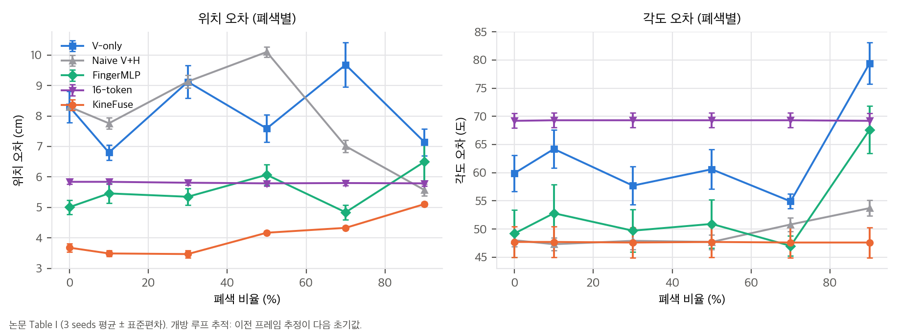
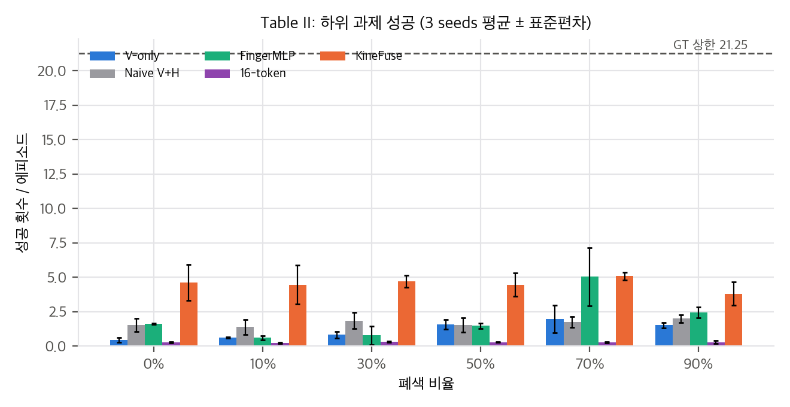
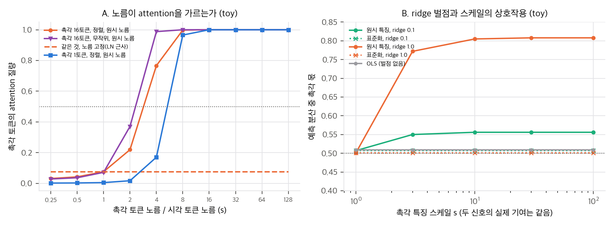
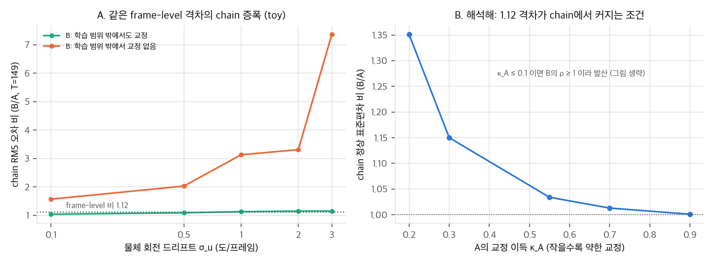

# KineFuse: 가림 속 손가락 자세 추적에서 촉각 토큰을 어떻게 묶을까

다지 손으로 물체를 돌리면 손가락이 카메라 앞을 가립니다. 시각 자세 추정은 바로 이 순간에 떨어집니다. KineFuse(arXiv:2607.14842, IROS 2026 채택)는 손에 이미 있는 신호, 즉 관절 위치와 속도, 근위 3축 F/T, 손끝 접촉을 시각 추정기에 붙여 가림 속 자세를 보강합니다. 이 글은 방법보다 **평가 설계와 수치**를 중심으로 읽은 기록입니다.

## 무엇을 했나

손가락 관절 16개를 한 토큰에 몰아 넣거나(Naive), 손가락별 MLP로 나누거나(FingerMLP), 관절 16개를 그대로 토큰으로 두거나(16-token), 손가락 단위 4토큰으로 묶는(KineFuse) 네 가지 촉각 인코더를 같은 시각 백본에 붙였습니다. 평가는 세 단계입니다. 프레임 단위 교정, 이전 추정을 다음 초기값으로 쓰는 개방 루프 추적, 그리고 자세를 받아 재배향하는 RL 정책의 성공 횟수입니다.

## 논문의 주장과 확인한 것

| 평가 | 논문 수치 | 재계산 |
|---|---|---|
| 프레임 단위 | 최고/최저 1.12배 (표 없음) | 확인 불가. 단위(cm)도 의심스럽습니다 |
| 개방 루프 추적 (Table I) | 평균 위치 오차 4.04 대 8.11 cm, 약 2배 | 재현 (2.01배) |
| 조작 성공 (Table II) | 평균 4.53 대 0.29, 15배 | 재현 (15.8배, 칸별 12.7–19.4배). 기준선은 최저인 16-token입니다 |

요약 문장은 "추적에서 최대 15배"라고 쓰지만, 본문은 2배를 추적에, 15배를 조작 성공에 붙입니다. 같은 격차가 평가 단계에 따라 1.12배, 2배, 15배로 보이는 것은 흥미롭습니다. 다만 세 수치는 서로 다른 지표라서 "증폭"이라는 한 단어로 묶기 어렵습니다.

Table I을 다시 그리면 위치 오차에서는 KineFuse가 여섯 가림 수준 모두 가장 낮고, seed 편차를 넘는 차이가 보입니다(Holm 보정 후 24개 검정 중 12개 유의). 그러나 각도 오차는 16-token이 69도로 일정하게 높고, 본문의 "KineFuse만 각도가 일정하다"는 맞지 않습니다. 본문은 "고 가림에서 격차가 벌어진다"고도 쓰지만, 네 기준선 모두 격차가 줄어듭니다.

조작 성공은 3 seeds입니다. 24개 칸 중 Holm 보정 후 유의한 칸은 3개뿐입니다. 평균 차는 크지만 칸별 근거는 약합니다. V-only 성공이 폐색과 함께 오르는 현상도 지표가 폐색 강도를 잘 반영하지 않는다는 신호로 읽었습니다.

## 노름 지배: 가정 모델로 본 조건

논문은 flat 융합이 "norm dominance"로 시각을 누른다고 쓰지만, 노름을 보고하지 않았습니다. 시각 토큰 400개와 촉각 토큰 K개를 이어 붙인 한 층 attention으로 toy를 만들었습니다.

- 로짓이 날카로운 경우, 정렬된 촉각 토큰 16개는 노름이 시각의 약 2–4배를 넘으면 attention의 절반 이상을 가져갑니다. 노름을 고정하면 이 효과는 사라집니다.
- ridge 벌점이 있으면 촉각 특징의 스케일이 가중치 벌점을 λ/s²로 바꿉니다. 그래서 스케일이 커질수록 촉각 몫이 커집니다. 벌점이 없는 최소제곱법에서는 가중치가 스케일을 보상해 변하지 않습니다.

결론은 "지배가 있다"가 아니라 "지배는 노름 비와 벌점에 달린 조건부 현상이다"입니다. 실제 모델에서 확인하려면 학습 중 토큰 노름과 attention 질량을 기록해야 합니다.

## 프레임 격차가 chain에서 커지는 조건

프레임에서 같은 1.12배 격차도 chain에서는 다르게 나타날 수 있습니다. 한 프레임의 교정 이득을 κ라 하면 chain의 정상 분산은 1/(1−(1−κ)²)에 비례합니다. 교정이 약할수록(κ가 작을수록) 같은 프레임 격차가 chain에서 1.35배로 커지고, κ가 0.1 이하이면 발산합니다. 학습 범위 밖의 상태에서 교정이 없는 가정 모델에서는 드리프트가 클 때 chain 비가 3–7배까지 올라갑니다.

논문의 1.12→2→15 연쇄가 이 메커니즘인지는 확인되지 않았습니다. 이 toy는 **frame 평가가 chain 여유를 보지 못한다**는 점을 보여 주는 가정 모델입니다.

## 실험 설계에서 생기는 질문

- **영 입력 대조:** 촉각을 0으로 두면 V-only보다 2.3배 낫다는 주장은 표 없이 제시됩니다. KineFuse만 두 단계 학습을 거쳤기 때문에 "구조 효과"와 "학습 절차 효과"가 섞입니다.
- **고유감각 누수:** 관절 위치는 손 자세를 알려 주고, 잡힌 물체의 자세는 손 자세에 묶여 있습니다. 촉각 0 실험은 이 정보를 빼지 못합니다.
- **16-token:** 가림에 따른 위치 오차가 5.79–5.84 cm로 거의 변하지 않습니다. 시각 입력에 반응하지 않는 상수 출력에 가깝고, "관절 토큰이 시각을 누른다"보다 학습 실패를 먼저 의심해야 합니다.
- **회전 대 위치:** 설계 5개의 평균에서 성공 순위는 위치 오차보다 각도 오차와 더 잘 맞습니다(ρ = −0.9 대 −0.7, n = 5). 설계 수가 적어 가설로만 남깁니다.

## 구현할 수 있는가

공식 재현은 불가능합니다. 공개된 코드와 가중치, 데이터가 없습니다. 시뮬레이션 데이터는 IsaacLab으로 만들고 시각 추정기는 CUDA를 쓰므로 GPU가 필요하며, 실환경은 저자 그룹의 F/T 손이 필요합니다.

아이디어 재구현은 구조 자체는 쉽습니다. 손가락 토큰화, 손가락 내 마스크 attention, 16→4 풀링, URDF 편향 Graphormer는 PyTorch로 수백 줄입니다. 가장 큰 장벽은 **고유감각, 근위 F/T, 접촉, 물체 자세 GT가 함께 있는 데이터**입니다. 이 맥에서는 표 재계산과 toy까지 끝났고, 소형 모델 학습은 설치 승인 뒤에 가능합니다.

## 한 줄 정리

손가락 단위 토큰이라는 설계는 명확하지만, 이 논문의 수치 보고는 본문끼리 어긋나는 곳이 많습니다. 인용할 때는 추적 2배와 조작 15배를 따로 적고, 프레임 1.12배는 표가 공개되기 전까지 보류하는 것이 안전합니다.

*논문 그림은 라이선스(CC BY-NC-ND 4.0) 때문에 이 글에 싣지 않았습니다. 그림은 논문 수치로 직접 그린 것입니다. 원문은 arXiv:2607.14842에서 확인할 수 있습니다.*

## 자료

- [통합 리포트 PDF](report/report_public.pdf)
- [01. 논문 분석: KineFuse (arXiv:2607.14842)](analysis/01_paper_analysis.md)
- [02. 선행연구와 관계](analysis/02_prior_work.md)
- [03. 재계산과 유도](analysis/03_analysis.md)
- [04. 주장 검증: 표 재계산, toy, 구현 가능성](analysis/04_claim_verification.md)
