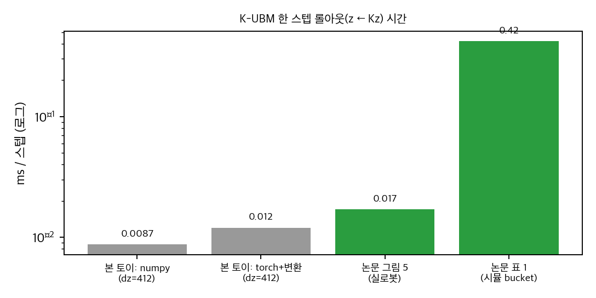

# 03. 수치 재계산과 일관성 검사

논문 표 3–6, 9, 10과 그림 3–5의 값을 `analysis/recompute.py`(수 초, numpy, scipy)로 다시 계산했습니다. 결과는 `analysis/recompute_results.json`입니다. 재현이나 학습은 하지 않았습니다. 그림 3의 막대는 숫자가 적혀 있지 않아 이미지 픽셀에서 읽었습니다(오차 약 1%p, 표와 맞춰 본 결과 약 0.3%p 낮게 읽히는 경향). 그림 4와 5는 벡터 그래픽이라 좌표에서 정확히 읽었습니다. 이 문서에서 "(판독)"은 그림 3 픽셀 판독입니다. 점검 항목은 V1–V14, 주장 판정은 C1–C10입니다.

## 1. 재계산

### 1.1 표 3–6의 "Average" 열 (V1, V13)

표의 각 행은 7과제 평균(Flow, DynaMo)을 적습니다. 과제별 값에서 다시 평균을 냈습니다.

| 행 | 재계산(Flow / DynaMo) | 표(Flow / DynaMo) | 차이 |
|---|---|---|---|
| Diffusion (2,4,8) | 70.84 / 52.86 | 70.8 / 52.7 | 0.04 / 0.16 |
| Diffusion (2,8,16) | 68.71 / 53.24 | 68.9 / 53.2 | 0.19 / 0.04 |
| ACT (10) | 65.60 / 60.40 | 65.6 / 60.4 | 0 / 0 |
| ACT (20) | **72.83** / 69.90 | **73.4** / 69.9 | **0.57** / 0 |
| ACT (40) | 71.59 / 68.10 | 71.6 / 68.1 | 0 / 0 |
| KODex V1, V2, V3 | 22.87/41.9, 24.80/46.66, 26.66/43.33 | 22.9/41.9, 24.8/46.7, 26.7/43.3 | 반올림 이내 |
| KOROL [64] | 26.84 / 37.64 | 26.8 / 37.6 | 반올림 이내 |
| KOROL [2·입력, 128] | 25.76 / **38.77** | 25.8 / **44.9** | DynaMo **6.1** |
| KOROL [512, 256, 128] | 19.50 / **39.20** | 19.5 / **46.1** | DynaMo **6.9** |

- 셀 값의 반올림 오차는 평균에서 0.05 이내이므로, 0.1을 넘는 차이(ACT(20) Flow 0.57, KOROL DynaMo 6.1과 6.9, Diffusion (2,8,16) Flow 0.19)는 표 안에서 설명되지 않습니다. 그림 3의 KOROL DynaMo 평균 막대(판독 45.6)는 과제별 막대 평균(판독 39.4)이 아니라 표의 평균 열 쪽 값에 가깝습니다. ACT(20) Flow 평균 막대(판독 73.3)도 재계산값 72.8이 아니라 표의 73.4 쪽입니다. 어느 쪽이 원자료인지는 저자 확인이 필요합니다.
- "± SD"의 정의: KODex(시드 1개) 행은 7과제 값의 모집단 SD와 같습니다(예 V1 Flow 23.7). 5시드 행은 과제 간 SD(Diffusion (2,4,8) Flow 29.8)와 다르고, 시드 간 분산을 합친 값에 가깝습니다(근사 30.0, 표 30.5). 즉 이 SD는 "시드 × 과제 35개 값의 SD"로 읽히며(그림 3 캡션 "computed over all seeds and all tasks"와 맞음), 시드 간 SD가 아닙니다. 그림 3의 평균 패널 오차 막대도 같은 의미로 보입니다(해석이며 저자 확인이 필요합니다).

### 1.2 시행 수의 정수 점검과 분모 (V2, V3)

5시드 × 30개 테스트 = 150회라면 셀 값(소수 1자리 %)은 k/150 꼴이어야 합니다. 표 3과 4의 70개 5시드 셀 중:

- **55개는 150회로 설명됩니다.** DexArt의 Bucket과 Laptop, 모든 DynaMo 셀이 여기에 속합니다.
- **9개는 150회로도 145회로도 설명되지 않습니다.** 모두 **Flow 특징**이고 Adroit 과제입니다: Door(ACT 20: 23.2, ACT 40: 44.2), Tool(79.2, 67.2), Reorientation(85.0, 78.8), Relocation(Diffusion (2,4,8): 89.2, ACT 20: 89.4, ACT 40: 84.6). 시드마다 분모가 다른 비율의 평균이면 나올 수 있는 값입니다.
- **6개는 150회가 아니라 145회(= 5 × 29)로 설명됩니다.** Toilet Flow 5개 셀(69.0, 67.6, 74.5, 69.0, 68.3)과 Diffusion (2,4,8) Tool Flow(88.3)입니다. KODex(시드 1개) Toilet Flow 세 값(3.4, 10.3, 3.4)도 30회가 아니라 **29회**(1/29, 3/29, 1/29)로만 설명되고, 같은 과제의 DynaMo 값(16.7, 6.7, 3.3)은 30회(5/30, 2/30, 1/30)로 설명됩니다.

즉 Flow 특징 평가에서 일부 시연이 분모에서 빠진 것으로 보입니다. 논문 §4.1은 "30 for testing"이라고만 씁니다. 공식 평가 스크립트는 SAM이 객체를 검출하지 못한 시연을 성공률 분모에서 제외합니다(`04` D8). 같은 원인일 가능성이 높지만 확인은 저자에게 달려 있습니다. 시행 수가 일정하지 않다는 점은 본문에 적혀 있지 않아, 5시드 평균과 Toilet 열의 해석에 영향을 줍니다.

### 1.3 부록 E의 구조 선택과 K-UBM의 설정 (V4 보조)

부록 E는 기준선마다 과제별로 가장 좋은 구조를 "테스트 성공률 평균 기준"으로 고른다고 씁니다(Diffusion 2종, ACT 3종, KODex 3종, KOROL 3종). 그림 3의 막대는 표의 최고 행과 일치합니다(예: KODex Flow Tool 30.0 = V2/V3의 30.0, Diffusion Flow Bucket 90.4/92.5 = 표 90.7/92.7). 그림 3에는 Diffusion과 ACT 변형이 모두 그려져 있으므로 선택 효과는 "최고 변형 대 K-UBM"을 볼 때만 작용합니다. K-UBM은 한 설정(표 7)을 모든 과제에 썼습니다.

### 1.4 그림 3: 순위와 과제별 비교 (V4, V5)

그림 3 판독과 표를 합친 7과제 평균(%):

| 방법 | Flow | DynaMo |
|---|---|---|
| UVA (판독, 원시 영상) | 83.7 | 83.8 |
| **K-UBM (판독)** | **73.5** (그림의 평균 막대 73.7) | **73.0** |
| ACT (20) | 72.8(표 73.4) | 69.9 |
| Diffusion (2,4,8) / (2,8,16) | 70.8 / 68.7 | 52.9 / 53.2 |
| KOROL (최고 행) | 26.8 | 44.9(표) |
| KODex (최고 행) | 26.7 | 46.7 |

- "K-UBM은 평균 2위"(§4.2)는 맞습니다. 다만 2위와 3위(ACT 20)의 차이는 Flow에서 0.1–0.7%p로, 평균 하나의 이항 표준오차(150회, 약 3.6%p)보다 훨씬 작고, 같은 방법을 쓰는 과제별 비교로는 가릴 수 없습니다. 과제별 차이(K-UBM − ACT(20), Flow)는 −5.3, −11.8, −2.0, +22.5, +4.5, +3.3, −6.5로 4과제에서 낮고, Wilcoxon 부호순위 p = 0.81(과제 7개, 판독 값). UVA 대비는 Flow에서 −6.7, +5.4, −15.0, **−43.9**(Door), −10.5, +6.3, −6.7이고 p = 0.078, DynaMo에서 p = 0.109입니다(과제 7개로는 검정력이 낮음).
- **Door가 평균을 가릅니다.** K-UBM의 Door는 판독 45.7%(Flow), 54.4%(DynaMo)이고 UVA는 89.6%, 89.9%입니다. 반면 Diffusion은 Door에서 모든 설정이 0.0%입니다(표 3). 이 Door 값 하나가 "Diffusion 대비 우위"(Flow +45.7%p)를 만듭니다.
- DynaMo Reorientation에서 ACT와 Diffusion이 25–33%로 낮고(표 4, 3) K-UBM이 92.0%입니다(+66.7%p). 같은 과제의 Flow에서는 ACT 85.0%입니다. 특징 종류에 따른 이 큰 차이는 본문에서 설명하지 않습니다.

### 1.5 그림 4와 그림 3의 K-UBM (V5)

그림 4(구조 절제, 3시드, Flow)의 K-UBM 막대는 좌표에서 정확히 72.4, 75.3, 67.3, 45.8, 84.0, 88.6, 83.4(평균 73.8)입니다. 그림 3(5시드, Flow)의 판독 값(72.0, 74.9, 67.0, 45.7, 83.7, 88.3, 82.9)과 과제별 차이는 0.1–0.5%p(판독의 -0.3%p 편향 안)로 같은 값처럼 보입니다. 시드 3개의 평균과 시드 5개의 평균이 이렇게 일치하는 이유는 본문에 없습니다(같은 실행을 재사용했을 가능성). 캡션과의 관계는 저자 확인이 필요합니다. 절제 변형은 L-L 28.3, NL-L+S 32.5, NL-S MLP 38.4, LSTM 50.5, Transformer 48.4이고 K-UBM이 모든 과제에서 최고입니다(마진 7.9–34.5%p, 시드 3개).

### 1.6 표 6의 KOROL Flow Tool과 그림 3 (V6)

그림 3 Flow Tool 패널의 KOROL 막대는 약 3%(오차 막대는 약 20%까지)이지만, 표 6의 같은 칸은 세 구조 모두 13.0–32.7%입니다. 다른 KOROL 셀(Bucket 46.6, Laptop 약 20, Reorientation 36.5, Relocation 7.7)은 표의 어느 행과 맞습니다. 이 한 칸만 표와 맞는 행이 없습니다(그림 판독).

### 1.7 표 9: 반응성 (V7)

과제당 30회 × 7 = 210회. 합계는 모두 표의 평균과 같습니다.

| 방법 | 성공 | 비율 | Wilson 95% | 과제 간 SD(표의 ±) |
|---|---|---|---|---|
| Diffusion | 87/210 | 0.414 | 35.0–48.2 | 0.28 (모집단 SD) |
| ACT | 87/210 | 0.414 | 35.0–48.2 | 0.26 |
| **K-UBM** | **121/210** | **0.576** | 50.9–64.1 | 0.20 |
| K-UBM 트리거 검출 RT | 185/210 | 0.881 | | 0.16 |

- Fisher 정확 검정(과제 7개를 합친 210회): K-UBM 대 Diffusion p = 0.0013, 대 ACT p = 0.0013. 과제별로는 Tool(p = 0.008, 0.001), Reorientation, Relocation에서 K-UBM이 높고, Bucket은 ACT가 높으며(15 대 24, p = 0.029), Toilet과 Laptop은 구분되지 않습니다(p = 0.17–0.40). Door는 대 Diffusion에서만 유의한데 Diffusion은 섭동 없이도 0/30입니다. 합산 검정은 과제 간 이질성을 무시합니다.
- 섭동 전 K-UBM 성공률(그림 3 Flow 판독 × 30)에 대한 섭동 후 성공 수의 비: Bucket 0.69, Laptop 0.76, **Toilet 0.35**, Door 1.09, Tool 0.92, Reorientation 0.64, Relocation 1.09. 재계획이 있어도 섭동으로 성공이 줄어드는 과제(Toilet, Reorientation)가 있고, Door와 Relocation은 오히려 판독 평균을 넘습니다(판독 오차와 30회 표본 변동 안).
- 반응형 기준선의 반응 후 성공이 거의 0인 칸이 있습니다(ACT Reorientation 0/30, Diffusion 1/30). 섭동 전 이 과제의 Flow 성공률은 80–85%입니다(표 3, 4). 본문은 이를 "복구 행동이 분포 밖이기 때문"으로 설명합니다. 목표 특징을 바꾸는 섭동이 반응형 정책의 입력 분포를 직접 벗어나게 했을 가능성도 있는데, 이는 검증하지 않았습니다.

### 1.8 표 10과 그림 5: 실로봇 (V8, V9)

- 성공률(%) 평균: Diffusion 72.5, ACT 92.5, K-UBM 85.0이 표의 값과 같습니다. 과제당 10회(시행 수 가정) × 4 = 40회로 읽으면 29/40, 37/40, 34/40이고 Wilson 95%는 57.2–83.9, 80.1–97.4, 70.9–92.9입니다.
- Fisher: K-UBM 대 ACT p = 0.48, K-UBM 대 Diffusion p = 0.27, ACT 대 Diffusion p = 0.037. 과제별 K-UBM 대 ACT는 p = 1.0, 0.58, 0.47, 0.47. 즉 "ACT가 높고 K-UBM은 경쟁력이 있다"(§5)에서 K-UBM과 ACT, Diffusion 사이의 순위는 이 시행 수로는 구분되지 않습니다.
- jerk(rad/s³): 과제별 값의 평균이 표의 "Avg"와 같고(팔 44.69/28.42/4.98, 손 14.16/16.57(표 16.56)/4.14), "±"는 4개 과제의 표본 SD(n−1)입니다(예 팔 K-UBM 2.01). 배수: 팔 Diffusion/K-UBM 8.97, ACT/K-UBM 5.71("6–9배" 맞음), 손 3.42, 4.00("3–4배" 맞음). K-UBM의 jerk는 4개 과제 모두 ACT보다 낮습니다.
- 추론 시간: 그림 5의 실로봇 값(K-UBM 0.017, ACT 0.058, Diffusion 26.4 ms)과 표 1(시뮬 Bucket, 0.42, 0.52, 29.95 ms)을 비교하면 K-UBM만 약 25배, ACT 9배, Diffusion 1.1배 차이가 납니다. §3.3의 토이가 이 차이의 크기를 보여 줍니다.

### 1.9 표 2: 리프팅 차원, 모델 크기 (V10, V11)

- 표 2의 V1, V2, V3 차원은 n_h, n_o에서 닫힌 식으로 재현됩니다: 기본 2(n_h + n_o), V1 = 기본 + n_o + C(n_h, 2) + n_h, V2 = 기본 + C(n_h, 2) + n_h, V3 = V2 + 2n_h + 2n_o. 네 과제 군 12개 값이 모두 일치합니다(예: n_h = 28, n_o = 128 → 846, 718, 1030).
- K-UBM의 크기(공식 코드 구조 기준, 표 7의 설정): DexArt(상태 28 + 흐름 128 = 156, d_z = 412)에서 리프팅 MLP 약 11.9만, K 약 17.0만 파라미터(합 약 28.9만). Adroit Relocation(286, d_z = 542)에서 약 13.6만 + 29.4만. 한 스텝 롤아웃은 d_z × d_z 행렬-벡터 곱(약 34만 FLOP).

## 2. 일관성 검사 목록

| ID | 항목 | 결과 |
|---|---|---|
| V1 | 표 3–6 평균 열 | 대부분 일치. ACT(20) Flow(0.57), KOROL DynaMo 두 행(6.1, 6.9), Diffusion (2,8,16) Flow(0.19)가 어긋남 |
| V2 | 150회 정수 점검 | 70셀 중 55셀은 150회, 6셀은 145회(Toilet Flow 5, Diffusion Tool Flow 1)로, 9셀(모두 Adroit Flow)은 어느 쪽으로도 설명되지 않음 |
| V3 | KODex, Toilet Flow | 30회가 아닌 29회로만 설명됨(DynaMo는 30회) |
| V4 | 그림 3 순위 | K-UBM 2위(판독 73.5/73.0)는 맞지만 3위와 차이가 불확실 범위 안 |
| V5 | 그림 4 대 그림 3 | K-UBM 값이 3시드와 5시드에서 같은 값으로 보임 |
| V6 | KOROL Flow Tool | 그림 약 3%, 표 6 13.0–32.7% |
| V7 | 표 9 합계와 평균 | 일치. 통합 Fisher p = 0.0013, 과제별은 이질적 |
| V8 | 표 10 평균과 비율 | 일치. 40회 가정에서 K-UBM 대 ACT p = 0.48 |
| V9 | jerk 배수 | "6–9배", "3–4배" 맞음. ± 는 n = 4 표본 SD |
| V10 | 표 2 차원 | 12개 값 모두 일치 |
| V11 | 모델 크기 | 논문에 파라미터 수 없음. 공식 구조 기준 약 29–43만 |
| V12 | 추론 시간 | 표 1(0.42 ms)과 그림 5(0.017 ms)의 K-UBM 값이 약 25배 차이 |
| V13 | "±" 정의 | 5시드 행은 시드×과제 SD로 읽힘, KODex는 과제 간 SD |
| V14 | 이름 | 표 3은 열 이름이 Door/Hammer/Pen/Relo, 표 4–6과 그림은 Door/Tool/Reorientation/Relocation. 같은 과제로 읽힘 |

## 3. 토이

### 3.1 한 스텝 롤아웃 시간 (T1, V12)

`analysis/toy_rollout_timing.py`(수 초, 단일 스레드 CPU)는 d_z = 412, 542, 407인 무작위 K로 z ← Kz 한 스텝의 시간을 쟀습니다. 결과(ms): numpy 행렬-벡터 0.0087, 0.0146, 0.0087, torch Linear + numpy 변환 0.012, 0.0127, 0.0136. 논문 그림 5의 0.017 ms는 이 순수 연산 시간과 같은 자리 수이고, 표 1의 0.42 ms는 이보다 30배 이상 큽니다. 공식 평가 스크립트의 계측은 `정책 시간 총합 / 성공 스텝 j`이고 총합에 초기화(리프팅 MLP 첫 호출)가 들어갑니다(`04` D9). 한 번의 초기화 비용이 스텝 수로 나뉘어 스텝당 값에 더해지는 구조이므로, 표 1의 값은 순수 롤아웃보다 초기화 분이 섞인 값일 가능성이 있습니다(이 기기의 측정이며 논문 기기와 다릅니다).

## 4. 주장 판정 (C1–C10)

| ID | 주장(출처) | 판정 | 근거 |
|---|---|---|---|
| C1 | 시뮬 평균은 SOTA 기준선과 "비교 가능", 2위(§4.2, 초록) | **부분 확인** | 평균 2위(V4)이나 UVA와 약 10%p 차이, 3위와는 구분 안 됨. Door 한 과제 영향이 큼 |
| C2 | K-UBM이 가장 일관된 성능, 구조 튜닝 거의 불필요(§4.2) | 부분 확인 | K-UBM은 한 설정이고 기준선은 과제별 최적이지만(1.3), 과제 간 변동(Door 46%, Reorientation 88%)은 큼. 시드 간 SD는 그림 3 막대 높이로만 확인 가능 |
| C3 | K-UBM은 UVA보다 약간 낮은 성능, 훨씬 빠른 추론(§4.2, 표 1) | 확인(방향) | 98.6 대 0.42 ms는 측정 구성이 다름(V12, UVA는 확산 두 헤드) |
| C4 | 상태 포함 리프팅과 선형 동역학이 최고(§4.3, 그림 4) | 확인(3시드) | 모든 과제에서 K-UBM 최고(V5). 시드 3개이고 오차 막대 겹침 가능성 있음, 변형별 하이퍼파라미터 튜닝 범위는 본문에 없음 |
| C5 | 실로봇 성공률 "경쟁력"(85.0 대 92.5)(§5) | 확인(제한적) | 시행 수 40으로는 순위를 가릴 수 없음(p = 0.48) |
| C6 | jerk 6–9배, 3–4배 감소(§5) | 확인 | V9. 제어 주파수와 jerk 계산 방식은 본문에 없음 |
| C7 | 추론 가장 빠름 0.017 ms(§5) | 확인(연산 크기) | 토이로 같은 자리 수 확인. ACT 0.058과의 차이는 0.04 ms로 실제 제어 주기에서는 둘 다 무시 가능 |
| C8 | 재계획으로 반응성 최고(부록 I, 표 9) | 부분 확인 | 합산 210회에서 유의(p = 0.0013)하나 과제별로 이질적, 반응형 기준선 일부는 섭동 직후 입력 분포 밖(1.7). 공식 코드의 DexArt 반응성 스크립트는 재계획이 꺼져 있음(`04` D10) |
| C9 | 가림 강건성(초록, 부록 L) | 미확인 | K-UBM에 대한 실험이 없음(반응형 기준선의 저하만 보임) |
| C10 | "효율적 학습"(v4 초록, §1) | 미확인 | 학습 시간, 데이터량 비교가 본문, 부록에 없음 |
