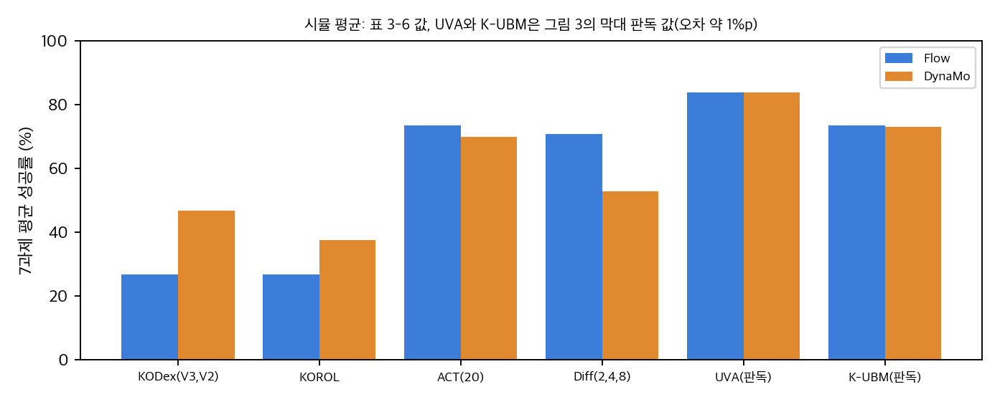
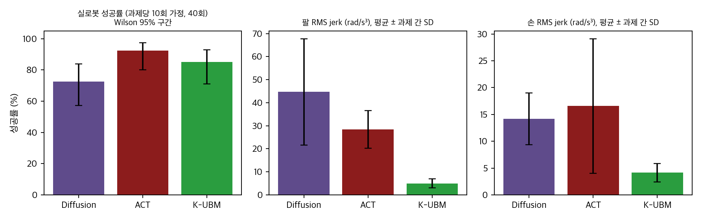
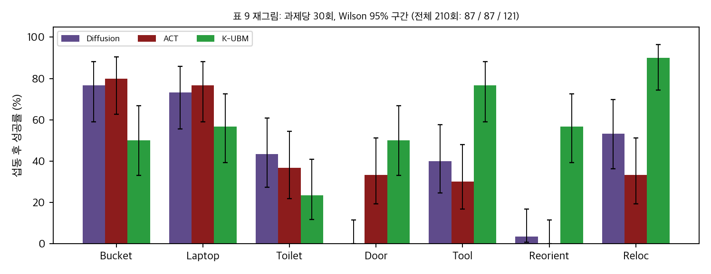
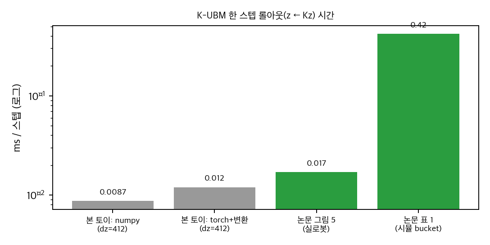

> **논문:** Yunhai Han 외 9인. *Going with the Flow: Koopman Behavioral Models as Pseudo Planners for Visuo-Motor Dexterity.* CoRL 2026 포스터, arXiv:2602.07413 (v4, 2026-11-20).
> 공식 코드는 GitHub GT-STAR-Lab/K-UBM에 있습니다(라이선스 파일 없음). 논문 그림은 arXiv 비독점 배포 라이선스(CC가 아님)라서 넣지 않았고, 이 글의 그래프는 모두 표 값과 그림 판독 값으로 우리가 다시 그린 것입니다.

## 논문이 묻는 것

다지 손의 시각-운동 모방 학습은 확산 정책과 트랜스포머에 기대고, 액션 청킹으로 흔들림을 줄입니다. 저자들은 이 구성이 "일관성과 반응성의 경직된 교환"을 만든다고 보고, 기술을 **로봇 행동과 시각 특징이 함께 진화하는 동역학계**로 학습하자고 제안합니다(UBM). 첫 사례인 K-UBM은 행동과 시각 특징(CoTracker 점 흐름의 128차원 압축, 또는 DynaMo)을 한 상태로 묶고, 그 앞에 학습된 MLP 리프팅을 붙여 z = [ξ; ψ]를 만든 뒤 **선형 연산자 K로 z_{t+1} = K z_t**를 굴립니다. 초기 프레임 하나로 전체 궤적을 개루프로 뽑고, 예측한 흐름과 관측이 크게 벌어질 때만 다시 계획합니다.

학습은 15 스텝 다단계 손실로 인코더와 K를 함께 하고, K를 항등으로 초기화하고 K의 학습률을 인코더보다 10배 낮추는 것이 안정화의 핵심이라고 합니다(§3.2, 부록 J).

## 판본에서 달라진 것

v1(2026-02)은 실로봇 2과제(Kinova 팔)에 ACT 하나를 비교했고 본문이 "highest mean success rate"였습니다. v3(2026-06)에서 실로봇을 Franka + LEAP 4과제와 Diffusion, ACT 비교로 바꾸고 UVA를 기준선에 넣으면서 "second highest"가 됐습니다. v4(2026-11, CoRL 최종본)는 표 수치는 v3와 같고 초록을 "matches or exceeds"에서 "performs comparably"로 낮췄으며 구조 절제(그림 4)를 새로 넣었습니다.

## 이 글에서 확인한 것

**1. 시뮬 평균은 2위이고 3위와 구분되지 않습니다.** 그림 3 막대를 읽으면 K-UBM의 7과제 평균은 Flow 특징 약 73.5%, DynaMo 약 73.0%(그림 판독 값, 오차 약 1%p)입니다. UVA는 약 83.7%이고 ACT(20)는 표 기준 73.4%입니다. 평균 하나의 이항 표준오차가 약 3.6%p(150회 가정)이므로 2위와 3위의 차이는 이 표로는 가를 수 없습니다. Door에서 K-UBM은 약 46%, UVA는 약 90%이고 Diffusion은 모든 설정에서 0%라서, 이 한 과제가 순위를 크게 좌우합니다.

*그래프 (우리가 그림). UVA와 K-UBM은 그림 3 막대의 판독 값이고 나머지는 표 3–6의 평균 열입니다.*

**2. 표의 평균 열 일부가 과제별 값의 평균과 다릅니다.** 표 6의 KOROL DynaMo 두 행은 과제별 값을 평균하면 38.8과 39.2인데 평균 열은 44.9와 46.1입니다. ACT(20) Flow는 72.8과 73.4입니다. 그림 3의 KOROL Flow Tool 막대(약 3%)는 표 6의 같은 칸(13.0–32.7%)과 맞는 행이 없습니다. 어느 쪽이 원자료인지는 저자 확인이 필요합니다.

**3. Flow 특징 성공률 일부는 150회(5시드 × 30)로 설명되지 않습니다.** 5시드 셀 70개 중 55개는 150회로, 6개(Toilet Flow 5개와 Diffusion Tool Flow 1개)는 145회(= 5 × 29)로 설명되고, 9개(모두 Adroit Flow)는 어느 쪽으로도 설명되지 않습니다. KODex의 Toilet Flow 값(3.4, 10.3, 3.4)은 30회가 아니라 29회로만 설명됩니다. 공식 평가 스크립트는 SAM이 객체를 찾지 못한 시연을 성공률 분모에서 빼는데, 같은 원인일 가능성이 있습니다. 논문 본문은 "30개 테스트"라고만 적습니다.

**4. 실로봇 85.0% 대 92.5%는 40회로는 구분되지 않습니다.** 표 10의 성공률이 모두 10의 배수라 과제당 10회(시행 수 가정)로 읽으면 K-UBM 34/40, ACT 37/40, Diffusion 29/40이고 K-UBM 대 ACT의 Fisher p = 0.48입니다. 반면 jerk는 팔이 ACT 대비 5.7배, Diffusion 대비 9.0배, 손이 4.0배와 3.4배 낮고 4개 과제 모두 ACT보다 낮습니다. "더 매끄럽다"는 주장은 이 표에서 뒷받침됩니다.

*그래프 (우리가 그림). 표 10을 다시 그렸고 성공률 구간은 과제당 10회를 가정한 Wilson 95%, jerk의 막대는 4개 과제 평균 ± 표본 SD입니다.*

**5. 반응성 우위는 합산에서 뚜렷하고 과제별로는 이질적입니다.** 표 9의 210회(7과제 × 30)에서 K-UBM 121, Diffusion 87, ACT 87로 Fisher p = 0.0013입니다. 과제별로는 Tool, Reorientation, Relocation에서 K-UBM이 높고 Bucket은 ACT가 높으며(15 대 24, p = 0.029) Laptop과 Toilet은 구분되지 않습니다. 반응형 기준선이 섭동 뒤 거의 0%가 되는 칸(ACT Reorientation 0/30)은 섭동 전 80–85%였던 과제입니다.

*그래프 (우리가 그림). 표 9의 성공 수와 과제당 30회의 Wilson 95% 구간입니다.*

**6. 그림 4(3시드)와 그림 3(5시드)의 K-UBM 값이 같은 값으로 보입니다.** 그림 4는 벡터 도형이라 좌표에서 정확히 읽을 수 있고(72.4, 75.3, 67.3, 45.8, 84.0, 88.6, 83.4), 그림 3 판독 값과 과제별로 0.1–0.5%p 차이입니다. 시드 3개의 평균과 5개의 평균이 이렇게 겹치는 이유는 본문에 없어서 저자 확인이 필요합니다. 구조 절제 자체는 모든 과제에서 K-UBM이 최고입니다(L-L 28.3, NL-L+S 32.5, MLP 38.4, LSTM 50.5, Transformer 48.4, K-UBM 73.8).

## 공식 코드를 정적으로 읽어 본 결과

공식 저장소는 K-UBM 학습과 DexArt 3과제, Adroit 4과제의 평가 러너, 과제당 체크포인트 하나를 담고 있습니다. 실행하지 않고 읽었고, 핵심 구성(리프팅 (128, 256) → 256, 학습률 5e-4와 5e-5, 15 스텝, 항등 초기화, 상태 포함)은 표 7과 일치합니다.

- **논문에 없는 설정.** Adam, 배치 256, 10,000 에폭, 기울기 클리핑 최대 노름 1.0, 평균 MSE를 15 스텝에 합산, 체크포인트는 학습 손실 최저 에폭입니다. 학습 윈도우는 15 스텝인데 평가 러너는 최대 100 스텝을 개루프로 굴립니다.
- **평가 보고 방식.** 성공률 분모에서 검출 실패를 빼고, 체크포인트는 과제당 시드 하나입니다(논문은 5시드 평균).
- **재계획.** 논문 부록 K는 점프가 이전 점프 평균의 3배를 넘을 때 트리거한다고 쓰는데, 코드의 호출은 DexArt 5배, Adroit 30배입니다. DexArt 스크립트는 재계획이 꺼져 있고 공식 문서도 완성된 데모가 아니라고 적습니다.
- **빠진 것.** Diffusion, ACT, UVA, KODex, KOROL 구현, 실로봇 코드, 표 3–10을 만드는 집계 코드와 데이터가 없습니다. 루트 LICENSE도 없고 번들된 CoTracker는 비상업(CC BY-NC 4.0)입니다.

## 추론 시간 토이

K-UBM 한 스텝은 d_z × d_z 행렬-벡터 곱입니다(DexArt d_z = 412). 단일 스레드 CPU에서 재 보니 한 스텝이 0.009–0.014 ms였습니다. 논문 그림 5의 실로봇 값 0.017 ms와 같은 자리 수이고, 표 1의 시뮬 값 0.42 ms는 이보다 30배 이상 큽니다. 공식 평가 스크립트의 계측은 "초기화 시간을 포함한 정책 시간 총합 / 성공 스텝 수"라서, 초기화 비용이 스텝으로 나뉘어 섞였을 가능성이 있습니다(이 기기의 측정이며 논문 기기와 다릅니다).

*그래프 (우리가 그림). 로그 축입니다. 본 토이는 이 기기의 단일 스레드 CPU, 논문 값은 각각 표 1(시뮬 Bucket)과 그림 5(실로봇)입니다.*

## 구현 가능성

실로봇과 시뮬 성공률 재현은 이 맥에서 어렵습니다(SAPIEN, 레거시 mujoco_py, 외부 자산). 기준선은 코드가 없습니다. 모델이 작아(약 29–43만 파라미터) 공식 데이터로 K-UBM만 학습하는 것은 CPU로도 가능해 보이지만 데이터를 받지 않았고 학습 시간은 측정하지 않았습니다.

## 남는 질문

- 표 6의 KOROL DynaMo 평균 열과 그림 3 KOROL Flow Tool 막대의 원자료는 무엇인가?
- Flow 특징의 일부 셀은 시드마다 분모가 다른 것인가? 다르다면 몇 개 시연이 빠졌는가?
- 그림 4의 3시드와 그림 3의 5시드가 같은 값으로 보이는 이유는?
- 반응성 실험의 공개 코드 설정(임계 5배, 30배)과 논문(3배)의 관계는?
- "efficient learning"과 "occlusion robustness" 문구를 K-UBM 자체로 뒷받침하는 실험은 어디에 있는가? (학습 시간 비교와 K-UBM의 가림 실험은 논문에 없습니다.)

모두 저자 확인이 필요한 항목이고, 이 글은 수치와 서술이 어떻게 다른지를 적은 것입니다.

## 자료

- [통합 리포트 PDF](report/report_public.pdf)
- [01. 논문 분석: Going with the Flow (K-UBM)](analysis/01_paper_analysis.md)
- [02. 선행연구와 구성 요소](analysis/02_prior_work.md)
- [03. 수치 재계산과 일관성 검사](analysis/03_analysis.md)
- [04. 공식 코드와 논문 대조](analysis/04_code_verification.md)
