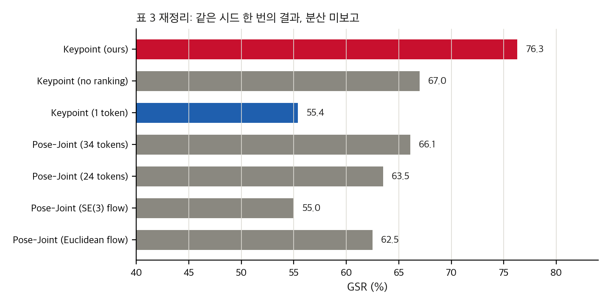
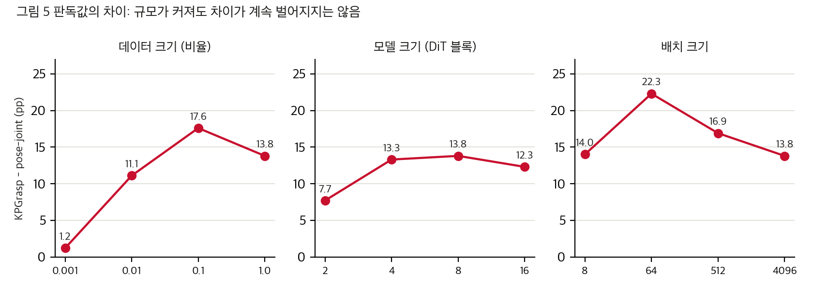
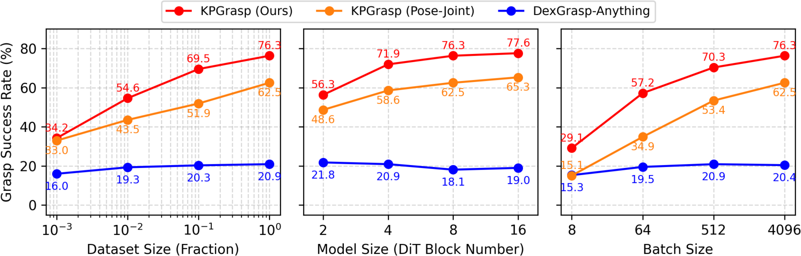
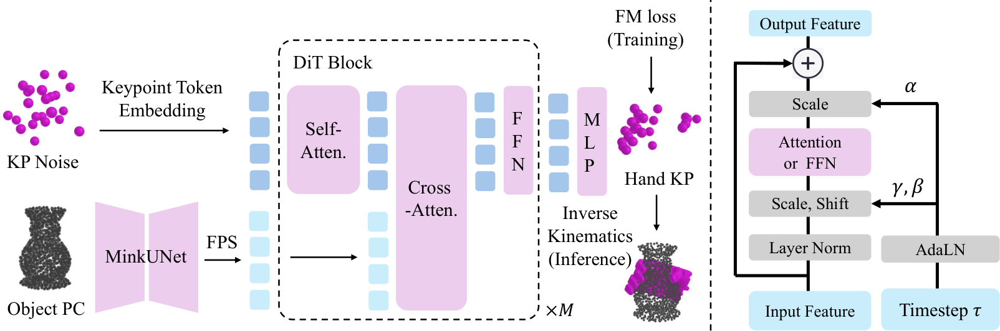
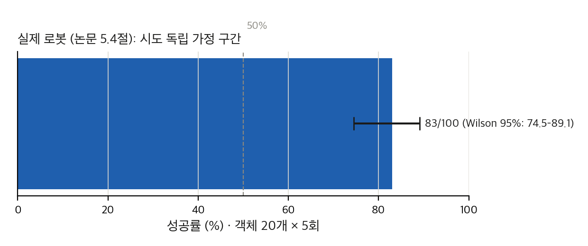

> **논문:** Yuansen Huang, Jiayi Chen, Haoran Liu, Yubin Ke, Bing Han, Jiangran Lyu, Mi Yan, Li Yi, He Wang. *KPGrasp: Scalable Keypoint Flow Matching for Dexterous Grasp Generation.* CoRL 2026 스포트라이트, arXiv:2606.09314 (v2, 2026-10-10).
> 공식 코드는 GitHub Yuansen-Huang/KPGrasp에 있습니다 (LICENSE는 CC BY-NC 4.0). 이 글의 그림 두 장은 논문 그림 (출처 표기)이고, 나머지 세 장은 우리가 그린 그래프입니다.

## 논문이 묻는 것

손 파지를 학습으로 생성하려면 보통 접촉 손실을 넣거나, 생성 뒤에 접촉 기반 정제를 합니다. 손목 자세 (SE(3))와 관절각을 한 벡터로 묶어 예측하면 회전 불연속, 오차 누적, 손실 균형 문제가 생긴다는 것이 논문의 출발점입니다.

KPGrasp는 두 가지를 바꿉니다. 첫째, 출력을 **물체와 같은 좌표계의 손 키포인트 3D 좌표**로 둡니다. 둘째, 트랜스포머 흐름 모델을 **표준 흐름 정합 손실 하나**로 학습합니다. 추론에서는 노이즈 100개를 오일러 5단계로 풀고 가능도 상위 10개를 고릅니다.

## 이 글에서 확인한 것

**1. 수치 재계산은 대부분 맞습니다.** 표 2의 평균 12개, 표 1과 표 3의 KPGrasp 행, IK 격자 (2,139 × 6 × 10 = 128,340)가 모두 일치합니다.

**2. 단위 문제가 있습니다.** 초록의 "47.4%"는 퍼센트 포인트이고, 상대 증가는 164%입니다. 분류기 대비 "12.4%"도 같은 문제입니다.

*그래프: 우리가 그린 표 3 재정리. 모든 값은 시드 한 번의 결과이며 분산은 보고되지 않았습니다.*

**3. 절제 차이를 판단할 근거가 부족합니다.** 가능도 순위는 67.0에서 76.3으로 9.3 pp 올립니다. 그러나 키포인트와 최고 pose-joint의 차이를 제외하면 1-2 pp 차이가 많고, 학습 시드 분산이 없어서 이를 확정할 수 없습니다.

**4. 그림 5와 본문이 맞지 않습니다.** 배치 512의 성공률은 본문 73.5%이고, 그림에 인쇄된 값은 70.3%입니다. "차이가 규모와 함께 벌어진다"는 주장은 데이터 축에서만 맞고, 배치 축에서는 512에서 16.9 pp, 64에서 22.3 pp로 중간에 최대입니다.

*그래프: 논문 그림 5의 인쇄 값을 읽어 만든 차이. 우리가 그린 그래프입니다.*

*그림: 논문 그림 5 (스케일링 곡선, 데이터·블록·배치 세 축). © 저자, CC BY 4.0, 출처 arXiv:2606.09314 (v2).*

**5. 공식 코드는 논문과 다른 규약을 씁니다.** 논문은 키포인트 21개, 단일 단계를 설명하지만, 공식 저장소는 28개 키포인트와 pregrasp·grasp·squeeze 세 단계를 한 토큰에 묶습니다. 손실, 추론 5단계, 상위 10, IK 5회 반복은 논문과 같습니다. 평가기 (표 1의 GSR 등과 표 2의 DGA 평가)와 체크포인트 URL은 공개되지 않았습니다.

*그림: 논문 그림 3 (KPGrasp 모델 구조). © 저자, CC BY 4.0, 출처 arXiv:2606.09314 (v2).*

**6. 실로봇은 가능함을 보이는 수준입니다.** 물체 20개, 물체당 5회, 100회에서 83회 성공했습니다. Wilson 95% 구간은 74.5–89.1%입니다. 같은 물체의 시도는 독립이 아니므로 실제 불확실성은 더 큽니다.

*그래프: 우리가 그린 실제 로봇 결과. 시도 독립 가정의 구간입니다.*

## 구현 가능성

- **이 맥 (M4 Pro, MPS, CUDA 없음)에서 논문 학습은 불가능합니다.** 논문은 RTX 4090 8장에서 약 2일을 씁니다.
- **공식 가중치는 아직 공개되지 않았습니다.** 추론 재현도 지금은 불가능합니다.
- **방법을 소형으로 다시 짜는 것은 가능합니다 (2-3주, 추정).** 키포인트 출력과 흐름 정합이 실제로 pose-joint보다 나은지를 확인하는 용도로는 쓸 만합니다.

## 정리

KPGrasp의 아이디어는 단순하고 설명이 명확합니다. 출력을 유클리드 키포인트로 두고 흐름 정합 하나로 학습하면, 접촉 손실 없이도 Dexonomy와 DGA 벤치마크에서 강한 수치를 얻습니다. 다만 근거의 상당 부분이 시드 한 번과 저장소에 없는 평가기에 기대고 있습니다. 세부 검산과 판정은 analysis/03_analysis.md와 analysis/04_code_verification.md에 있습니다.

## 자료

- [통합 리포트 PDF](report/report_public.pdf)
- [01. 논문 분석: KPGrasp](analysis/01_paper_analysis.md)
- [02. 선행연구와 관련 자료](analysis/02_prior_work.md)
- [03. 재계산, 일관성 검사, 주장 판정](analysis/03_analysis.md)
- [04. 공식 코드 대조와 구현 가능성](analysis/04_code_verification.md)
