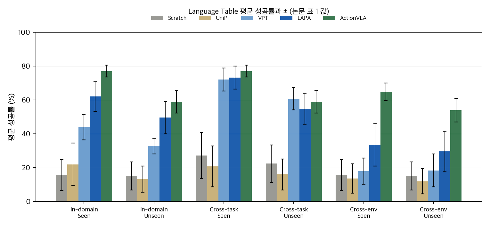
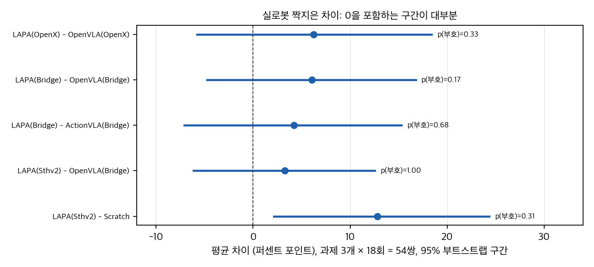
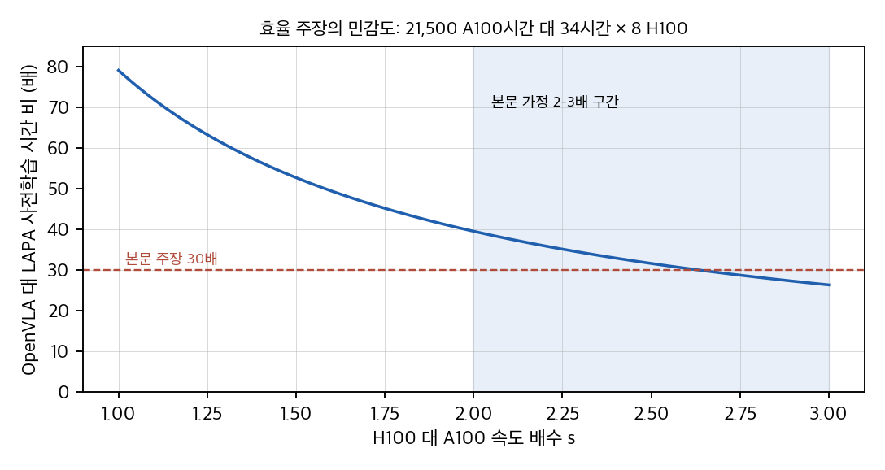

# LAPA: 행동 라벨 없는 영상으로 VLA 사전학습하기

*Latent Action Pretraining from Videos* (Ye, Jang 외 15인, KAIST·UW·Microsoft Research·NVIDIA·AI2)는 로봇 행동 라벨 없이 영상에서 VLA(Vision-Language-Action) 모델을 사전학습하는 방법을 제안합니다. ICLR 2025 포스터로 채택되었습니다(iclr.cc 공식 목록). 이 글은 논문의 표 값을 다시 계산하고, 공식 코드를 정적으로 읽은 결과입니다. 재현 실험은 하지 않았습니다.

## 방법 한 줄 요약

1. **잠재 행동 양자화.** 프레임 두 장의 차이를 코드북 8, 토큰 4개로 양자화합니다. 디코더는 교차 어텐션으로 잠재 행동을 받고, 현재 프레임 임베딩에는 stop-gradient를 씁니다.
2. **잠재 사전학습.** 7B VLM(LWM)이 명령어와 현재 관측으로 잠재 토큰을 예측합니다. 행동 라벨이 필요 없습니다.
3. **행동 미세조정.** 잠재 헤드를 버리고 새 행동 헤드를 붙여, 소량의 로봇 궤적으로 차원별 256 bin 행동을 학습합니다.

## 재계산으로 본 주장

그래프: 논문 표 1 값과 ±. 우리가 그린 그래프입니다. ±는 부분 과제 5개의 표준오차로 확인했습니다.

- **Language Table에서는 라벨 없는 기준선보다 대부분 낫습니다.** 다만 Cross-task Seen에서 VPT와의 차이는 1.2포인트이고(p = 0.84), 행동 라벨 사전학습(ActionVLA)에는 뒤집니다.
- **표 1의 ±는 "세 조합에 걸친" 값이 아니라 과제 5개의 표준오차입니다.** 평균 네 칸이 부록 표와 0.2–0.4포인트 다릅니다.

그래프: 실로봇 과제 3개 × 18회, 모델당 54회를 짝지은 차이와 부트스트랩 구간. 우리가 그린 그래프입니다.

- **"SOTA VLA보다 +6.22%"는 방향만 맞습니다.** 평균 차이는 6.22포인트지만 95% 구간은 −5.8 ~ +18.4이고, 부호 검정 p는 0.33입니다. 엄격 성공(점수 1)만 보면 차이는 7.4포인트이고 역시 유의하지 않습니다.
- **그래도 사람 영상 사전학습은 처음부터 학습보다 낫습니다.** 짝지은 차이 +12.8포인트, Wilcoxon p = 0.03입니다.

그래프: H100 대 A100 속도 배수에 따른 효율 비. 본문 가정(2–3배)에서 26–40배이고, 초록의 "30배 이상"은 속도 배수가 2.6을 넘으면 깨집니다. 우리가 그린 그래프입니다.

- **효율 주장은 가정에 달려 있습니다.** 21,500 A100-시간이라는 OpenVLA 값은 본문에 출처가 없습니다.

## 공식 코드와 논문

공식 저장소(MIT)는 LAQ의 교차 어텐션, stop-gradient, NSVQ, 등분위 이산화를 논문과 같게 구현했습니다. 차이는 세 가지입니다.

- 사전학습 배치는 논문 128, 코드 256입니다. 스텝 수 70k는 논문 본문에 없습니다.
- 사전학습 손실에 텍스트 항 0.01이 더해져 있습니다. 논문 본문에는 없습니다.
- 그리퍼 차원은 분위수 빈이 아니라 정수 값으로 씁니다.

또 LAQ 학습 코드는 사람 영상(SSv2)용만 공개되어 있습니다. 로봇 영상용 LAQ 학습 코드는 없습니다.

## 이 맥에서 할 수 있는 것

논문 수치 재현은 8장의 H100으로 34시간이 필요해서 불가능합니다. CUDA가 없는 맥에서는 공식 LAQ 추론도 `device='cuda'` 패치와 가중치 다운로드가 먼저 필요합니다. 잠재 양자화의 코드북 붕괴와 stop-gradient 효과는 CPU 토이로 점검할 수 있습니다.

## 버전과 라이선스

- v1(2024-10-15)과 v2(2025-05-15)는 수치가 같습니다. 번호와 문구만 바뀌었습니다.
- 논문 라이선스는 CC BY 4.0입니다(arXiv 페이지 "view license"). 이 글의 그래프는 우리가 그린 것이고, 논문 그림은 싣지 않았습니다.

## 자료

- [통합 리포트 PDF](report/report_public.pdf)
- [LAPA: Latent Action Pretraining from Videos (arXiv:2410.11758) 논문 분석](analysis/01_paper_analysis.md)
- [LAPA: 선행연구, 공식 저장소, 관련 분석](analysis/02_prior_work.md)
- [LAPA: 수치 재계산과 일관성 검사](analysis/03_analysis.md)
- [LAPA: 공식 코드 대조 (논문 ↔ 저장소)](analysis/04_code_verification.md)
