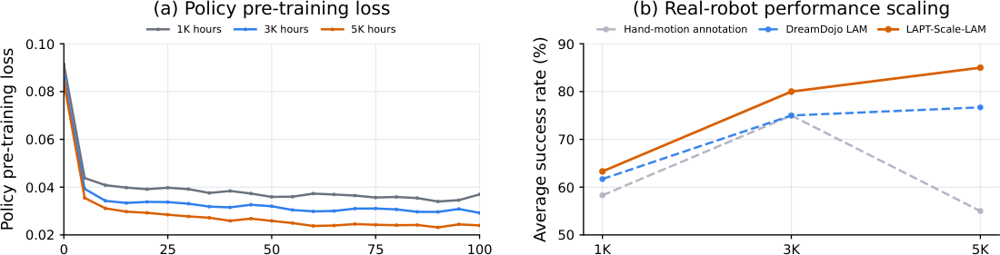
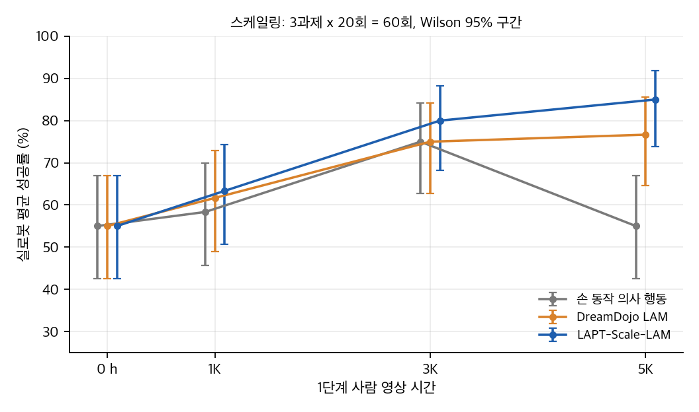
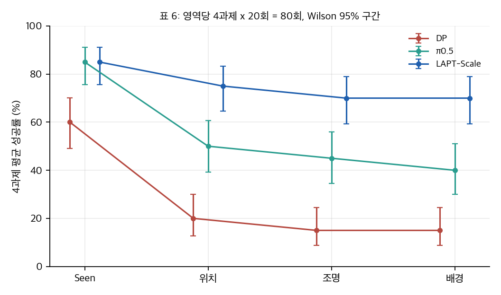
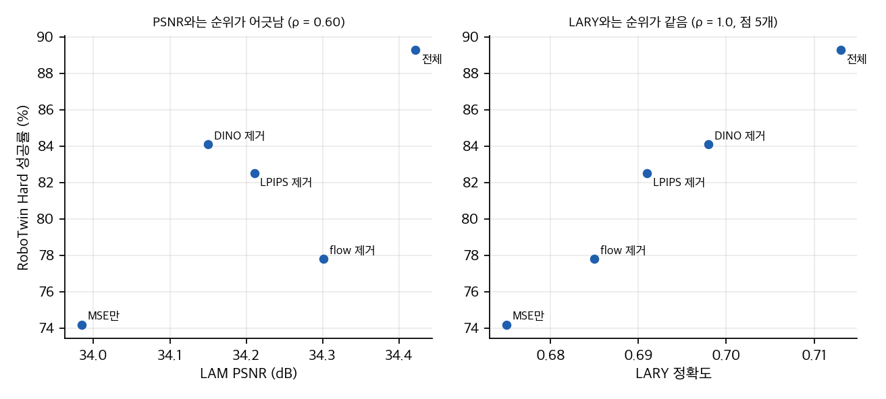
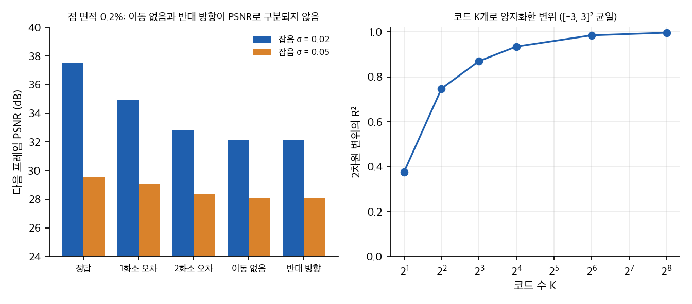

> **논문:** Zhiyuan Xiang, Peidong Liu, Mingyang Li, Jiawei Li, Wenhow Li, Wenbo Ding, Xiang Deng. *LAPT-Scale: Scaling Embodied Policies with Latent Action Pre-Training on Human Videos.* CoRL 2026 포스터, arXiv:2610.13732 (v1, 2026-10-09). 라이선스 CC BY 4.0.
> 공식 코드와 프로젝트 페이지는 찾지 못했습니다(2026-11-23 확인). 논문 그림은 그림 4 한 장만 출처를 적어 싣고, 나머지는 우리가 만든 그래프입니다.

## 논문이 묻는 것

사람의 1인칭 영상은 많지만 로봇 행동 라벨이 없습니다. 손 자세를 추정해 의사 행동을 만들면 추정 오차가 라벨 잡음이 됩니다. LAPT-Scale은 두 프레임에서 연속 잠재 행동(32차원)을 뽑는 모델(LAM)을 23.3K 시간의 영상에 학습하고, 이 잠재를 정책의 1단계 흐름 정합 목표로 씁니다. LAM의 손실은 화소 재구성에 LPIPS, DINOv2 특징, RAFT 광학 흐름 정렬을 더한 것입니다. 정책은 사람 영상 5.1K 시간(1단계), 250시간 로봇 데이터(2단계), 과제별 미세조정(3단계) 순으로 학습합니다.

주장은 RoboTwin 2.0 90.0%/89.3%, RoboCasa-GR1 64.8%, 실로봇 3과제 평균 85.0%이고, 사람 영상을 1K → 3K → 5K 시간으로 늘리면 실로봇 평균이 63.3 → 80.0 → 85.0%라는 것입니다.

## 표를 다시 계산하면

**1단계 자체의 효과는 확실합니다.** 실로봇 3과제(과제당 20회, 합 60회)에서 1단계 없음 55.0%(33/60), 계산량을 맞춘 연장 대조 53.3%, 1단계 5K 85.0%(51/60)입니다. Fisher 정확 검정 p < 0.001입니다.

**규모 이득은 1K 대 5K까지만 유의합니다.** 1K 대 5K는 38/60 대 51/60으로 p = 0.012(Holm 보정 후 0.046)이지만 3K 대 5K는 p = 0.63이고, 1K는 사람 영상이 없는 대조와도 구분되지 않습니다(p = 0.46). 과제별로 보면 Cup은 70 → 95 → 75로 단조가 아닙니다. 각 점은 한 번의 학습이고, 1단계가 100K 스텝으로 고정이라 데이터 양과 반복 횟수가 같이 변합니다(비중첩 1초 구간을 가정하면 1K는 약 28 에폭, 5K는 약 5.7 에폭).

그림: 논문 그림 4 (© Zhiyuan Xiang 외, CC BY 4.0, 출처 arXiv:2610.13732). 왼쪽 손실은 서로 다른 데이터 집합에서 잰 학습 손실이라 크기 비교가 품질 비교는 아닙니다. 오른쪽의 손 동작 5K 값(55.0%)은 사람 영상이 없는 대조(55.0%)와 같습니다.

그래프: 감독 방식별 60회의 Wilson 95% 구간. LAPT와 DreamDojo LAM은 1K, 3K, 5K 모두에서 구간이 겹칩니다. 우리가 그린 그래프입니다.

**같은 구조의 기준선 대비 이득은 검정되지 않습니다.** 정책 구조가 같은 JoyAI-RA 대비 실로봇 +5.0점은 51/60 대 48/60으로 p = 0.63이고, 이 격차를 80% 검정력으로 잡으려면 팔당 약 900회가 필요합니다. RoboCasa +1.6점은 1,200회를 가정하면 p = 0.42입니다. RoboTwin은 시행 수가 본문에 없어 검정할 수 없습니다. JoyAI-RA 0.1은 초록에서 대규모 1인칭 사람 조작 영상을 사전학습에 이미 쓴다고 밝히므로, 이 비교는 "사람 영상을 쓰는가"가 아니라 "잠재 행동 감독 대 명시적 행동 공간 통일"에 가깝습니다. π0.5 대비는 51/60 대 34/60으로 p = 0.001입니다. DreamDojo LAM 대비 5K 우위(85.0 대 76.7)도 p = 0.35입니다. 후자는 공개 사전학습 LAM이고 이쪽은 자체 말뭉치로 학습한 LAM이라 교란이 큽니다.

**어려운 4과제의 일반화 비교는 견고합니다.** 위치·조명·배경 변화에서 LAPT-Scale 70–75%, π0.5 40–50%입니다(영역당 80회). 영역별 p = 0.0018, 0.0023, 0.0002로 Bonferroni 기준을 통과합니다. 다만 평균 열(75.0 대 55.0)은 seen 영역을 포함하고, 이동 영역만 평균하면 71.7 대 45.0입니다. LAPT는 1단계와 250시간 정렬을 거쳤고 π0.5는 같은 시연만으로 후학습되어 "잠재 행동의 효과"와 "사전학습 총량의 효과"를 나눌 수 없습니다.

그래프: 영역당 4과제 x 20회 = 80회를 독립 시행으로 합산한 Wilson 95% 구간. 이동 3영역에서 LAPT와 π0.5의 구간이 겹치지 않습니다. 과제 군집을 무시해 낙관적입니다. 우리가 그린 그래프입니다.

## LAM 진단과 절제

**표 7의 VQ-LAM은 표 17의 LAPA와 같은 값입니다.** PSNR 18.3416, SSIM 0.6741, LPIPS 0.3443이 소수 넷째 자리까지 일치합니다. 본문은 "같은 전이 예측 프로토콜로 코드북만 바꾼" 비교라고 설명하지만 부록은 LAPA를 외부 이산 모델로 소개합니다. 15.6 dB 차이(MSE 약 37배)는 이산화만의 효과로 읽기 어렵습니다.

**표 5에서는 LARY가 정책 성공률과 순위가 같고 PSNR는 그렇지 않습니다.** RoboTwin Hard 순위(전체 > DINO 제거 > LPIPS 제거 > flow 제거 > MSE만)는 LARY 순위와 같고(Spearman ρ = 1.0) PSNR 순위와는 다릅니다(ρ = 0.60). 점이 5개이고 단일 학습입니다. flow 제거(−11.5점)가 단일 제거 중 가장 크지만, 세 단일 제거의 합(23.5점)이 전체 제거(15.1점)보다 커서 효과가 가산적이지 않습니다. PSNR 0.44 dB 차이는 MSE 9.6% 감소에 불과합니다.

그래프: 왼쪽은 PSNR, 오른쪽은 LARY 정확도를 가로축으로 한 RoboTwin Hard 성공률(점 5개, 단일 학습). 우리가 그린 그래프입니다.

## 작은 토이로 본 것

합성 영상(무늬 배경 + 움직이는 점 + 센서 잡음)에서 예측기별 PSNR을 계산했습니다. 점 면적이 0.2%이고 잡음이 0.05이면 움직임을 아예 놓친 예측("이동 없음")과 반대 방향으로 움직인 예측이 둘 다 28.11 dB로 구분되지 않았고, 1화소 위치 오차와 2화소 위치 오차의 차이는 0.65 dB였습니다. 2차원 변위를 코드 8개로 양자화하면 R²가 0.87, 64개로 0.985입니다. 논문의 PSNR 격차(0.44 dB)와 성공률 격차(15점)의 불일치가 이런 기전일 가능성을 보여 주지만 실제 영상의 잡음과 움직임 비중은 알 수 없어서 인과는 확인되지 않았습니다.

그래프: 왼쪽은 점 면적 0.2%의 합성 영상에서 예측기별 PSNR, 오른쪽은 코드 K개로 양자화한 2차원 변위의 R². 우리가 만든 토이이며 논문의 수치를 예측하지 않습니다.

## 데이터 구성에서 눈에 띈 것

그림 2의 장면 구성(Factory 42.9%)은 표 8의 Egocentric-10K 비중(10.0/23.3 = 42.9%)과 같습니다. 이 출처는 LAM 말뭉치(23.3K 시간)에는 들어가지만 정책 1단계 5.1K에는 0.0K입니다. 5.1K의 57%(2.9K 시간)는 비공개 자체 수집 영상입니다. 따라서 그림 2는 정책 감독의 다양성이 아닙니다.

## 이 맥에서 구현할 수 있는가

**논문 결과의 재현은 불가능합니다.** 한 번의 전체 파이프라인이 약 9.6K H200 GPU시간(LAM 4,938 + 주석 1,700 + 1·2단계 2,976)이고, 정책 기반 모델, 250시간 로봇 데이터, 자체 수집 영상이 공개되지 않았으며 코드가 없습니다.

**LAM의 구조와 손실은 구현할 수 있습니다.** PyTorch 400–600줄, 3–5일(추정)입니다. 소형 규모(10–50 M 파라미터, 64×64)의 학습과 합성 영상 검증은 Apple M4 Pro의 MPS에서 가능합니다. LPIPS, DINOv2, RAFT 가중치가 필요한 정렬 항 절제는 다운로드 승인 뒤의 조건부입니다.

## 읽을 때 조심할 것

- 모든 검정은 한 번의 학습과 독립 시행을 가정해 낙관적입니다. 시드 반복과 신뢰구간이 논문에 없습니다.
- 표 1, 2, 5의 시행 수와 기준선 값의 출처가 본문에 없어서 해당 비교는 검정하지 못했습니다.
- 토이는 우리가 만든 합성 영상입니다. RAFT, DINOv2, LPIPS 항의 효과는 시험하지 않았습니다.

## 정리

LAPT-Scale의 설계(고정 LAM의 잠재를 정책 1단계 목표로 쓰고 같은 행동 전문가를 이어서 학습)는 간결하고, 1단계가 없을 때보다 낫다는 점은 이 표본으로도 분명합니다. 다만 규모 이득의 3K 이후, 같은 구조 기준선과 DreamDojo LAM 대비 우위, 연속 대 이산의 통제된 비교, 정제 필터의 효과는 아직 열려 있습니다. 시행 수, 시드, 같은 LAM에서 라벨만 섞은 대조 같은 정보가 공개되면 판단이 훨씬 단단해질 것입니다.

## 자료

- [통합 리포트 PDF](report/report_public.pdf)
- [01. 논문 분석: LAPT-Scale](analysis/01_paper_analysis.md)
- [02. 선행연구와 계보](analysis/02_prior_work.md)
- [03. 수치 재계산, 일관성 검사, 토이](analysis/03_analysis.md)
- [04. 주장 검증과 구현 가능성](analysis/04_claim_verification.md)
