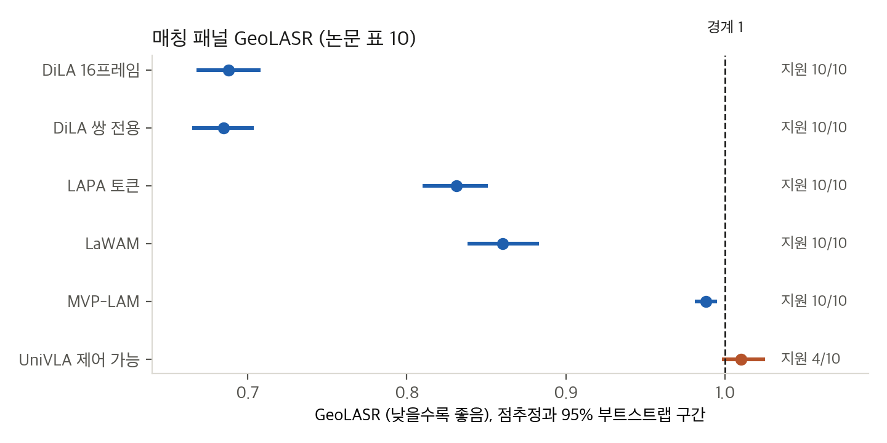
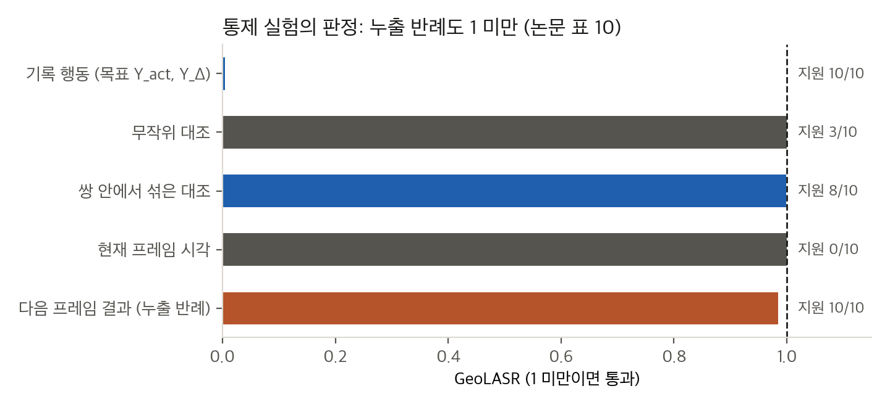
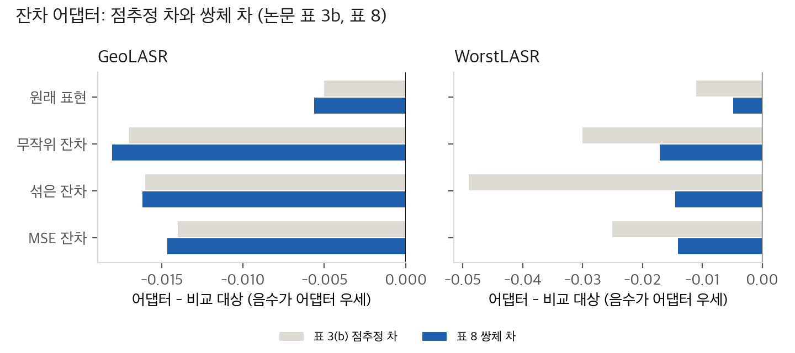

> **논문:** Yu Zhou, Changsong Lei, Yixiang Wei, Kairui Wen, Huankun Sheng, Ming Li, Yeying Fan, Yu-Hui Wen, Yong-Jin Liu. *Beyond Prediction Gain: LASR as a Metric for Action-Grounded Latents in World Models.* arXiv:2611.17775 (v1, 2026-11-13). 학회 표기는 없습니다.
> 공식 코드와 프로젝트 페이지는 찾지 못했습니다. 논문 라이선스는 arXiv 비독점이라 이 글에는 논문 그림을 넣지 않았습니다. 그림은 논문 표 값으로 우리가 그린 것입니다.

## 논문이 묻는 것

세계모델은 행동이 미래를 어떻게 바꾸는지 알아야 계획과 제어가 됩니다. 그런데 학습 영상에는 행동 주석이 거의 없습니다. 잠재 행동 모델은 관측 열에서 행동 같은 잠재 변수를 뽑아 이 빈칸을 메우려 합니다.

문제는 예측을 잘하는 잠재가 **행동을 담았는지** 알기 어렵다는 점입니다. 현재 상태, 에피소드 진행도, 과제 정체성만으로도 다음 상태가 어느 정도 예측되기 때문입니다. 저자들은 이 지름길을 가려내는 **오프라인 평가 지표**를 제안합니다.

## 방법: 세 경로와 하나의 비율

같은 예측기 계열로 세 경로를 맞춥니다.

- **상태 경로:** 현재 상태 S만 씁니다. 기준선입니다.
- **잠재 경로:** (S, Z)를 씁니다. 평가 대상입니다.
- **제어 경로:** (S, b*)를 씁니다. 비행동 대안 b*는 검증 집합에서 고릅니다.

점수는 잠재 경로의 위험을 두 기준 중 더 강한 쪽으로 나눈 값입니다.

ρ = E_Z / min(E_state, E_ctrl)

1 미만이어야 잠재가 두 기준을 모두 이긴 것입니다. 목표는 기록된 행동 A_t와 한 단계 상태 변화입니다. 쌍마다 점수를 내고, 기하평균(GeoLASR)과 최댓값(WorstLASR)으로 요약합니다.

## 결과 읽기

매칭 패널(ManiSkill3 다섯 과제)에서 다섯 표현의 GeoLASR은 DiLA, LAPA, LaWAM, MVP-LAM, UniVLA 순서입니다. 같은 순서가 분기 정확도에도 나타납니다. 다만 LAPA와 LaWAM의 구간은 겹칩니다.

*그림 1. 매칭 패널 GeoLASR과 부트스트랩 구간 (논문 표 10 값). 우리가 그렸습니다.*

*그림 2. 통제 실험의 판정 (논문 표 10 값). 다음 프레임 결과는 저자도 누출 반례라고 부르지만 1 미만이라 지표를 통과합니다. 우리가 그렸습니다.*

## 확인한 것과 조심해서 읽을 것

**맞는 것.** 집계식과 표 사이의 값은 모두 일치했습니다. 표 4에서 표 2로, 표 3(b)에서 표 7로, 표 10에서 표 2의 매칭 열로 다시 계산해 맞았습니다. 선형 가우시안 경우의 닫힌 식도 유도와 맞습니다.

**조심해서 읽을 것.**

- **행동 목표는 자명합니다.** Y = A_t를 (S, A)로 예측하면 항등 매핑이라 오차가 거의 0입니다. 표 2의 "기록 행동 기준 ≈ 0"은 이 결과입니다. 양성 대조가 실질적으로 작동하는 곳은 상태 변화 목표뿐입니다.
- **누출 반례가 통과합니다.** 다음 프레임 정보를 가진 잠재가 10쌍 모두에서 1 미만입니다. 지표만으로는 누출과 행동 정보를 구별하지 못합니다. 저자도 개입 실험을 따로 보고합니다.
- **쌍체 추정의 정의가 없습니다.** 어댑터 대비 WorstLASR 쌍체 차이는 점추정 차이의 0.3–0.6배입니다. 방향은 같지만 효과 크기는 작게 읽어야 합니다.

*그림 3. 잔차 어댑터 대비 점추정 차(표 3b)와 쌍체 차(표 8). 우리가 그렸습니다.*

## 구현할 수 있나

이 맥에서 LASR 평가기 자체와 합성 검사는 CPU로 할 수 있습니다. 실데이터에서 한 표현을 검증하는 것은 데이터와 체크포인트 승인이 있어야 합니다. 다섯 표현 전체, 매칭 시뮬 패널, 세계모델 예측은 GPU와 대형 자원이 필요해 당장은 하지 않습니다.

## 한 줄 평

잠재가 "예측에 도움이 되는가"에서 "상태와 대안을 넘어서는가"로 질문을 옮긴 점은 좋습니다. 다만 지금 형태의 지표는 행동 목표의 양성 대조가 자명하고 누출을 거르지 못하므로, 다른 교란 검사와 함께 써야 합니다.

## 자료

- [통합 리포트 PDF](report/report_public.pdf)
- [01. 논문 분석: LASR (arXiv:2611.17775)](analysis/01_paper_analysis.md)
- [02. 선행연구와 공식 코드 (LASR, arXiv:2611.17775)](analysis/02_prior_work.md)
- [03. 수치 재계산과 일관성 검사 (LASR, arXiv:2611.17775)](analysis/03_analysis.md)
- [04. 주장 검증 (LASR, arXiv:2611.17775)](analysis/04_claim_verification.md)
