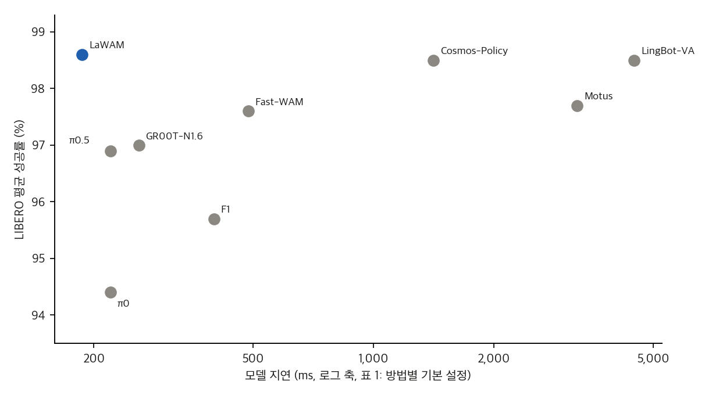
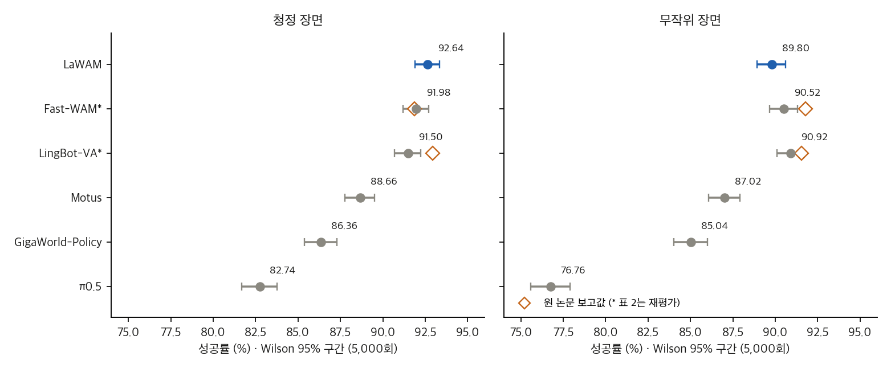
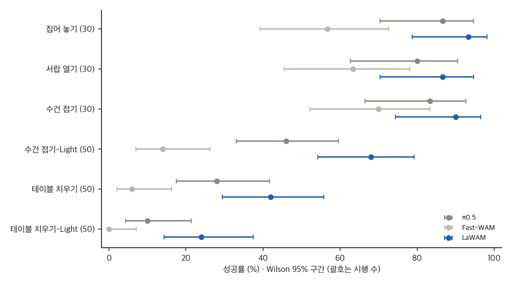
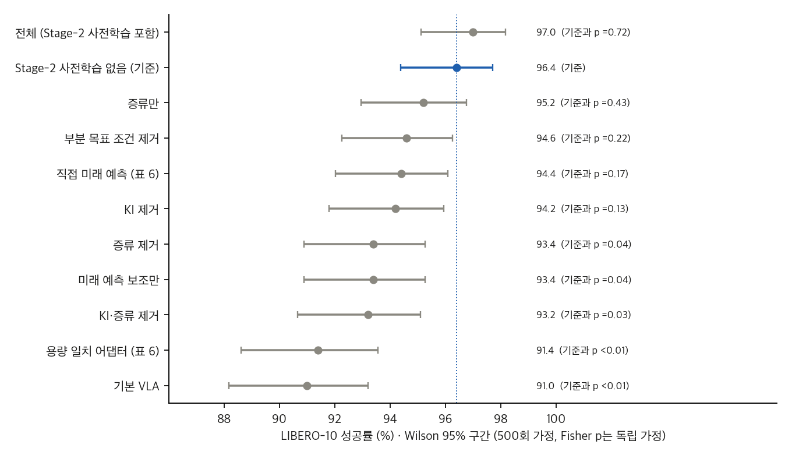

> **논문:** Jialei Chen 외. *LaWAM: Latent World Action Models for Efficient Dynamics-Aware Robot Policies.* CoRL 2026 포스터, arXiv:2606.15768 (v2, 2026-10-25).
> 공식 코드는 GitHub RLinf/LaWAM에 있습니다. 이 글의 그림은 모두 우리가 그린 그래프이며, 논문 그림은 넣지 않았습니다 (arXiv 비독점 배포 라이선스).

## 논문이 하는 일

잠재 행동 모델(LAM)은 보통 사전학습 뒤 순방향 디코더를 버립니다. LaWAM은 DINOv3 특징 공간에서 LAM을 학습한 뒤 **디코더를 추론에도 남깁니다.** 정책이 예측한 잠재 행동에서 디코더가 청크 끝의 미래 특징(잠재 부분 목표)을 한 번에 만들고, 행동 전문가가 이를 교차 어텐션으로 읽습니다. 픽셀 영상을 생성하지 않으므로 187 ms로 동작하고, LIBERO 98.6%, RoboTwin 91.22%를 보고합니다.

## 지연: 24배는 어디서 나오나

*그래프: 우리가 그린 그래프. 표 1의 방법별 기본 설정 지연 (로그 축)과 LIBERO 평균.*

4,482/187 = 23.97이라 산술은 맞지만 상대는 LingBot-VA입니다. Fast-WAM에는 2.6배, π0.5에는 1.18배입니다. 논문 부록 F.1이 각 방법이 자기 해상도와 지평선을 유지했다고 밝히므로 작업량을 맞춘 비교는 아닙니다.

## 벤치마크: 기준선과 구분되지 않는다

LIBERO 98.6은 98.5 기준선과 구분되지 않고 (2,000회 가정 Fisher p = 0.89), 표 1에는 500회에서 정수가 안 되는 값이 섞여 있어 평가 횟수가 같지 않습니다. RoboTwin은 청정 92.64, 무작위 89.80입니다.

*그래프: 우리가 그린 그래프. 표 5에서 계산한 평균과 5,000회 기준 Wilson 구간. 마름모는 원 논문 보고값 (표 2는 저자가 재평가).*

두 조건을 평균하면 Fast-WAM 91.25, LaWAM 91.22, LingBot-VA 91.21로 0.04 pp 안입니다. 과제 50개 쌍체 비교에서 Fast-WAM과 LingBot-VA와 구분되지 않습니다. 재평가 대신 원 논문 보고값과 비교하면 무작위 장면에서는 LaWAM이 유의하게 낮습니다.

## 실로봇과 절제

*그래프: 우리가 그린 그래프. 표 3의 성공 수와 Wilson 구간.*

LaWAM이 여섯 조건 모두에서 점추정이 가장 높습니다. 그러나 π0.5와의 Fisher 검정은 Fold Towel-Light(34/50 대 23/50)만 보정 전 p = 0.043이고 나머지는 0.11 이상입니다.

*그래프: 우리가 그린 그래프. 500회로 가정한 성공 수. p는 기준과의 독립 Fisher 검정.*

논문의 핵심 문장인 "디코딩된 미래를 조건으로 넣으면 이득"에 해당하는 비교는 96.4 대 94.6 (1.8 pp)로 p = 0.22입니다. 지식 격리(KI)의 효과도 증류가 있을 때(−2.2 pp)만 보이고 없을 때는 −0.2 pp입니다.

## 코드와 논문의 차이

공식 코드를 정적으로 읽어 대조했습니다 (실행하지 않음).

- 논문 E.2는 LaWM 디코더를 24층이라 쓰지만 230M은 12층 구성에서 나옵니다 (12층 228.3M, 24층 455M). 공개 LAM 체크포인트의 파일 크기(2.90 GB)도 12층과 0.3% 안에서 맞습니다.
- 로봇 영상 지평선은 논문 1.2 s, 공개 LAM 설정 1.6 s이고, 손실은 MSE 대신 smooth-L1, KL 계수 기본값은 5e-5입니다 (논문 1e-5).
- 교차 어텐션 키에 현재 특징과 예측 특징을 구분하는 위치·유형 임베딩이 없습니다.
- 사전학습 데이터 혼합과 절제 변형 코드는 공개되어 있지 않습니다.
- RoboTwin 평가 스크립트의 시행 수 기본값은 14로, 논문의 과제당 100회와 다릅니다.
- 이슈 목록에는 제3자의 재현 격차 보고가 있습니다. 시뮬레이터 버전에 민감하다는 내용이며 이 글에서 검증하지 않았습니다.

## 정리

- 아이디어(디코더를 남겨 부분 목표를 조건으로 쓰기)는 간결하고 지연이 낮은 것은 사실입니다.
- 성능 우위는 방향만 맞고 표본으로는 구분되지 않는 곳이 대부분입니다.
- 재사용하려면 논문 서술보다 공개 설정과 이슈를 함께 확인해야 합니다.

## 자료

- [통합 리포트 PDF](report/report_public.pdf)
- [01. 논문 분석: LaWAM (arXiv:2606.15768)](analysis/01_paper_analysis.md)
- [02. 선행 연구와 관련 자료](analysis/02_prior_work.md)
- [03. 수치 재계산과 일관성 검사](analysis/03_analysis.md)
- [04. 공식 코드와 논문 대조](analysis/04_code_verification.md)
