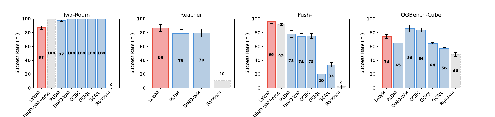
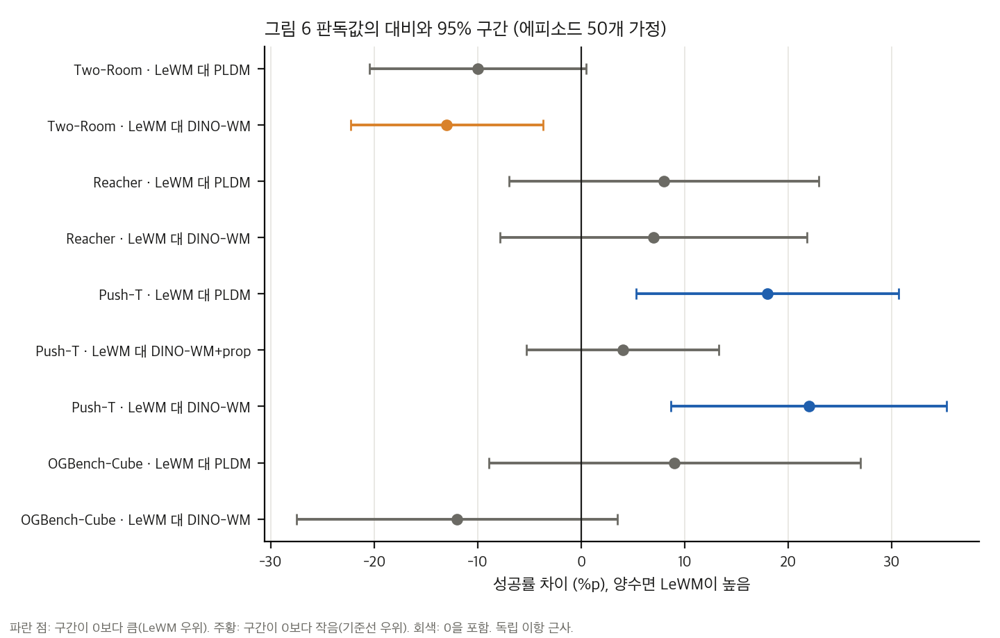
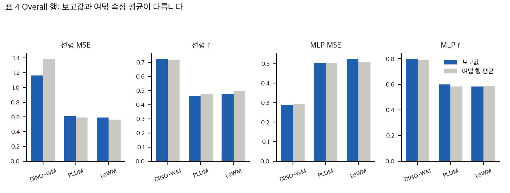
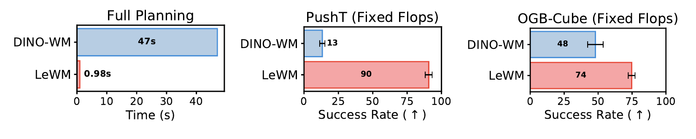

> **논문:** Lucas Maes, Quentin Le Lidec, Damien Scieur, Yann LeCun, Randall Balestriero. *LeWorldModel: Stable End-to-End Joint-Embedding Predictive Architecture from Pixels.* arXiv:2603.19312 (v3, 2026-06-03). NeurIPS 2026 포스터.
> 공식 코드(MIT)는 정적으로만 읽었고 실행하지 않았습니다. 그림 6과 그림 3은 CC BY 4.0 논문의 그림을 출처와 함께 실었고, 나머지 그래프는 우리가 그렸습니다.

## 논문이 하려는 것

세계모델은 행동이 환경을 어떻게 바꾸는지 예측해, 실제로 움직이기 전에 계획을 세우게 해 줍니다. 잠재 공간 JEPA는 관측을 작은 벡터로 압축하고 그 안에서 미래를 예측하는 방식입니다. 문제는 붕괴입니다. 모든 입력을 같은 벡터로 보내면 예측 손실은 0에 가까워지지만 아무 정보도 남지 않습니다.

기존 방법은 붕괴를 막으려고 지수이동평균, 정지 그래디언트, 사전학습 인코더, 여러 항의 손실을 씁니다. 이 논문은 **예측 MSE와 SIGReg 항 하나**만 씁니다. SIGReg는 잠재 벡터가 등방 가우시안처럼 보이도록 무작위 방향으로 투영한 뒤 정규성 검정 통계를 평균합니다. 손실의 튜닝 대상이 여섯 개에서 한 개(λ)로 줄어든다는 것이 주장입니다.

## 결과와 우리가 확인한 것

논문 그림 6에서 LeWM은 Push-T 96%, Reacher 86%, Cube 74%, Two-Room 87%입니다. 우리가 에피소드 50개 가정으로 이항 대비를 계산하니, **Push-T에서 PLDM 대비 18%p(p ≈ 0.006), DINO-WM 대비 22%p(p ≈ 0.001)의 차이는 뚜렷합니다.** Reacher의 차이는 구별되지 않습니다. Two-Room에서는 LeWM이 DINO-WM보다 13%p 낮습니다.

표 값을 다시 계산하면서 몇 가지를 찾았습니다.

- **표 4의 Overall 행이 여덟 속성의 평균과 맞지 않습니다.** DINO-WM의 선형 MSE는 보고값 1.162, 평균 1.389입니다. 집계 방법이 적혀 있지 않아 Overall 행은 근거로 쓰기 어렵습니다.

- **표 5의 PLDM "78.0 ± 5.0"과 표 10의 "4.67 ± 0.06"은 시드 3개 × 에피소드 50개 격자에서 나올 수 없습니다.** SD의 정의가 표마다 다른 것으로 보입니다.
- **TwoRoom 평가 예산이 v1의 150에서 v3의 50으로 바뀌었는데, 그림 6 수치는 두 버전에서 같습니다.** 어느 쪽이 맞는지 논문만으로는 알 수 없습니다.

"계획이 48배 빠르다"는 47초 대 0.98초의 비율(47.96배)로 맞습니다. 다만 하드웨어와 계획 횟수가 적혀 있지 않습니다. 같은 Cube 과제에서 그림 3은 DINO-WM을 48%, 그림 6은 86%로 보고합니다. 고정 FLOPs 설정이 부록에 정의되어 있지 않아 두 값의 차이를 설명할 수 없습니다.

## 공식 코드와 비교

공식 저장소(MIT, 별 4천 개 이상)는 학습과 평가 코드를 담고 있어서, 구조와 손실을 직접 대조할 수 있었습니다. 두 항 손실, ViT-Tiny 인코더, 6층 예측기, CEM 계획은 논문과 맞습니다. 그러나 다음은 다릅니다.

- λ는 본문 0.1, 공식 설정 0.09입니다.
- 예측 손실은 식의 합이 아니라 원소 평균입니다. 그래서 λ 값을 옮길 때 상대 가중치가 크게 달라질 수 있습니다.
- 에포크는 논문 10, 공식 기본 100입니다.
- 평가 코드는 `cuda`를 두 곳에 고정해 두고 있어 맥에서는 바꿔야 합니다.
- 프로브, 물리 위반 탐지(VoE), 디코더 코드는 공개되어 있지 않습니다. 논문 표 1·3·4와 그림 8은 이 저장소만으로 재현할 수 없습니다.

## 구현할 수 있을까

이 맥(Apple M4 Pro, 메모리 24 GiB, CUDA 없음)을 기준으로 보면 다음과 같습니다. 측정하지 않은 추정입니다.

- **모델 구조, 두 항 손실, CEM 계획:** 옮길 수 있습니다. 파라미터가 약 1,500만 개라 메모리는 충분합니다.
- **공개 체크포인트로 Push-T 추론 확인:** 조건부입니다. 설치, 평가 데이터 13.1 GB, 코드 패치가 필요하고 2–4일 정도로 봅니다.
- **처음부터 학습:** 어렵습니다. 한 에포크가 수 시간 이상일 것으로 보이고, 10 에포크도 수십 시간입니다.
- **기준선(DINO-WM, PLDM) 재현:** GPU 재학습이 필요해 맥에서는 어렵습니다.

판정은 **부분 구현 가능**입니다. 모델과 계획은 옮길 수 있지만, 논문 수치를 같은 조건에서 다시 맞추려면 GPU가 필요합니다.

## 정리

LeWM은 "붕괴를 막는 항 하나면 된다"는 설계를 보여 줍니다. 구현은 간결하고 Push-T에서 PLDM보다 확실히 낫습니다. 반면 표 집계, 에포크, 평가 프로토콜, 그림 설정은 논문과 코드 사이에 빈틈이 있습니다. 따라서 수치를 그대로 인용하기보다는 방법의 구조를 가져다 쓰는 쪽이 안전합니다.

## 자료

- [통합 리포트 PDF](report/report_public.pdf)
- [01. 논문 분석: LeWorldModel (arXiv:2603.19312 v3)](analysis/01_paper_analysis.md)
- [02. 선행연구와 관련 자료](analysis/02_prior_work.md)
- [03. 수치 재계산과 일관성 검사](analysis/03_analysis.md)
- [04. 논문 ↔ 공식 코드 대조 (정적 읽기)](analysis/04_code_verification.md)
