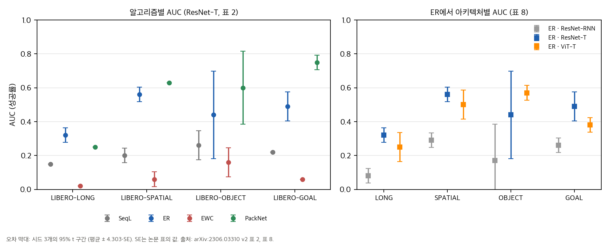
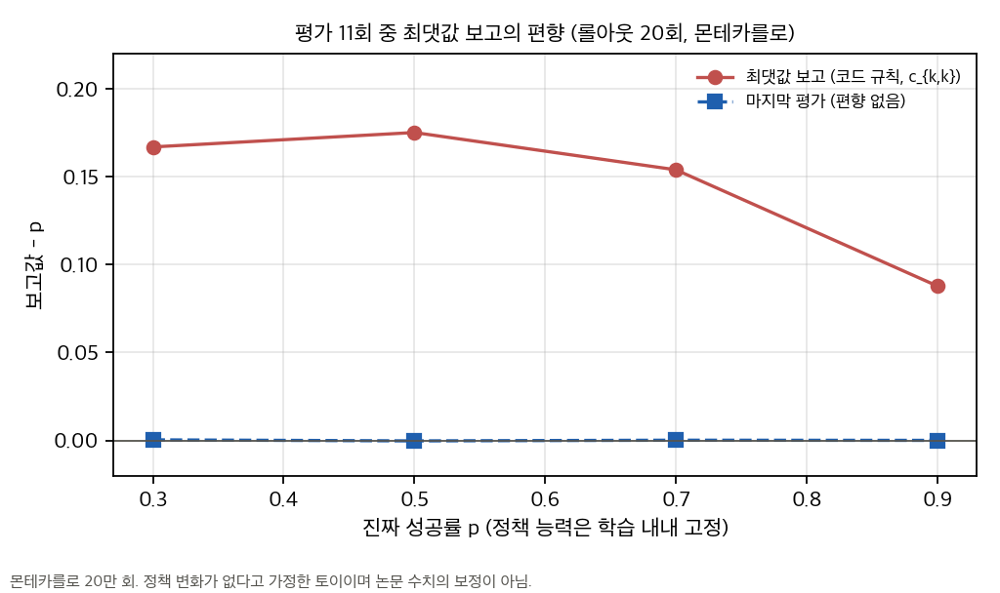

> **논문:** Bo Liu, Yifeng Zhu, Chongkai Gao, Yihao Feng, Qiang Liu, Yuke Zhu, Peter Stone. *LIBERO: Benchmarking Knowledge Transfer for Lifelong Robot Learning.* NeurIPS 2023 Datasets and Benchmarks 트랙, arXiv:2306.03310 (v2, 2023-10-14).
> 공식 코드는 GitHub Lifelong-Robot-Learning/LIBERO(MIT)에 있습니다. 이 글의 그림 두 장은 우리가 만든 그래프입니다. 논문 그림은 쓰지 않았습니다.

## 논문이 묻는 것

로봇은 과제를 하나씩 배우면서 앞서 배운 것을 잊지 않아야 합니다. 이 논문은 평생학습을 **절차적 지식**(어떻게 움직이는가)까지 포함한 문제로 놓고, 이를 재는 벤치마크 LIBERO를 만듭니다. 과제 130개를 네 묶음(SPATIAL, OBJECT, GOAL, LONG, 그리고 사전학습용 LIBERO-90)으로 나누고, 과제마다 사람이 원격조작한 시연 50개를 붙입니다. 순차 미세조정, 세 가지 평생학습 알고리즘(ER, EWC, PackNet), 세 가지 정책 구조를 같은 틀에서 비교합니다.

벤치마크 설계는 깔끔합니다. 세 suite는 분포 이동 축을 하나씩 바꿉니다. 그래서 어떤 지식이 전이되지 않았는지 알아보기 쉽습니다.

## 이 글에서 확인한 것

**1. 표끼리는 모두 맞습니다.** 표 1의 72칸과 표 2의 48칸은 부록 표 8의 같은 칸과 전부 같습니다. 부록 E.3의 90개 과제 값은 모두 0.05의 배수입니다. 롤아웃을 20회 했다는 설명과 맞습니다.

**2. 본문 차이 중 일부만 유의합니다.** 양측 Welch 검정으로 본문 주장을 다시 보니 다음과 같습니다.
- ER에서 ResNet-T가 ViT-T보다 낫다는 주장은 GOAL에서만 유의합니다(p = 0.017). LONG과 SPATIAL은 경계 또는 비유의입니다.
- PackNet에서 아키텍처 차이가 LONG에서만 크다는 주장은 맞습니다(p = 0.012).
- 순차 미세조정의 FWT가 가장 높다는 주장은 EWC와 PackNet에 대해서는 유의하지만, ER과의 차이는 대부분 유의하지 않습니다.
- 언어 임베딩에 따른 차이가 없다는 주장은 맞습니다. 다만 시드가 3개라서 "차이가 없다"는 증거로는 약합니다.

*그림 1 (우리가 그림). 표 2와 표 8의 AUC. 오차 막대는 시드 3개의 평균 ± 4.303·SE입니다. 원자료 출처: arXiv:2306.03310 v2.*

**3. 최댓값을 보고하면 성공률이 위로 치우칩니다.** 코드는 과제마다 5 epoch마다 같은 20개 초기 상태로 평가하고, 가장 높은 체크포인트를 저장하고 보고합니다. 별도의 검증 집합이 없습니다. 정책 능력이 학습 내내 고정되어 있다고 가정하고 몬테카를로로 보면, 11번 중 최댓값은 진짜 성공률보다 약 0.15–0.18 높게 나옵니다. 마지막 평가는 편향이 없습니다.

*그림 2 (우리가 그림). 진짜 성공률 p에 따른 보고값의 편향, 롤아웃 20회, 몬테카를로 20만 회. 논문 수치를 보정한 것이 아닙니다.*

이 값은 NBT와 AUC의 기준이 되는 c_{k,k}에 들어갑니다. 편향이 있다면 이 지표로 비교하는 알고리즘 순위도 영향을 받을 수 있습니다.

**4. FWT 정의가 표준과 다릅니다.** 논문의 FWT는 과제를 배우는 동안의 성공률 평균입니다. 표준 FWT는 과제를 배우기 전의 제로샷 성능입니다. 논문은 표준 FWT의 문헌을 인용하면서도 이 차이를 밝히지 않습니다. 또 식 (3)의 NBT는 K = k일 때 분모가 0이 되는데, 이 경우는 정의되지 않았습니다.

**5. 공식 코드는 대부분 논문을 따릅니다.** 옵티마이저(AdamW), 학습률 일정, 평가 횟수, 아키텍처 하이퍼파라미터, EWC와 PackNet 설정은 논문과 맞습니다. 다음은 차이이거나 논문에 없는 부분입니다.
- 데이터 증강(색 지터, 이동 증강)이 기본으로 켜져 있지만 논문에는 없습니다.
- ER은 "과제당 1,000 궤적"이라고 쓰지만 코드는 처음 1,000개 시퀀스 창을 씁니다.
- NBT와 AUC를 계산하는 코드가 저장소에 없습니다. 결과 행렬만 저장합니다.

## 구현 가능성

- **재계산과 검정:** 이 글의 모든 수치는 논문 텍스트에서 다시 읽어 계산했습니다.
- **시뮬레이터 실행:** 조건부입니다. Python 3.8, robosuite 1.4.0, EGL 렌더링을 전제합니다. macOS에서 그대로 되는지는 확인하지 않았습니다. 데이터는 suite별로 6–67 GB이고 전체는 약 100 GB입니다.
- **학습 재현:** 논문은 A100이나 A40을 씁니다. 이 맥에서는 학습을 재현하지 않았습니다.

## 출처와 라이선스

- 논문은 arXiv에 CC BY 4.0으로 공개되어 있습니다(abs 페이지 "view license" 링크 확인). PDF 본문에서 저작권 표시는 찾지 못했습니다.
- 공식 코드는 MIT 라이선스입니다. 데이터의 라이선스는 README(CC BY 4.0)와 Hugging Face 카드(apache-2.0)가 다르게 적혀 있습니다. 재배포 전에 확인이 필요합니다.
- 이 글에 쓴 그래프 두 장과 분석 문서, 재계산 스크립트는 작성자가 만들었습니다. 원 논문 그림은 쓰지 않았습니다.

## 자료

- [통합 리포트 PDF](report/report_public.pdf)
- [LIBERO: Benchmarking Knowledge Transfer for Lifelong Robot Learning 논문 분석](analysis/01_paper_analysis.md)
- [LIBERO 선행연구, 공식 코드, 관련 분석](analysis/02_prior_work.md)
- [LIBERO 수치 재계산과 검정](analysis/03_analysis.md)
- [LIBERO 공식 코드 대조 (정적 읽기)](analysis/04_code_verification.md)
