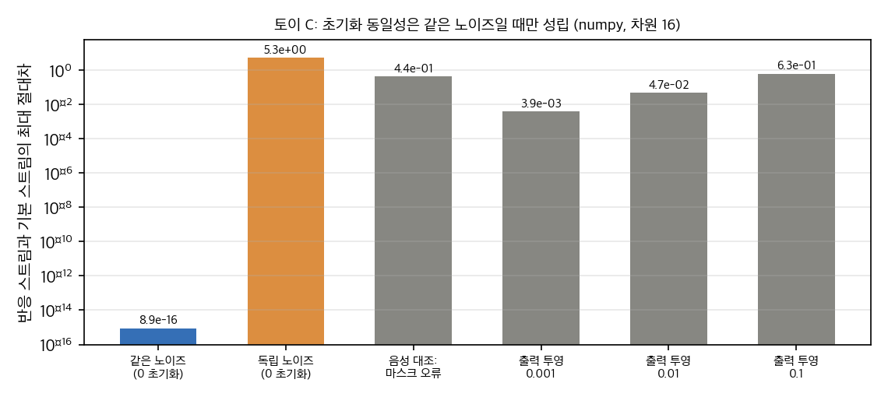
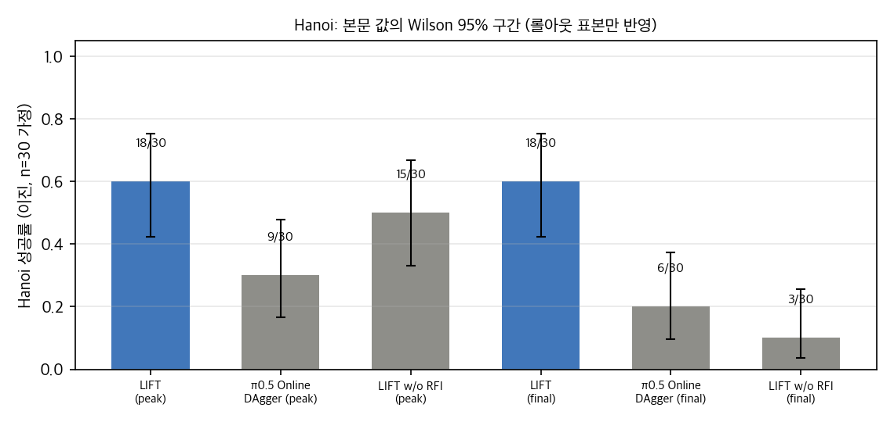
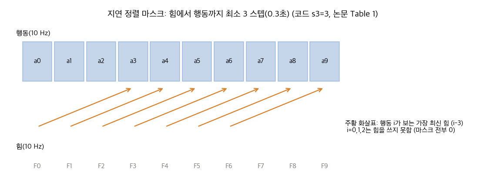

> **논문:** Yi Wang 외 10인. *Never Too Late for Force: Accelerating VLA Post-Training with Reactive Force Injection.* CoRL 2026 Spotlight, arXiv:2607.14236 (v3, 2026-10-12).
> 공식 코드: `y-wng/LIFT` (Apache-2.0, 정적으로만 읽음). 논문 라이선스는 CC BY-SA 4.0이라 논문 그림은 싣지 않았습니다. 아래 그래프는 논문 본문의 수치와 직접 만든 토이로 그렸습니다.

---

## 논문이 묻는 것

사전학습 VLA는 이미지와 언어로 행동 청크를 한 번에 냅니다. 그래서 접촉 순간에 힘이 바뀌어도 청크가 끝날 때까지 반응하지 못합니다. LIFT는 이 문제를 **후학습 단계에서** 풉니다. 기존 action expert를 복사해 반응 expert를 하나 더 붙이고, 6D 말단 힘을 GRU로 요약해 0으로 초기화한 교차어텐션으로 넣습니다. 그래서 학습 시작 시점의 출력은 원래 정책과 같습니다. 후학습은 사람이 고친 온라인 교정 데이터와 기존 시각 데이터를 1:1로 섞는 DAgger입니다.

## 기억할 설계 세 가지

- **지연 정렬 마스크.** 행동 i는 힘 프레임 i-3까지만 봅니다(10 Hz, 0.3초). 청크 시작의 처음 세 행동은 힘을 쓰지 못합니다.
- **0 초기화.** 교차어텐션 출력 투영을 0으로 두면 학습 전 출력은 원래 정책과 같습니다.
- **반응 스트림만 로봇에 보냄.** 추론은 두 스트림을 모두 계산하지만, 로봇에는 반응 행동만 보냅니다(코드 확인).

*그래프: numpy 초기화 토이(차원 16, 2층)로 계산한 최대 절대차(로그 축). 같은 노이즈에서만 0입니다. 코드도 두 스트림에 독립 노이즈를 씁니다. 우리가 그린 그래프입니다.*

## 본문 수치를 다시 계산해 보기

하노이는 이진 성공이라 비율의 신뢰구간을 계산할 수 있습니다. 체크포인트당 30회라고 가정했습니다.

*그래프: 하노이 본문 값(피크, 최종)의 Wilson 95% 구간. n=30 가정이며 롤아웃 표본만 반영합니다. 우리가 그린 그래프입니다.*

- LIFT 최종 18/30 대 온라인 DAgger 최종 6/30: Fisher 정확검정 p = 0.003.
- LIFT 피크 18/30 대 온라인 DAgger 피크 9/30: p = 0.037.
- LIFT 피크 18/30 대 단일 프레임 기준선 피크 15/30: p = 0.60. **피크 차이는 유의하지 않습니다.**
- 피크는 체크포인트의 최대값이라 선택 편향이 있습니다. 같은 성공률을 가정한 몬테카를로에서도 피크 차이 0.3은 드물었습니다(p < 0.001).

하지만 **학습 시드가 논문에 없습니다.** 방법마다 한 번씩 학습했고, 신뢰구간은 롤아웃 표본만 반영합니다. 학습 실행 사이의 차이는 측정되지 않았습니다.

수건과 책은 단계 점수라 표준편차를 알 수 없습니다. 표준편차를 0.2–0.5로 가정하면 수건의 피크 차이(0.825 대 0.725)는 유의하지 않습니다(p ≈ 0.05–0.44). 책의 피크 차이(0.6 대 0.4)는 가정에 따라 p = 0.0001–0.12입니다.

## 일반화 주장과 그림이 맞지 않습니다

서론은 "객체, 천, 조명이 바뀌어도 큰 저하가 없다"고 씁니다. 그런데 막대 그래프(Figure 6)의 라벨을 보면 책 꽂기의 "Another desktop"은 원본 0.5에서 0.1로, 하노이의 "Another desktop"은 0.6에서 0.3으로 떨어집니다. 본문 5.4는 "대부분의 조건"이라고 한정하지만, 그 두 조건은 한정 밖에 있지 않습니다. 또 그림의 조건명("Another desktop", "Another book")은 부록 L의 조건 정의와 맞지 않습니다.

## 힘의 빠르기

논문은 힘이 "high-frequency"라고 씁니다. 실제로 힘 센서는 1000 Hz 이상이지만 입력은 10 Hz로 내려 씁니다. 행동도 10 Hz로 갱신됩니다. 지연 정렬 L=3을 더하면, 접촉이 생긴 뒤 행동에 반영되기까지 최소 0.3초가 걸립니다. 추론 시간은 보고되지 않았습니다.

*그래프: 행동 10스텝 청크에서 힘 프레임 사용 관계. 주황 화살표는 행동 i가 보는 가장 최신 힘입니다. 우리가 그린 그래프입니다.*

## 코드와 논문의 차이

공식 저장소(Apache-2.0)는 학습과 추론 코드를 담고 있습니다. 여기서 몇 가지가 논문과 다릅니다.

- **단일 프레임 기준선은 청크 시작의 힘 한 프레임입니다.** 코드의 `use_force_history=False`는 첫 힘 토큰만 허용합니다. 논문 본문이 말하는 "현재 힘 한 프레임"과 다를 수 있습니다.
- **EMA 0.999**가 설정에 있지만 논문 표에는 없습니다.
- **과제별 초기 체크포인트가 다릅니다.** 하노이는 공개 π0.5 기본 체크포인트에서, 책은 자체 1단계 체크포인트에서 시작합니다.
- **데이터와 수집 도구는 공개되지 않았습니다.** v1은 "code and data"라고 했지만 v3는 "code"만 씁니다.

## 이 맥에서 할 수 있는 것

Apple M4 Pro 24 GiB에서는 공식 코드를 돌리거나 π0.5 규모로 학습할 수 없습니다. 실로봇과 데이터도 없습니다. 반면 **구조를 작게 옮기는 것**은 가능합니다. 반응 expert, 지연 마스크, 0 초기화 교차어텐션을 소형 PyTorch 모델에 넣고, 초기화 동일성을 단위 테스트로 확인하는 일은 며칠이면 됩니다. MuJoCo 접촉 과제에서 힘 지연 값을 바꿔 보는 실험도 CPU로 가능합니다.

## 정리

- 하노이에서 LIFT가 온라인 DAgger보다 높다는 결과는 롤아웃 기준으로 확실합니다. 시드 변동은 빠져 있습니다.
- 힘 메모리가 단일 프레임보다 낫다는 주장은 최종 점수에서만 유의합니다. 기준선 정의를 확인해야 합니다.
- 일반화에서 큰 저하가 없다는 서론의 주장은 그림과 맞지 않습니다.
- 구조는 옮길 수 있고, 수치 재현은 GPU와 데이터가 있어야 합니다.

---

*이 글은 논문의 공개 본문과 공개 저장소의 정적 읽기, 직접 만든 토이를 바탕으로 합니다. 학습은 하지 않았고, 가중치와 데이터는 받지 않았습니다. 논문 그림과 원문 PDF는 라이선스(CC BY-SA 4.0) 때문에 싣지 않았습니다.*

## 자료

- [통합 리포트 PDF](report/report_public.pdf)
- [01. 논문 분석: Never Too Late for Force (LIFT, arXiv:2607.14236)](analysis/01_paper_analysis.md)
- [02. 선행 연구와 관련 자료](analysis/02_prior_work.md)
- [03. 수치 재계산, 일관성 검사, 토이 검증](analysis/03_analysis.md)
- [04. 논문 ↔ 코드 대조, 주장 검증, 구현 가능성](analysis/04_code_verification.md)
