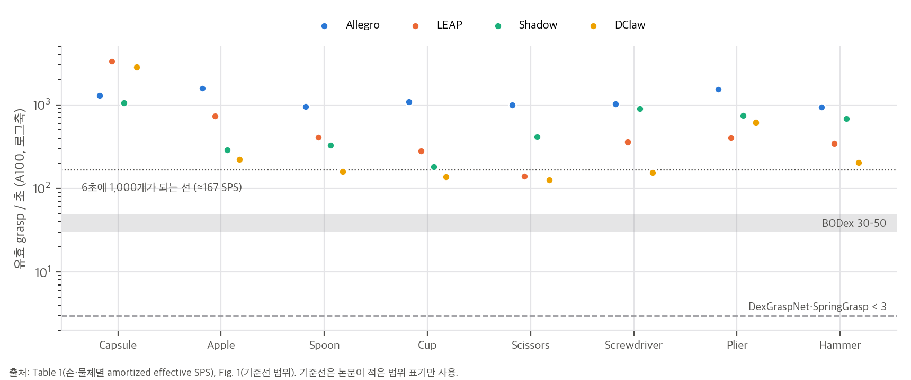

# 01. 논문 분석: Lightning Grasp (arXiv:2511.07418)

- 제목: *Lightning Grasp: High Performance Procedural Grasp Synthesis with Contact Fields*
- 저자: Zhao-Heng Yin, Pieter Abbeel (UC Berkeley EECS)
- 공개: arXiv v1 2025-11-10(판본은 v1뿐) · 코드 https://github.com/zhaohengyin/lightning-grasp (확인 커밋 `af43818`, 2026-06-12)
- 라이선스: 논문은 arXiv 비독점 배포(nonexclusive-distrib 1.0)라 **CC BY가 아닙니다.** 코드는 **CC BY-NC 4.0**이고, README는 "소프트웨어와 그것이 만든 데이터"를 학술·연구용으로 한정합니다(`04` D12).
- 분석 범위: 본문 13쪽, 결과 그림 3쪽, 참고문헌(총 18쪽). 공개 코드의 Python 부분 전체(약 5천 줄)와 저장소 이슈 16건을 읽었습니다. CUDA 커널은 소스가 없어 읽지 못했습니다.

---

## 1. Abstract (한 줄 요약과 주장)

**한 줄 요약:** 손이 만들 수 있는 모든 접촉(위치 + 법선)을 손마다 한 번 표본으로 뽑아 BVH로 저장해 둡니다(**contact field**). 그러면 물체 표면과 교차 검사만으로 손가락별 접촉 가능 영역이 나옵니다. 그 안에서 안정한 접점을 무작위 국소 탐색으로 고르고, IK로 손가락을 그 접점에 맞춥니다. 이렇게 해서 dexterous grasp를 A100 한 장으로 초당 수백~수천 개 만듭니다.

논문이 내세우는 주장은 다음과 같습니다(Abstract, Sec. 1).

1. 기존 해석적(procedural) 방법보다 **수 자릿수 빠릅니다.** A100에서 forward 한 번에 유효 grasp 1,000–10,000개를 2–5초에 만듭니다.
2. 도구처럼 불규칙한 물체에도 **비지도로** grasp를 만듭니다.
3. 손으로 조율한 에너지 함수 가중치나 민감한 초기화, 손 초기 자세 템플릿이 필요 없습니다.
4. 이 성능은 **기하 계산과 탐색을 분리**한 데서 나옵니다. contact field가 둘 사이의 경계면입니다.

---

## 2. Method

### 2.1 전체 구조 (Fig. 2, Fig. 5)

```
[손마다 한 번] 손 메쉬를 작은 접촉 패치로 나눔 → 관절 배치를 무작위로 뽑아 패치의 (위치, 법선)을 모음
              → 1 cm box로 덮고 LBVH로 정리 = contact field (Sec. 4, Alg. 1)
[물체마다]  물체 점군 2,048개 → 오목한 점 제거(Sec. 5.1)
  1. 물체 배치: 손바닥 위 canonical box 또는 contact field의 한 점에 물체 표면점을 맞춤 (Sec. 5.2)
  2. 접촉 영역: 물체 (p, −n)을 contact field BVH에 질의 → 손가락(의존 그룹)별 접촉 가능 영역 D_i (Sec. 5.3)
  3. 접점 최적화: 각 D_i에서 점 하나씩, 블록별 0차 무작위 국소 탐색으로 안정성 점수 J 최소화 (Sec. 5.4, Alg. 2)
  4. 운동학: 역조회로 손 쪽 접점을 찾고, 두 점 맞춤 DLS IK → 투영으로 미세 조정 (Sec. 5.5, Eq. 7–8)
  5. 후처리: 안 쓴 손가락 관절을 무작위로 채우고 충돌 검사로 거름 (Sec. 5.6)
```

### 2.2 grasp의 정의와 안정성 기준 (Sec. 3.2, Eq. 1–2)

grasp는 (손 좌표계의 물체 자세 P, 관절 q)입니다. 유효 조건은 두 가지입니다.
- **침투 없음:** 손과 물체가 경계에서만 만납니다. 실제로는 약 2 mm 침투를 허용합니다.
- **안정성:** 접점 부분집합에서 다음 최적값이 ε보다 작아야 합니다. 이를 "frictionless self-balancing wrench"라고 부릅니다.

```
FSWO:  min_α  ‖Σ αᵢ nᵢ‖² + λ ‖Σ αᵢ (pᵢ × nᵢ)‖²     s.t. ∃ j: αⱼ = 1,  αᵢ ≥ 0          (Eq. 1)
```

마찰이 있는 GSWO(Eq. 2)는 접선 성분 β를 마찰 원뿔 안에서 더한 형태입니다. 저자는 둘 다 j를 고정하면 볼록 문제 n개로 나뉘고, 투영 경사하강으로 풀 수 있다고 씁니다. 공개 코드는 **FSWO만** 구현합니다(`04` D2).

### 2.3 Contact field (Sec. 4)

- **정의 (Def. 4.1–4.3, Eq. 3–5):** 손 표면 점 p와 법선 n을 모든 관절 배치 q로 옮긴 집합이 CF(i, p, n) ⊂ ℝ³ × S²입니다. 손 전체의 합집합이 CF(H)이고, 물체의 접촉 표면 표현은 S(O) = {(p, −n)}입니다. **접촉 영역(contact domain)은 CF(H) ∩ S(O)**입니다.
- **근사 (Sec. 4.3, Alg. 1):** q를 무작위로 뽑아 접촉 벡터를 모으고, 위치 성분으로 box를 덮어 LBVH를 만듭니다. leaf마다 법선 벡터 몇 개를 둡니다. 질의할 때는 물체 점의 위치로 트리를 내려가고, leaf에서 −n과 정렬된 법선이 있는지 내적으로 검사합니다.
- **세분화 (Sec. 4.4):** 손 표면을 패치 m개로 나눠 패치마다 BVH를 따로 둡니다. 그래야 "어느 손가락의 어느 점"이 그 접촉을 만드는지 역조회할 수 있습니다.
- **메모리:** 1 cm box 3,000개 × 벡터 256개 × 16 B ≈ 12 MB이고, contact field 100개면 1.2 GB라고 추정합니다. 이 산술은 맞습니다(`04` C5). 단, "대부분의 box는 50개 이하"라는 전제는 코드 설정에서 성립하지 않을 수 있습니다(`03` §2).

### 2.4 탐색 파이프라인 (Sec. 5)

| 단계 | 논문 서술 | 공개 코드의 실제 값 |
|---|---|---|
| 물체 전처리 | 작은 box를 놓았을 때 크게 침투하는 오목점 제거 (Sec. 5.1) | 점군 2,048개. 점마다 반지름 1 cm, 높이 2 mm 원기둥 안에 다른 점이 5개 넘게 있으면 제거 |
| 물체 배치 | exhaustive(contact field의 한 점에 맞춤) 또는 canonical(손바닥 위 box) (Sec. 5.2) | 기본값 canonical. 배치의 50%는 손바닥(static link)에 붙여 시작 |
| 접촉 영역 | 의존 그룹(정적 링크를 뺀 운동학 트리의 연결 성분)별로 합치고 k개를 무작위 선택 (Sec. 5.3) | k = 3. 영역마다 물체 점 500개를 다시 뽑고, 점이 5개 이하인 영역은 버림 |
| 접점 최적화 | 블록별 0차 무작위 국소 탐색, 이전 힘 해를 warm start로 재사용("free lunch") (Sec. 5.4, Alg. 2) | 바깥 5회 × 접점 3개 × 변이 6개. 변이 폭 σ = 5 × 점 간격. 점수 = FSWO 잔차 노름, 통과 기준 < 0.15 |
| 운동학 | 역조회로 손 접점을 찾고, p̃→p와 p̃+βñ→p+βn 두 점을 맞추는 DLS (Eq. 7–8). 2단계 투영 미세 조정 | β = 1 cm, λ = 1e-4. **무작위 재시작 10회**와 사슬별 최선 해 조합(논문에 없음). 미세 조정 15스텝, 최종 허용 4 mm |
| 후처리 | 안 쓴 관절을 무작위로 채우고, 손-손·손-물체 충돌이나 안정성 기준에 걸리면 버림 (Sec. 5.6) | 무작위 채우기 최대 5회. **충돌만** 검사하고 안정성은 다시 보지 않음(`04` D4) |

**Discussion (Sec. 5.7):** 저자는 이 알고리즘을 탐색 트리로 봅니다(물체 자세 → 손가락 → 접점 → 관절). 그 위에서 완전성 논증, 이전 결과 재사용(multi-pass), 데이터 기반 물체 자세 정책, 사람이 지정하는 기능적 grasp 같은 확장을 제안합니다. 완전성은 "충분히 가까운 초기값이면"이라는 조건이 붙은 정성 논증입니다.

---

## 3. Experiments

### 3.1 설정 (Sec. 6.1)
- **손:** Shadow(22 DoF), LEAP(16), Allegro(16), DClaw 집게(9).
- **물체:** YCB와 인터넷 3D 모델(CC 라이선스 자산 4개 명시).
- **하드웨어:** 주 측정은 A100이고, 프로파일링은 TITAN X, V100, A100, RTX 4090입니다.
- **지표:** **amortized effective samples per second(SPS)**, 즉 유효 grasp 수를 걸린 시간으로 나눈 값 하나입니다. grasp 품질(시뮬레이터에서 실제로 잡히는지, 침투 깊이, 다양성 지표)은 정량으로 보고하지 않았습니다. 결과는 "그림으로 보는 것이 가장 낫다"고 씁니다(Fig. 1, 12–14).

### 3.2 처리량 (Table 1)

| 손 | Capsule | Apple | Spoon | Cup | Scissors | Screwdriver | Plier | Hammer | trimmed µ (논문) | 우리 재계산 |
|---|---|---|---|---|---|---|---|---|---|---|
| Allegro | 1296.1 | 1578.8 | 955.6 | 1090.0 | 989.2 | 1020.6 | 1545.0 | 944.2 | 1090.8 | **1149.4** |
| LEAP | 3306.0 | 729.0 | 408.3 | 281.6 | 138.6 | 356.6 | 403.0 | 343.0 | 420.2 | 420.3 |
| Shadow | 1060.2 | 288.4 | 329.4 | 181.5 | 416.2 | 895.0 | 745.1 | 678.6 | 558.8 | 558.8 |
| DClaw | 2823.5 | 221.3 | 158.9 | 138.1 | 126.1 | 154.5 | 619.3 | 203.2 | 249.1 | 249.2 |

해석 (재계산은 `04_code_verification.md` §3과 `analysis/table_check.py`):
- **Allegro 행의 trimmed µ가 정의와 맞지 않습니다.** 최솟값(Hammer)과 최댓값(Apple)을 빼면 1149.4입니다. 1090.8은 Capsule과 Apple을 뺄 때만 나옵니다. 나머지 세 행은 정의대로 맞습니다.
- **"1,000–10,000개를 2–5초에"는 모든 경우에 성립하지 않습니다.** 표 캡션은 "모든 설정이 6초 안에 끝난다"고 씁니다. 그런데 SPS × 6초가 1,000에 못 미치는 칸이 32칸 중 5칸입니다(LEAP–Scissors 832개, DClaw의 Spoon 953, Cup 829, Scissors 757, Screwdriver 927). 다만 SPS가 여러 번 실행한 amortized 값이라면 forward 한 번의 개수와 직접 맞지 않을 수 있습니다.
- **손에 따라, 물체에 따라 차이가 큽니다.** 같은 손에서도 물체 사이 차이가 최대 24배입니다(LEAP: Capsule 3306 vs Scissors 138.6). 본문의 "Allegro가 일관되게 더 많다"는 trimmed µ 기준으로는 맞습니다. 물체별로는 Capsule에서 LEAP와 DClaw가 Allegro보다 높습니다.



### 3.3 기존 방법과의 비교 (Fig. 1)

| 방법 | Diverse Contact | 유효 SPS | forward 시간 (초) |
|---|---|---|---|
| DexGraspNet [19] | ✓ | < 3 | 1800–2000 |
| SpringGrasp [6] | ✗ (손끝) | < 3 | 10–40 |
| BODex [5] | ✗ (손끝) | 30–50 | 100–120 |
| **Lightning Grasp** | ✓ | **300–1000** | **2–5** |

- 기준선 수치는 범위로만 적혀 있습니다. 어떤 물체와 손으로, 어떤 설정으로 쟀는지는 본문에 없습니다.
- **BODex 대비는 "수 자릿수"가 아니라 한 자릿수입니다.** SPS 비율은 6–33배, forward 시간 비율은 20–60배입니다. DexGraspNet 대비로는 SPS 100배 이상, 시간 360–1000배입니다. SpringGrasp 대비로는 SPS 100배 이상이지만 forward 시간은 2–20배입니다.
- Sec. 6.3은 "TITAN X도 A100 위 기존 방법보다 20–100배 빠르다"고 하고, Fig. 10 캡션은 "수백 배 빠르다"고 씁니다. TITAN X의 626 SPS는 BODex(30–50) 대비 12.5–21배이고, DexGraspNet(< 3) 대비 200배 이상입니다. 두 문장은 기준선을 어느 것으로 잡느냐에 따라 맞거나 틀립니다.

### 3.4 단계별 시간 (Fig. 10)
Allegro + YCB Apple 기준입니다. GPU 네 종 모두 단계별 비율의 합이 99.7–100.0%로 반올림 안에서 맞습니다. "접촉 최적화와 운동학 최적화가 각각 약 33%"는 접촉 최적화 27–43%, 운동학 I+II 34–38%로 대체로 맞습니다. A100 SPS 1578.0은 Table 1의 Allegro–Apple 1578.8과 거의 같습니다. RTX 4090은 TITAN X의 3.5배입니다.

### 3.5 어려운 경우 (Sec. 6.2, Fig. 11)
컵처럼 오목한 물체에서 SPS가 크게 떨어집니다. 운동학 최적화는 접점 주변의 국소 충돌은 풀지만, 손가락 다른 부분이 물체를 관통하는 전역 침투는 못 풉니다. 저자는 contact field box에 손가락 모양 정보를 넣어 질의 단계부터 충돌을 고려하자는 방향을 제안합니다.

---

## 4. Limitations

### 4.1 저자가 밝힌 한계
오목한 물체의 전역 침투, 손가락 하나에 접점 여러 개를 두는 일반형이 공개판에 없다는 점(Sec. 5.6), 데이터 기반 탐색 미구현(Sec. 5.7)을 듭니다. 저장소 README는 여기에 세 가지를 더합니다. 아주 큰 물체는 아직 쓰지 말 것, mimic joint가 있는 손은 10–200 SPS로 느리다는 것, torch 2.11에서 GPU 메모리가 해제되지 않는다는 것입니다.

### 4.2 분석하면서 추가로 발견한 한계와 의문점
1. **물리 검증이 없습니다.** "유효"는 충돌이 없고 **계획한 접점**의 FSWO가 0.15 미만이라는 뜻입니다. 시뮬레이터에서 잡히는지(흔들기, 중력)는 재지 않았습니다. 저장소 이슈 #6은 IsaacGym에서 침투와 불안정(물체가 튕겨 나감)을 보고합니다. 이슈 #14는 중력이 빠져 있다고 지적합니다.
2. **안정성 기준이 마찰 없는 형태이고, 물체 크기에 따라 달라집니다**(`03` §1). 코드의 토크 가중은 10 m⁻¹(λ = 100 m⁻²)로 고정입니다. 같은 모양의 접점 배치를 4 cm에서 30 cm로 키우면 통과 비율이 100%에서 8%로 떨어집니다(toy). README의 "큰 물체는 아직"과 이슈 #15의 크기 한계와도 이어지는 성질입니다.
3. **손바닥에서 시작한 배치의 점수 계산에 좌표계 혼용이 있습니다**(`04` D3). 손가락 접점은 물체 좌표계 값이고, 손바닥 접점은 손 좌표계 값인데, 둘을 그대로 이어 붙입니다. 최종 통과 판정은 손바닥 접점을 빼고 다시 계산하므로 잘못된 grasp가 통과하지는 않습니다. 다만 배치의 절반이 엉뚱한 목적함수로 최적화됩니다. 코드 읽기로 확인했고, 실행으로 검증하지는 않았습니다.
4. **실현된 접점은 다시 채점하지 않습니다**(`04` D4). IK가 허용 오차 4 mm 안으로 맞추고 빈 손가락을 무작위로 채운 뒤에는 충돌만 봅니다.
5. **"Diverse Contact ✓"의 범위가 좁습니다**(`04` D9). 공개 설정에서 Allegro, LEAP, DClaw는 손끝 링크와 손바닥만 접촉에 씁니다. Shadow는 중간 마디도 넣었지만 법선 대부분을 막아 둡니다(이슈 #12, 답변 없음). 손 전체 표면을 쓰는 DexGraspNet과는 다른 의미의 다양성입니다.
6. **"조율이 필요 없다"는 에너지 가중치에 한정된 말입니다.** 공개 코드에는 손마다 정한 canonical box, 허용·금지 법선, 충돌 예외 목록이 있고, 통과 기준 0.15, 토크 가중 10, 변이 폭 5×간격 같은 상수도 손으로 정한 값입니다(`04` D8).
7. **핵심 커널이 비공개입니다.** BVH 구성·질의, GJK, 투영, 점-메쉬 충돌은 미리 컴파일된 `.so`로만 배포됩니다(`04` D1). 논문의 핵심인 Alg. 1과 질의 단계를 코드로 확인할 수 없습니다.
8. **Table 1을 저장소로 다시 잴 수 없습니다.** 저장소에 시간 측정이나 벤치마크 스크립트가 없습니다(`04` D10).
