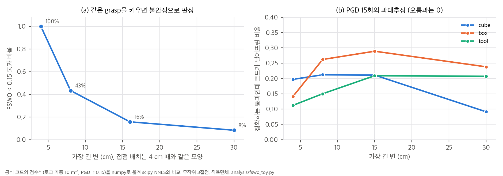
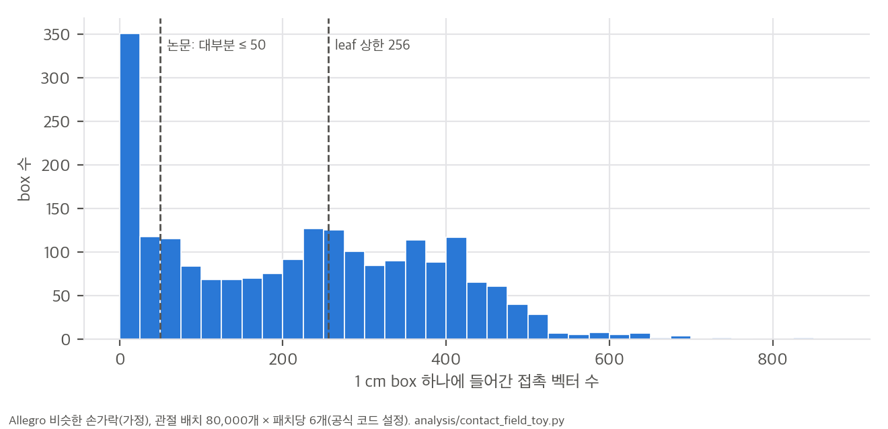

# 03. 핵심 식 해석과 toy 검증

재계산 스크립트는 세 개이고, 모두 numpy·scipy 단일 스레드로 CPU에서 30초 안에 끝납니다.
- `analysis/table_check.py`: Table 1, Fig. 1, Fig. 10, 본문 수치 → `table_check_results.json`
- `analysis/fswo_toy.py`: 공식 코드의 안정성 점수식을 numpy로 옮겨 scipy의 정확한 NNLS와 비교 → `fswo_toy_results.json`
- `analysis/contact_field_toy.py`: 코드 설정의 contact field 표본 밀도 → `contact_field_toy_results.json`

## 1. 안정성 점수 FSWO는 실제로 무엇을 재는가

### 1.1 코드의 식
`lygra/batch_grasp_optimizer.py`의 `compute_wrench_score_vectorized`는 접점 k개 중 하나(pivot j)의 힘을 1로 고정합니다. 그리고 나머지 접점의 힘 αᵢ ≥ 0으로 그 힘과 토크를 상쇄하는 NNLS를 풉니다.

```
A_j = [ nᵢ ;  α_w · (pᵢ − pⱼ) × nᵢ ]  (i ≠ j, 6 × (k−1)),   b_j = [ −nⱼ ; 0 ]
score = min_j ‖A_j x* − b_j‖,   x* = argmin_{x ≥ 0} ‖A_j x − b_j‖²,   α_w = 10 (단위 m⁻¹)
```

논문 Eq. 1과 비교하면 차이가 세 가지 있습니다.
1. 토크 기준점이 원점이 아니라 pivot 접점입니다. 힘이 정확히 균형일 때만 기준점과 무관하므로, 잔차가 0이 아닌 경우에는 값이 조금 달라집니다.
2. λ = α_w² = 100 m⁻²이고, 점수는 제곱이 아닌 노름입니다. 통과 기준은 0.15입니다.
3. 마찰 항(GSWO, Eq. 2)과 중력이 없습니다.

### 1.2 물체 크기 의존성 (F2b)
위치를 s배 키우면 힘 행은 그대로이고 토크 행만 s배가 됩니다. 토크가 완전히 상쇄되지 않는 배치라면 점수가 s에 비례해 커집니다. 그래서 **같은 모양의 grasp도 물체가 크면 불안정으로 판정**됩니다. 4 cm 직육면체에서 통과한 무작위 3접점 배치 300개를 그대로 키워 다시 채점했습니다.

| 가장 긴 변 | 4 cm | 8 cm | 16 cm | 30 cm |
|---|---|---|---|---|
| FSWO < 0.15 통과 비율 | 100% | 43% | 16% | 8% |
| 점수 중앙값 | 0.085 | 0.168 | 0.316 | 0.506 |

물리적으로 같은 grasp라면 크기와 무관하게 판정이 같아야 합니다. 토크 행을 물체 크기(예: 외접 반지름 R)로 나누는 α_w = 1/R 형태라면 이 의존성이 사라집니다. README가 "아주 큰 물체는 아직 쓰지 말라"고 하고, 이슈 #15가 점 간격으로 크기 한계를 설명합니다. 이 toy는 그와 별개로 점수식 자체도 크기에 불리하다는 것을 보여 줍니다.



### 1.3 투영 경사하강 15회의 정확도 (F1)
코드는 NNLS를 고정 학습률 0.15의 투영 경사하강(PGD)으로 15회(warm start면 4회) 돌립니다. 직육면체 세 형상(정육면체, 1:0.6:0.4 상자, 1:0.15:0.15 막대)과 크기 네 가지에서 무작위 3접점 1,500개씩을 비교했습니다.
- **PGD 점수는 정확한 값보다 항상 크거나 같습니다.** PGD가 낸 x도 실현 가능한 해이므로 잔차가 최적값보다 작을 수 없습니다. 정확히 통과하는 배치에서 과대추정 중앙값은 0.027–0.035입니다.
- 그 결과 **정확히는 통과인 배치의 9–29%를 떨어뜨리고, 잘못 통과시키는 경우는 0입니다.** 보수적인 방향이라 안전하지만, 수율(SPS)을 깎습니다.
- 수렴 조건 lr < 2/L(L = λ_max(AᵀA))이 30 cm 정육면체에서는 24%의 배치에서 깨집니다. 상한은 L ≤ (k−1)(1 + α_w² D²)입니다. D = 0.3 m면 lr·L ≤ 3이라서, 큰 물체에서는 고정 학습률이 맞지 않을 수 있습니다.

### 1.4 warm start의 "free lunch" (F3, Sec. 5.4)
안정한 배치(정확한 점수 < 0.05)에서 접점 하나를 σ = 15.7 mm(사과 크기 물체의 코드 기본 변이 폭)만큼 움직였습니다. 그 뒤 직전 힘 해에서 4회만 돌린 결과를 비교했습니다.

| | warm start 4회 | cold start 15회 |
|---|---|---|
| 과대추정 중앙값 (8 cm 상자) | 0.015 | 0.031 |
| 과대추정 중앙값 (15 cm 상자) | 0.017 | 0.031 |

warm start 4회가 cold start 15회보다 정확합니다. 논문의 "free lunch" 주장은 toy에서 그대로 재현됩니다.

### 1.5 손바닥 접점의 좌표계 혼용 (F4, `04` D3)
코드는 손바닥(static link)에 물체를 붙여 시작한 배치에서, 손가락 접점(물체 좌표계)과 손바닥 접점(손 좌표계)을 그대로 이어 붙여 점수를 냅니다. 무작위 물체 자세 600개로 올바른 점수와 혼용 점수를 비교했습니다.
- Spearman 상관이 **0.25**입니다. 후보끼리의 순위가 거의 뒤섞입니다.
- 0.15 기준 통과 판정은 **13%**에서 서로 다릅니다.

최종 판정은 손바닥을 빼고 다시 계산하므로 잘못된 grasp가 통과하지는 않습니다. 그 대신 손바닥 배치(전체의 50%)의 접점 최적화가 엉뚱한 방향으로 갑니다. 그리고 손바닥에 기대는 power grasp는 손끝만으로도 균형이 맞아야 통과합니다.

## 2. Contact field의 표본 밀도 (Sec. 4.4)

공식 코드는 패치마다 keyvector 6개, 관절 배치 80,000개를 씁니다. 그래서 패치 하나에 접촉 벡터가 48만 개 생기고, 이를 1 cm box로 덮고 leaf당 최대 256개로 자릅니다. Allegro와 비슷한 치수의 손가락(가정)으로 손끝 패치 세 개를 계산했습니다.

| 손끝 패치 | 차지한 box(≈ cm³) | box당 중앙값 | 50개 초과 box | 256개 초과 box | 256 상한으로 버려지는 벡터 |
|---|---|---|---|---|---|
| 손바닥 쪽 | 2,139 | 230 | 78% | 44% | 25% |
| 옆면 | 1,969 | 265 | 81% | 53% | 25% |
| 끝 | 2,208 | 231 | 82% | 42% | 17% |



- 논문의 "대부분의 box는 벡터 50개 이하"는 **이 설정에서 성립하지 않습니다.** 대부분이 50개를 넘고, 절반 가까이가 상한 256에 걸립니다.
- 그래도 메모리 상한은 지켜집니다. leaf 상한 때문에 box 약 2,100개 × 256 × 16 B ≈ 9 MB로, 논문의 12 MB 추정 안입니다.
- 상한에 걸린 box에서 무작위로 256개만 남겨도, 0.2 rad 안에 남은 법선이 있는 비율은 100%였습니다. 법선 방향 덮임은 잃지 않습니다. 단, 커널이 실제로 어떤 벡터를 남기는지는 소스가 없어 확인할 수 없습니다.
- box당 평균 50개면 되는 표본은 약 17,800개입니다. 80,000개는 4.5배 많은 셈입니다. 이 구성은 Python 루프(관절 배치 8만 회)로 실행 때마다 다시 돌고, 캐시 저장·불러오기는 고장 나 있습니다(`04` D6). 이 시간은 "forward 2–5초"에 들어가지 않습니다.
- 256개로 S²를 나눌 때 원뿔 반각은 arccos(1 − 2/256) = 7.17°로, 논문의 "약 7°"가 맞습니다.

## 3. 처리량 산술 (C1–C7)

- **trimmed µ:** Allegro 행만 정의와 다릅니다(1149.4 vs 1090.8, Capsule과 Apple을 뺀 값). 01 §3.2 참조.
- **forward 한 번의 개수:** SPS × 6초 < 1,000인 칸이 5개입니다(최저 DClaw–Scissors 757개).
- **배수:** BODex 대비 SPS 6–33배, 시간 20–60배입니다. DexGraspNet 대비 SPS 100배 이상, 시간 360–1000배입니다. SpringGrasp 대비 SPS 100배 이상, 시간 2–20배입니다. TITAN X는 BODex 대비 12.5–21배입니다.
- **코드 기본값의 계산 예산:** forward 한 번에 접점 후보 128 × 128 = 16,384개를 만들고, 후보마다 점수를 105번(바깥 5 × 접점 3 × (변이 6 + 1)) 계산합니다. IK는 무작위 재시작 10회라서 16만 번 풉니다. 유효 grasp가 1,000–3,000개라면 후보의 6–18%만 끝까지 남습니다.
- **변이 폭:** σ = 5 × √(표면적/2048)입니다. 반지름 4 cm 사과라면 점 간격 3.1 mm, σ 15.7 mm입니다. 18 cm 정육면체면 점 간격이 9.7 mm로, 이슈 #15의 "1 cm 해상도 한계"와 같은 계산입니다.
