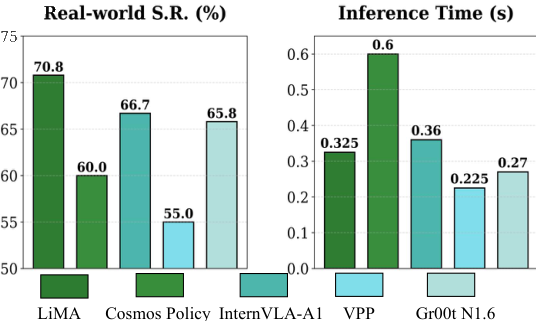
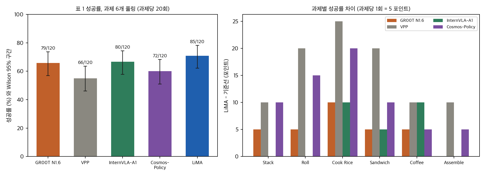
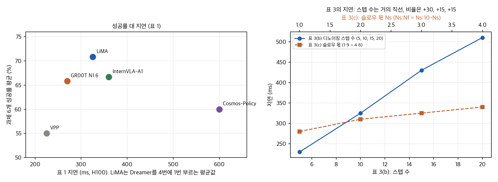
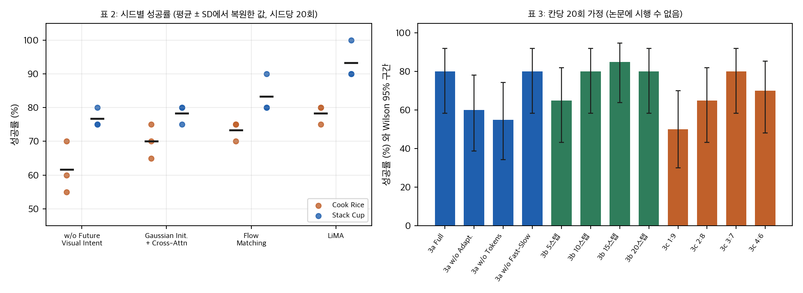
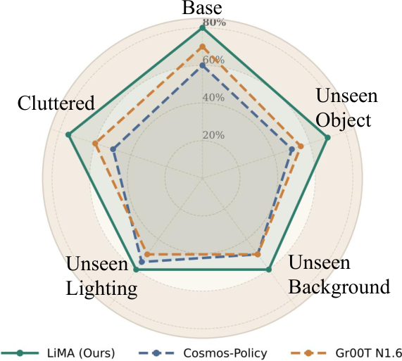
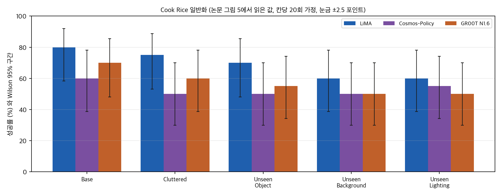

> **논문:** Ning Chen, Yankai Fu, Junkai Zhao, Qianpu Sun, Guocai Yao, Pengwei Wang, Zhongyuan Wang, Shanghang Zhang. *LiMA: Bridging Long-term Imagination to Real-time Dexterous Manipulation via Asynchronous Diffusion.* arXiv:2609.28431 (v1, 2026-09-23). CoRL 2026 포스터.
> 공식 코드는 아직 공개되지 않았습니다(프로젝트 페이지에 "Code Coming soon"). 논문 그림 두 장(차트)은 출처를 적어 실었고, 나머지는 우리가 그린 그래프입니다.

## 논문이 묻는 것

월드 액션 모델(WAM)은 미래 영상을 상상해 행동에 반영하지만 반복 생성 때문에 느립니다. LiMA는 느린 **Future Dreamer**(Cosmos-Predict2 2B)가 드물게 장기 의도를 만들고, 빠른 **Motion Refiner**(1B)가 매 갱신마다 그 의도에서 출발해 행동을 다듬도록 나눕니다. 두 시스템은 Schrödinger bridge(I²SB 사후분포)로 이어지고, 의도 갱신은 Refiner 네 번에 한 번(ΔT = 4)입니다. 양팔 UR5와 22-DoF 손 두 대로 여섯 과제(과제당 20회)를 평가합니다.

*그림 1의 일부 (논문 원문). © 저자, CC BY 4.0, 출처 arXiv:2609.28431 (v1).*

## 이 글에서 확인한 것

**1. 표 산술은 맞습니다.** 부록 표 5의 단계 성공률 평균이 표 1의 PSR 30칸과 모두 일치하고, 표 1의 SR은 모두 마지막 단계 값입니다. 초록의 70.8%, 78.9%, 지연 감소 45.8%((600 − 325)/600)도 재현됩니다.

**2. 성공률의 순서는 일관되지만, 강한 VLA 기준선과의 차이는 이 시행 수로는 구분되지 않습니다.** LiMA는 여섯 과제 어디서도 기준선보다 낮지 않고, VPP와 Cosmos-Policy에 대해서는 과제 단위로 6승 0패입니다(부호 검정 p = 0.031). 과제 여섯 개를 풀링(과제당 20회, 시행 독립 가정)하면 GR00T N1.6과의 차이는 +5.0 포인트(구간 [−6.7, +16.5], p = 0.49), InternVLA-A1과는 +4.2 포인트(p = 0.58)입니다. 기준 성공률 60%에서 과제당 20회가 검출할 수 있는 차이는 약 34 포인트입니다.

*그림: 과제당 20회와 시행 독립을 가정한 구간입니다. 우리가 그린 그래프입니다.*

**3. "장기 과제에서 PSR이 더 높다"는 서술은 작은 차이에 기댑니다.** Cook Rice와 Make Sandwich의 PSR은 가장 높은 기준선(InternVLA-A1) 대비 +4.0, +2.5 포인트이고, Make Coffee(−1.7)와 Roll T-shirt(−5.0)에서는 기준선이 더 높습니다.

**4. 지연 325 ms는 사이클 평균이고, 표 3과 함께 읽으면 정의가 더 필요합니다.** 논문은 T_avg = (T_Dreamer + 4 T_Refiner)/4로 정의합니다. 표의 다른 방법 값은 한 번의 순전파 시간으로 읽힙니다. 표 3(a)의 "w/o Fast-Slow" 0.45 s를 Dreamer와 Refiner를 매번 함께 도는 동기식으로 읽으면 T_Refiner ≈ 283 ms, T_Dreamer ≈ 167 ms가 됩니다. 표 3(c)의 지연이 슬로우 몫 한 스텝당 +30, +15, +15 ms 늘어나는 것을 "디노이징 스텝 배분"으로 읽으면 패스트 스텝 비용이 음수(약 −5.6 ms)가 되어 두 읽기를 함께 택할 수 없습니다(가정 의존적인 계산입니다). 비율 열이 어떤 양의 배분인지, 표 3이 어떤 설정에서 쟀는지는 저자 확인이 필요합니다.

*그림: 왼쪽은 표 1, 오른쪽은 표 3(b)(c)의 값입니다. 우리가 그린 그래프입니다.*

**5. 브리지의 이점은 표 2에서 방향으로만 확인됩니다.** 3시드 × 20회(60회)로 보면 LiMA가 여섯 칸(두 과제 × 세 변형) 모두에서 가장 높습니다. 흐름 정합 대비 차이는 Cook Rice +5.0(p = 0.67), Stack Cup +10.0(p = 0.15)이고, 가우시안 시작 + 교차 주의 대비는 Stack Cup에서만 p = 0.034입니다. 표 3은 시행 수가 적혀 있지 않아 칸당 20회로 가정하면 어떤 한 쌍도 p < 0.05가 아닙니다(시행 수 20 가정).

*그림: 표 2는 평균 ± SD에서 시드 세 개를 복원한 값입니다(5 포인트 격자에서 유일하게 복원됨). 표 3은 칸당 20회 가정입니다. 우리가 그린 그래프입니다.*

**6. 식 5의 시작 분산은 정의가 더 필요합니다.** 부록 A.1은 σ_t² = ∫₀ᵗβ로 정의하므로 σ_1²는 누적 분산 전체이고(대칭 스케줄에서 중간 분산 최대값의 4배), 식 3의 학습용 사후분포는 t → 1에서 분산이 0입니다. 식 5는 N(Z_int, σ_1² I)에서 추론을 시작하는데 σ_1 값은 적혀 있지 않습니다. 원 I²SB의 샘플링은 열화 입력에서 잡음 없이 시작합니다. 의도된 설계일 수 있으므로 값의 정의를 저자에게 확인해야 합니다. 닫힌형 디노이저를 쓴 작은 수치 토이에서는 "같은 조건 정보를 받는" 두 시작점이 1스텝 해가 같았습니다. 브리지의 이점이 있다면 샘플링 기하가 아니라 학습의 용이성에서 와야 하고, 이는 학습 없는 토이로는 시험할 수 없습니다.

**7. 일반화는 방향만 확인됩니다.** 그림 5(Cook Rice)에서 읽은 값(그림 판독, 눈금 ±2.5 포인트, 칸당 20회 가정)으로 LiMA는 네 교란 모두에서 높습니다(+5 ~ +25 포인트). 네 설정을 풀링하면 Cosmos-Policy 대비 +15 포인트(p = 0.077), GR00T N1.6 대비 +12.5 포인트(p = 0.15)입니다. Base 대비 평균 유지율은 LiMA 83%, Cosmos-Policy 85%, GR00T N1.6 77%입니다.

*그림 5 (논문 원문). © 저자, CC BY 4.0, 출처 arXiv:2609.28431 (v1).*

*그림: 그림 5의 마커를 픽셀로 읽은 값(그림 판독)입니다. 우리가 그린 그래프입니다.*

## 정리

- 표 값의 산술은 맞고 성공률 순서는 일관됩니다.
- 강한 VLA 기준선과의 차이, 브리지의 인과 효과, 표 3의 설계 선택은 시행 수가 적어 방향만 보입니다.
- 지연의 정의(사이클 평균 대 순전파), 표 3(c)와의 양립, 식 5의 σ_1, 학습 때 Z_int의 출처는 저자 확인이 필요합니다.
- 구현 측면에서 공식 코드·가중치·시연 데이터가 아직 없고, 실험은 양팔 UR5와 22-DoF 손 두 대를 전제합니다. 구조의 소형 재구현은 가능하지만 논문 수치의 재현은 어렵습니다.

재계산 스크립트와 결과, 전체 분석은 함께 올린 저장소 자료에 있습니다.

## 자료

- [통합 리포트 PDF](report/report_public.pdf)
- [01. 논문 분석: LiMA](analysis/01_paper_analysis.md)
- [02. 선행연구와 관련 저장소](analysis/02_prior_work.md)
- [03. 수치 재계산, 일관성 검사, 토이](analysis/03_analysis.md)
- [04. 주장 대조와 구현 가능성](analysis/04_claim_verification.md)
