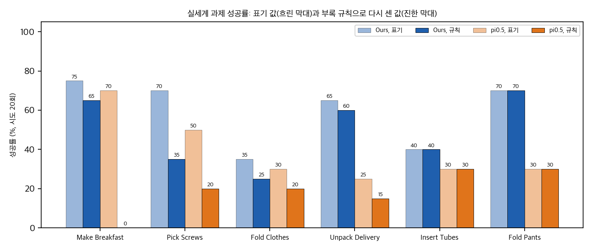
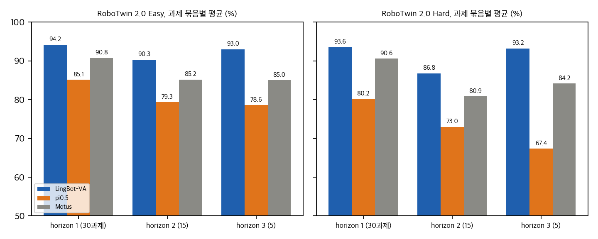
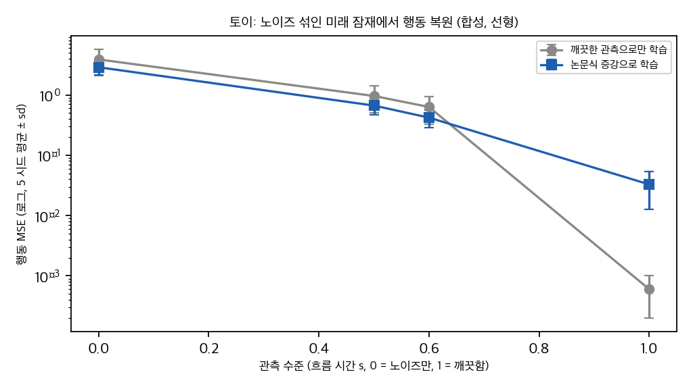

> **논문:** Lin Li, Qihang Zhang 외. *Causal World Modeling for Robot Control.* arXiv:2601.21998 (v2, 2026-03-22). 학회는 프로젝트 페이지와 GitHub 저장소 표기를 따랐고 공식 목록은 확인하지 못했습니다.
> 공식 코드는 GitHub robbyant/lingbot-va (Apache-2.0)에 있습니다. 이 글의 그래프는 우리가 표 수치로 다시 그렸습니다. 논문 그림은 쓰지 않았습니다.

## 질문

로봇 정책은 보통 현재 관측에서 행동을 바로 냅니다. 세계 모델을 붙인 정책은 미래 영상을 먼저 만들고 행동을 고르는 방식이 많습니다. 그런데 영상 생성은 매 추론마다 여러 번 denoise해야 해서 느리고, 양방향 어텐션을 쓰면 미래 토큰이 과거 예측에 영향을 줍니다. LingBot-VA는 이 두 문제를 인과 자기회귀로 풀려고 합니다.

## 설계

- **한 시퀀스에 영상과 행동:** 영상 토큰(Wan2.2-5B 초기화)과 행동 토큰을 같은 인과 시퀀스에 넣습니다. chunk 안은 양방향, chunk 사이는 인과입니다.
- **폐루프:** 실행 뒤 실제 관측으로 영상 KV 캐시를 갈아 끼웁니다.
- **잡음 증강:** 학습 때 과거 영상 잠재를 확률 0.5로 부분적으로 섞어, 추론에서 영상 denoising을 덜 하고도 행동을 복원하게 합니다.
- **비동기 추론:** 실행과 다음 청크 계산을 겹치는 방식을 제안합니다.

## 결과와 확인

RoboTwin 2.0 50과제 평균은 Easy 92.9, Hard 91.6입니다. 표 S1의 과제 값에서 다시 계산해도 0.2 이내로 맞습니다. 과제 단위로 보면 π0.5보다 이긴 과제가 40개, Motus보다 31개입니다.

LIBERO 98.5는 3시드 × 500회 프로토콜에서 정수 성공 수로 설명됩니다. 다만 Object 99.6은 CronusVLA와 같아서 "새 최고"는 공동 1위입니다.

실세계 6과제는 확인할 부분이 있습니다. 부록은 "모든 단계를 끝내고 총점이 최대일 때만 성공"이라고 정의하는데, 표의 성공 열이 이 규칙과 맞지 않습니다. 여섯 과제 중 네 과제에서 성공 수가 다릅니다. Pick Screws의 LingBot-VA 성공률은 표기 70%이고 규칙으로 세면 35%입니다. Fold Clothes의 진행 점수는 π0.5 62.9보다 낮은 48.8이라서 "모든 과제와 두 지표에서 SOTA"는 성립하지 않습니다.

*실세계 6과제 성공률. 흐린 막대는 표에 적힌 값, 진한 막대는 부록 규칙으로 다시 센 값입니다.*

RoboTwin의 horizon 묶음별 평균은 표 1과 맞습니다. 긴 horizon일수록 격차가 커지는 경향이 있습니다.

*RoboTwin 2.0 horizon 묶음별 평균(Easy, Hard). 표 S1 과제 값에서 계산했습니다.*

## 공개 코드와 논문의 차이

공식 저장소를 정적으로 읽었습니다. 실행하지 않았습니다.

- **아키텍처:** 논문은 폭이 다른 두 스트림(행동 폭 768, 별도 QKV)을 설명합니다. 공개 모델은 행동 토큰도 같은 블록을 공유합니다. README도 공개 버전을 "shared backbone"이라고 적고, 분리 버전은 준비 중이라고 합니다.
- **추론 속도:** 논문은 영상 3단계(s=0.6)와 행동 10단계를 말합니다. 공개 설정은 영상 25단계와 행동 50단계를 씁니다. 부분 적분은 설정을 바꿔야 가능합니다.
- **비동기 파이프라인:** 논문의 FDM 손실과 비동기 알고리즘은 공개 코드에 없습니다. 공개 평가 클라이언트는 행동 청크를 다 실행한 뒤 다음 청크를 계산하는 동기식입니다.
- **행동 표현:** 논문은 절대 자세라고 적었지만, RoboTwin 학습은 세그먼트 첫 프레임 기준 상대 자세입니다.

따라서 논문의 "2배 빠름" 주장은 이 저장소로는 확인할 수 없습니다.

## 토이로 본 잡음 증강

잡음 증강의 직관을 확인하려고 선형 토이를 만들었습니다(합성 데이터, 5시드). 부분 노이즈에서는 증강 학습이 행동 오차를 약 30% 줄였습니다. 하지만 깨끗한 입력에서는 오차가 약 55배 커졌습니다. 정밀도와 강건성 사이에 교환이 있다는 뜻입니다. 토이는 방향만 보여 줍니다. 논문의 실제 설정과 직접 비교한 결과는 아닙니다.

*합성 선형 토이에서 관측 수준(흐름 시간 s)에 따른 행동 MSE. 5시드 평균과 표준편차.*

## 구현 가능성

- 이 맥(M4 Pro, 24 GiB, CUDA 없음)에서 학습과 시뮬레이터 평가는 불가능합니다.
- 공식 체크포인트 추론은 MPS 포팅과 큰 가중치 다운로드가 필요해서 조건부입니다.
- 블록 인과 마스크와 잡음 증강은 CPU에서 작은 모델로 확인할 수 있습니다.

## 출처와 라이선스

- 논문 arXiv:2601.21998은 CC BY 4.0입니다 (arXiv abs 페이지 확인).
- 공식 코드는 Apache-2.0이고, 체크포인트와 데이터 라이선스는 확인하지 못했습니다.
- 이 글의 그래프, 토이, 분석 문서와 스크립트는 저희가 만들었습니다. 논문 그림은 쓰지 않았습니다.

## 자료

- [통합 리포트 PDF](report/report_public.pdf)
- [LingBot-VA 논문 분석 (arXiv:2601.21998)](analysis/01_paper_analysis.md)
- [LingBot-VA 선행연구와 관련 자료 (02)](analysis/02_prior_work.md)
- [LingBot-VA 수치 재계산과 일관성 검사 (03)](analysis/03_analysis.md)
- [LingBot-VA 논문 ↔ 공식 코드 대조 (04)](analysis/04_code_verification.md)
