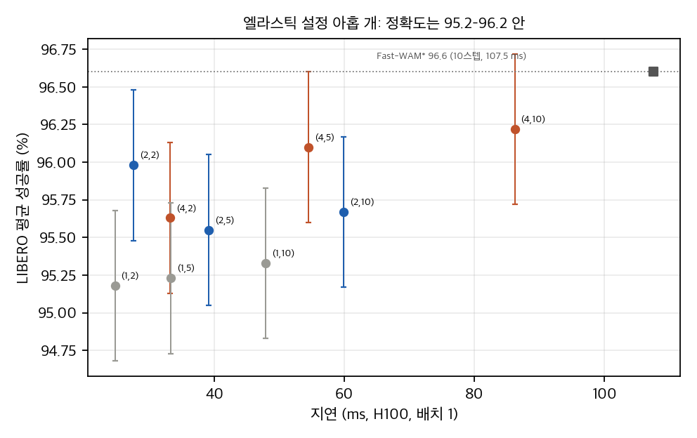
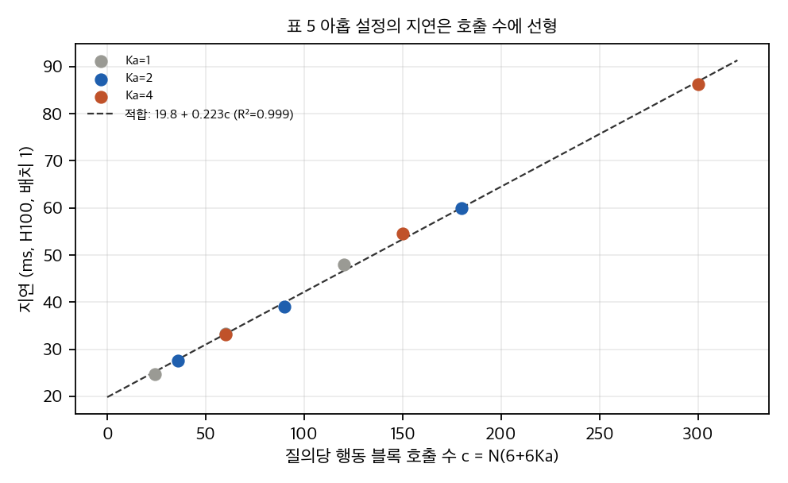

> **논문:** Anh Dao, Xinxin Liu, Hang Yu, Jeffrey A Chan Santiago, Yuzhang Shang. *LoopedWAM: Looped World Action Models for Elastic Inference.* arXiv:2611.25595 (v1, 2026-11-19). 학회 표기는 확인되지 않았습니다.
> 공식 코드(MIT)는 정적으로만 읽었고 실행하지 않았습니다. 논문 그림은 싣지 않고, 우리가 만든 그래프만 씁니다.

## 무엇을 했나

세계 행동 모델(WAM)은 영상 생성 모델의 힘을 빌려 로봇 행동을 예측합니다. 보통 2B에서 14B 규모라서 제어 루프에 넣기 무겁습니다. LoopedWAM은 같은 질문을 다른 쪽에서 풉니다. 블록을 더 많이 쌓지 않고, **저장한 블록을 되풀이해서** 깊이를 얻습니다.

이 글은 논문을 읽고, 공개된 표 수치를 다시 계산하고, 공식 코드를 파일 단위로 대조한 결과입니다.

## 핵심 아이디어

- **저장과 실행을 떼어 놓기.** 두 전문가가 각각 12블록(프렐루드 3, 코어 6, 코다 3)을 저장하고, 코어를 4번 되풀이해 30층을 실행합니다. 파라미터는 Dense 30블록 대비 2.4배 적습니다.
- **비디오와 행동의 깊이를 따로 정하기.** 비디오 전문가는 질의당 한 번만 돌고, 행동 전문가는 샘플링 스텝마다 돕니다. 그래서 비디오 깊이는 싸고 행동 깊이는 비쌉니다. 논문은 행동 루프가 비디오의 같은 깊이 특징을 읽도록 "늦은 정렬"을 씁니다.
- **엘라스틱 자기증류.** 교사(4루프, 10스텝)를 동결하고, 학생 하나가 행동 루프 {1, 2, 4}와 스텝 {2, 5, 10}의 아홉 설정을 모두 맞추도록 학습합니다. 학생은 교사 궤적을 따라가지 않고 **자기 상태**에서 교사 사상을 맞춥니다.

## 결과 (논문 표)

| 벤치마크 | LoopedWAM | 비교 |
|---|---|---|
| LIBERO 평균 | 96.1 | Fast-WAM 재평가 96.6 |
| RoboTwin 2.0 | 91.9 | Fast-WAM 91.8 |
| RoboCasa-GR1 | 52.2 | DiT4DiT 50.8 |
| 실로봇 (80회) | 71.3% | Fast-WAM 미세조정 71.3% |

메모리는 Fast-WAM의 7.4분의 1입니다. 엘라스틱 설정은 24.7에서 86.2 ms 사이에서 LIBERO 95.2–96.2%를 유지합니다.

## 다시 계산해 보니

- **대부분의 평균과 비율은 맞습니다.** LIBERO 평균, 엘라스틱 아홉 설정의 평균과 이득, RoboTwin 50 과제, RoboCasa 24 과제의 평균이 모두 반올림 안에서 맞습니다.
- **지연은 호출 수에 선형입니다.** 아홉 설정의 지연을 블록 호출 수에 맞추면 R² = 0.9986입니다.
- **"루프 배분"의 효과는 확실합니다.** 같은 파라미터에서 비디오 루프 4, 행동 루프 1이 그 반대보다 LIBERO에서 2.3점 높습니다 (6000 에피소드, z ≈ 4.9).

*그림: 엘라스틱 아홉 설정의 지연(ms)과 LIBERO 평균. 대부분 설정의 구간이 서로 겹칩니다. 우리가 그린 그래프입니다.*

*그림: 질의당 행동 블록 호출 수 c = N(6+6Ka)와 지연의 관계. 우리가 그린 그래프입니다.*

## 주의할 점

- **실로봇의 "동등"은 차이를 보지 못했다는 뜻입니다.** 57/80과 57/80의 95% 구간은 60.5–80.0%입니다. Fisher 검정 p = 1.0이라서, 이 결과로 같다고 말할 수는 없습니다.
- **RoboCasa 우위는 확실하지 않습니다.** DiT4DiT와의 차이 1.4점은 1200 에피소드에서 z ≈ 0.7입니다.
- **전체 모델의 지연 이득은 약합니다.** 전체 깊이의 1.2배는 저자가 밝힌 반복 측정 편차(최대 15%) 안입니다. 실로봇에서 전체 모델은 Fast-WAM보다 10 ms 느렸습니다(160 대 150 ms). 본문은 이를 언급하지 않습니다.
- **논문에 없는 학습 세부가 코드에 있습니다.** 손실 가중치(1, 0.5, 0.1, 0.5), 역전파 스텝 수(마지막 2), 플로우 shift(비디오 5, 행동 1), 실행 행동 수(LIBERO 10, RoboTwin 24, RoboCasa 12)가 코드에만 있습니다. 재구현하려면 이 값들이 필요합니다.
- **밀집 기준선과 아블레이션 설정은 저장소에 없습니다.** 표 4와 표 7의 Dense-12, Dense-30, KV-mix, 증류 목적 변형은 공개 코드로 재현할 수 없습니다.

## 구현할 수 있나

**부분적으로 가능합니다.** 이 맥(Apple M4 Pro, MPS, CUDA 없음)에서는 다음이 가능합니다.

- 공식 체크포인트를 로드하고 관측 하나로 추론하기. 가중치 약 2.3 GB를 받고, CUDA에 묶인 부분을 MPS로 바꾸면 됩니다.
- 공식 코드 구조를 읽고 목적 함수를 작은 장난감에서 확인하기.

불가능한 것은 다음입니다.

- 학습 (H100 4장, LIBERO 잠재 캐시 약 42 GB, RoboTwin 약 1.1 TB)
- 지연 측정 (H100 기준)
- 실로봇 재현

## 공식 저장소

| 항목 | 링크 | 상태 |
|---|---|---|
| 코드 | github.com/anhdao69/LoopedWAM | MIT, 최근 커밋 2026-11-19, 별 4 |
| 프로젝트 페이지 | anhdao69.github.io/LoopedWAM | 학회 표기 없음 |
| 체크포인트 | huggingface.co/anhdao69/LoopedWAM | 메타데이터 apache-2.0 (코드와 다름) |

## 라이선스

논문은 arXiv abs 페이지에서 CC BY 4.0입니다. 이 글은 그림을 싣지 않았고, 표는 수치를 인용하는 범위에서만 옮겼습니다.

## 자료

- [통합 리포트 PDF](report/report_public.pdf)
- [01. 논문 분석: LoopedWAM](analysis/01_paper_analysis.md)
- [02. 선행연구, 가까운 대안, 공식 저장소](analysis/02_prior_work.md)
- [03. 수치 재계산과 일관성 검사](analysis/03_analysis.md)
- [04. 공식 코드 정적 대조 (논문 ↔ 코드)](analysis/04_code_verification.md)
