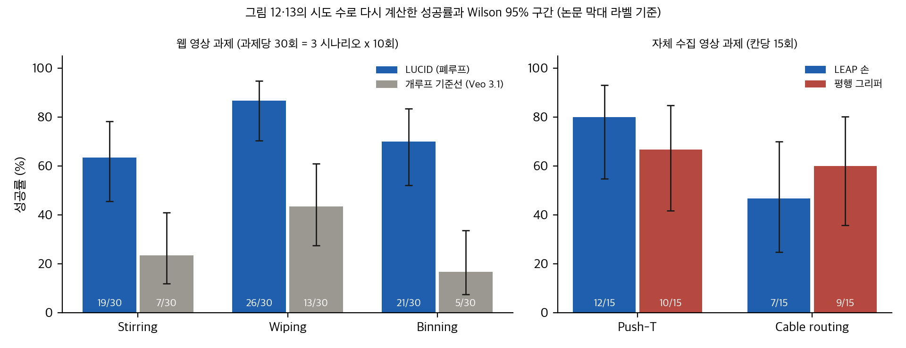
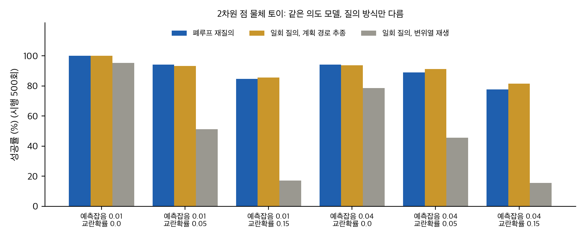
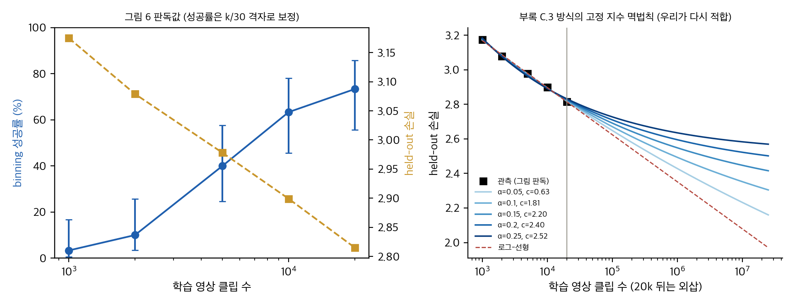

> **논문:** Harsh Gupta, Guanya Shi, Wenzhen Yuan. *LUCID: Learning Embodiment-Agnostic Intent Models from Unstructured Human Videos for Scalable Dexterous Robot Skill Acquisition.* CoRL 2026 포스터, arXiv:2606.11628 (v1, 2026-06-10).
> 공식 코드는 확인되지 않았습니다(프로젝트 페이지의 Code 링크가 비어 있음). 논문 그림은 라이선스상 싣지 않았고, 이 글의 그림은 모두 우리가 그린 그래프입니다.

## 논문이 묻는 것

사람 영상은 많지만 행동 라벨이 없고, 시뮬레이션은 행동 데이터를 무한히 만들지만 과제마다 보상을 짜야 합니다. LUCID는 둘을 "의도"로 잇습니다. 영상에서 다음 1초의 물체 점 흐름과 손바닥 자세를 예측하는 의도 모델 f_θ를 배우고, 시뮬에서 그 참조를 따라가는 과제 무관 정책 π를 따로 학습합니다. 배포 때는 f_θ를 약 1 Hz로 다시 질의합니다. 로봇 시연은 쓰지 않습니다.

## 이 글에서 확인한 것

**1. 73% 대 28%는 시도 수와 맞습니다.** 그림 12의 막대 라벨로 66/90 대 25/90이고, 과제별 Fisher p는 0.004 이하입니다. 시나리오 9칸을 층으로 묶으면 모두 LUCID 쪽이고 Mantel–Haenszel p는 4e-10입니다. 칸당 10회이므로 칸 하나씩 보면 Holm 보정 후 확실한 칸은 Binning 시나리오 2(9/10 대 1/10) 하나입니다.

*그래프 (우리가 그림). 그림 12, 13 막대 라벨의 시도 수(웹 과제 칸당 10회, 자체 수집 칸당 15회)로 다시 계산했습니다.*

**2. 이 격차를 폐루프 효과로만 읽기는 어렵습니다.** 개루프 기준선은 Veo 3.1이 만든 영상에서 참조를 뽑습니다. 의도의 출처, 질의 횟수, 추출 방식이 함께 다릅니다. 같은 f_θ를 한 번만 질의하는 변형은 실험에 없습니다. 2차원 점 물체 토이(가정 설정, 시행 500회)에서는 같은 의도 모델이라도 실행기가 계획 경로를 상태 피드백으로 추종하면 일회 질의가 폐루프와 비슷했고, 변위열을 그대로 재생하면 교란에서 크게 무너졌습니다. 토이는 분리 실험의 필요를 보일 뿐 LUCID의 격차 크기에 대한 증거는 아닙니다.

*그래프 (우리가 그림). 예측 잡음과 교란 확률을 바꾼 여섯 조건의 성공률입니다.*

**3. 손과 그리퍼의 19/30 대 19/30은 ±23 %p 안에서만 같습니다.** 칸당 15회입니다. cable routing에서 그리퍼가 낫다는 서술(7/15 대 9/15)은 p = 0.72로 이 표본에서는 구별되지 않습니다.

**4. 스케일링은 한 과제, 점 5개, 점당 30회입니다.** 그림 6에서 읽은 값(그림 판독 값, 성공 1, 3, 12, 19, 22회 가정)으로 성공 추세는 확실하지만 10k와 20k는 구별되지 않습니다(p = 0.58). 손실은 로그-선형에 아주 가깝고(R² = 0.999), 부록 C.3의 고정 지수 후보 다섯 개가 모두 맞아 2천만 클립 외삽은 2.18–2.57로 벌어집니다. 그림 6의 20k 점(약 73%)과 그림 12 binning(21/30 = 70%)이 한 회 차이로 다르며 저자 확인이 필요합니다.

*그래프 (우리가 그림). 왼쪽은 그림 판독 값(성공률은 k/30 격자로 보정), 오른쪽은 부록 C.3 방식으로 다시 적합한 외삽입니다.*

**5. 정책 절제는 시뮬 보상 곡선입니다.** 3 시드, 곡선 끝 값(그림 판독 값)은 교사 67 대 27(MLP) 대 13(eigen 없음), 학생 61 대 47(DAgger+BC) 대 42(손목 카메라 없음)입니다. 표와 성공률이 없고 보상 정규화가 정의되지 않았습니다.

## 코드와 주장 대조

공식 코드가 없어 코드 대조 대신 주장 17개를 검증했습니다. 지지 4, 부분 9, 구별 안 됨 1, 확인 불가 3으로 갈렸고(항목별 근거는 `analysis/04_claim_verification.md`), 저자에게 확인하고 싶은 것은 20k 점의 평가 구성, 바이올린 분포의 정의, 에피소드 보상 정규화, 시나리오 요인별 결과, 영상 선별 기준입니다.

## 구현 가능성

실로봇, Isaac Lab 대규모 PPO(환경 20,480개, 교사 1B 스텝), 영상 추출 모델 4종이 필요해 일반 노트북에서 전체 재현은 어렵습니다. 수치 재계산과 폐루프 토이는 CPU에서 수 초에 돌고, 축소판 의도 모델과 MuJoCo 추적 정책은 가능한 범위입니다(노력 약 1–2개월, 추정). 가정 설정과 그림 판독 값은 본문에 표시했으며 모든 계산은 저자 확인이 필요한 항목을 포함합니다.

## 자료

- [통합 리포트 PDF](report/report_public.pdf)
- [01. LUCID 논문 분석](analysis/01_paper_analysis.md)
- [02. 선행연구와 관련 저장소](analysis/02_prior_work.md)
- [03. 수치 재계산, 일관성 검사, 토이](analysis/03_analysis.md)
- [04. 주장 검증과 구현 가능성](analysis/04_claim_verification.md)
