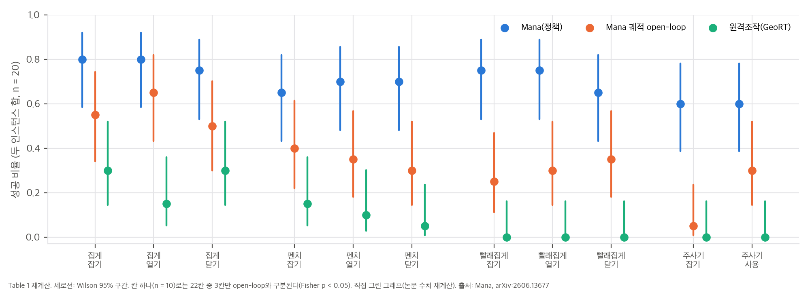
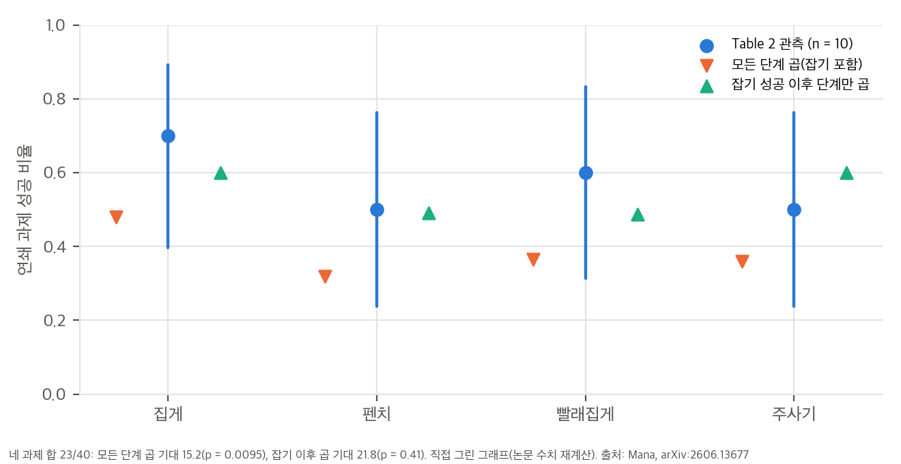
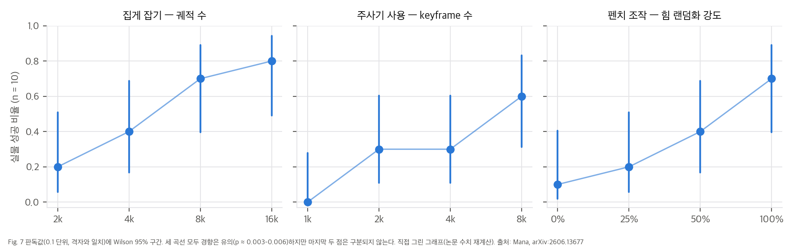
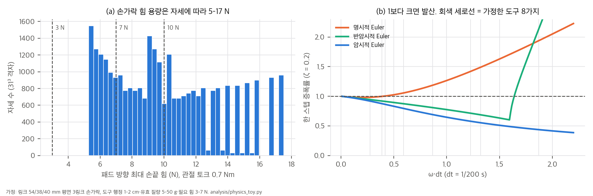

# 03. 수치 재계산과 물리 toy

스크립트는 `analysis/table_check.py`(Table 1·2, Fig. 7, 부록 산술 → `table_check_results.json`)와 `analysis/physics_toy.py`(손가락 힘 용량, 적분기 안정성, 랜덤화 크기 → `physics_toy_results.json`)입니다. 둘 다 numpy·scipy 단일 스레드로 수 초 안에 끝납니다. 그래프는 `analysis/plot_figures.py`가 그립니다.

## 1. Table 1: 평균은 맞고, 칸 하나는 잡음이 크다

| 방법 | 22칸 평균 | 잡기 8칸 | 조작 14칸 |
|---|---|---|---|
| Ours | 0.705 | 0.700 | 0.707 |
| Ours (open-loop) | 0.364 | 0.312 | 0.393 |
| 원격조작(GeoRT) | 0.095 | 0.113 | 0.086 |

- "약 70%"(Sec. 5.2)는 세 집계 모두에서 맞습니다. 원격조작 집게 평균 0.25도 "약 30%"와 맞습니다.
- **도구별 합산 비교:**

| 도구 | Ours | open-loop | 원격조작 | Ours vs open-loop p | 칸 단위로 유의한 칸 |
|---|---|---|---|---|---|
| 집게 | 47/60 [0.66, 0.87] | 34/60 | 15/60 | 0.019 | 0/6 |
| 펜치 | 41/60 [0.56, 0.79] | 21/60 | 6/60 | 4.7×10⁻⁴ | 0/6 |
| 빨래집게 | 43/60 [0.59, 0.82] | 18/60 | 0/60 | 9.0×10⁻⁶ | 1/6 |
| 주사기 | 24/40 [0.45, 0.74] | 7/40 | 0/40 | 1.9×10⁻⁴ | 2/4 |

  대괄호는 Wilson 95% 구간입니다. 도구 단위로는 넷 모두 유의합니다. 반면 칸(n = 10) 단위로는 22칸 중 3칸만 p < 0.05입니다. 표에서 "0.8 대 0.5" 같은 칸 하나의 차이를 근거로 삼으면 안 됩니다. 8/10의 95% 구간은 [0.49, 0.94]입니다.
- 비대응 Fisher 근사입니다. 같은 초기 조건을 쓴 짝 비교인지는 논문에 없습니다.

## 2. 단계별 평가와 Table 2의 관계

Table 1은 단계마다 **그 단계의 안정된 시작 자세**에서 따로 쟀습니다(Sec. 5.1). Table 2는 여러 단계가 이어진 과제입니다. 단계가 서로 독립이라고 보고 성공률을 곱해 Table 2와 비교했습니다. 단계별 값은 두 인스턴스 평균입니다.

| 과제 | 단계 성공률 | 모든 단계 곱 | 잡기 이후만 곱 | Table 2 |
|---|---|---|---|---|
| 집게 집기 | 0.80 · 0.80 · 0.75 | 0.48 | 0.60 | 7/10 |
| 펜치 자르기 | 0.65 · 0.70 · 0.70 | 0.32 | 0.49 | 5/10 |
| 빨래집게 | 0.75 · 0.75 · 0.65 | 0.37 | 0.49 | 6/10 |
| 주사기 주입 | 0.60 · 0.60 | 0.36 | 0.60 | 5/10 |
| 합 | | 기대 15.2 | 기대 21.8 | 23/40 |

- 모든 단계 곱을 기준으로 하면 관측 23/40은 P(합 ≥ 23) = 0.0095로 너무 높습니다(네 이항분포 합의 정확 분포).
- 잡기 이후만 곱하면 P = 0.41로 자연스럽습니다.
- 논문도 "wrist teleoperation is enabled only after the object has been successfully grasped and lifted"라고 씁니다(Sec. 5.4). 그래서 Table 2는 **잡기 성공을 조건으로 한 성공률**로 읽는 것이 맞아 보입니다. 다른 설명은 단계 간 양의 상관입니다(좋은 파지가 이후 단계도 쉽게 함). 두 경우 모두 "잡기부터 작동까지 자율"의 성공률은 Table 2보다 낮습니다. 조건부 해석을 따르면 Table 2 × 잡기 성공률 = 0.56 / 0.33 / 0.45 / 0.30입니다.

## 3. Fig. 7: 경향은 유의, 포화는 미확인

| 곡선 | 10회 중 성공 | 경향 검정 p | 끝점(1 vs 4) p | 마지막 두 점 p |
|---|---|---|---|---|
| 집게 잡기 vs 궤적 수 | 2, 4, 7, 8 | 0.0029 | 0.023 | 1.0 |
| 주사기 사용 vs keyframe 수 | 0, 3, 3, 6 | 0.0055 | 0.011 | 0.37 |
| 펜치 조작 vs 힘 랜덤화 | 1, 2, 4, 7 | 0.0030 | 0.020 | 0.37 |

- "데이터 양, 상태 다양성, 힘 랜덤화에 성능이 강하게 의존한다"는 결론(Fig. 7 캡션)은 경향 검정으로 지지됩니다.
- 다만 x축이 2배씩 늘어 마지막 구간은 16k, 8k, 100%입니다. 더 늘리면 계속 오르는지는 이 자료로 알 수 없습니다.
- 끝점이 Table 1과 같으므로, 이 그림은 "주 설정에서 빼면 얼마나 떨어지는가"를 보여 줍니다.

## 4. 손가락 힘 용량과 랜덤화 범위 (toy)

**P1 손가락 힘 용량.** 링크 54/38/40 mm인 평면 3링크 손가락(Allegro 근사, 가정)에 관절 토크 상한 0.7 Nm(Sec. 6)을 주고, 원위 링크에 수직인 패드 방향으로 낼 수 있는 최대 힘을 31³개 자세에서 계산했습니다. 조건은 모든 관절에서 |J_iᵀ d|·f ≤ τ_max입니다.

| 양 | 값 |
|---|---|
| 한 관절 어림 τ/L (L = 0.06–0.07 m) | 10.0–11.7 N |
| 패드 방향 최대 힘 중앙값 / 90% 분위 / 최대 | 9.7 / 15.2 / 17.5 N |
| 7 N 이상 낼 수 있는 자세 비율 | 77% |
| 10 N 이상 | 47% |
| 손가락을 편 자세 | 5.3 N |

- 저자들의 "10 N 한계"는 한 관절 어림값과 맞습니다. 실제 한계는 자세에 따라 5–17 N으로 넓게 퍼집니다.
- 근위 관절에서 손끝까지 거리가 최대 0.13 m라, 손가락을 펼수록 낼 수 있는 힘이 줄어듭니다.
- 그래서 3–7 N이 필요한 도구라도 **어떤 접촉 자세를 고르느냐**가 힘 여유를 정합니다. keyframe을 촘촘히 뽑아야 한다는 논문 관찰(Sec. 3.1, Fig. 7 가운데)을 힘 쪽에서도 설명할 수 있습니다(해석).

**P3 랜덤화 범위(부록 A.3)를 힘으로 환산.**

| 랜덤화 | 환산 | 필요한 힘 3–7 N과 비교 |
|---|---|---|
| 물체 힘 섭동 σ = α·m·g (α 0.05–0.2) | 30 g 도구 0.015–0.06 N, 100 g 0.05–0.2 N, 200 g 0.1–0.39 N | 최대 13%, 보통 수 % |
| 도구 PD 이득 ×0.8–1.5 | 작동력 2.4–10.5 N | 위쪽 끝이 10 N 한계를 넘음 |
| 로봇 PD 이득 ×0.8–1.2 | 같은 추적 오차에서 손끝 힘 ±20% | |
| 마찰 ×0.5–1.5 (기준 μ = 1 가정) | 마찰원뿔 반각 27°–56° | |

- 물체 섭동은 작동력보다 한 자릿수 작습니다. 힘 쪽 견고성은 주로 이득과 마찰 랜덤화에서 오는 것으로 보입니다(해석).
- 도구 이득 1.5배 × 7 N = 10.5 N은 저자들이 말한 하드웨어 한계를 넘습니다. 스프링 강성이 PD 이득에 비례하고 시뮬레이션 손의 토크 상한이 실물과 같다면, 랜덤화된 일부 환경은 풀 수 없는 문제입니다(가설). 다만 P1에서 보듯 굽힌 자세에서는 10 N 이상도 가능하므로, 그런 환경에서는 특정 자세만 해가 됩니다.

## 5. 적분기 안정성 (toy)

부록 A.6은 "도구 강성과 힘이 커서 명시적 Euler 대신 암시적 Euler가 결정적"이라고 씁니다. 도구 관절을 감쇠 진동자 x'' + 2ζωx' + ω²x = 0로 두고 dt = 1/200 s 한 스텝의 증폭률(스펙트럼 반경)을 계산했습니다. 가정은 필요한 힘 3–7 N, 행정 1–2 cm, 유효 질량 5–50 g입니다. 그러면 k = F/s = 150–700 N/m, ω = 55–374 rad/s, ω·dt = 0.27–1.87입니다.

| 경우 (F, s, m) | ω·dt | 명시적 (ζ = 0.2) | 반암시적 | 암시적 |
|---|---|---|---|---|
| 3 N, 1 cm, 5 g | 1.22 | 1.42 (발산) | 0.71 | 0.58 |
| 3 N, 2 cm, 50 g | 0.27 | 0.98 | 0.94 | 0.92 |
| 7 N, 1 cm, 5 g | 1.87 | 1.94 (발산) | 2.13 (발산) | 0.44 |
| 7 N, 1 cm, 50 g | 0.59 | 1.06 (발산) | 0.87 | 0.79 |

- 명시적 Euler는 감쇠가 없으면 모든 경우에서, ζ = 0.2에서도 8가지 중 6가지에서 발산합니다. 안정하려면 dt < 2ζ/ω(1–7 ms)가 필요합니다.
- 7 N, 1 cm, 10 g 경우를 1초(200 스텝) 돌리면 진폭 배율이 명시적 4×10³⁴, 반암시적 2×10⁻³³, 암시적 3×10⁻⁵²입니다.
- 반암시적(symplectic) Euler도 ω·dt > 약 1.8이면 발산합니다. 암시적 Euler는 언제나 안정합니다(대신 수치 감쇠가 큽니다).
- **결론:** A.6의 주장은 이 규모의 도구 스프링에서 정량적으로 맞습니다. 이 toy는 단일 자유도이고, 접촉과 PhysX 솔버 반복은 포함하지 않습니다.

## 6. 보상 스케일 (부록 A.2)

각 항이 절반(exp = 0.5)이 되는 오차는 ln 2 / β입니다.

| 항 | β | 절반 오차 |
|---|---|---|
| 도구 회전 관절 (L1) | 10 /rad | 0.069 rad (4.0°) |
| 도구 직선 관절(주사기) | 50 /m | 1.39 cm |
| 도구 위치 | 100 /m | 6.9 mm |
| 도구 자세 | 5 /rad | 0.139 rad (7.9°) |
| 손 관절 (16 DoF L1 합) | 10 /rad | 합 0.069 rad, 관절당 평균 4.3 mrad |
| 손바닥 위치(잡기) | 50 /m | 1.39 cm |

- **손 관절 항은 사실상 꺼져 있습니다.** L1 합에 β = 10을 쓰면 관절당 평균 4 mrad만 어긋나도 절반이 됩니다. 정규화라고 보기에는 너무 날카로워, 거의 항상 0 근처일 것입니다(해석).
- **접촉 개수 항은 상한이 없습니다.** w₂·r_contact는 접촉 쌍 하나당 0.15이고, 9개면 r_tool 최댓값(1.3)과 같습니다. 접촉을 늘리는 쪽으로 강하게 밀어 주는 설계입니다. 얇은 도구에서 손가락 여러 마디를 대는 파지를 선호하게 만들 수 있습니다(해석).
- 성공 보너스 +100은 dense 항의 수십~수백 스텝 합과 비슷한 크기입니다. 에피소드 길이가 논문에 없어 정확한 비율은 계산할 수 없습니다.
- PPO 한 번 업데이트에는 4,096 × 8 = 32,768 표본이 들어가고, 4개 minibatch × 5 epoch = 20 gradient step입니다.
