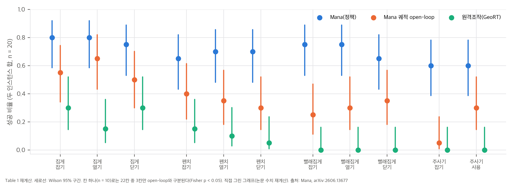
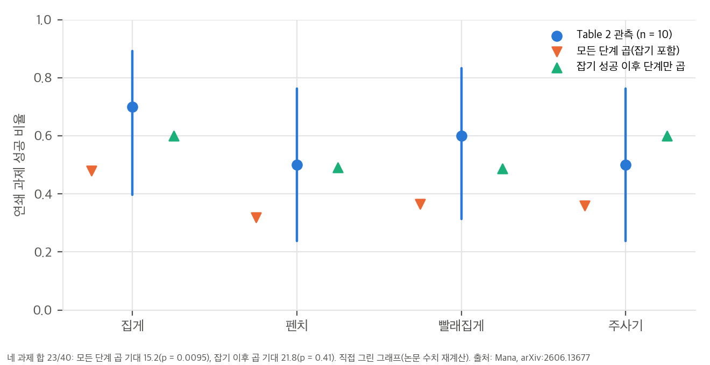
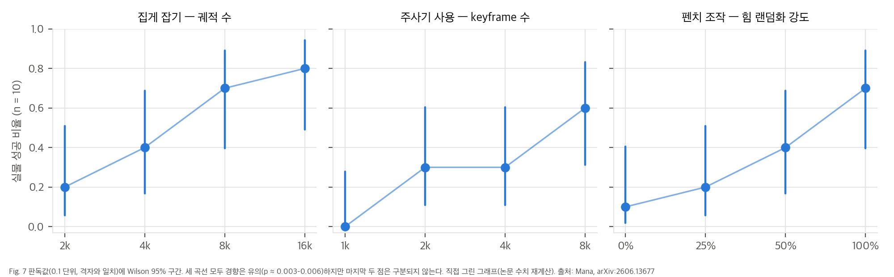
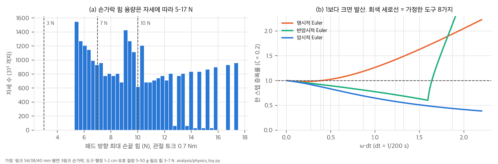

# 03. 수치 재계산과 물리 toy

스크립트는 `analysis/table_check.py`(Table 1·2, Fig. 7, 부록 산술 → `table_check_results.json`)와 `analysis/physics_toy.py`(손가락 힘 용량, 적분기 안정성, 랜덤화 크기 → `physics_toy_results.json`)입니다. 둘 다 numpy·scipy 단일 스레드로 수 초 안에 끝납니다. 그래프는 `analysis/plot_figures.py`가 그립니다.

## 1. Table 1: 평균은 맞고, 칸 하나는 잡음이 크다

| 방법 | 22칸 평균 | 잡기 8칸 | 조작 14칸 |
|---|---|---|---|
| Ours | 0.705 | 0.700 | 0.707 |
| Ours (open-loop) | 0.364 | 0.312 | 0.393 |
| 원격조작(GeoRT) | 0.095 | 0.113 | 0.086 |

- "약 70%"(Sec. 5.2)는 세 집계 모두에서 맞습니다. 원격조작 집게 평균 0.25도 "약 30%"와 맞습니다.
- **도구별 합산 비교:**

| 도구 | Ours | open-loop | 원격조작 | Ours vs open-loop p | 칸 단위로 유의한 칸 |
|---|---|---|---|---|---|
| 집게 | 47/60 [0.66, 0.87] | 34/60 | 15/60 | 0.019 | 0/6 |
| 펜치 | 41/60 [0.56, 0.79] | 21/60 | 6/60 | 4.7×10⁻⁴ | 0/6 |
| 빨래집게 | 43/60 [0.59, 0.82] | 18/60 | 0/60 | 9.0×10⁻⁶ | 1/6 |
| 주사기 | 24/40 [0.45, 0.74] | 7/40 | 0/40 | 1.9×10⁻⁴ | 2/4 |

  대괄호는 Wilson 95% 구간입니다. 도구 단위로는 넷 모두 유의합니다. 반면 칸(n = 10) 단위로는 22칸 중 3칸만 p < 0.05입니다. 표에서 "0.8 대 0.5" 같은 칸 하나의 차이를 근거로 삼으면 안 됩니다. 8/10의 95% 구간은 [0.49, 0.94]입니다.
- 비대응 Fisher 근사입니다. 같은 초기 조건을 쓴 짝 비교인지는 논문에 없습니다.

## 2. 단계별 평가와 Table 2의 관계

Table 1은 단계마다 **그 단계의 안정된 시작 자세**에서 따로 쟀습니다(Sec. 5.1). Table 2는 여러 단계가 이어진 과제입니다. 단계가 서로 독립이라고 보고 성공률을 곱해 Table 2와 비교했습니다. 단계별 값은 두 인스턴스 평균입니다.

| 과제 | 단계 성공률 | 모든 단계 곱 | 잡기 이후만 곱 | Table 2 |
|---|---|---|---|---|
| 집게 집기 | 0.80 · 0.80 · 0.75 | 0.48 | 0.60 | 7/10 |
| 펜치 자르기 | 0.65 · 0.70 · 0.70 | 0.32 | 0.49 | 5/10 |
| 빨래집게 | 0.75 · 0.75 · 0.65 | 0.37 | 0.49 | 6/10 |
| 주사기 주입 | 0.60 · 0.60 | 0.36 | 0.60 | 5/10 |
| 합 | | 기대 15.2 | 기대 21.8 | 23/40 |

- 모든 단계 곱을 기준으로 하면 관측 23/40은 P(합 ≥ 23) = 0.0095로 너무 높습니다(네 이항분포 합의 정확 분포).
- 잡기 이후만 곱하면 P = 0.41로 자연스럽습니다.
- 논문도 "wrist teleoperation is enabled only after the object has been successfully grasped and lifted"라고 씁니다(Sec. 5.4). 그래서 Table 2는 **잡기 성공을 조건으로 한 성공률**로 읽는 것이 맞아 보입니다. 다른 설명은 단계 간 양의 상관입니다(좋은 파지가 이후 단계도 쉽게 함). 두 경우 모두 "잡기부터 작동까지 자율"의 성공률은 Table 2보다 낮습니다. 조건부 해석을 따르면 Table 2 × 잡기 성공률 = 0.56 / 0.33 / 0.45 / 0.30입니다.

## 3. Fig. 7: 경향은 유의, 포화는 미확인

| 곡선 | 10회 중 성공 | 경향 검정 p | 끝점(1 vs 4) p | 마지막 두 점 p |
|---|---|---|---|---|
| 집게 잡기 vs 궤적 수 | 2, 4, 7, 8 | 0.0029 | 0.023 | 1.0 |
| 주사기 사용 vs keyframe 수 | 0, 3, 3, 6 | 0.0055 | 0.011 | 0.37 |
| 펜치 조작 vs 힘 랜덤화 | 1, 2, 4, 7 | 0.0030 | 0.020 | 0.37 |

- "데이터 양, 상태 다양성, 힘 랜덤화에 성능이 강하게 의존한다"는 결론(Fig. 7 캡션)은 경향 검정으로 지지됩니다.
- 다만 x축이 2배씩 늘어 마지막 구간은 16k, 8k, 100%입니다. 더 늘리면 계속 오르는지는 이 자료로 알 수 없습니다.
- 끝점이 Table 1과 같으므로, 이 그림은 "주 설정에서 빼면 얼마나 떨어지는가"를 보여 줍니다.

## 4. 손가락 힘 용량과 랜덤화 범위 (toy)

**P1 손가락 힘 용량.** 링크 54/38/40 mm인 평면 3링크 손가락(Allegro 근사, 가정)에 관절 토크 상한 0.7 Nm(Sec. 6)을 주고, 원위 링크에 수직인 패드 방향으로 낼 수 있는 최대 힘을 31³개 자세에서 계산했습니다. 조건은 모든 관절에서 |J_iᵀ d|·f ≤ τ_max입니다.

| 양 | 값 |
|---|---|
| 한 관절 어림 τ/L (L = 0.06–0.07 m) | 10.0–11.7 N |
| 패드 방향 최대 힘 중앙값 / 90% 분위 / 최대 | 9.7 / 15.2 / 17.5 N |
| 7 N 이상 낼 수 있는 자세 비율 | 77% |
| 10 N 이상 | 47% |
| 손가락을 편 자세 | 5.3 N |

- 저자들의 "10 N 한계"는 한 관절 어림값과 맞습니다. 실제 한계는 자세에 따라 5–17 N으로 넓게 퍼집니다.
- 근위 관절에서 손끝까지 거리가 최대 0.13 m라, 손가락을 펼수록 낼 수 있는 힘이 줄어듭니다.
- 그래서 3–7 N이 필요한 도구라도 **어떤 접촉 자세를 고르느냐**가 힘 여유를 정합니다. keyframe을 촘촘히 뽑아야 한다는 논문 관찰(Sec. 3.1, Fig. 7 가운데)을 힘 쪽에서도 설명할 수 있습니다(해석).

**P3 랜덤화 범위(부록 A.3)를 힘으로 환산.**

| 랜덤화 | 환산 | 필요한 힘 3–7 N과 비교 |
|---|---|---|
| 물체 힘 섭동 σ = α·m·g (α 0.05–0.2) | 30 g 도구 0.015–0.06 N, 100 g 0.05–0.2 N, 200 g 0.1–0.39 N | 최대 13%, 보통 수 % |
| 도구 PD 이득 ×0.8–1.5 | 작동력 2.4–10.5 N | 위쪽 끝이 10 N 한계를 넘음 |
| 로봇 PD 이득 ×0.8–1.2 | 같은 추적 오차에서 손끝 힘 ±20% | |
| 마찰 ×0.5–1.5 (기준 μ = 1 가정) | 마찰원뿔 반각 27°–56° | |

- 물체 섭동은 작동력보다 한 자릿수 작습니다. 힘 쪽 견고성은 주로 이득과 마찰 랜덤화에서 오는 것으로 보입니다(해석).
- 도구 이득 1.5배 × 7 N = 10.5 N은 저자들이 말한 하드웨어 한계를 넘습니다. 스프링 강성이 PD 이득에 비례하고 시뮬레이션 손의 토크 상한이 실물과 같다면, 랜덤화된 일부 환경은 풀 수 없는 문제입니다(가설). 다만 P1에서 보듯 굽힌 자세에서는 10 N 이상도 가능하므로, 그런 환경에서는 특정 자세만 해가 됩니다.

## 5. 적분기 안정성 (toy)

부록 A.6은 "도구 강성과 힘이 커서 명시적 Euler 대신 암시적 Euler가 결정적"이라고 씁니다. 도구 관절을 감쇠 진동자 x'' + 2ζωx' + ω²x = 0로 두고 dt = 1/200 s 한 스텝의 증폭률(스펙트럼 반경)을 계산했습니다. 가정은 필요한 힘 3–7 N, 행정 1–2 cm, 유효 질량 5–50 g입니다. 그러면 k = F/s = 150–700 N/m, ω = 55–374 rad/s, ω·dt = 0.27–1.87입니다.

| 경우 (F, s, m) | ω·dt | 명시적 (ζ = 0.2) | 반암시적 | 암시적 |
|---|---|---|---|---|
| 3 N, 1 cm, 5 g | 1.22 | 1.42 (발산) | 0.71 | 0.58 |
| 3 N, 2 cm, 50 g | 0.27 | 0.98 | 0.94 | 0.92 |
| 7 N, 1 cm, 5 g | 1.87 | 1.94 (발산) | 2.13 (발산) | 0.44 |
| 7 N, 1 cm, 50 g | 0.59 | 1.06 (발산) | 0.87 | 0.79 |

- 명시적 Euler는 감쇠가 없으면 모든 경우에서, ζ = 0.2에서도 8가지 중 6가지에서 발산합니다. 안정하려면 dt < 2ζ/ω(1–7 ms)가 필요합니다.
- 7 N, 1 cm, 10 g 경우를 1초(200 스텝) 돌리면 진폭 배율이 명시적 4×10³⁴, 반암시적 2×10⁻³³, 암시적 3×10⁻⁵²입니다.
- 반암시적(symplectic) Euler도 ω·dt > 약 1.8이면 발산합니다. 암시적 Euler는 언제나 안정합니다(대신 수치 감쇠가 큽니다).
- **결론:** A.6의 주장은 이 규모의 도구 스프링에서 정량적으로 맞습니다. 이 toy는 단일 자유도이고, 접촉과 PhysX 솔버 반복은 포함하지 않습니다.

## 6. 보상 스케일 (부록 A.2)

각 항이 절반(exp = 0.5)이 되는 오차는 ln 2 / β입니다.

| 항 | β | 절반 오차 |
|---|---|---|
| 도구 회전 관절 (L1) | 10 /rad | 0.069 rad (4.0°) |
| 도구 직선 관절(주사기) | 50 /m | 1.39 cm |
| 도구 위치 | 100 /m | 6.9 mm |
| 도구 자세 | 5 /rad | 0.139 rad (7.9°) |
| 손 관절 (16 DoF L1 합) | 10 /rad | 합 0.069 rad, 관절당 평균 4.3 mrad |
| 손바닥 위치(잡기) | 50 /m | 1.39 cm |

- **손 관절 항은 사실상 꺼져 있습니다.** L1 합에 β = 10을 쓰면 관절당 평균 4 mrad만 어긋나도 절반이 됩니다. 정규화라고 보기에는 너무 날카로워, 거의 항상 0 근처일 것입니다(해석).
- **접촉 개수 항은 상한이 없습니다.** w₂·r_contact는 접촉 쌍 하나당 0.15이고, 9개면 r_tool 최댓값(1.3)과 같습니다. 접촉을 늘리는 쪽으로 강하게 밀어 주는 설계입니다. 얇은 도구에서 손가락 여러 마디를 대는 파지를 선호하게 만들 수 있습니다(해석).
- 성공 보너스 +100은 dense 항의 수십~수백 스텝 합과 비슷한 크기입니다. 에피소드 길이가 논문에 없어 정확한 비율은 계산할 수 없습니다.
- PPO 한 번 업데이트에는 4,096 × 8 = 32,768 표본이 들어가고, 4개 minibatch × 5 epoch = 20 gradient step입니다.

## 추가 검증 (2026-11-11)

스크립트: `analysis/extra_lmik.py` → `analysis/extra_lmik_results.json` (numpy 단일 스레드, 약 2분 30초).

### 추가 검증 1: 침투 해소 항(Algorithm 1)의 효과, 평면 toy

**목적.** Algorithm 1(LM IK 한 스텝마다 침투 중심 p를 p + d로 옮기는 항을 더함, 부록 A.1)이 얇은 물체의 지면 파지에서 해의 비율을 올리는지, 접촉 유지와 충돌 회피의 상충이 어디서 생기는지 본다. 공개 Lightning Grasp에는 이 항이 없으므로(`04` D2), 논문 서술대로 구현한 toy로 확인한다.

**설정(가정).**
- 평면 좌표, 지면 y = 0, 높이 1 cm·폭 4 cm 상자. 지면이 없는 조건도 함께 본다.
- 손가락 2개, 각각 평면 3링크(0.030, 0.030, 0.025 m), 밑동 (±0.06, 0.07 m), 반지름 3 mm, 관절 6개, 관절 한계 ±2.6 rad.
- 접촉 목표는 상자 옆면(x = ±0.023 m)의 높이 2–8 mm 사이 한 점이다. 접촉 투영(NearestProjection)은 반복마다 갱신한다.
- 외부 반복 60회, 반복마다 침투 점을 계산하고 LM 스텝을 1회 수행한다. 잔차는 [손끝 − 접촉 목표, λ(침투 점 − (점 + (r − sd)·n))]이고, λ = 0이면 일반 접촉 IK다.
- 성공(valid): 두 손끝의 접촉 오차 < 2 mm이고, 모든 링크 점의 침투 깊이 ≤ 0.5 mm.
- 시작점 500개(무작위 관절각, 접촉 높이)를 고정하고 λ만 바꾼다(짝 비교).

**결과.**

| 지면 | λ | 성공률 (Wilson 95%) | 접촉은 맞고 침투함 | 접촉 성공 | 침투 깊이 90% 분위 |
|---|---|---|---|---|---|
| 있음 | 0 (일반 IK) | 0.584 [0.54, 0.63] | 0.186 | 0.770 | 1.04 mm |
| 있음 | 0.3 | 0.730 [0.69, 0.77] | 0.040 | 0.770 | 0.37 mm |
| 있음 | 1 | 0.760 [0.72, 0.80] | 0.016 | 0.776 | 0.13 mm |
| 있음 | 3 | 0.756 [0.72, 0.79] | 0.000 | 0.756 | 0.02 mm |
| 없음 | 0 | 0.616 [0.57, 0.66] | 0.154 | 0.770 | 0.99 mm |
| 없음 | 1 | 0.752 [0.71, 0.79] | 0.018 | 0.770 | 0.14 mm |
| 없음 | 3 | 0.772 [0.73, 0.81] | 0.000 | 0.772 | 0.03 mm |

짝 비교(λ = 1 대 λ = 0): 지면이 있을 때 λ = 1만 성공한 시작점 88개, 반대 0개(부호 검정 p ≈ 6 × 10⁻²⁷). 지면이 없을 때는 68 대 0(p ≈ 7 × 10⁻²¹).

**결론.**
- 일반 접촉 IK의 실패는 대부분 "접촉은 맞지만 침투한 해"다(지면이 있을 때 18.6%). 침투 항(λ = 1)은 이를 1.6%로 줄이고 성공률을 58%에서 76%로 올린다. 논문 Algorithm 1의 방향과 같다.
- 이득은 λ = 1–3 부근에서 거의 평탄하다. λ = 3에서는 접촉 성공이 0.776에서 0.756으로 조금 줄어든다. 접촉 유지와 충돌 회피의 상충은 이 toy에서 작게 나타난다.
- 시작점의 약 23%는 접촉 목표에 도달하지 못한다(관절 한계). 두 방법 모두 여기서 실패하며, 이 상한은 설정에 따른 값이다.
- **한계.** 평면 2손가락, 점 샘플 침투 검사, 상자 1개. 3차원, 실제 접촉 솔버, LG의 기하 샘플링은 포함하지 않았다. 논문 Fig. 8과 직접 비교하지 않았으므로 실제 LG+의 성능은 이 결과로 정해지지 않는다. 앞 절의 "지면 근처 한계"는 이 toy에서 재현되었다.

### 추가 검증 2: 도구 관절 적분기 안정성, MuJoCo 1자유도

**목적.** §5는 도구 관절을 명시적 Euler로 적분하면 이 규모(3–7 N, 1–2 cm, 5–50 g, dt = 1/200 s)에서 발산한다는 toy 결과를 보였습니다. 이 절에서는 같은 파라미터 격자를 MuJoCo 4.0.0의 적분기로 돌려, 실제 시뮬레이터 기본 적분기에서도 같은 판정이 나오는지 봅니다.

**설정(가정).**
- 미끄럼 관절 1개(질량 m, 강성 k = F/s, 점성 감쇠 c = 2ζ√(km), 평형 0). 초기 변위 s, 정지 상태에서 놓습니다. 중력 0, 접촉 없음.
- 격자: (F, s, m) = (3 N, 1 cm, 5 g), (3 N, 2 cm, 50 g), (7 N, 1 cm, 5 g), (7 N, 1 cm, 50 g). ζ = 0과 0.2. dt = 1/200, 1/500, 1/1000 s. 1 s 적분.
- 적분기: MuJoCo `Euler`, `implicit`, `implicitfast`, `RK4`.
- 지표: 마지막 0.2 s의 |x| 최댓값을 s로 나눈 값. 1보다 크면 초기 진폭보다 커진 것입니다. 값이 발산하면 NaN 또는 비정상 판정.
- `analysis/extra_joint_integrator.py` → `analysis/extra_joint_integrator_results.json` (CPU 단일 스레드, 약 0.2초).
- 장치: CPU. 패키지: mujoco 4.0.0, numpy 1.26.4, Python 3.12.7.

**결과 (ζ = 0.2, dt = 1/200 s).** 네 적분기 모두 네 경우에서 진폭이 줄어들었고(0.0000–0.0002 배, 마지막 0.2 s 기준), 발산하지 않았습니다. `Euler`, `implicit`, `implicitfast`는 모든 경우에서 값이 같았습니다.

**결과 (ζ = 0, 감쇠 없음).**

| 경우 (F, s, m) | ω·dt | Euler, dt 1/200 | Euler, 1/500 | Euler, 1/1000 | RK4, 1/200 |
|---|---|---|---|---|---|
| 3 N, 1 cm, 5 g | 1.22 | 1.26 | 1.03 | 1.01 | 0.04 |
| 7 N, 1 cm, 5 g | 1.87 | 2.83 | 1.08 | 1.02 | 0.00 |
| 3 N, 2 cm, 50 g | 0.27 | 1.01 | 1.00 | 1.00 | 1.00 |
| 7 N, 1 cm, 50 g | 0.59 | 1.05 | 1.01 | 1.00 | 0.95 |

- ζ = 0.2에서 `Euler`는 §5의 명시적 Euler 발산 판정(8가지 중 6가지 발산)과 달리 네 경우 모두 감쇠합니다.
- ζ = 0, ω·dt ≈ 1.9인 7 N, 1 cm, 5 g에서 `Euler`는 진폭이 초기의 2.8배까지 커집니다. dt를 1/500으로 줄이면 1.08배로 줄어듭니다. 이 값은 에너지 오차이고, 1-DOF 발산이 아닙니다.

**결론.**
- §5의 "명시적 Euler 발산" 결론은 MuJoCo의 기본 `Euler`에는 맞지 않습니다. MuJoCo `Euler`는 관절 감쇠와 강성을 암시적으로 다루는 것으로 보입니다(감쇠 상태에서 세 적분기가 같은 값을 줍니다). 따라서 "명시적 Euler가 발산하므로 암시적 적분이 필요하다"는 §5의 문장은, MuJoCo 기본 설정에서는 그대로 적용되지 않습니다. 순수 명시적 Euler의 발산은 numpy toy에서만 보였습니다.
- 감쇠가 없을 때는 dt의 영향이 큽니다. ω·dt가 1.9 근처이면 MuJoCo `Euler`의 진폭 오차가 dt 1/200에서 2.8배입니다. 도구 스프링의 실제 감쇠가 0에 가깝다면 dt를 1/500 이하로 두는 것이 안전합니다.
- 접촉이 있는 경우는 확인하지 않았습니다. 접촉 솔버의 반복 횟수와 soft contact 설정이 도구 진동에 어떻게 작용하는지는 이 절로 정해지지 않습니다.
- **한계.** 중력과 접촉이 없는 1자유도 선형 스프링 관절입니다. 실제 손의 관절 결합, 도구 질량 분포, 접촉 정지는 포함하지 않았습니다. 명시적 Euler를 MuJoCo 안에서 직접 돌린 것이 아니라(MuJoCo에 없음), §5의 numpy 결과와는 별개 시스템입니다. 공식 파이프라인의 dt와 적분기 설정은 확인하지 않았습니다.

## 추가 검증 (2026-11-14): 스프링 구동 집게의 적분기·dt 안정성, 블록 접촉 (MuJoCo 4.0.0)

스크립트: `analysis/extra_tongs_contact.py` → `analysis/extra_tongs_contact_results.json` (CPU 단일 스레드, 약 1초).

**목적.** 앞 절(2026-11-11)은 접촉이 없는 1자유도 관절이었습니다. 이 절에서는 스프링으로 닫히는 두 날 집게가 블록을 무는 접촉 과제에서 적분기와 dt에 따른 결과가 어떻게 달라지는지 봅니다.

**설정(가정).**
- 두 날(각 질량 10 g, 길이 12 cm, 반지름 4 mm). 날마다 경첩 관절 하나에 비틀림 스프링(강성 k, 기준각 −0.3 rad, 반대쪽 날은 대칭)과 점성 감쇠 0.002 N·m·s/rad를 줍니다. 경첩은 손 밑동에서 2 cm 떨어져 있습니다.
- 블록: 고정 상자, 반치수 2 × 1.2 × 2 cm, 중심 x = 10 cm. 중력 0. 날은 열린 상태(0 rad)에서 출발합니다.
- 강성 k = 0.5와 2.0 N·m/rad. 접촉: MuJoCo 기본 soft contact(solref 기본값)와 stiff contact(solref 시간 상수 0.005 s, 날과 블록 모두).
- 적분기: `Euler`, `implicit`, `implicitfast`, `RK4`. dt: 1/200, 1/500, 1/1000, 1/2000 s. 1 s 적분.
- 지표(마지막 0.2 s 평균): 관절각, 관절각 peak-to-peak(떨림), 접촉 법선 힘 합(접촉점마다 세므로 과대 계산), 가장 깊은 침투 깊이, 날 1의 토크 균형 잔차(접촉 토크 + 스프링 토크, 평형이면 0).
- 기준: 같은 k와 접촉 설정에서 `implicitfast`, dt = 1/4000 s. 기준 자체가 블록을 관통하면(아래 "관통" 정의) 오차를 계산하지 않습니다.
- 관통 정의: 평균 관절각이 −0.197 rad보다 작으면(날 끝이 블록 중심면을 넘으면) 관통으로 표시합니다. 관통 상태는 유효한 파지가 아닙니다.

**결과 1: 기본 접촉, k = 0.5 (유효 파지).** 기준 관절각 −0.0962 rad, 침투 4.57 mm, 토크 잔차 2 × 10⁻⁵ N·m 이하(평형 확인).

| dt | Euler / implicit / implicitfast (관절각 차) | RK4 (관절각 차) |
|---|---|---|
| 1/200 | 0.00045 rad | 0.00092 rad |
| 1/500 | 0.00107 rad | 0.00062 rad |
| 1/1000 | 0.00005 rad | 0.00007 rad |
| 1/2000 | 0.00002 rad | 0.00002 rad |

- 네 적분기 모두 발산하지 않았고 평형에 도달했습니다. 관절각 차는 dt 1/200–1/500에서 1 mrad 이내입니다.
- 침투 깊이(4.55–4.59 mm)는 dt에 거의 무관합니다. 이 깊이는 soft contact의 정적 침투이고 수치 오차가 아닙니다. 여기서 법선 힘 합(18 N)도 접촉점을 두 번 세서 과대 계산된 값이라, 평형은 토크 잔차로 확인했습니다.

**결과 2: stiff contact, k = 0.5.** 기준 관절각 −0.0340 rad, 침투 0.075 mm. dt 1/500 이하에서 네 적분기가 기준과 같습니다(차 0). dt 1/200에서는 네 적분기 모두 관절각 차 0.0017 rad로 같은 값을 줍니다. 적분기 차이는 나지 않고 dt 차이만 남습니다.

**결과 3: 강성 k = 2.0 (스프링이 세서 충격이 큼).**
- 기본 접촉: 기준(dt 1/4000)이 블록을 관통(관절각 −0.412 rad)했습니다. 따라서 이 행의 오차는 계산하지 않습니다. dt 1/200과 1/2000의 Euler 계열, 그리고 RK4 1/500·1/1000은 같은 관통 상태(−0.412 rad)에 도달했습니다. dt 1/500 및 1/1000의 Euler·implicit·implicitfast는 관통하지 않은 것처럼 보이는 −0.176 rad에 머물렀지만, 토크 잔차가 2.7 × 10⁻³ N·m로 평형이 아니어서 기준과 다른 해입니다. 이 행은 신뢰할 수 없습니다.
- stiff contact: 기준은 −0.0356 rad, 침투 0.27 mm로 유효합니다. dt 1/500 이하의 네 적분기는 기준과 같습니다(차 0). **dt 1/200에서 적분기에 따라 결과가 갈렸습니다.** Euler·implicit·implicitfast는 블록을 관통(−0.421 rad)하고, RK4는 관통하지 않고 깊이 4.5 mm로 침투한 다른 정상 상태(−0.093 rad, 잔차 2 × 10⁻⁶ N·m)에 도달했습니다. 세 적분기가 같은 관통 상태를 내는 것은 충격 순간의 큰 침투(약 7 mm)를 접촉 솔버가 막지 못했기 때문으로 보입니다.

**결론.**
- 이 집게 설정에서 적분기 선택의 영향은 dt가 1/200 이하이면 작습니다(관절각 차 1.1 mrad 이하, 침투 깊이는 soft contact의 정적 값). 기본 접촉에서는 dt를 1/200보다 줄여도 침투 값은 바뀌지 않습니다.
- 단단한 접촉과 강성 2에서 dt = 1/200이면 적분기가 결과를 바꿉니다(기본 접촉의 강성 2에서는 네 적분기가 모두 관통). 암시적 적분기(`implicit`, `implicitfast`)가 RK4보다 안정하다는 가정은 이 설정에서 맞지 않았습니다. 셋 다 관통 쪽, RK4는 침투 쪽으로 갔습니다. 어느 쪽이 "맞는" 해인지는 기준(dt = 1/4000)이 정하는데, 이 결과는 dt 1/200로는 결정되지 않는다는 뜻입니다.
- 앞 절(§5 toy와 1-DOF)의 "dt를 줄이면 안전하다"는 결론은 이 접촉 과제에서도 dt 1/500 이하에서 성립했지만, 1/200에서는 깨졌습니다. 실제 시뮬레이션에서는 dt를 줄이거나 접촉 시간 상수를 확인해야 합니다.

**한계.**
- 집게 하나, 블록 하나, 중력 0, 손 없음. 주사기(슬라이드 접촉 정지)는 하지 않았습니다.
- 날 질량, 블록 크기, 접촉 solref를 하나씩만 바꿨습니다. 전체 민감도 분석은 아닙니다.
- 기본 접촉 k = 2의 기준이 관통 상태라 이 행은 해석하지 않았습니다.
- 법선 힘 합은 접촉점을 중복 계산하므로 힘의 절대값으로 쓰지 마십시오. 평형 확인은 토크 잔차를 기준으로 했습니다.
