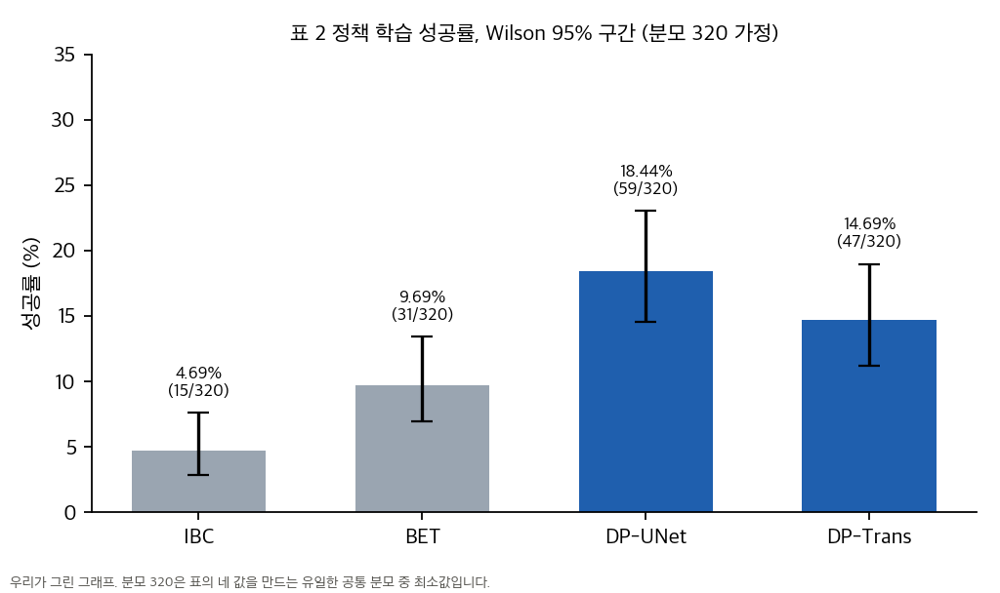
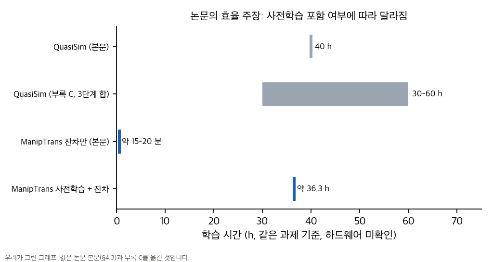

> **논문:** Kailin Li, Puhao Li, Tengyu Liu, Yuyang Li, Siyuan Huang. *ManipTrans: Efficient Dexterous Bimanual Manipulation Transfer via Residual Learning.* CVPR 2025, arXiv:2503.21860 (v1, 2025-03-27, 이후 버전 없음).
> 공식 코드(GPL-3.0, ManipTrans/ManipTrans)는 정적으로만 읽었고 실행하지 않았습니다. 논문 그림은 arXiv non-exclusive 라이선스라서 싣지 않고, 우리가 만든 그래프만 씁니다.

## 논문이 묻는 것

사람 손으로 찍은 MoCap 데이터는 많지만, 그것을 로봇 손으로 옮기면 두 가지가 어긋납니다. 사람 손과 로봇 손의 형태가 다르고, MoCap 오차가 시간에 따라 쌓입니다. 특히 병뚜껑 풀기나 펜 뚜껑 닫기처럼 두 손이 함께 움직이는 작업은 기존 방법이 거의 다루지 않았습니다.

ManipTrans는 이 문제를 **두 단계**로 나눕니다. 1단계는 물체 없이 손 궤적만 따라가는 정책을 PPO로 사전학습합니다. 2단계는 1단계의 행동에 보정량을 더하는 잔차 정책을 학습하고, 이때 물체 상태와 접촉력을 관측과 보상에 넣습니다. 보상 함수를 작업마다 새로 설계하지 않는다는 점이 주장의 중심입니다.

## 표 1을 다시 계산했더니

가장 중요한 표는 강화학습 기준선과의 비교(표 1)입니다. 단일 과제 성공률은 ManipTrans 58.1%, Retarget + Residual 47.8%, RL-Only 34.3%이고, 양손 과제는 39.5%, 13.9%, 12.1%입니다.

**그런데 이 값들을 만드는 분모가 맞지 않습니다.** 네 단일 과제 값을 하나의 정수 분모로 설명할 수 없습니다(n ≤ 200). 양손 13.9%도 39.5%와 같은 분모로는 나오지 않습니다. 논문은 평가 시도 수를 쓰지 않았습니다. 시드나 과제별 평균으로 집계했을 가능성이 큽니다.

차이의 확실성도 하위 집단마다 다릅니다.

- 양손 과제에서 ManipTrans와 RL-Only의 차이(39.5% 대 12.1%)는 가능한 모든 분모에서 p ≤ 1.1×10⁻⁶입니다. 확실합니다.
- 단일 과제에서 ManipTrans와 Retarget + Residual의 차이(58.1% 대 47.8%)는 p = 0.06–0.11입니다. 확실하지 않습니다.

오차 열(E_r, E_t, E_j, E_ft)은 **성공한 롤아웃만으로** 계산했다고 캡션에 있습니다. 성공률이 낮은 방법일수록 쉬운 궤적만 남아서 오차가 작아집니다. 오차 숫자는 SR과 함께 읽어야 합니다.

## 정책 학습 벤치마크

표 2는 병 옮기기 과제에서 IBC, BET, Diffusion Policy(UNet, Transformer) 네 방법의 성공률을 보고합니다(4.69%, 9.69%, 18.44%, 14.69%).

네 값은 분모 320과 맞습니다. 본문 설정(140 시퀀스의 15%를 시험으로 쓰고 시퀀스당 20회 롤아웃)은 420이어야 하므로 맞지 않습니다. 320이 맞다면 시험 시퀀스가 16개입니다. 저자에게 확인해야 할 내용입니다.

그래프: 표 2의 성공률과 Wilson 95% 구간입니다. 분모 320은 가정입니다. DP-UNet은 IBC와 BET보다 확실히 높고, DP-Trans와의 차이는 확실하지 않습니다. 우리가 그린 그래프입니다.

## 시간 주장

논문은 같은 과제에서 QuasiSim이 약 40시간, ManipTrans의 잔차 학습이 약 15분이라고 씁니다. 이 15분은 **사전학습을 뺀 값**입니다. 부록 C는 사전학습이 단일 GPU에서 약 1.5일이라고 씁니다. 사전학습을 더하면 약 36.3시간이고, 40시간과 약 10% 차이입니다.

그래프: 논문 본문과 부록 C의 시간을 옮긴 것입니다. 사전학습(약 36시간)을 빼면 막대가 짧게 보이지만, 포함하면 QuasiSim과 거의 같습니다. 우리가 그린 그래프입니다.

QuasiSim의 시간도 본문(약 40시간)과 부록 C(단계당 10–20시간, 3단계)가 다릅니다. 하드웨어도 두 방법이 같은지 논문에 없습니다. "효율적이다"는 주장은 사전학습을 여러 과제가 나눠 쓴다는 전제가 있어야 성립합니다.

## 공식 코드와 논문이 다른 곳

공식 코드는 논문의 두 단계 구조와 PPO 설정(horizon 32, minibatch 1024, γ 0.99, Adam), 환경 수, 시간 간격, 물체 밀도, 좌우 손 거울 데이터를 논문과 맞게 갖추고 있습니다. 그러나 다음은 다릅니다.

- **학습률:** 논문과 코드 기본값은 5e-4인데, 저장소 README의 학습 명령은 2e-4를 씁니다.
- **손가락 보상:** 논문은 거리 제곱을 쓰고 마디별 가중치(표 5)를 쓰는데, 코드는 거리 노름과 손가락 공통 그룹 가중치를 씁니다.
- **손가락 임계:** 논문은 6 cm에서 4 cm로 줄인다고 쓰지만, 코드는 관절 그룹마다 다른 값을 씁니다.
- **성공 판정:** 논문은 3 cm, 30°, 8 cm, 6 cm를 쓰는데, 코드의 성공 판정은 학습 중 완화 계수에 따라 임계가 바뀝니다.
- **잔차 보상:** 논문은 세 개의 항을 쓰고 가중치를 밝히지 않았습니다. 코드는 19개 항과 가중치를 씁니다.

평가 스크립트, 실로봇 코드, 두 기준선(Retarget + Residual, RL-Only)의 구현은 저장소에 없습니다. 표 1–4를 이 저장소로 다시 만들 수 없습니다.

## 이 맥에서 구현할 수 있는가

**논문 수치의 재현은 이 맥(Apple M4 Pro, 약 24 GiB, CUDA 없음)에서 불가능합니다.** 공식 코드는 Isaac Gym Preview 4, Linux와 NVIDIA GPU, CUDA 빌드 pytorch3d가 필요합니다. 데이터(DexManipNet)는 8.31 GB이고, MANO와 OakInk-V2는 등록이 필요합니다.

CPU에서 할 수 있는 것은 두 가지입니다. 하나는 평가 지표(손가락 위치 오차, 성공 판정)를 MANO 키포인트 데이터가 있을 때 계산하는 것입니다. 다른 하나는 MuJoCo로 작은 추적 과제를 만들어 잔차 구조와 보상 형태를 비교하는 것입니다. 후자는 1–2주 정도로 추정합니다(측정하지 않았습니다).

## 읽을 때 조심할 것

- 표 1의 분모와 집계 방식을 확인하기 전에는 방법 차이를 정량으로 인용하지 마세요.
- 효율 비교는 사전학습 시간을 포함해서 읽으세요.
- 표 4의 양손 열은 설명이 없고 단조롭지 않습니다.
- 정책 학습 벤치마크는 과제가 하나이고 시드 수가 없습니다.

## 정리

ManipTrans는 "손 모방을 먼저 배우고 물체 상호작용은 잔차로 더한다"는 구조를 명확하게 보여 줍니다. 양손 과제에서 기준선보다 성공률이 높다는 방향은 분명합니다. 그러나 분모, 오차 표본, 효율 계산, 코드와 논문의 임계 차이가 모두 열려 있습니다. 이 구조를 자기 과제에 가져갈 때는 보상 형태와 성공 판정 기준을 먼저 고정해야 합니다.

## 자료

- [통합 리포트 PDF](report/report_public.pdf)
- [01. 논문 분석: ManipTrans (arXiv:2503.21860)](analysis/01_paper_analysis.md)
- [02. 선행연구와 자료 지도: ManipTrans](analysis/02_prior_work.md)
- [03. 수치 재계산과 일관성 검사: ManipTrans](analysis/03_analysis.md)
- [04. 논문 ↔ 공식 코드 대조: ManipTrans](analysis/04_code_verification.md)
