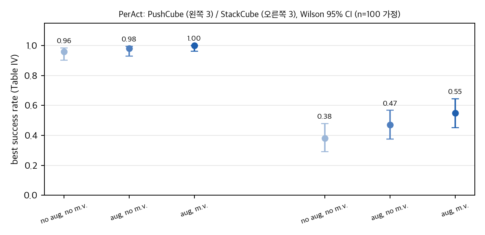
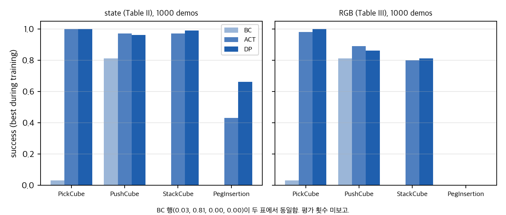
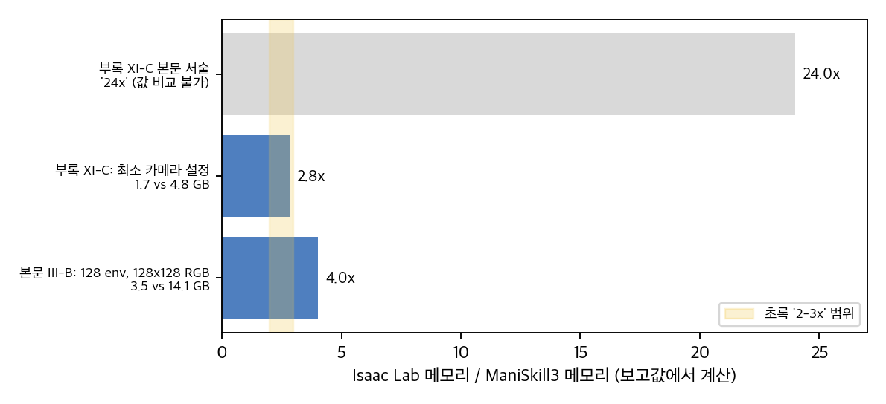

# 03. 수치 재계산과 일관성 검사

재현(학습, 시뮬레이션 실행)은 하지 않았습니다. 논문에 적힌 표·본문 값만 써서 재계산했습니다. 스크립트는 `analysis/recompute.py`(scipy, 1초 미만), 결과는 `analysis/recompute_results.json`, 그래프는 `analysis/plot_figures.py`로 만듭니다.

## 1. 실물 sim2real: 22/24

| 항목 | 값 |
|---|---|
| 보고 | 91.6% (3 runs x 8회, §IV-D) |
| 정확한 비율 | 22/24 = 91.67% (보고값은 절삭 표기) |
| Wilson 95% CI | 74.2% – 97.7% |

해석: 표본이 24회라서 CI 폭이 약 23 %p입니다. 세 번의 학습 실행 간 차이는 원자료가 없어 분해할 수 없습니다. "이 방법이 시뮬레이션만 쓴 것보다 낫다"는 대조군이 없습니다(§K4 in `01`).

## 2. PerAct (Table IV): 최고 체크포인트 값의 신뢰구간

평가 횟수는 본문 App. X-B의 "evaluated over 100 episodes"를 쓰고, 설정마다 n=100으로 가정했습니다. Table IV는 "80k 스텝 중 최고 성공률"이라서 **선택 편향**이 있습니다. 아래 CI는 참고용입니다.

| 과제 | 설정 | 성공률 | Wilson 95% CI |
|---|---|---|---|
| PushCube | 무증강, 단일 시점 | 0.96 | 0.90 – 0.98 |
| PushCube | 증강, 단일 시점 | 0.98 | 0.93 – 0.99 |
| PushCube | 증강, 다중 시점 | 1.00 | 0.96 – 1.00 |
| StackCube | 무증강, 단일 시점 | 0.38 | 0.29 – 0.48 |
| StackCube | 증강, 단일 시점 | 0.47 | 0.38 – 0.57 |
| StackCube | 증강, 다중 시점 | 0.55 | 0.45 – 0.64 |

- StackCube에서 무증강 (38/100) 대 증강+다중시점 (55/100): 차이 0.17, 두 비율 z = 2.41, **p = 0.016** (양측). 평가 100회 가정과 최고 체크포인트 선택이 맞을 때 성립합니다. 최고값을 고르면 p는 과대평가됩니다.
- PushCube 무증강 대 증강+다중시점: 0.04, z = 2.02, p = 0.043. 천장 효과가 있어 해석이 약합니다.
- 본문의 "증강과 다중 시점이 성공률을 높인다"는 StackCube에서만 방향이 맞고, 시드 간 분산이 없어 확정하기 어렵습니다.

## 3. LfD 표 (Table II·III)

- 평가 횟수, seed 수가 없어서 유의성 검정은 할 수 없습니다. 그래서 n=100을 가정한 Wilson CI만 보여 줍니다. 예: RGB DP 1000 demos PickCube 1.00 → CI 0.96–1.00, StackCube 0.81 → CI 0.72–0.88. 실제 n이 다르면 이 CI도 바뀝니다.
- **BC 행 불일치:** Table II(state)와 Table III(RGB)의 BC 1000 demos 행은 PickCube 0.03, PushCube 0.81, StackCube 0.00, PegInsertion 0.00으로 완전히 같습니다. 두 입력 관측이 같은 결과를 낼 수는 없으므로 복사 오류 가능성이 큽니다. 저자 확인이 필요합니다.
- 텍스트의 "Diffusion Policy가 가장 좋다, 특히 데모가 적을 때"(App. X-A)는 두 표 모두에서 대체로 맞습니다. 다만 PegInsertion RGB에서 전 알고리즘이 0.00 (1000 demos BC·ACT·DP)인 점은 본문에서 설명하지 않습니다.

## 4. real2sim 상관 0.9284 (SIMPLER 포팅)

점 개수가 명시되지 않았습니다. Pearson r = 0.9284에 대해 가정별 p-value는 다음과 같습니다.

| 점 개수 가정 | 근거 | 양측 p |
|---|---|---|
| n = 4 | 과제 4개, 정책 평균 기준 | 0.072 |
| n = 8 | 과제 4 x 정책 2 (Octo, RT-1X) | 0.0009 |

n=4이면 "유의하지 않음"이 됩니다. 어떤 점을 썼는지 밝히지 않았기 때문에 상관의 해석은 저자 확인이 필요합니다. MMRV 0.0147은 점 개수와 순위 정의가 없어서 재계산하지 않았습니다.

## 5. 메모리 비율: 본문 값끼리 맞는가

| 출처 | 설정 | Isaac Lab / ManiSkill3 | 비율 |
|---|---|---|---|
| 본문 §III-B, Fig. 2 | 128 env, 128x128 RGB | 14.1 GB / 3.5 GB | **4.0배** |
| 부록 XI-C | 최소 카메라 설정 | 4.8 GB / 1.7 GB | **2.8배** |
| 부록 XI-C | 시뮬레이션 전용 | — | 1.5–2배 (Fig. 30 서술) |
| 초록·§I | 전반 | — | **2–3배** |
| 부록 XI-C, Fig. 31·32 서술 | 640x480, 320x180 카메라 | — | **"about 24x"** |

- 초록의 2–3배와 부록의 2.8배는 일치합니다. 본문의 4.0배는 초록 범위를 넘습니다.
- 부록 XI-C의 **"about 24x better GPU memory efficiency"는 같은 부록의 다른 수치와 맞지 않습니다.** 24는 소수점 이동 같은 오타일 수도 있고, 다른 지표일 수도 있습니다. 그래프(Fig. 31·32)를 읽어야 확인되므로 여기서는 확정하지 않습니다.

## 6. 속도 배수 (15x, 8x)

본문 §IV-C의 서술값입니다. ManiSkill2 시간은 15 min과 80 min으로 역산됩니다. Fig. 11의 곡선에서 시간을 읽지 않았으므로 역산값이 맞는지는 모릅니다. v1은 같은 비교를 "약 5배"라고 적었습니다(v1 결과 절). 같은 실험에서 배수가 5배에서 15배로 바뀐 이유가 적혀 있지 않습니다.

## 7. 처리량 30,000+ FPS

초록과 §III-B에 있지만 표가 없고, Fig. 4 한 장에만 나옵니다. 이 값을 재계산할 자료가 없어서 확인하지 못했습니다. 본문 캡션에는 "Speed is dependent on ... numbers/trends here may not hold for every environment"라고 적혀 있습니다.

## 8. 실험 명세 점검 (쓰기 가능한 값)

- sim2real 학습 규모: 본문(§IV-D)과 부록(App. VIII-F)이 "1500만 샘플, 256 env, RTX 4090 약 1시간"으로 일치합니다. 세부 반복 수는 적혀 있지 않습니다.
- 제어 주파수와 델타 범위: 30 Hz, ±0.05 rad (App. VIII-B). 제어 주파수는 시뮬 60 Hz (부록 XI-A)와 다릅니다. 두 실험의 설정이 다르므로 모순은 아닙니다.
- 큐브 크기 범위 [1.5, 2.25] cm, 동작 범위 등은 원문과 일치합니다.

## 9. 검증 방식 요약

| 검사 | 결과 |
|---|---|
| 22/24 비율과 보고값 91.6% | 일치 (절삭) |
| Table IV 신뢰구간과 검정 | 계산 완료 (n=100 가정) |
| Table II·III BC 행 | **동일 값 (복사 의심)** |
| 메모리 비율 3종 | 2.8배, 4.0배, 24배 서로 다름 |
| real2sim 상관의 p-value | 점 개수에 따라 0.07 또는 0.001 |
| 처리량 30,000 FPS | 재계산 불가 (그림만) |
| 속도 15x·8x | 서술값, 그림 미재판독 |

## 10. 리플레이 버퍼 메모리 산수 (§III-B)

본문: "128x128 카메라 하나의 RGB를 20만 프레임 버퍼에 저장하려면 최소 9 GB". 계산: 200,000 x 128 x 128 x 3 바이트 = 9.83 GB (10^9 기준) = 9.15 GiB. **본문 값과 맞습니다.** 이 수식은 메모리 예산 계산에 그대로 쓸 수 있습니다. 깊이와 분할 채널을 더하면 크기는 비례해서 늘어납니다.

## 11. 하지 않은 것

- 그림의 점 좌표를 벡터에서 읽지 않았습니다.
- 학습, 롤아웃, 시뮬레이션을 실행하지 않았습니다. 시뮬레이터 설치와 실행은 하지 않았습니다(요청 사항).
