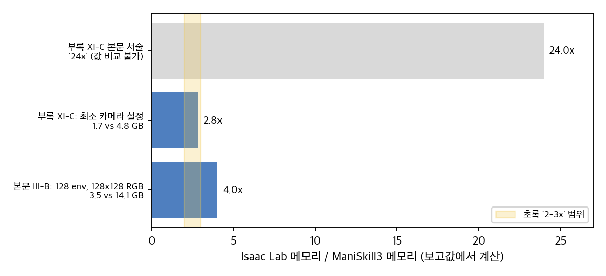
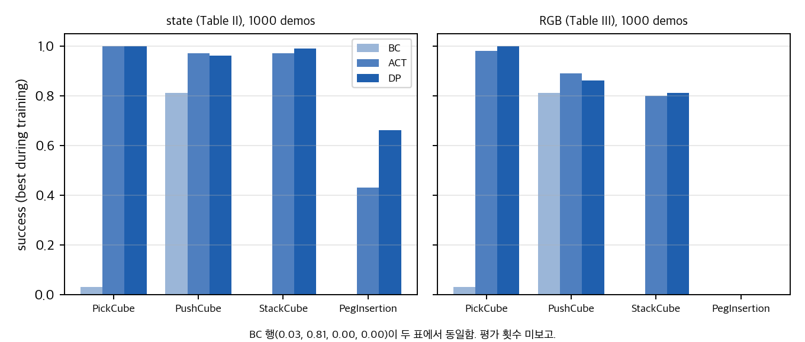
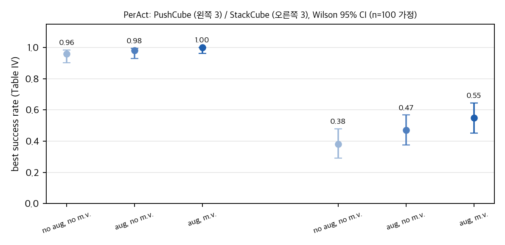

> **논문:** Stone Tao 외 (UCSD, CMU, Hillbot, TU Dresden, Tsinghua, King's College London). *ManiSkill3: GPU Parallelized Robotics Simulation and Rendering for Generalizable Embodied AI.* arXiv:2410.00425 (v2, 2025-05-30). RSS 2025 (공식 proceedings, DOI 10.15607/RSS.2025.XXI.021, 제목 "Demonstrating GPU Parallelized Robot Simulation and Rendering for Generalizable Embodied AI with ManiSkill3").
> 공식 코드(Apache-2.0, mani-skill/ManiSkill)는 클론해서 정적으로만 읽었고 실행하거나 설치하지 않았습니다. 논문 그림은 싣지 않고, 우리가 만든 그래프만 씁니다.

## 이 논문이 주장하는 것

GPU에서 물리와 렌더링을 함께 병렬화한 로봇 시뮬레이터를 공개합니다. 초록의 핵심 수치는 세 가지입니다. 시뮬레이션과 렌더링을 합쳐 30,000 FPS 이상, GPU 메모리 2–3배 적음, 그리고 과제 범주 12개와 20개 이상의 로봇입니다. 실물 쪽으로는 저가 Koch v1.1 팔에서 시각 정책을 시뮬레이션만으로 학습해 91.6% 성공률을 보고합니다.

## 보고된 숫자를 다시 계산하면

**메모리 비율은 본문 안에서 맞지 않습니다.** 128개 환경, 128x128 RGB에서 Isaac Lab은 14.1 GB, ManiSkill3는 3.5 GB를 씁니다. 약 4.0배입니다. 부록의 최소 카메라 설정은 4.8 GB 대 1.7 GB로 2.8배입니다. 초록의 "2–3배"와는 맞습니다. 그런데 부록에는 "about 24x"라는 문장이 따로 있고, 이 값은 위 두 비율과 맞지 않습니다.

**실물 91.6%는 24회 시도의 결과입니다.** 세 번 학습한 정책을 각각 8회씩 평가해서 22번 성공했습니다. 22/24의 Wilson 95% 신뢰구간은 74–98%입니다. 시뮬레이션만 학습한 대조군이 없어서, 이 수치만으로 sim2real 방법이 얼마나 좋은지 말하기 어렵습니다. 초록의 실물 수치는 v1에서 95%였고 v2에서 91.6%로 바뀌었습니다. 이유는 적혀 있지 않습니다.

**모방학습과 PerAct 표는 평가 횟수와 seed 수가 빠져 있습니다.** PerAct 표는 80k 스텝 중 최고 성공률이라서 선택 편향이 있습니다. 평가 100회를 가정하고 계산하면 StackCube의 무증강(38%)과 증강·다중 시점(55%) 차이는 p = 0.016입니다. 최고 체크포인트를 고른 값이므로 실제 차이는 이보다 작을 수 있습니다.

모방학습 표에서는 두 입력 방식(state, RGB)의 BC 1000 demos 행이 네 과제 모두 똑같습니다(0.03, 0.81, 0.00, 0.00). 두 입력 방식에서 같은 값이 나온 이유는 표만으로 알 수 없어 저자 확인이 필요합니다.

## 속도 주장

PPO 학습 시간은 PickCube에서 GPU 시뮬레이션이 약 1분에 상태 기반 학습을 끝내고, ManiSkill2 CPU 시뮬레이션 대비 15배 빠르다고 합니다. RGB 기반은 약 10분에 8배 빠릅니다. 이 배수는 본문 서술값이고 그림에서 시간을 다시 읽지는 않았습니다. v1은 같은 비교를 약 5배로 적었습니다.

## 공식 코드에서 확인된 것

공식 저장소에서 확인된 것은 몇 가지입니다. 벤치마크 설정은 논문과 같이 시뮬레이션 120 Hz, 제어 60 Hz, 솔버 위치 4·속도 0입니다. 디지털 트윈 SIMPLER 포팅은 네 과제로 등록되어 있습니다. 로봇 패키지는 24개입니다. PPO 기본 할인율 0.8도 논문과 같습니다.

반면 PPO 기본 환경 수(512)와 롤아웃 길이(50)는 논문이 권장하는 범위(256–4096 환경, 16–32 스텝)와 다릅니다. 실물 Koch sim2real 학습 설정은 공개 저장소에서 찾지 못했습니다. 저장소에 있는 디지털 트윈 예시는 SO100 팔입니다.

## 이 맥에서 구현할 수 있는가

**논문 수치의 재현은 이 맥에서 할 수 없습니다.** Apple M4 Pro에는 CUDA가 없습니다. PhysX GPU 시뮬레이션과 Isaac Lab 비교는 CUDA가 필요합니다. 실물 로봇과 SIMPLER 가중치도 필요합니다.

**할 수 있는 것은 계산과 검사입니다.** 실험 표의 신뢰구간과 검정, 상관의 점 개수 가정, 리플레이 버퍼 메모리(20만 프레임 x 128x128 RGB = 약 9.8 GB, 본문의 "최소 9 GB"와 맞음), 설정 대조입니다. 설치 없이 작은 CPU 토이로 모방학습 방법들의 순위가 과제 구조에 따라 바뀌는지도 볼 수 있습니다. 노력은 1–2일 정도입니다.

## 읽을 때 조심할 것

- 처리량 30,000 FPS는 그림 한 장에만 있고, 측정 과제와 환경 수가 본문에 없습니다.
- Isaac Lab과의 비교는 단일 cartpole 과제이고, 렌더링 방식도 다릅니다(레이트레이싱 대 래스터화). 저자도 "apples-to-apples가 아니다"라고 씁니다.
- 91.6%는 24회 시도입니다. 신뢰구간이 74–98%로 넓습니다.
- 논문은 CC BY 4.0이지만, 그림에 제3자 장면과 실물 사진이 있어서 이 글에는 넣지 않았습니다.

## 정리

ManiSkill3는 GPU 병렬 시뮬레이션과 렌더링을 가장 넓게 묶어 낸 오픈소스 시뮬레이터입니다. 공식 코드도 공개되어 있고 Apache-2.0입니다. 다만 보고 수치는 과제 하나, 최고 체크포인트, 또는 본문과 부록 사이에서 서로 다른 값으로 나뉘어 있습니다. 읽을 때는 주장별로 어떤 표가 근거인지 확인하는 것이 좋습니다.

## 자료

- [통합 리포트 PDF](report/report_public.pdf)
- [01. 논문 분석: ManiSkill3 (arXiv:2410.00425 v2)](analysis/01_paper_analysis.md)
- [02. 선행연구, 관련 자료, 이 저장소의 관계](analysis/02_prior_work.md)
- [03. 수치 재계산과 일관성 검사](analysis/03_analysis.md)
- [04. 코드 검증: 논문 ↔ 공식 저장소 (정적 읽기)](analysis/04_code_verification.md)
