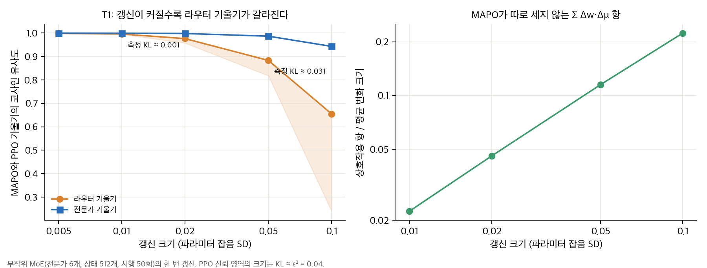
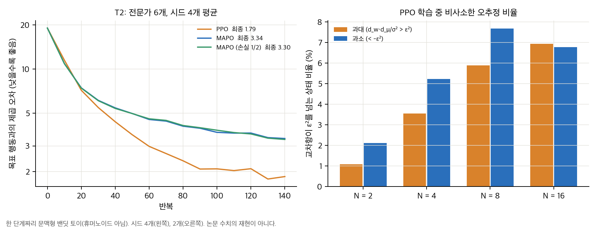
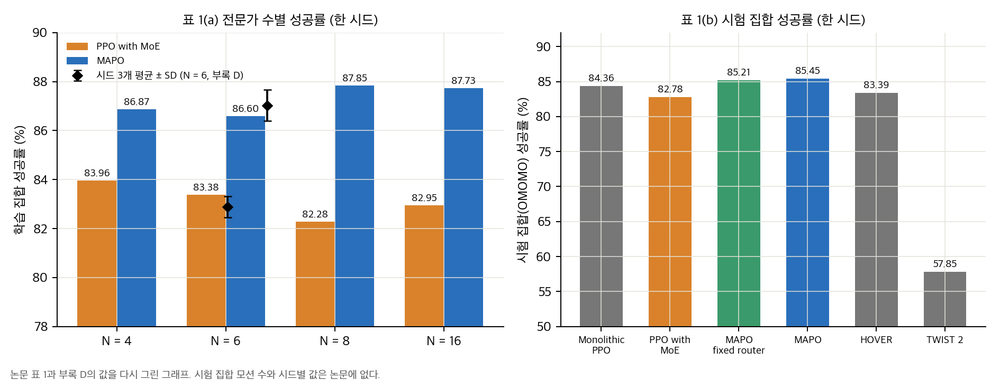

# MAPO 수치 재계산, 일관성 검사, 토이

재계산 스크립트는 `analysis/recompute.py`(수 초, numpy·scipy), 토이는 `analysis/toy_algebra.py`(수 초)와 `analysis/toy_moe_ppo.py`(약 75초, torch CPU)입니다. 결과는 `analysis/*_results.json`에 있습니다. 논문은 모션 수, 시험 모션 수, 시드별 값을 적지 않아서, 가정한 값은 문장 안에 "(… 가정)"으로 밝혔습니다. 그림에서 읽은 값은 "(그림 판독)"이라고 적었고 눈금 한 칸 안팎의 오차가 있습니다.

## 1. 보고 수치 재계산 (V1–V12)

### V1. 성공률이 정수 비율로 나오려면 필요한 분모

표 1의 성공률은 소수 둘째 자리입니다. 성공률 = 성공 수 / M으로 보고 소수 둘째 자리로 반올림해 모두 맞는 가장 작은 M을 찾았습니다.

| 값 묶음 | 값 수 | 가능한 가장 작은 M | 다음 가능한 M |
|---|---|---|---|
| 학습 집합 (N = 4, 6, 8, 16과 세 행) | 10 | **6,016** | 6,017, 6,253, 6,535 |
| 시험 집합 (여섯 행) | 6 | **3,293** | 4,130, 4,233, 4,496 |
| 둘 모두 | 16 | 7,195 | 7,443, 7,449 |

- M이 약 10,000을 넘으면 어떤 소수 둘째 자리 값도 정수 비율로 가능해, 이 검사는 M이 작을 때만 걸러냅니다.
- 학습 집합 M ≥ 6,016이라는 것은 AMASS(원논문 11,000개 이상)와 LAFAN1을 합친 규모와 맞습니다(M이 모션 수이든 모션 수 × 롤아웃 5이든 같은 검사).
- **시험 집합(OMOMO) M이 3,293 미만이면 표시된 값이 정수 비율이 아닙니다.** 롤아웃 5회 평균 등으로 분모가 늘어난 경우일 수 있습니다. 논문이 시험 모션 수와 롤아웃 수를 적지 않아 판단하지 못합니다(저자 확인 필요).

### V2. MAPO − PPO with MoE 차이 (표 1)

| 집합 | 성공률 | Eg-pos | El-pos | Eacc | Evel | Ert-h | Ert-vel | Ert-r | Ert-p |
|---|---|---|---|---|---|---|---|---|---|
| 학습 N = 4 | +2.91 | −12.9 | −10.4 | −0.629 | −2.15 | −0.004 | −0.083 | −0.012 | −0.011 |
| 학습 N = 6 | **+3.22** (+3.9%) | −5.7 | −9.88 | −0.923 | −2.52 | −0.010 | −0.095 | **+0.018** | **+0.012** |
| 학습 N = 8 | +5.57 | −29.6 | −21.82 | −1.721 | −5.45 | −0.019 | −0.178 | +0.012 | +0.005 |
| 학습 N = 16 | +4.78 | −22.7 | −21.5 | −1.626 | −4.52 | −0.013 | −0.153 | +0.010 | +0.003 |
| 시험 N = 6 | +2.67 | −15.6 | −8.61 | −0.687 | −2.01 | −0.011 | −0.071 | +0.011 | −0.001 |

(오차는 음수가 개선. 단위는 표 1 그대로.) 시험 집합에서 MAPO − Monolithic PPO는 성공률 +1.09 %p, Eg-pos −1.4 mm, El-pos −1.14입니다. MAPO − MAPO with fixed router는 +0.24 %p, Eg-pos **+4.2**(MAPO가 더 큼)입니다.

### V3. 최선 칸 수와 "대부분 지표에서 최저" 문장

표의 굵은 글씨(최선)를 다시 계산했더니 모든 칸이 맞았습니다(불일치 0). 굵은 칸 수는 다음과 같습니다.

| 집합 | MAPO | PPO with MoE | MAPO with fixed router | TWIST 2 | 오차 8개 중 MAPO 최선 |
|---|---|---|---|---|---|
| 학습 (9칸) | 7 (성공률 포함) | 2 (Ert-r, Ert-p) | 0 | - | **6** |
| 시험 (9칸) | 5 (성공률, El-pos, Evel, Ert-h, Ert-vel) | 0 | 1 (Eg-pos) | 3 (Eacc, Ert-r, Ert-p) | **4** |

시험 집합에서 HOVER와 TWIST 2를 빼고 네 행만 보면 8개 중 6개입니다(Eacc는 MAPO가 최선). 논문 문장 "lowest tracking errors across most metrics on both the training and evaluation datasets"(§6.2)는 학습 집합과 네 행 비교에는 맞고, 표에 TWIST 2가 들어간 시험 집합에서는 8개 중 4개입니다(`03` K3).

### V4. 전문가 수 절제 문장

본문: "MAPO consistently achieves better performance than PPO with MoE across all tested expert counts, except for the root roll and pitch errors"(§6.2). 칸별 확인:
- 성공률과 오차 6개(Eg-pos, El-pos, Eacc, Evel, Ert-h, Ert-vel)는 N = 4, 6, 8, 16 모두에서 MAPO가 좋습니다(24칸 중 24칸).
- Ert-r, Ert-p는 **N = 6, 8, 16에서 MAPO가 나쁘고, N = 4에서는 MAPO가 좋습니다.** 예외 문장은 N = 4에는 맞지 않습니다.

### V5. 시드 3개 요약 통계로 본 학습 집합 차이

부록 D "mean ± standard deviation across the three training seeds"를 표본 SD(ddof = 1)로 읽고 Welch t 검정을 했습니다(시드 수 3, 시드별 값은 논문에 없음).

| 지표 | MAPO | PPO with MoE | 차이 | 95% 구간 | Welch p |
|---|---|---|---|---|---|
| 성공률 | 87.03 ± 0.64 | 82.89 ± 0.43 | +4.14 %p | 2.83–5.45 | 0.0014 (t = 9.3, df = 3.5) |
| Eg-pos | 147.9 ± 1.5 | 154.1 ± 1.7 | −6.2 mm | −9.9 – −2.5 | 0.0094 |

SD를 모집단 SD(ddof = 0)로 읽으면 p는 0.0027(성공률), 0.019(Eg-pos)입니다. 시드가 3개뿐이라 검정력이 낮지만, 이 요약 통계로는 두 방법의 차이는 시드 변동보다 큽니다. 같은 시드 수로 표 1의 나머지 칸(N 절제, 시험 집합, 기준선)은 비교할 수 없습니다.

**표 1의 값이 시드 중 하나인지 확인.** 표 1 값(MAPO 86.60, PPO 83.38)이 세 시드 중 하나라면 시드 평균과 SD가 양립해야 합니다. 표본 SD(ddof = 1) 기준으로 양립하려면 PPO with MoE 성공률에서 나머지 두 시드의 차이가 0.05–0.19 %p여야 합니다(보고된 SD 0.43의 반올림 구간 반영). 모집단 SD로 읽으면 여유가 큽니다. 다른 세 값(MAPO 성공률, 두 Eg-pos)은 여유가 있습니다. 표 1 값과 시드 평균의 차이는 SD의 0.3–1.1배입니다. 이 점은 SD 정의에 따라 달라지는 관찰이며, 정의를 적어 주면 해소됩니다.

### V6. 182, 155, 191 개 모션

- 세 시드의 개수 평균 176.0, 표본 SD 18.7. 초록의 182는 이 중 첫째 값입니다. 반대 방향은 1, 1, 0개이므로 순(net) 차이는 181, 154, 191입니다(시드 번호와 표 1 시드의 대응은 논문에 없음).
- 모션 수 N을 모릅니다. 성공률 차이(표 1 단일 시드 3.22 %p, 3시드 평균 4.14 %p)를 모션 수로 바꾸면 N = 5,621(단일 시드)과 4,372(3시드 평균)에서 일관된 승리 집합(181개)이 전체 격차와 같아집니다. N이 이보다 크면 격차의 나머지는 "5회 중 일부만 성공"한 모션에서 나옵니다.

| 가정한 N | 전체 격차 모션 수 (3.22 / 4.14 %p) | 일관된 집합이 설명하는 몫 |
|---|---|---|
| 5,000 | 161 / 207 | 112% / 87% |
| 8,000 | 258 / 331 | 70% / 55% |
| 11,000 | 354 / 455 | 51% / 40% |

- "일관되게"는 5회 평가 롤아웃이 모두 성공(또는 실패)한 경우를 뜻합니다(§6.2). 평가 롤아웃은 학습된 정책 하나에 대한 반복이므로(본문 "evaluation rollouts of each trained policy") 정책 학습의 무작위성은 이 개수에 들어 있지 않습니다. 시드 3개의 개수 변동(155–191)이 그 변동의 일부를 보입니다.

### V7. 시험 집합 차이의 구분 가능성 (N과 불일치 비율 가정)

시험 집합 성공률 차이는 MAPO − Monolithic PPO 1.09 %p, − PPO with MoE 2.67 %p, − MAPO with fixed router 0.24 %p입니다. 같은 모션에 대한 짝 비교로 보고, 두 정책의 성공 여부가 갈리는 모션 비율 d를 가정해 양측 5%, 검정력 80%에 필요한 시험 모션 수를 계산했습니다(정규 근사).

| 비교 | 차이 (%p) | d = 0.05 | d = 0.10 | d = 0.20 |
|---|---|---|---|---|
| MAPO − Monolithic PPO | 1.09 | 3,304 | 6,607 | 13,213 |
| MAPO − PPO with MoE | 2.67 | 551 | 1,101 | 2,202 |
| MAPO − fixed router | 0.24 | 68,133 | 136,266 | 272,531 |

d = 0.10 가정에서 짝 비교 p는, 시험 모션 N = 1,000일 때 대 Monolithic 0.28, 대 PPO with MoE 0.0074이고, N = 2,000에서 각각 0.12와 0.0002입니다. 논문에 시험 모션 수가 없으므로 이 표는 "N과 d가 얼마여야 구분되는가"를 보여 줄 뿐입니다. 한 시드의 결과이므로 학습 변동은 포함되지 않습니다.

### V8. 학습 규모 산술 (표 C.2)

- 반복당 표본 4096 × 24 = 98,304, 미니배치 4개(24,576), 에폭 5 → 반복당 기울기 갱신 20회.
- 그림 4의 "Training steps" 30,000을 반복 횟수로 가정(rsl_rl 관행, 논문에 정의 없음)하면 환경 스텝 2.95 × 10⁹, 기울기 갱신 600,000회. 절제 실험(15k)은 1.47 × 10⁹.
- 환경 스텝 속도를 초당 20,000, 40,000, 60,000 스텝으로 가정(논문에 없음)하면 한 번 학습은 41, 20.5, 13.7 시간입니다.
- 논문에서 세어 본 학습 실행 수의 하한: 표 1 11회(Monolithic, PPO MoE, fixed router, MAPO, HOVER, N 절제 6개), 추가 시드 4회, 그림 5 곡선 22개 이상. 약 37회, 대부분 단일 A6000입니다. 총 GPU 시간은 수백 시간 규모입니다(위 속도 가정 기준, 추정).

### V9. 보상 표 (표 C.1)

- 양의 항 가중치 합 24.0 (루트 방향 1, 상대 몸체 위치 20, 방향 1, 속도 1, 각속도 1). 상대 몸체 위치가 83%.
- 상대 몸체 위치 항 exp(−e²/0.05)의 값(e는 몸체 평균 제곱 오차의 제곱근, 가정): e = 0.05 m 0.951, 0.1 m 0.819, 0.2 m 0.449, 0.3 m 0.165, 0.5 m 0.0067.
- 성공 기준의 평균 위치 오차 0.5 m에서 같은 크기의 루트 상대 오차의 보상은 0.007입니다. 성공 오차가 전역인지 루트 상대인지 본문에 없어서 정의가 같다고 볼 수 없고, 크기 비교만 합니다. 
- 비교: BeyondMimic 코드의 몸체 위치 보상은 σ = 0.3이어서 같은 오차 0.3 m에서 e⁻¹ = 0.37이고, MAPO 식은 0.165입니다.

### V10. 파라미터 수 (표 C.2의 층 크기, 관측 차원 O와 행동 차원 29는 가정)

| 전문가 수 | O = 200 | O = 300 | O = 400 |
|---|---|---|---|
| 2 | 439,484 | 490,684 | 541,884 |
| 4 | 546,040 | 597,240 | 648,440 |
| 6 | 652,596 | 703,796 | 754,996 |
| 8 | 759,152 | 810,352 | 861,552 |
| 16 | 1,185,376 | 1,236,576 | 1,287,776 |

N = 16은 N = 4의 약 2.2배 파라미터입니다. 표 1의 N 절제는 용량과 섞여 있습니다. Monolithic PPO의 층 크기는 논문에 없어(표 C.2는 MoE 구조만) 용량이 같은지 확인할 수 없습니다(`03` K7).

### V11. 그림 판독 값 (눈금 한 칸 안팎)

- 그림 4(a): MAPO 약 28, PPO with MoE 약 15.5 → 비 1.81. 프로젝트 페이지의 "약 1.8배"와 맞음.
- 그림 4(c): 전문가 쌍 15개의 거리 차이는 양수 11, 음수 4, 평균 1.75, 중앙값 2.1. 음수 4쌍은 모두 E1이 낀 쌍(E1–E2 −2.0, E1–E3 −0.3, E1–E4 −0.5, E1–E6 −0.5). 5.3은 색 막대 눈금(±4)을 넘습니다. 단위는 본문에 정의 없음(평균 L2 거리).
- 그림 4(b): 상위 1·2위 합 MAPO 0.80, PPO 0.73이고 나머지 네 개의 합은 0.20, 0.27(균등이면 6분의 1 = 0.167).

### V12. 클리핑 비율 (부록 D 본문)

- 바닐라 정책 기울기 학습 중: MAPO 라우터 기준 약 5%, PPO 기준 약 50%(10배).
- MAPO 학습 중: MAPO 라우터 기준 약 2%, PPO 기준 약 24%(12배). 그림 D.3(b) 판독으로 MAPO 전문가 기준은 약 20%로, PPO 기준 24%와 가깝습니다. 따라서 PPO 기준으로 더 많이 잘리는 몫의 대부분은 라우터 성분입니다.

## 2. 일관성 검사 (K1–K10)

**K1. 초록과 프로젝트 페이지.** 논문 초록은 182개 모션 문장을, 프로젝트 페이지 초록은 "about 1.8× higher reward" 문장을 씁니다. 둘 다 논문 본문 값과 맞습니다(V6, V11). 어느 쪽이 최신인지는 알 수 없습니다.

**K2. N 절제 문장.** V4.

**K3. "대부분 지표" 문장.** V3. 시험 집합에서는 8개 중 4개(TWIST 2 포함), 네 행만이면 6개입니다.

**K4. N = 2 절제가 표 1에 없음.** 그림 2는 N = 2, 4, 8, 16을, 표 1은 N = 4, 6, 8, 16을 씁니다. 그림 2의 "과소추정이 우세한" 설정(N = 2)에 대한 성능 결과는 보고되지 않았습니다. 본문 §6.1이 N = 6을 "prior works [19, 30]를 따른" 값이라고 적으며, 그림 2와 표 1에서 쓴 N 집합이 달라 이 연결은 직접 확인되지 않습니다.

**K5. 엔트로피 계수와 보상 격차 (그림 5(b)).** MAPO는 σ에 두 손실의 기울기가 들어가 엔트로피의 유효 계수가 절반이 됩니다(§6.2). 논문은 두 손실에 1/2을 곱한 Averaged-MAPO를 같은 계수의 PPO와 비교하고 "모든 값에서 더 높다"고 씁니다. 그림 5(b) 판독(15k 스텝, 겹침으로 ±2 안팎)은 다음과 같습니다.
- MAPO 기본값(그림 점선 "MAPO @ 15k")은 약 24.5.
- PPO with MoE는 엔트로피 계수 0.01에서 약 13, 0.005에서 약 22–23, 0.001에서 약 25.
- Averaged-MAPO는 0.01에서 약 15, 0.005에서 약 25–26, 0.001에서 약 28–30.
→ 같은 계수끼리의 격차는 약 1.5–5이고, 기본 설정 간 격차(약 24.5 대 13)의 상당 부분은 계수를 0.01에서 0.005로 바꾼 것과 맞먹는 크기입니다. 표 1의 성공률은 엔트로피 0.01의 기본 PPO와 비교한 값입니다(표 C.2). 엔트로피 계수를 낮춘 PPO의 성공률 표는 없습니다. 표 1 비교의 "PPO 쪽 하이퍼파라미터 튜닝 수준"은 확인할 수 없습니다.

**K6. ε 절제의 대칭성 (그림 5(a)).** MAPO는 ε = 0.1, 0.2로, PPO는 0.2, 0.3, 0.4로 시험했습니다. PPO에 ε = 0.1은 없습니다. "갱신 예산이 커서 이긴 것이 아니다"는 PPO의 ε를 키워도 나빠지고 MAPO의 ε를 줄여도 유지된다는 근거입니다. PPO를 보수적으로 한 쪽(0.1)은 비교에 없습니다.

**K7. 용량 일치.** Monolithic PPO의 층 크기가 논문에 없고(표 C.2는 MoE 구조), 표 1에서 MoE와 단일 정책의 차이는 학습 집합 +1.6 %p, 시험 집합 −1.58 %p입니다(PPO with MoE − Monolithic). 그림 4(a)의 "MoE가 단일 정책보다 높은 보상"은 보상 곡선이고, 시험 집합 성공률은 반대 방향입니다.

**K8. 식 (3)–(6) 항등식.** 수치로 확인했습니다. 무작위 MoE에서 KL_measured − (KL_expert + KL_router + 교차항)의 최대 절댓값 3.6 × 10⁻¹⁶(`토이 T1`, §3.1).

**K9. 4절 분해와 5절 비율이 다른 분해.** 4절의 KL 분해는 순차 경로(전문가 먼저)를, 식 (7)의 비율은 둘 다 옛 값에서 출발하는 병렬 분해를 씁니다. 토이 T1에서 (a) 같은 갱신의 교차항 부호가 전문가 먼저와 라우터 먼저 경로에서 **13%의 상태에서 서로 다르고**(갱신 크기 0.05, 평균 측정 KL 0.031), 피어슨 상관은 0.90입니다. 과대·과소의 구분은 경로 선택에 따라 일부 달라집니다. (b) 병렬 분해는 Σ Δw_e Δμ_e 상호작용 항을 놓치며, 그 크기는 평균 변화의 2.3%(갱신 0.01), 4.3%(0.02), 11.3%(0.05), 22.8%(0.1)로 갱신 크기에 거의 비례합니다.

**K10. 부록 B의 기울기 주장.** 토이 T1에서 확인한 것: (a) 새 정책 = 옛 정책에서는 MAPO와 PPO의 기울기가 같습니다(코사인 1.0, 노름 비 1.0). (b) 전문가 평균 기울기 블록의 MAPO/PPO 비는 w_old/w와 6자리까지 일치(식 25–26이 맞음). (c) 갱신이 커지면 라우터 기울기의 코사인이 내려갑니다. 갱신 크기 0.02(측정 KL 0.005)에서 0.974, 0.05(KL 0.031)에서 0.884(최소 0.776), 0.1(KL 0.146)에서 0.620(최소 0.065). 전문가 기울기는 각각 0.998, 0.986, 0.941입니다. 무작위 파라미터 변화이고 실제 학습 궤적이 아니므로, 논문의 "라우터 기울기 각도 90° 아래"(그림 B.1)와 모순이 아니며 둘은 다른 양입니다.

## 3. 토이

휴머노이드가 아니며 논문 수치를 재현하지 않습니다. 논문 주장의 수학적 부분과 한 가지 학습 현상을 장난감 규모에서 시험합니다.

### 3.1 토이 T1: 식과 기울기 검사 (`toy_algebra.py`, 수 초)

위 K8–K10의 결과를 냈습니다. 모델은 8차원 상태, 4차원 행동, 전문가 6개의 소규모 MoE이고, 갱신은 무작위 파라미터 잡음입니다. 학습 궤적이 아니어서 크기는 PPO의 ε² = 0.04 규모(측정 KL 약 0.03)에 맞춰 읽어야 합니다.

### 3.2 토이 T2: PPO 대 MAPO (`toy_moe_ppo.py`, 약 75초)

과제: 8차원 상태에서 6개 영역별로 다른 선형 목표 행동(4차원)을 맞추는 한 단계 문맥형 밴딧(보상 = −제곱 오차). 정책은 밀집 소프트맥스 MoE(전문가 6개), 같은 하이퍼파라미터(반복 150회, 반복당 상태 2048, 미니배치 4개 × 에폭 4, Adam 3×10⁻³, ε = 0.2, 엔트로피 0.005), 시드 4개(같은 과제).

| 방법 | 최종 오차 (낮을수록 좋음, 시드별) | 평균 | 클리핑 비율 |
|---|---|---|---|
| PPO | 1.53, 1.51, 1.57, 2.55 | **1.79** | 18.8% |
| MAPO | 3.45, 2.73, 2.93, 4.24 | 3.34 | 라우터 7.9%, 전문가 15.7% |
| MAPO (두 손실 1/2배) | 3.54, 2.86, 2.59, 4.21 | 3.30 | 라우터 8.8%, 전문가 17.3% |
| 단일 정책 (전문가 1개, PPO, 시드 2개) | 7.02, 7.07 | 7.04 | - |

PPO가 MAPO보다 낮은 오차입니다(Welch p = 0.012, 시드 4개, 같은 과제라 일반화 근거는 약함). 두 MAPO 변형은 차이가 없습니다(p = 0.94). **이 토이는 MAPO의 우위를 재현하지 못했습니다.** 이유를 시험하지 않았으며, 가능한 요인은 (i) 한 단계 과제라 시간 신용 할당과 GAE가 없는 점, (ii) 적응 학습률과 공유 인코더가 없는 점, (iii) 부록 B.5가 인정한 라우터 기울기 편향(위 K10)입니다. 논문 주장에 대한 반증이 아니며, MAPO의 이득이 과제 구조에 의존할 수 있다는 정도로 읽어야 합니다.

교차항(식 6)의 크기는 PPO 학습 중에 비사소했습니다. 반복마다 갱신이 끝난 뒤 교차항이 ε²를 넘는 상태 비율은 다음과 같습니다(시드 2개 평균, 초기 10회 반복 제외, 클리핑이 있는 PPO 학습 중 값으로 논문 그림 2의 바닐라 정책 기울기와는 조건이 다름).

| 전문가 수 | 과대 (> ε²) | 과소 (< −ε²) | 측정 KL 평균 |
|---|---|---|---|
| 2 | 1.1% | 2.1% | 0.035 |
| 4 | 3.6% | 5.2% | 0.062 |
| 8 | 5.9% | 7.7% | 0.095 |
| 16 | 6.9% | 6.8% | 0.107 |

과대추정이 전문가 수와 함께 늘어나는 점은 그림 2(a)와 방향이 같습니다. 과소추정도 이 토이에서는 N = 8까지 늘어나고 N = 2에서 가장 적어, 그림 2(b)의 "N이 작을수록 과소추정 우세"와는 방향이 다릅니다. 비율의 크기도 그림 2(0.1–0.4)보다 훨씬 작습니다.

## 4. 그림 (우리가 그림)

표 1의 성공률과 부록 D의 시드 3개 평균 ± SD를 다시 그린 그래프입니다. 시험 집합의 모션 수와 시드별 값은 논문에 없습니다.
