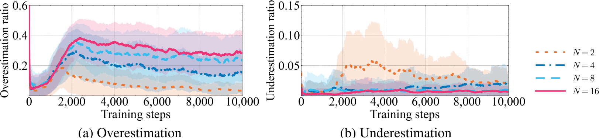
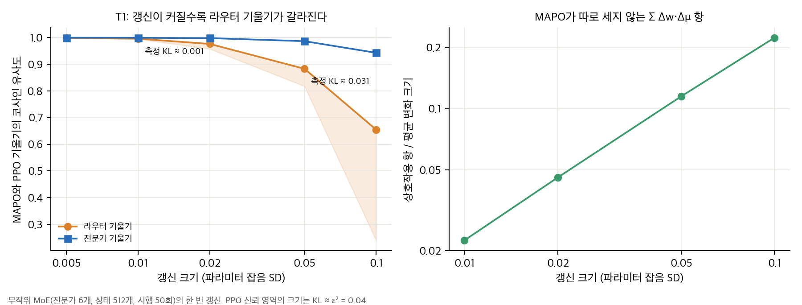
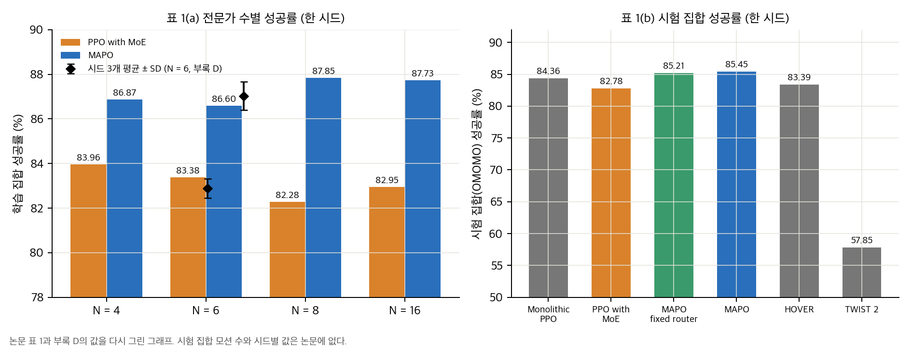
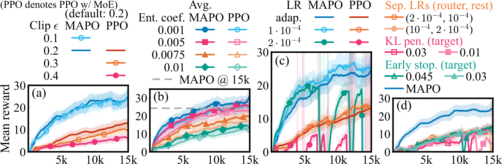
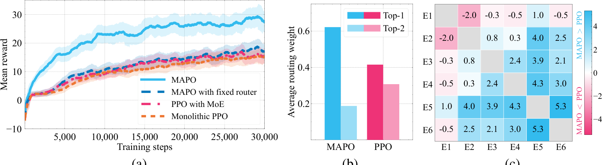
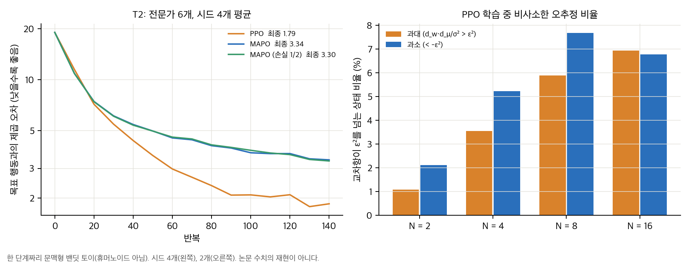

> **논문:** Seonghyeon Lim, Hyeonwoo Lee, Mincheol Kim, Kimin Lee, Hyun Myung. *MAPO: Mixture of Experts with Alternating Policy Optimization for Universal Humanoid Motion Tracking.* CoRL 2026 포스터, arXiv:2611.02613 (v1, 2026-11-02).
> 이 글의 논문 그림 세 장은 출처를 적었고(CC BY 4.0), 나머지 그래프는 이 글을 쓴 쪽이 그렸습니다. 공식 코드는 2026-11-26 기준으로 확인하지 못했습니다.

## 논문이 묻는 것

휴머노이드가 사람 모션 데이터를 따라 하게 만들 때, 모션이 다양하면 하나의 정책이 서로 다른 모션 사이에서 간섭을 겪습니다. 그래서 여러 전문가(expert)와 이들을 섞는 라우터를 둔 MoE 정책이 쓰입니다. 이 논문은 이런 MoE를 PPO로 학습할 때 생기는 문제를 짚습니다. PPO의 클리핑은 옛 정책과 새 정책의 KL을 약 ε² 수준으로 묶는 장치인데, 가우시안 MoE에서는 이 KL에 라우터 변화와 전문가 변화의 **교차항**이 들어갑니다(식 6). 교차항이 양수이면 KL이 부풀어 갱신이 필요 이상으로 막히고(과대추정), 음수이면 줄어 과격한 갱신이 통과합니다(과소추정). 논문은 이를 **발산 오추정**이라 부릅니다.

해결책 MAPO는 같은 데이터에서 두 개의 비율을 따로 계산합니다. 전문가를 갱신할 때는 혼합 가중치를 수집 시점 값으로 고정하고(r_expert), 라우터를 갱신할 때는 전문가 출력을 수집 시점 값으로 고정합니다(r_router). 각 비율을 따로 클리핑하고 두 손실을 더합니다.

*그림 2 (논문 원문). 바닐라 정책 기울기로 MoE를 학습할 때 교차항이 ε²보다 큰 갱신의 비율. © 저자, CC BY 4.0, 출처 arXiv:2611.02613.*

## 이 글에서 확인한 것

**1. 식 3–6은 항등식이고, 분해가 경로에 의존합니다.** 무작위 MoE에서 KL = KL_expert + KL_router + 교차항의 오차가 4e-16이었습니다. 다만 논문 4절은 "전문가 먼저, 라우터 나중" 경로로 분해합니다. 같은 갱신을 "라우터 먼저"로 분해하면 교차항 부호가 달라지는 상태가 13%였습니다(갱신 크기 0.05, 측정 KL 0.031). 또 식 7의 두 비율은 둘 다 옛 값에서 출발하는 다른 분해여서, Σ Δw·Δμ 상호작용 항이 어느 비율에도 들어가지 않습니다. 그 크기는 평균 변화의 11%였습니다(같은 조건).

*그래프 (우리가 그림). 전문가 6개의 무작위 MoE에서 한 번 갱신했을 때의 값입니다. 학습 궤적이 아니고, PPO 신뢰 영역의 크기는 KL ≈ 0.04입니다.*

부록 B가 말하는 전문가 쪽 기울기의 배율(w_old/w)은 6자리까지 맞았습니다. 라우터 쪽은 갱신이 클수록 PPO 기울기에서 벗어납니다(측정 KL 0.031에서 코사인 0.884, 0.146에서 0.620). 논문도 라우터 편향이 있음을 적고 있으며, 그림 B.1로는 기울기 각도가 90° 아래임을 보입니다. 이 토이는 무작위 갱신이라 두 결과를 직접 비교하지는 않습니다.

**2. 학습 집합의 성공률 우위는 시드 3개 요약으로도 분명합니다.** 표 1은 한 시드(86.60% 대 83.38%)입니다. 부록 D의 시드 3개는 87.03 ± 0.64% 대 82.89 ± 0.43%입니다. SD를 표본 SD로 가정하면 차이 +4.14 %p의 Welch p는 0.0014입니다. 표 1 값이 세 시드 중 하나라면, 표본 SD 기준으로 PPO 쪽은 나머지 두 시드의 성공률 차이가 0.05–0.19 %p여야 시드 통계와 양립합니다. SD 정의를 알면 해소되는 관찰입니다.

*그래프 (우리가 그림). 표 1과 부록 D의 값을 다시 그렸습니다. 시험 집합 모션 수와 시드별 값은 논문에 없습니다.*

**3. 시험 집합(OMOMO)의 우위는 작고, 구분 가능성을 판단할 자료가 없습니다.** MAPO 85.45%는 Monolithic PPO 84.36%보다 1.09 %p, PPO with MoE 82.78%보다 2.67 %p 높고, 라우터를 고정한 변형(85.21%)과는 0.24 %p 차이입니다. PPO with MoE는 시험 집합에서 Monolithic보다 낮습니다. 시험 모션 수가 논문에 없어, 짝 비교에서 두 정책의 결과가 갈리는 모션 비율을 10%로 가정하면 시험 모션 N = 1,000일 때 대 Monolithic p는 0.28, N = 2,000에서 0.12입니다(가정한 값).

**4. "대부분의 지표에서 최저 오차"는 집합에 따라 다릅니다.** 오차 지표 8개 중 MAPO가 최선인 것은 학습 집합에서 6개, TWIST 2를 포함한 시험 집합에서 4개입니다(HOVER와 TWIST 2를 뺀 네 행만 보면 6개). 전문가 수 절제의 예외(root roll, pitch 오차)는 N = 6, 8, 16이고 N = 4에는 해당하지 않습니다.

**5. 보상 격차는 엔트로피 계수 선택과 얽혀 있습니다.** MAPO는 σ에 두 손실의 기울기가 들어가 유효 엔트로피 계수가 절반이 됩니다. 논문은 두 손실에 1/2을 곱한 Averaged-MAPO로 같은 계수의 PPO와 비교하고 "모든 값에서 더 높다"고 씁니다.

*그림 5 (논문 원문). 15k 스텝의 절제 실험. © 저자, CC BY 4.0, 출처 arXiv:2611.02613.*

그림 5(b)에서 읽은 값(그림 판독, 겹침 때문에 ±2 안팎)은 다음과 같습니다. MAPO 기본값은 약 24.5이고, PPO with MoE는 엔트로피 계수 0.01에서 약 13, 0.005에서 약 22–23입니다. 같은 계수끼리의 격차는 약 1.5–5로 읽힙니다. 표 1은 엔트로피 0.01 기본값의 PPO와 비교한 값이어서, 엔트로피를 낮춘 PPO의 성공률이 어떤지는 논문만으로는 알 수 없습니다.

*그림 4 (논문 원문). © 저자, CC BY 4.0, 출처 arXiv:2611.02613.*

그림 4(a)의 30,000 스텝 보상은 MAPO 약 28, PPO with MoE 약 15.5로 읽혀 비가 약 1.8입니다. 프로젝트 페이지 초록의 "about 1.8× higher reward"와 맞습니다. arXiv v1 초록에는 이 문장이 없고 대신 "182개 모션" 문장이 있습니다.

**6. 한 단계 밴딧 토이에서는 PPO가 앞섰습니다.** 8차원 상태를 6개 영역으로 나눠 영역마다 다른 선형 목표 행동을 맞추는 문맥형 밴딧에서, 같은 하이퍼파라미터의 전문가 6개 MoE를 시드 4개로 학습했습니다. 최종 오차는 PPO 1.79, MAPO 3.34(Welch p = 0.012)였습니다. 휴머노이드 추종이 아니고 시간 신용 할당, 적응 학습률, 공유 인코더가 없으므로 논문 주장에 대한 반증이 아니며, 이득이 과제 구조에 의존할 수 있다는 정도로 읽어야 합니다. 같은 토이에서 PPO 학습 중 교차항이 ε²를 넘는 상태 비율은 전문가 수와 함께 늘었습니다(과대추정 1.1% → 6.9%, N = 2 → 16). 과소추정은 N = 8에서 가장 컸고(7.7%), 논문 그림 2(b)의 "전문가가 적을수록 과소추정이 우세"와는 방향이 다릅니다. 클리핑이 있는 학습 중 값이라 그림 2의 바닐라 기울기와 조건이 다릅니다.

*그래프 (우리가 그림). 한 단계 문맥형 밴딧 토이. 시드 4개(왼쪽), 2개(오른쪽).*

## 아직 알 수 없는 것

- 학습·시험 모션 수, 평가 롤아웃 수, 표 1의 시드가 세 시드 중 어느 것인지. 표 1의 성공률이 정수 비율이려면 시험 집합의 분모가 3,293 이상이어야 합니다(분모를 모션 수 × 롤아웃으로 늘려 센 경우 포함 여부는 논문에 없음).
- Monolithic PPO의 층 크기, PPO with MoE에서 라우터→인코더 기울기 차단 여부, 적응 학습률이 쓰는 KL의 정의.
- 학생 정책의 실로봇 결과는 영상으로만 제시되어 정량 비교가 없습니다.
- 공식 코드와 체크포인트. 프로젝트 페이지에 링크가 없고, GitHub에는 프로젝트 페이지 소스 저장소만 확인했습니다(2026-11-26).

## 구현 가능성

논문 결과의 재현에는 Isaac Lab과 A6000급 GPU, 한 번 약 14–41 시간(환경 속도 가정)의 학습을 논문 전체로 약 37회 하는 규모가 필요합니다. 반면 식 7의 대리 손실은 PyTorch로 15줄 안팎이어서 작은 과제에서 PPO와 비교해 보는 것은 CPU로 가능합니다.

## 재계산과 토이 스크립트

게시 폴더의 `analysis/recompute.py`(표 재계산), `analysis/toy_algebra.py`(식과 기울기 검증), `analysis/toy_moe_ppo.py`(PPO 대 MAPO 토이)에 있습니다.

## 자료

- [통합 리포트 PDF](report/report_public.pdf)
- [MAPO 논문 분석 (arXiv:2611.02613)](analysis/01_paper_analysis.md)
- [MAPO 선행연구와 가까운 대안](analysis/02_prior_work.md)
- [MAPO 수치 재계산, 일관성 검사, 토이](analysis/03_analysis.md)
- [MAPO 주장 검증 (공식 코드 없음)](analysis/04_claim_verification.md)
