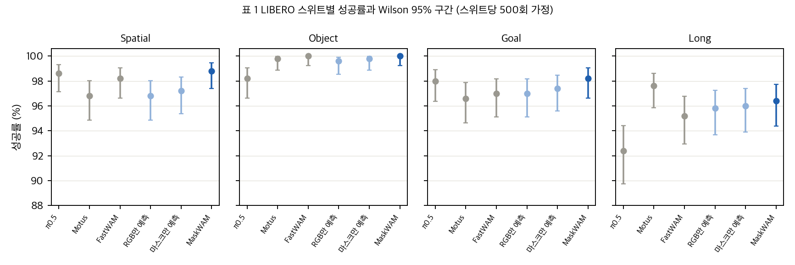
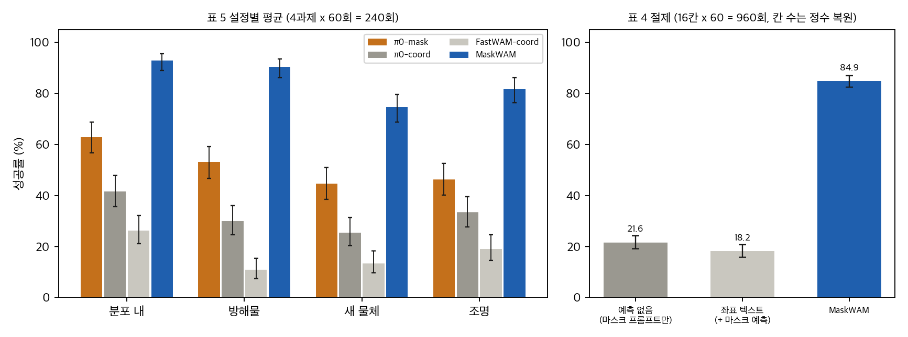
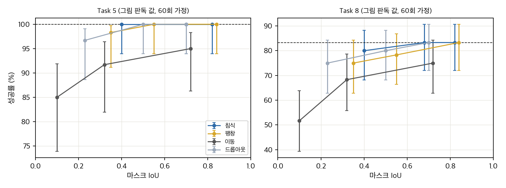

# 03. 수치 재계산, 일관성 검사, 주장 판정

모든 값은 `analysis/recompute.py`가 논문 표 1–5와 그림 4, 8에서 옮긴 숫자로 계산하고 `analysis/recompute_results.json`에 저장합니다(수 초, numpy·scipy). 이 폴더에서는 아무것도 학습하거나 실행하지 않았고, 새 실험(toy)도 하지 않았습니다. 재계산이 이 문서의 중심입니다.

**시행 수 가정.** 논문이 적은 값은 그대로 씁니다: 실로봇 language-clear 과제당 100회(표 3 캡션), language-ambiguous 칸당 60회(표 5 캡션), 그림 8은 서술상 20회(`K3`). 적지 않은 값은 가정합니다: LIBERO는 스위트당 500회(10과제 × 50회, 공식 평가 스크립트 기본 `--num_trials 50`), RoboTwin은 과제당 100회(표의 값이 모두 정수라 100회로 설명됨). 가정이 들어간 검정에는 "(시행 수 n 가정)"을 붙입니다. 쌍체 정보(같은 초기 상태, 같은 시드)가 표에 없어 검정은 비쌍 Fisher와 과제 단위 부호 검정을 씁니다.

## 1. 표 재계산

### 1.1 표 1: LIBERO (V1, V2)

- **V1 평균:** 9개 행의 평균이 모두 칸 값의 산술 평균과 일치합니다. Ours는 98.35 → 98.4, π0는 94.15 → 94.1로 적혀 있습니다(소수 둘째 자리가 5인 두 경우 반올림 방향이 다름. 다른 표에서는 72.25 → 72.3처럼 올림). 모든 칸이 스위트당 500회에서 정수 성공 횟수로 복원됩니다(시행 수 500 가정).
- **V2 검정(풀링 2000회, 시행 수 500 가정):**

| 비교 | 차이(pp) | Fisher p |
|---|---|---|
| Ours 대 RGB만 예측 | +1.05 | 0.030 |
| Ours 대 마스크만 예측 | +0.75 | 0.116 |
| Ours 대 FastWAM | +0.75 | 0.116 |
| Ours 대 Motus | +0.65 | 0.172 |
| Ours 대 π0.5 | +1.55 | 0.0019 |

Ours의 Wilson 95% 구간은 [97.7, 98.8]입니다. 2000회 대 2000회에서 80% 검정력으로 구분할 수 있는 최소 차이는 약 1.3 pp(기준 97%)이므로 FastWAM과 Motus와의 0.65–0.75 pp 차이는 이 설계의 검출 한계 아래입니다. 스위트별 Ours − RGB만: Spatial +2.0, Object +0.4, Goal +1.2, Long +0.6. **Long에서는 Motus 97.6이 Ours 96.4보다 높고(−1.2), Object에서는 FastWAM 100.0이 같습니다**(그림 `own_libero.png`).

그래프: 우리가 그린 그래프. 표 1의 스위트별 성공률과 Wilson 95% 구간(스위트당 500회 가정).

### 1.2 표 2: RoboTwin 2.0 (V3, V4)

- **V3 평균:** 다섯 행 모두 6과제 평균과 일치(72.83, 87.67, 87.33, 88.83, 92.17). 본문의 "+19.4%, +4.5%"(π0, FastWAM 대비)는 평균 차 19.3과 4.5의 반올림 표기이며 포인트 차이입니다(92.2 − 72.8 = 19.4).
- **V4 검정(과제당 100회 가정):**

| 비교 | 평균 차(pp) | 과제 승/패/무 | 부호 검정 p | 풀링 Fisher p (600회) |
|---|---|---|---|---|
| Ours 대 π0 | +19.3 | 6/0/0 | 0.031 | < 1e-18 |
| Ours 대 FastWAM | +4.5 | 6/0/0 | 0.031 | 0.012 |
| Ours 대 RGB만 | +4.8 | 6/0/0 | 0.031 | 0.0075 |
| Ours 대 마스크만 | +3.3 | 6/0/0 | 0.031 | 0.061 |
| 마스크만 대 RGB만 | +1.5 | 4/1/1 | | 0.48 |
| FastWAM 대 RGB만 | +0.3 | | | 0.93 |

여섯 과제 모두에서 Ours가 가장 높습니다. 반면 **마스크만 대 RGB만의 차이(+1.5)는 구분되지 않고**, RGB만 변형은 FastWAM과 거의 같습니다(87.3 대 87.7). 600회 대 600회의 검출 한계는 약 4.8 pp(기준 88%)입니다.

### 1.3 표 3: 실로봇 language-clear (V5, V6)

- **V5 평균:** 모두 일치(55.75, 72.25, 79.0, 79.25, 84.25 → 55.8, 72.3, 79.0, 79.3, 84.3). 본문의 "86% → 91%(과제 1), 76% → 81%(과제 3)"도 표와 같고, 과제 2(77 → 82)와 과제 4(78 → 83)도 같은 +5입니다.
- **V6 검정(과제당 100회, 네 과제 합 400회):**

| 비교 | 평균 차(pp) | 풀링 Fisher p | 과제별 p |
|---|---|---|---|
| Ours 대 π0 | +28.5 | < 1e-18 | 모두 < 0.001 |
| Ours 대 π0.5 | +12.0 | 5e-5 | 0.14, < 0.001, 0.31, 0.38 |
| Ours 대 FastWAM | +5.25 | 0.068 | 0.65, 0.39, 0.60, 0.22 |
| Ours 대 RGB만 | +5.0 | 0.082 | 0.38, 0.48, 0.49, 0.48 |

Ours의 337/400은 Wilson 95% [80.4, 87.5]입니다. 네 과제 모두에서 Ours가 높지만(4승 0패), **FastWAM 및 자기 RGB만 변형과의 차이는 개별 과제에서도 합산에서도 5% 수준에서 구분되지 않습니다**. 과제당 100회로 80% 검정력에 필요한 최소 차이는 약 13 pp, 400회 합산은 약 7 pp입니다.

### 1.4 표 5, 그림 4, 표 4: language-ambiguous (V7–V10)

- **V7 정수 복원:** 표 5의 64개 칸(4 방법 × 4 설정 × 4 과제)이 모두 60회에서 정수 성공 횟수로 복원되고(예: 96.7 = 58/60, 23.3 = 14/60), 설정별 평균도 칸 평균과 소수 첫째 자리까지 일치합니다. Ours의 칸별 성공 횟수는 분포 내 60/60/53/50, 방해물 60/59/51/47, 새 물체 52/46/42/39, 조명 56/55/44/41입니다.
- **V8 전체:** 설정 평균의 평균이 그림 4와 일치합니다: Ours 84.9(815/960, Wilson [82.5, 87.0]), π0-mask 51.7(496/960), π0-coord 32.6(313/960), FastWAM-coord 17.4(167/960). 서론의 "가장 강한 기준선보다 33.2% 높다"는 84.9 − 51.7 = 33.2 포인트입니다. Ours 대 π0-mask 풀링 Fisher p = 8e-57.
- **V9 표 4:** 21.6, 18.2, 84.9는 960회에서 각각 207, 175, 815로 복원됩니다(표 5의 Ours 815와 같음). 비교: Ours-no-pred(21.6)는 π0-mask(51.7)보다 30.1 pp 낮습니다(p = 3e-43). Ours-coord(18.2)와 FastWAM-coord(17.4)의 차이는 +0.8 pp입니다(p = 0.68). Ours-coord는 π0-coord(32.6)보다 14.4 pp 낮습니다(p = 5e-13). Ours 대 no-pred는 +63.3 pp입니다.
- **V10 구조:** 16칸(과제 × 설정)을 단위로 보면 Ours 평균의 95% 구간은 ±5.9 pp이고(칸 간 SD 11.9), 960회 Wilson(±2.3)보다 넓습니다. 같은 네 과제와 같은 체크포인트에서 나온 칸이므로 독립 시행 960회로 읽으면 구간이 좁게 나옵니다. 분포 내에서 과제 5–6은 100%, 과제 7–8은 85.8%입니다. 분포 내 대비 하락은 방해물 −2.5, 새 물체 −18.3, 조명 −11.2 pp입니다.

그래프: 우리가 그린 그래프. 표 5의 설정별 평균(240회, Wilson 95%)과 표 4 절제(960회). 칸 수는 퍼센트에서 정수로 복원한 값입니다.

### 1.5 그림 8: 마스크 잡음 강건성 (V11)

그림 8의 점을 읽은 값입니다(그림 판독 값, 오차 ±0.5 pp 안팎). 두 과제 모두 침식, 팽창, 이동, 드롭아웃 각 3점과 온라인 SAM3(IoU 1.0) 기준선입니다.

| 과제 | 온라인 | 침식 | 팽창 | 이동 | 드롭아웃 |
|---|---|---|---|---|---|
| 5 | 100 | 100, 100, 100 | 98.3, 100, 100 | 85.0, 91.7, 95.0 | 96.7, 100, 100 |
| 8 | 83.3 | 80.0, 83.3, 83.3 | 75.0, 78.3, 83.3 | 51.7, 68.3, 75.0 | 75.0, 80.0, 83.3 |

읽은 26개 값 중 **11개(과제 5에서 98.3, 96.7, 91.7, 과제 8에서 83.3 등)는 20회 시행으로는 나올 수 없고(5 pp 단위), 모두 60회에서의 정수 비율로 설명됩니다**(예: 91.7 = 55/60, 51.7 = 31/60). 온라인 SAM3의 100%와 83.3%도 표 5 분포 내 과제 5, 8의 값과 같습니다. 이 점은 `K3`에서 다룹니다. 60회 기준(시행 수 60 가정)으로 과제 8의 이동 IoU 0.1 (51.7%, 31/60)은 온라인 기준선(83.3%, 50/60)보다 낮고(Fisher p = 0.0004), 드롭아웃 IoU 0.23 (75%, 45/60)은 구분되지 않습니다(p = 0.37).

그래프: 우리가 그린 그래프. 그림 8의 판독 값을 다시 그렸고 구간은 조건당 60회 가정의 Wilson 95%입니다. 점선은 온라인 SAM3 기준선입니다.

### 1.6 본문 산수 (V12)

abstract·서론·§4의 파생 수치는 모두 표에서 재현됩니다: Q1의 +2.0(Spatial)과 +1.2(Goal), LIBERO 97.3 → 98.4(+1.1), RoboTwin +19.4와 +4.5, 실로봇 과제 1의 86 → 91과 과제 3의 76 → 81, 33.2 pp. 부록 B.1의 "50개 에피소드 주석에 약 3분"은 에피소드당 3.6초이고, 언어 모호 과제의 점 프롬프트 5–10초/에피소드는 이와 별도의 추가 시간으로 읽힙니다.

### 1.7 계산량 산술 (V13, `04` §4에서 사용)

코드 설정(`04` §4)으로 계산한 근사입니다. 측정값이 아닙니다. 384 × 320 입력, 시간 압축 4배와 공간 16배, 패치 2 → 잠재 격자 3 × 12 × 10 = **비디오 토큰 360개**(마스크는 채널로 이어 붙이므로 토큰이 늘지 않음), 행동 토큰 48개. Wan 5B DiT 약 4.9 B, 행동 전문가 약 0.63 B 파라미터. bf16 가중치 약 10.3 GiB(공개 체크포인트 파일 11,281,252,992 B와 같은 규모). 1회 비디오 패스 약 3.5 TFLOP, 청크 1개 추론(비디오 2패스 + 행동 10스텝) 약 7.7 TFLOP입니다. 전체 파인튜닝의 AdamW 상태까지 합하면 약 82 GiB 규모입니다.

## 2. 해석

1. **마스크 스트림의 기여는 방향이 일관되고 크기는 맥락마다 다릅니다.** LIBERO +1.05 pp(p = 0.030, 단일 평가 가정), RoboTwin +4.8 pp(6/6), 실로봇 language-clear +5.0 pp(p = 0.082). 세 곳 모두 같은 방향이지만 어느 곳도 "개별 과제" 수준에서는 구분되지 않습니다. 표에는 시드 반복과 신뢰구간이 없습니다.
2. **RGB만 예측하는 변형이 FastWAM과 같은 수준입니다**(RoboTwin 87.3 대 87.7, 실로봇 79.3 대 79.0). 이 변형은 MoT와 채널 확장을 갖고 있으므로 구조 변경 자체가 이득을 주는 것은 아니고, 이득은 마스크 예측 스트림에서 온다는 읽기와 맞습니다. 다만 RGB만 변형의 학습 설정(마스크 채널 존재 여부, 시퀀스 길이)이 FastWAM과 같은지는 적혀 있지 않습니다.
3. **language-ambiguous의 격차는 가장 크고 가장 해석이 어렵습니다.** Ours 84.9 대 π0-mask 51.7은 확실하지만, 이 비교는 백본(Wan 5B WAM 대 π0), 학습 데이터 처리, 마스크 주입 경로(채널 연결 + 예측 감독 대 SigLIP 임베딩 덧셈)가 모두 다릅니다. 마스크 프롬프트를 쓰되 예측을 뺀 같은 WAM(Ours-no-pred 21.6)이 π0-mask보다 낮으므로, "WAM이 시각 프롬프트와 잘 맞는다"보다 "이 주입 경로는 예측 감독이 있어야 쓰인다"가 데이터가 직접 지지하는 쪽입니다. 부록 C의 대안 설계는 수치가 없어 이 해석을 더 좁히지 못합니다.
3. **텍스트 좌표 프롬프트에서는 마스크 예측의 이득이 보이지 않습니다.** 미래 마스크 예측을 가진 Ours-coord(18.2)가 가지지 않은 FastWAM-coord(17.4)와 구분되지 않습니다(p = 0.68). 초록의 "표준 텍스트 조건 WAM에도 미래 마스크 예측이 큰 이득을 준다"는 LIBERO·RoboTwin·실로봇 language-clear(위 1.)의 크기로 지지되고, 모호성 과제의 텍스트 조건에서는 확인되지 않습니다.
4. **일반화의 "최소 하락"은 방해물에만 해당합니다.** 분포 내 대비 하락은 방해물에서 Ours −2.5 대 π0-mask −10.0 pp, 새 물체에서 −18.3 대 −18.3, 조명에서 −11.2 대 −16.6입니다. 절대 성공률은 모든 설정에서 Ours가 높지만, 새 물체의 하락 폭은 π0-mask와 같습니다.

## 3. 본문·표 일관성 (K)

| 번호 | 위치 | 관측 | 비고 |
|---|---|---|---|
| K1 | 표 1 π0.5 Spatial | 98.6, 평균 96.8. Fast-WAM 논문 표 2의 π0.5 행은 Spatial 98.8(평균 96.9)이다 | 98.8이면 Ours(98.8)와 Spatial에서 같고 "표 1의 π0.5를 넘는다"는 서술이 칸 단위로는 성립하지 않음. 저자 확인 필요 |
| K2 | 서론 (3), §4 "new SOTA 98.4%" | 표 1에는 LingBot-VA와 Cosmos Policy가 없다. 둘 다 참고문헌에 있고(WAM 목록 [23, 26]) LingBot-VA의 LIBERO 평균은 98.5, Fast-WAM의 Joint 변형도 98.5로 보고되어 있다. 평가 횟수가 다르다(LingBot-VA는 1500회) | 최고 기록은 표에 실린 행 기준으로 해석됨. Long에서는 Motus가 더 높음(97.6 대 96.4) |
| K3 | 부록 B.2 대 그림 8 | 본문은 "조건당 20회"라고 쓰지만, 그림 8의 판독 값 26개 중 11개가 20회로는 불가능하고 60회로는 모두 가능하다. 온라인 SAM3 기준선은 표 5 분포 내 값(100, 83.3)과 같다 | 60회 또는 표 5의 값을 재사용했을 가능성. 저자 확인 필요 |
| K4 | §4 RoboTwin 문단 "Mask World Model [55]" | 참고문헌 [55]는 Flow-as-interface(Xu 외)이고, Mask World Model은 [36]이다. 같은 논문이 [25]/[26], [33]/[34], [54]/[55]로 두 번씩 실려 있다 | 번호가 한 칸씩 밀린 서술 오류로 보임 |
| K5 | 표 2 RoboTwin | 과제 여섯 개가 줄임말이고 평가 횟수, 학습 방식(과제별/통합), 시드가 없다. FastWAM 행(83, 87, 92, 94, 80, 90)은 이름이 같아 보이는 과제의 Fast-WAM 논문 값(Beat Block Hammer 97, Click Bell 100, Move Playingcard Away 100, Place Burger Fries 99, 무작위화 열)과 다르다(과제 대응은 이름 기준 추정) | 표 캡션은 "과제당 500 무작위화 에피소드 학습"이라 해, 논문 값은 50과제 통합 학습과 다른 설정임. 저장소 이슈 #3도 같은 질문 |
| K6 | §3.2, §4.1 표 3 | 마스크 드롭아웃 0.5라고 쓰지만 공개 체크포인트 설정은 보존 확률 1.0이다(`04` D1). 표 3(language-clear)에서 Ours가 첫 프레임 마스크를 받았는지 서술이 없다 | 마스크를 받았다면 개선이 예측 감독과 프롬프트 입력 중 무엇 때문인지 분리되지 않음 |
| K7 | §4 Q1 "+2.0(Spatial)과 +1.2(Goal)" | 네 스위트 중 두 개만 인용. Object +0.4, Long +0.6 | 서술 선택의 문제. 표에는 모두 있음 |
| K8 | 서론 (3) "33.2%" | 포인트 차이이며 기준선은 언어 모호 과제의 π0-mask. language-clear에서 가장 강한 기준선(FastWAM)과의 차이는 +5.25 pp(p = 0.068) | 서론 문장에는 어느 설정의 기준선인지 없음 |
| K9 | 표 3 | 평균이 두 자리까지 .25인 값(72.25, 79.25, 84.25)을 위로 반올림 | 표 1 π0 94.15는 아래로. 규칙은 표마다 다르지만 영향은 0.1 pp |
| K10 | §6 한계 | 대규모 사전학습을 하지 않은 점과 마스크 자동 추출 한계는 적었다. 반면 시드 수, 학습 스텝, GPU 수, 베이스라인 학습 설정은 본문과 부록 어디에도 없다 | `04` D3에서 공개 설정으로 일부 확인 |

## 4. 주장 판정 (C)

| 번호 | 주장 (위치) | 근거 | 판정 |
|---|---|---|---|
| C1 | LIBERO 98.4%로 표 안 최고 (표 1, §4) | 산수 일치. FastWAM·Motus와의 차이 +0.65–0.75 pp는 검출 한계 1.3 pp 아래(p = 0.12, 0.17). Long에서는 Motus가 높음 | 표의 행 기준으로는 성립, 우월성은 확정하지 못함 |
| C2 | 마스크 예측만으로 프롬프트 없이 LIBERO 개선: 97.3 → 98.4 (§4) | +1.05 pp, p = 0.030(시행 수 500 가정, 단일 평가 가정). 스위트별 +2.0, +0.4, +1.2, +0.6 | 방향은 지지, 크기는 작고 시드 정보 없음 |
| C3 | RoboTwin 92.2%, FastWAM +4.5 (표 2) | 6과제 모두 1위(부호 p = 0.031), 풀링 p = 0.012(시행 수 100 가정). FastWAM 행이 다른 설정의 값(K5) | 같은 설정의 비교로는 지지, 외부 수치와 비교는 보류 |
| C4 | RGB와 마스크의 결합이 최적, 각각은 열세 (§4 RoboTwin, Q1) | 결합 대 마스크만 +3.3 pp(p = 0.061, 6/6 승), 마스크만 대 RGB만 +1.5(p = 0.48), LIBERO 결합 대 마스크만 +0.75(p = 0.12) | 결합이 가장 높다는 방향은 지지. 마스크만 대 RGB만은 구분 안 됨 |
| C5 | Q2: 미래 마스크 예측이 있어야 프롬프트가 쓰인다 (21.6 대 84.9, 표 4) | +63.3 pp는 매우 확실. 한 설계(0 초기화 채널, 첫 프레임 고정)에 대한 대조이고 시드, 대안 설계 수치, π0-mask(51.7)보다 낮은 이유는 없음 | 이 설계에 대해서는 지지. "필수"의 일반화는 보류 |
| C6 | Q3: 마스크 프롬프트가 좌표 텍스트보다 낫다 (84.9 대 18.2) | 격차는 매우 큼. 좌표 텍스트의 형식(정규화 좌표를 문장에 삽입)과 T5 동결 인코더가 불리할 수 있음. π0-coord는 32.6 | 지지(해당 텍스트 형식에 한정) |
| C7 | WAM은 비전 중심이라 시각 프롬프트가 더 잘 맞는다 (초록, 부록 A.3) | 근거는 Ours 대 π0-mask. 백본·주입 경로·데이터가 다르고 Ours-no-pred가 π0-mask보다 낮음 | 분리되지 않음 (교란) |
| C8 | 분포 밖에서도 강건 (방해물 90.4, 새 물체 74.6, 조명 81.7) | 기준선보다 모두 높음(+37.5, +30.0, +35.4 pp 대 π0-mask). 분포 내 대비 하락은 Ours −2.5, −18.3, −11.2, π0-mask −10.0, −18.3, −16.6 | 상대 우위는 지지, 하락 폭이 작은 것은 방해물과 조명 |
| C9 | 마스크가 불완전해도 강건 (부록 B.2) | 중간 훼손에서 하락 작음, 이동 IoU 0.1에서 과제 8이 51.7(p = 0.0004). 시행 수 서술 불일치(K3), 과제 2개 | 방향은 지지, 시행 수 확인 필요 |
| C10 | 마스크 감독이 어텐션을 과제 영역으로 모은다 (표 1 오른쪽, 그림 12) | 정성적 그림만. 정량 지표 없음. 공개 코드에는 어텐션 캡처가 없다(`04` D8) | 검증 불가 |
| C11 | 부분 디노이징이 지연을 줄인다 (§3.3) | 지연 측정 수치 없음. 코드상 영상 스트림 1스텝 + 행동 10스텝 + KV 캐시(`04` D4) | 서술은 코드와 맞고 수치는 없음 |
| C12 | 하나의 모델이 언어 명확·모호를 모두 처리 (§3.2 마스크 드롭아웃) | 공개 설정의 드롭아웃 확률 0(`04` D1). 표 3에서 프롬프트 사용 여부 서술 없음(K6) | 공개 설정으로는 확인 안 됨 |
