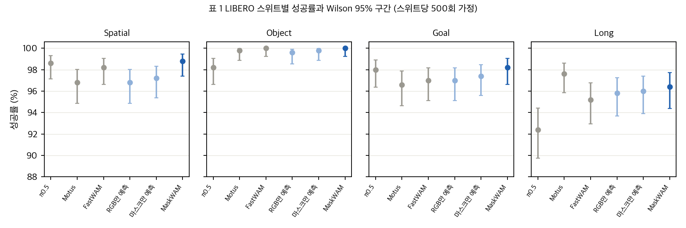
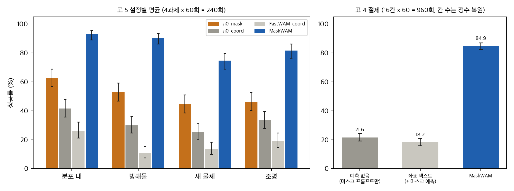
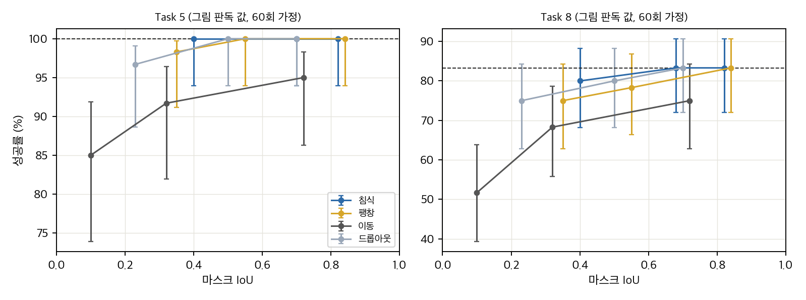

> **논문:** Hanyang Yu, Haitao Lin, Jingbo Zhang, Wenyao Zhang, Chenghao Gu, Heng Li, Ping Tan. *MaskWAM: Unifying Mask Prompting and Prediction for World-Action Models.* CoRL 2026 포스터, arXiv:2606.13515 (v1, 2026-06-11).
> 공식 코드는 GitHub hanyangyu1021/maskwam(MIT)에 있습니다. 논문은 arXiv 비독점 배포 라이선스라 논문 그림은 싣지 않고, 우리가 그린 그래프만 씁니다.

## 논문이 묻는 것

World-Action Model(WAM)은 미래 영상을 예측하면서 행동을 만듭니다. 논문은 두 가지 문제를 짚습니다. RGB 복원은 모든 영역을 똑같이 다뤄 과제 관련 물체가 배경에 섞이고, 텍스트 지시는 비슷한 물체가 여럿인 장면에서 대상을 가리지 못합니다.

MaskWAM의 답은 **마스크를 입력과 출력 양쪽에** 넣는 것입니다. 첫 프레임의 목표 마스크를 조건으로 주고, 미래 RGB와 함께 미래 마스크도 예측합니다. 마스크를 RGB처럼 렌더링해 같은 비디오 VAE로 인코딩하고 RGB 잠재와 채널로 이어 붙이므로, 사전학습된 Wan 2.2 백본에서 패치 임베딩과 출력 헤드의 채널만 늘리면 됩니다(새 채널은 0 초기화). 행동은 가벼운 MoT 전문가가 만들고, 추론에서는 영상 스트림에 한 스텝만 적용합니다.

## 이 글에서 확인한 것

**1. 표의 평균은 모두 재현됩니다.** 표 1, 2, 3, 5와 그림 4의 평균이 칸 값에서 다시 계산되고, 퍼센트는 정수 성공 횟수로 복원됩니다(시행 수는 논문 서술, LIBERO 스위트당 500회와 RoboTwin 과제당 100회는 가정).

**2. 마스크 스트림의 이득은 방향이 일관되고 크기는 맥락마다 다릅니다.** LIBERO에서 RGB만 예측하는 변형 대비 +1.05 pp(Fisher p = 0.030, 시행 수 500 가정)이고, FastWAM 대비 +0.75 pp는 p = 0.12입니다. RoboTwin 여섯 과제에서는 모든 과제에서 가장 높고(FastWAM 대비 +4.5 pp, 부호 검정 p = 0.031), 실로봇 language-clear에서는 +5.0 pp(p = 0.082)입니다. RGB만 예측하는 변형은 FastWAM과 구분되지 않습니다(87.3 대 87.7).

*그래프 (우리가 그림). 표 1의 스위트별 성공률과 Wilson 95% 구간(스위트당 500회 가정). Long에서는 Motus 97.6이 MaskWAM 96.4보다 높습니다.*

**3. 모호성 과제의 큰 격차는 확실하지만 해석에 주의가 필요합니다.** MaskWAM 84.9%는 π0-mask 51.7%보다 33.2 pp 높습니다. 한편 마스크 프롬프트를 주되 미래 마스크 예측을 뺀 변형은 21.6%로 π0-mask보다 낮습니다. 데이터가 직접 지지하는 것은 "WAM이 시각 프롬프트와 잘 맞는다"보다 "이 주입 경로는 예측 감독이 있어야 쓰인다" 쪽입니다. 좌표 텍스트를 쓴 변형(18.2)은 예측이 없는 FastWAM-coord(17.4)와 차이가 없었습니다(p = 0.68). 16개 칸(과제 × 설정) 단위로 보면 84.9의 95% 구간은 ±5.9 pp입니다.

*그래프 (우리가 그림). 표 5의 설정별 평균(4과제 × 60회)과 표 4 절제(960회, 칸 수는 퍼센트에서 정수로 복원).*

**4. 그림 8의 시행 수 서술과 그림의 값이 맞지 않습니다.** 부록 B.2는 조건당 20회라고 쓰지만, 그림에서 읽은 26개 값(그림 판독 값) 중 11개는 20회로는 나올 수 없는 값이고 60회로는 모두 설명됩니다(예: 91.7 = 55/60). 온라인 SAM3 기준선(100, 83.3)도 표 5의 분포 내 값과 같습니다. 60회를 가정하면 과제 8에서 큰 이동(IoU 0.1)은 51.7%로 기준선보다 확실히 낮습니다(p = 0.0004). 저자 확인이 필요합니다.

*그래프 (우리가 그림). 그림 8의 판독 값을 다시 그렸고 구간은 조건당 60회 가정의 Wilson 95%입니다. 점선은 온라인 SAM3 기준선입니다.*

**5. 표 1의 비교 대상 구성.** π0.5의 Spatial은 98.6으로 적혀 있지만 Fast-WAM 논문 표 2는 98.8입니다. 표에는 참고문헌에 있는 LingBot-VA(다른 평가 횟수로 98.5 보고)가 없어, "최고 98.4%"는 표에 실린 행 기준입니다. 본문 RoboTwin 문단의 "Mask World Model [55]"는 참고문헌 목록에서 다른 논문을 가리키고(Mask World Model은 [36]), 같은 논문이 두 번씩 실린 항목이 세 쌍 있습니다.

## 공식 코드와 논문의 차이

저장소는 정적으로만 읽었습니다(커밋 `657f444`). 구조(같은 VAE로 마스크 인코딩, 0 초기화 채널 확장, 공유 시각 타임스텝과 독립 행동 타임스텝, 기본 추론 경로의 1스텝 부분 디노이징)는 논문과 맞습니다. 다른 점은 다음과 같습니다.

- **마스크 입력 드롭아웃.** 논문은 학습 중 확률 0.5로 첫 프레임 마스크를 0으로 바꾼다고 쓰지만, 코드의 `mask_random`은 "유지 확률"이고 기본 1.0입니다. 공개 실로봇 체크포인트의 `config.json`도 1.0이라, 공개 설정에서는 드롭아웃이 꺼져 있습니다.
- **마스크 손실 가중치.** 식 3에는 가중치가 없고, 학습 설정은 0.5입니다.
- **학습 규모.** 논문에 없습니다. 체크포인트 설정의 워밍업(16,000과 8,000)이 프로세스 수에 비례하므로 GPU 16장(실로봇)과 8장(LIBERO)으로 학습한 것으로 추정됩니다.
- **입력 구성.** 논문은 단일 RGB로 설명하지만 코드는 정면과 두 손목 카메라를 T자로 합성합니다. 마스크 프롬프트는 정면에만 줍니다.
- **공개 범위.** RoboTwin 설정과 평가 코드, 기준선 코드, 로봇 폐루프 배포 코드는 없습니다. 마스크 프롬프트 생성은 클릭 한 점에서 SAM3로 만드는 경로만 있습니다.

## 맺음

마스크를 입력과 예측 목표로 함께 쓰는 설계는 단순하고, 표의 값은 내부적으로 잘 맞으며 이득의 방향도 일관됩니다. 남는 질문은 세 가지입니다. 예측 감독 없이 입력만 줬을 때 마스크가 쓰이지 않는 현상이 이 설계에 한정되는지, 모호성 과제의 큰 격차 중 얼마가 백본·주입 경로 차이인지, 그리고 공개 학습 설정이 논문 서술(드롭아웃)을 따르는지입니다. 시행 수와 드롭아웃 설정은 저자 확인이 필요합니다.

## 자료

- [통합 리포트 PDF](report/report_public.pdf)
- [01. 논문 분석: MaskWAM (arXiv:2606.13515)](analysis/01_paper_analysis.md)
- [02. 선행연구와 관련 코드](analysis/02_prior_work.md)
- [03. 수치 재계산, 일관성 검사, 주장 판정](analysis/03_analysis.md)
- [04. 공식 코드 대조와 구현 가능성](analysis/04_code_verification.md)
