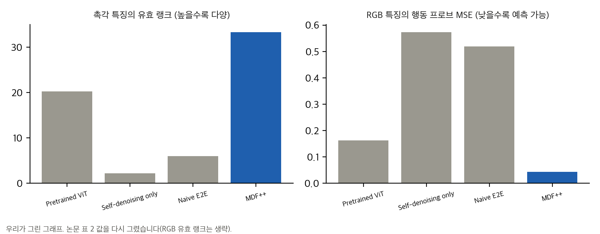
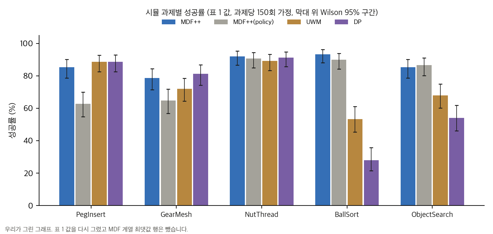
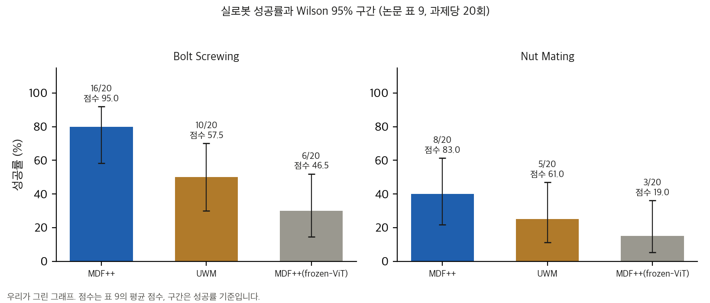

> **논문:** Zixuan Huang, Jinhao Yu, Zachary Charlick, Dmitry Berenson. *MDF++: Visuo-Tactile World Action Model with End-to-end Representation Learning.* CoRL 2026 포스터, arXiv:2611.09293 (v1, 2026-11-06).
> 공식 코드는 찾지 못했습니다(프로젝트 페이지에 코드 링크 없음). 논문 그림은 넣지 않았고, 이 글의 그래프는 우리가 논문 표 값으로 다시 그렸습니다.

## 논문이 묻는 것

접촉이 많은 조작에서는 영상만으로 부족합니다. 나사를 조이거나 너트를 맞출 때는 힘과 촉각의 작은 변화가 성공을 가릅니다. 최근 세계-행동 모델(WAM)은 행동과 미래 관측을 한 생성 모델에서 함께 예측합니다. 그런데 대부분의 WAM은 미리 학습한 프로즌 인코더 위에서 돌아갑니다. 픽셀을 복원하도록 학습된 인코더는 제어에 필요한 정보보다 시각 세부를 더 담을 수 있습니다.

인코더를 WAM과 함께 끝까지 학습하면 더 맞는 표현이 나올 것 같습니다. 그런데 저자들은 이렇게 하면 표현이 무너진다고 보고합니다. 인코더와 확산 백본이 함께 "denoise하기 쉬운" 잠재 공간으로 적응해 버리고, 그 공간은 제어에 쓸모가 없어진다는 것입니다.

MDF++는 이 문제에 대해 한 줄짜리 규칙을 제안합니다. **각 관측 인코더는 자기 스트림의 확산 손실에서는 그래디언트를 받지 않고, 다른 스트림(다른 감각과 행동)의 손실에서만 받습니다.** 학습 모드도 정책, 행동-관측 결합 예측, 순·역 동역학, 무작위 마스킹을 같은 확률로 섞습니다.

*그림: 논문 표 2의 값을 다시 그렸습니다. 프리트레인 ViT의 RGB 프로브 MSE는 0.163, MDF++는 0.043입니다. 촉각 유효 랭크는 단순 엔드투엔드 5.99, MDF++ 33.34입니다. 단일 실행이라 구간은 없습니다.*

## 숫자로 확인한 것

**시뮬 (다섯 과제, 과제당 150회 가정).** MDF++ 평균은 86.9%입니다. 같은 구조에서 그래디언트를 모두 흘린 naive 엔드투엔드는 64.1%, 프로즌 ViT 기준선은 58.7%, 정책 전용 학습은 78.9%입니다. 표의 값은 모두 150의 정수 배로 떨어져서 과제당 150회로 읽는 것이 맞습니다. naive 격차는 네 과제에서 검정이 유의합니다. 반면 정책 전용 대비 이득은 PegInsert와 GearMesh에만 유의하고, 나머지 세 과제는 검출력이 부족합니다.

*그림: 논문 표 1의 과제별 성공률을 우리가 다시 그렸습니다. 막대 위 구간은 Wilson 95%입니다. MDF 계열 최댓값 행은 뺐습니다.*

**실로봇 (볼트 조이기, 너트 맞추기, 과제당 20회).** 볼트에서 MDF++는 점수 95.0, UWM은 57.5, 프로즌 ViT는 46.5입니다. 너트는 83.0, 61.0, 19.0입니다. 점수 분포로 보면 볼트에서 UWM 대비 차이가 유의하고(p = 0.016), 너트에서는 방향만 맞습니다(p = 0.12). 성공률로 보면 볼트 80% 대 UWM 50%는 p = 0.096, 너트 40% 대 25%는 p = 0.50입니다. 프로즌 ViT에 대한 우위는 성공률에서도 확실합니다.

*그림: 논문 표 9의 성공 수를 우리가 다시 그렸습니다. 과제당 20회이고 막대 위 구간은 Wilson 95%입니다.*

## 확인하지 못한 것

- **인코더가 받는 그래디언트의 출처.** 이 방법은 다른 스트림의 손실에서만 인코더가 학습한다고 설명합니다. 그런데 손실 가중치를 보면 RGB 인코더가 받는 가중치의 약 80%가 행동 손실에서 옵니다. 교차 모달 예측이 효과의 원인인지, 행동 그래디언트가 원인인지 가르는 실험은 논문에 없습니다.
- **표 9의 총점 한 곳.** 프로즌 ViT 볼트의 총점은 930점입니다. 논문의 채점 규칙으로 계산하면 945점입니다. 평균 46.5는 맞지만 총점과 규칙이 어긋납니다.
- **단위.** 초록의 "최대 50%"는 볼트 성공률 80% 대 30%의 차이(pp)와 맞습니다. 본문의 "29%"는 단위가 적혀 있지 않습니다.
- **추적 오차 보정.** 평균 추적 오차 4mm에서 1.2mm로 줄었다는 주장은 측정 자료 없이 적혀 있습니다.

## 재현 가능성

이 맥(Apple M4 Pro, MPS, CUDA 없음)에서 원 실험을 재현하는 것은 어렵습니다. 시뮬은 Isaac Lab과 NVIDIA GPU가 필요하고, 실로봇은 Franka, GelSight, UMI 방식의 수집 장치가 필요합니다. 선택적 그래디언트 규칙과 작은 모델을 합성 데이터에서 구현하는 것은 가능합니다. 이 경우 행동 그래디언트만 허용하는 ablation을 함께 돌리면, 논문이 남긴 기전 질문에 답할 수 있습니다.

## 정리

MDF++의 핵심 아이디어는 "인코더를 끝까지 학습하되 자기 복원 그래디언트를 끊는다"입니다. 시뮬 평균의 개선은 크고 여러 과제에서 일관됩니다. 반면 기전 설명과 실로봇의 성공률 차이는 아직 확정되지 않았습니다. 촉각을 포함한 세계-행동 모델을 설계한다면, 표현 붕괴를 학습 중에 재는 진단과 행동 그래디언트의 기여를 함께 기록하는 것이 가장 먼저 쓸 만한 장치입니다.

## 자료

- [통합 리포트 PDF](report/report_public.pdf)
- [01. 논문 분석: MDF++ (arXiv:2611.09293)](analysis/01_paper_analysis.md)
- [02. 선행연구와 관련 저장소](analysis/02_prior_work.md)
- [03. 수치 재계산, 검정, 일관성 검사](analysis/03_analysis.md)
- [04. 주장 검증: MDF++ (arXiv:2611.09293 v1)](analysis/04_claim_verification.md)
