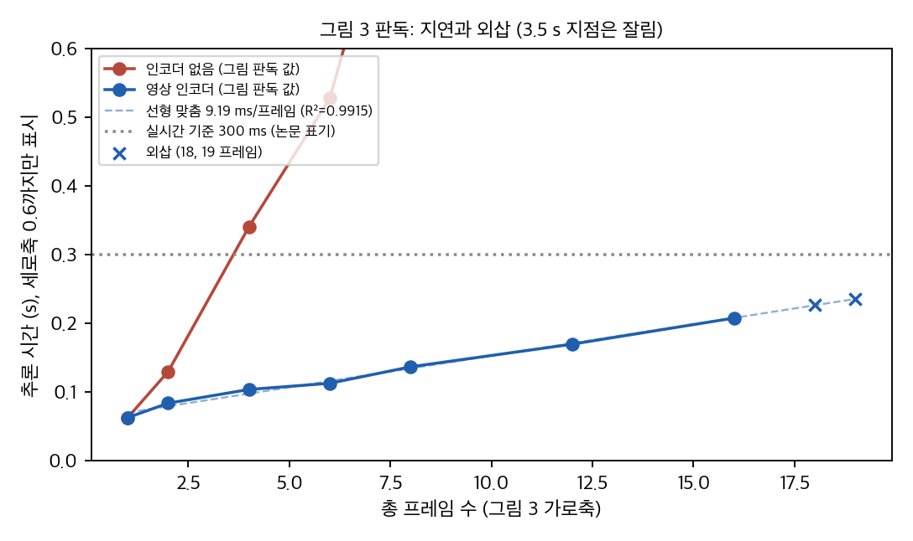
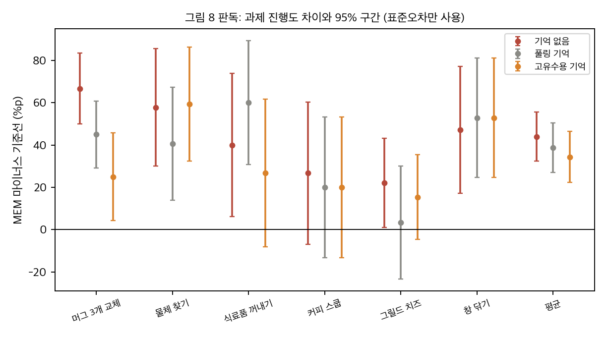
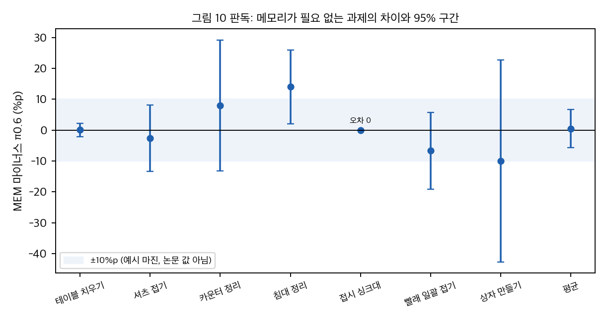
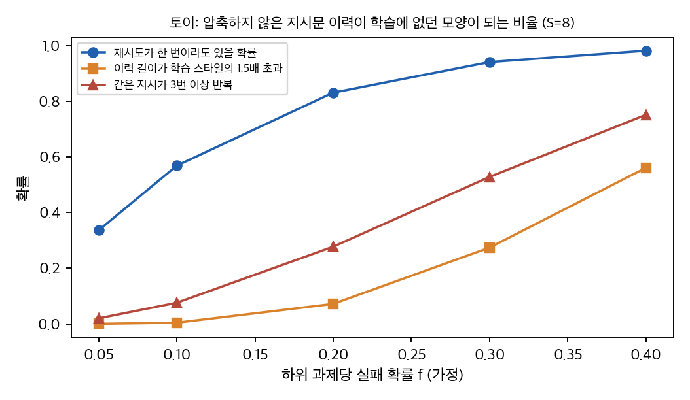

# 03. 수치 재계산과 해석

논문에 표가 없고 결과가 막대 그림에만 있습니다. 이 문서는 (1) PDF 벡터에서 막대 높이와 오차 막대 끝을 읽고(`extract_figures.py`, 정밀도 0.01%p), (2) 정수 비율과 오차 막대에서 시행 수를 복원하고, (3) 검정과 일관성 점검을 하고, (4) 설계 주장을 확인하는 작은 CPU 토이 두 개를 돌린 결과입니다. 항목 번호 V는 `recompute_results.json`의 키와 같습니다.

## 0. 읽는 방법과 가정

- **그림 판독 값:** 모든 막대 값은 원자료가 아니라 그림에서 읽은 값이고, 문장에 "(그림 판독 값)"을 붙이지 않은 곳도 같습니다. 오차 막대는 본문 Sec. IV-A가 "mean ± standard error"라고 적은 것을 모든 그림에 적용했습니다(그림 7–10에는 별도 서술이 없습니다).
- **시행 수는 가정:** 논문은 그림 6에 "정책·과제당 10회"만 적습니다. 나머지는 값이 정수 비율이 되는 n, 또는 이진 성공 가정의 n = 1 + p(1−p)/SE²(표본 SD 사용)에서 복원했고, 문장마다 "(시행 수 n 가정)"으로 밝혔습니다.
- **검정:** 점수 평균 비교는 표준오차 두 개로 정규 근사(`z`)를 썼습니다(시행 수 불필요). 이진 칸은 Fisher 정확 검정과 Wilson 95% 구간을 씁니다. 같은 롤아웃 환경과 같은 사전학습 모델을 공유해 독립 가정은 낙관적일 수 있습니다.
- **용어:** 막대의 "과제 진행도"는 부분 점수 평균이고 "성공률"은 이진 성공입니다. 그림 7만 성공률 축입니다.

## 1. 그림 3: 추론 시간 (V1)

읽은 값(초, 카메라 4개 H100 1장, 가로축 "총 프레임"):

| 프레임 | 1 | 2 | 4 | 6 | 8 | 12 | 16 |
|---|---|---|---|---|---|---|---|
| 인코더 없음 | 0.063 | 0.130 | 0.341 | 0.528 | 0.945 | 1.946 | 3.512 |
| 영상 인코더 | 0.063 | 0.084 | 0.104 | 0.113 | 0.137 | 0.170 | 0.208 |
| 비 | 1.0 | 1.6 | 3.3 | 4.7 | 6.9 | 11.5 | 16.9 |

- 인코더 없음은 4프레임(0.341 s)에서 논문이 그은 실시간 기준 300 ms를 넘습니다. 영상 인코더는 16프레임에서도 0.208 s입니다.
- 인코더 쪽 곡선은 선형 맞춤 9.19 ms/프레임 + 61 ms(R² = 0.992)로 잘 설명되고 16프레임은 1프레임의 3.3배입니다. 2차 맞춤에서 인코더 없음의 이차항은 0.0135 s/프레임²입니다.
- 실험 본문은 사후학습에서 "최대 18프레임, 54초"를 쓴다고 하는데(Sec. III-D) 그림 3의 가로축은 16까지입니다. 18, 19프레임은 선형 외삽으로 0.227, 0.236 s이고 300 ms 안입니다(외삽 값, 측정 아님). "총 프레임"이 카메라 수를 곱한 값인지는 서술이 없습니다. 1프레임의 두 곡선이 같은 값(0.063 s)이라서 같은 설정에서 시작함을 확인할 수 있습니다.
- 고수준 정책(언어 기억 갱신)의 추론 시간은 그림 3에 없습니다.

그래프: 그림 3의 두 곡선을 벡터에서 읽은 값과 인코더 쪽의 선형 맞춤, 18·19프레임 외삽. 인코더 없음 곡선은 세로축 0.6에서 잘림.

## 2. 그림 6: 장기 과제 (V3, V4, V5, V22)

읽은 값(평균 ± 표준오차, %): 

| 조건 | 레시피 준비 | 부엌 청소 | 평균 막대 |
|---|---|---|---|
| π0.6 (기억 없음) | 40.1 ± 6.8 | 20.0 ± 10.4 | 34.8 ± 5.8 |
| 영상만 | 28.4 ± 5.6 | 35.0 ± 12.1 | 30.2 ± 5.1 |
| naive 텍스트 + 영상 | 35.5 ± 7.0 | 42.5 ± 5.0 | 37.4 ± 5.3 |
| 텍스트만 | 29.5 ± 7.3 | 28.8 ± 11.8 | 29.3 ± 6.1 |
| π0.6-MEM | 63.2 ± 6.0 | 90.0 ± 3.1 | 70.6 ± 4.8 |

**V3: MEM 대 각 조건.** 레시피에서 +23.1(대 기억 없음, p = 0.011), +34.8(영상만, p = 2×10⁻⁵), +27.7(naive, p = 0.003), +33.6(텍스트만, p = 4×10⁻⁴). 부엌 청소는 +70.0, +55.0, +47.5, +61.3%p이고 모두 p < 10⁻⁵ (정규 근사). 롤아웃 단위를 가정한 Welch는 부엌 청소 n = 10에서 p 7.6×10⁻⁷–1.2×10⁻³, 레시피 n = 5(레시피 단위 평균 가정)에서 p 0.003–0.034이고 방향과 순위는 같습니다(V22). "둘 다 필요하다"는 서술은 두 칸의 추정에서 성립합니다.

**V4: 평균 막대가 두 칸의 평균이 아님.** MEM은 (63.2 + 90.0)/2 = 76.6인데 막대는 70.6입니다. 다섯 조건 모두 부엌 청소의 가중치가 0.263–0.278로 역산됩니다(단순 평균은 0.5, 롤아웃 10 대 50 가중이면 0.167). 가중치 정의는 본문에 없습니다. 이 차이로 "평균에서 MEM이 가장 높다"는 순위는 바뀌지 않지만 평균 막대는 두 칸의 단순 평균으로 재현되지 않습니다(`04` K1).

**V5: 오차 막대와 시행 수.** 부엌 청소 값은 1/80 격자(10회 × 8점)에 모두 들어맞습니다(20, 35, 42.5, 28.75, 90). 레시피 칸에서 오차 막대를 n = 50 롤아웃의 표준오차로 보면 필요한 롤아웃 SD가 가능한 최댓값 √(m(1−m)·n/(n−1))의 0.86–1.12배이고, naive(1.03)와 텍스트만(1.12)은 점수가 [0, 1]에 있는 한 불가능한 값입니다. n = 5(5개 레시피)로 보면 0.25–0.32배, n = 10이면 0.37–0.48배입니다. 따라서 레시피 오차 막대가 50회 롤아웃의 표준오차는 아니고 레시피 단위 평균의 오차일 수 있습니다(가능성, 저자 확인 필요, `04` K2).

## 3. 그림 7: 맥락 안 적응 (V2, V14, V19)

| 과제 | 기억 없음 | 기억 있음 | 차이 | 본문 |
|---|---|---|---|---|
| 젓가락 집기 | 84.4 ± 4.0 | 95.0 ± 2.3 | +10.6%p | "+11%" |
| 냉장고 열기 | 33.3 ± 10.5 | 95.2 ± 4.6 (구간 끝 99.99) | +61.9%p | "+62%" |

- 본문의 +11%, +62%는 상대 증가율이 아니라 %p 차이와 맞습니다.
- **냉장고:** 오차 막대에서 n = 21, 7/21 대 20/21(시행 수 n 가정)이고 Fisher p = 5×10⁻⁵, Wilson 95% 구간 0.17–0.55 대 0.77–0.99입니다.
- **젓가락:** 값이 하나의 시행 수로 정해지지 않습니다. 기억 없음 84.4%는 27/32, 54/64, 70/83과, 기억 있음 95.0%는 19/20, 76/80, 95/100과 맞습니다. 시나리오별 Fisher p는 0.39(27/32 대 19/20), 0.046(54/64 대 76/80), 0.023(70/83 대 95/100)이라 시행 수에 따라 유의 여부가 달라집니다. 본문은 시행 수와 검정을 적지 않아 "+11%"의 확실성은 이 자료로 판단할 수 없습니다(`04` M2).
- 문 열기 성공은 "4번 이하 잡기"로 정의되고(부록 B), 막대는 그 비율로 읽힙니다.

## 4. 그림 8: 핵심 기억 과제 (V6, V7, V17, V18, V20, V21)

읽은 값(평균 ± 표준오차, %):

| 과제 | 기억 없음 | 풀링 | 고유수용 | MEM |
|---|---|---|---|---|
| 머그 3개 교체 | 10.0 ± 4.8 | 31.7 ± 3.8 | 51.7 ± 7.9 | 76.7 ± 7.1 |
| 물체 찾기 | 31.3 ± 12.0 | 48.4 ± 11.3 | 29.7 ± 11.5 | 89.1 ± 7.6 |
| 식료품 꺼내기 | 33.3 ± 12.6 | 13.3 ± 9.1 | 46.7 ± 13.3 | 73.3 ± 11.8 |
| 커피 스쿱 | 53.3 ± 13.3 | 60.0 ± 13.1 | 60.0 ± 13.1 | 80.0 ± 10.7 |
| 그릴드 치즈 | 33.3 ± 6.1 | 52.0 ± 10.0 | 40.0 ± 5.2 | 55.4 ± 8.8 |
| 창 닦기 | 17.6 ± 9.5 | 11.8 ± 8.1 | 11.8 ± 8.1 | 64.7 ± 12.0 |
| 평균 막대 | 29.6 ± 4.3 | 34.9 ± 4.4 | 39.2 ± 4.6 | 73.6 ± 4.1 |

**V20/V21: 복원한 시행 수.** 오차 막대가 표본 SD 기반이고 값이 이진 성공이면 n = 1 + p(1−p)/SE²가 정수가 되며 k = pn도 정수여야 합니다. 이 조건을 만족하는 칸은 71개 중 23개입니다. 식료품 꺼내기 n = 15, 커피 스쿱 n = 15, 창 닦기 n = 17(네 조건 전부, 시행 수 n 가정), 물체 찾기 기억 없음 n = 16(5/16)입니다. 나머지 칸(머그 교체, 그릴드 치즈, 물체 찾기의 다른 조건, 모든 평균 막대)은 부분 점수이거나 조건별 시행 수가 달라 같은 방법으로 복원되지 않습니다. 그림 8의 시행 수는 본문에 없고, 복원값 15–17은 그림 6 설정의 10회와 다릅니다. 머그 교체는 값 격자가 1/60(3점 × 20회 가정)이고 그릴드 치즈는 조건마다 격자가 달라(기억 없음 1/3, 풀링 13/25, 고유수용 2/5, MEM 36/65) 조건별 시행 수가 같지 않을 수 있습니다(`04` K3).

**V6: MEM 대 기준선 (정규 근사, 표준오차만).** 

| 과제 | 대 기억 없음 | 대 풀링 | 대 고유수용 |
|---|---|---|---|
| 머그 3개 교체 | +66.7 (p 6×10⁻¹⁵) | +45.0 (2×10⁻⁸) | +25.0 (0.019) |
| 물체 찾기 | +57.8 (4×10⁻⁵) | +40.6 (0.003) | +59.4 (2×10⁻⁵) |
| 식료품 꺼내기 | +40.0 (0.021) | +60.0 (6×10⁻⁵) | +26.7 (0.13) |
| 커피 스쿱 | +26.7 (0.12) | +20.0 (0.24) | +20.0 (0.24) |
| 그릴드 치즈 | +22.1 (0.039) | +3.4 (0.80) | +15.4 (0.13) |
| 창 닦기 | +47.1 (0.002) | +52.9 (2×10⁻⁴) | +52.9 (2×10⁻⁴) |
| 평균 | +44.0 | +38.7 | +34.4 (모두 p < 10⁻⁷) |

- 6개 과제 가운데 MEM이 모든 기준선보다 유의하게 높은 칸은 머그 교체, 물체 찾기, 창 닦기 세 칸입니다. 커피 스쿱(p 0.12–0.24)과 그릴드 치즈(풀링 p 0.80)는 이 시행 수에서 구분되지 않습니다. "모든 기억 능력에서 강한 성능을 내는 유일한 모델"이라는 서술은 평균과 세 과제에서 확인되고, 두 과제는 방향만 맞습니다.
- 이진으로 복원된 칸의 Fisher 정확 검정(V21): 식료품 꺼내기 MEM 11/15 대 기억 없음 5/15 p = 0.066(정규 근사 0.021), 대 고유수용 7/15 p = 0.26, 대 풀링 2/15 p = 0.003. 커피 스쿱 12/15 대 8/15, 9/15 p 0.25–0.43. 창 닦기 11/17 대 3/17(기억 없음) p = 0.013, 대 2/17(풀링, 고유수용) p = 0.004. 정규 근사가 소표본에서 낙관적임이 식료품 꺼내기에서 드러납니다.
- **V14: 본문의 "기억 없음" 값.** 물체 찾기 25%(네 서랍 중 우연), 커피 50% 서술 대 막대 31.3%(5/16 가정), 53.3%(8/15 가정). 이항 검정 대 0.25는 p = 0.57, 대 0.5는 p = 1.0이라 서술값과 막대는 구분되지 않습니다.
- **V18:** 식료품, 커피, 창 닦기에서 SE가 표본 SD 이진 표준오차와 SD/최댓값 = 1.00으로 일치합니다.

그래프: 그림 8의 과제 진행도 차이와 95% 구간(표준오차만으로 계산, 정규 근사). 막대 값과 오차 막대는 그림 판독 값.

## 5. 그림 9: 사전학습 효과 (V8, V10, V11)

| 과제 | 사후학습만 | MEM | 차이 (p) |
|---|---|---|---|
| 머그 3개 교체 | 68.3 ± 4.5 | 76.7 ± 7.1 | +8.3 (0.32) |
| 물체 찾기 | 67.2 ± 11.8 | 89.1 ± 7.6 | +21.9 (0.12) |
| 식료품 꺼내기 | 40.0 ± 13.1 | 73.3 ± 11.8 | +33.3 (0.059) |
| 커피 스쿱 | 66.7 ± 12.6 | 80.0 ± 10.7 | +13.3 (0.42) |
| 그릴드 치즈 | 49.2 ± 8.7 | 55.4 ± 8.8 | +6.2 (0.62) |
| 창 닦기 | 17.6 ± 9.5 | 64.7 ± 12.0 | +47.1 (0.002) |
| 평균 막대 | 51.0 ± 4.6 | 73.6 ± 4.1 | +22.6 (0.0003) |

- **V8:** 그림 9의 MEM 막대는 그림 8의 MEM 막대와 같은 값입니다(차이 ≤ 0.01%p, 오차 막대도 같음). 같은 평가를 재사용한 것으로 읽힙니다.
- 본문 "사전학습이 상당히 향상"은 평균(+22.6%p, p = 0.0003)과 창 닦기에서 유의하고, 개별 과제 6개 중 5개는 이 오차 막대로 구분되지 않습니다. 방향은 6개 모두 양입니다.
- **V11:** 본문의 "사후학습만 변형이 풀링 기억보다 영상 인코더 설계가 낫다는 증거"는 평균(+16.1%p, p = 0.011)과 머그 교체(+36.7, p < 10⁻⁹)에서 확인되고, 물체 찾기(+18.7, p 0.25), 식료품(+26.7, p 0.094), 커피(+6.7), 그릴드 치즈(−2.8), 창 닦기(+5.9)는 구분되지 않습니다. 두 변형이 같은 시행 수와 같은 평가 세션을 공유하는지 본문에 없습니다.

## 6. 그림 10: 기억이 필요 없는 과제 (V12, V13, V21)

| 과제 | π0.6 | MEM | 차이 [95% 구간] |
|---|---|---|---|
| 테이블 치우기 | 98.0 ± 0.8 | 98.1 ± 0.8 | +0.1 [−2.1, +2.2] |
| 셔츠 접기 | 81.3 ± 3.6 | 78.7 ± 4.1 | −2.7 [−13.4, +8.1] |
| 카운터 정리 | 72.0 ± 9.0 | 80.0 ± 6.0 | +8.0 [−13.2, +29.2] |
| 침대 정리 | 58.7 ± 5.1 | 72.7 ± 3.4 | +14.0 [+2.0, +26.0] |
| 접시를 싱크대로 | 100 ± 0 | 100 ± 0 | 0 |
| 빨래 일괄 접기 | 93.3 ± 3.8 | 86.7 ± 5.1 | −6.7 [−19.1, +5.8] |
| 상자 만들기 | 90.0 ± 10.0 | 80.0 ± 13.3 | −10.0 [−42.7, +22.7] |
| 평균 막대 | 84.1 ± 2.3 | 84.6 ± 2.2 | +0.5 [−5.7, +6.7] |

- 7개 과제 중 차이의 부호는 양 3, 음 3, 0 하나입니다. 구간이 0을 제외하는 칸은 침대 정리(+14.0)뿐이고, 마진 ±10%p 안에 구간 전체가 들어가는 칸은 테이블 치우기, 접시 싱크대, 평균 막대입니다(마진은 예시값이며 논문 값이 아님).
- 그림 10 아래 표지에 따르면 앞 다섯 과제는 out-of-the-box 평가이고 빨래 일괄 접기와 상자 만들기는 미세조정(finetuning) 과제입니다.
- 복원 시행 수는 빨래 일괄 접기 45(42/45 대 39/45, Fisher p = 0.48), 상자 만들기 10(9/10 대 8/10, p = 1.0)입니다(시행 수 n 가정). 90% 기준에서 Fisher로 구분되는 최소 하락은 n = 10에서 60%p, n = 45에서 20%p입니다.
- 따라서 "π0.6의 최신 수준과 맞먹는다"는 서술은 평균 막대에서는 구간이 좁아 지지되지만(±6%p) 과제별로는 시행 수가 작아 ±10%p 이내 동등성도 확인되지 않는다는 뜻입니다. 침대 정리의 +14%p는 MEM이 π0.6보다 높게 읽히는 칸입니다.
- 평균 막대는 일곱 과제의 단순 평균(π0.6 84.8, MEM 85.2)과 0.5–0.7%p 다릅니다(V9).

그래프: 그림 10 일곱 과제와 평균 막대의 차이와 95% 구간(표준오차만 사용). 파란 띠는 예시 마진 ±10%p.

## 7. 평균 막대와 단순 평균 (V9)

| 그림과 조건 | 평균 막대 | 과제 단순 평균 | 차이 (%p) | 막대 SE 대 전파 SE (%p) |
|---|---|---|---|---|
| 8 기억 없음 | 29.6 | 29.8 | −0.25 | 4.31 대 4.18 |
| 8 풀링 | 34.9 | 36.2 | −1.31 | 4.36 대 3.95 |
| 8 고유수용 | 39.2 | 40.0 | −0.76 | 4.60 대 4.20 |
| 8 MEM | 73.6 | 73.2 | +0.38 | 4.12 대 4.02 |
| 9 사후학습만 | 51.0 | 51.5 | −0.52 | 4.64 대 4.27 |
| 10 π0.6 | 84.1 | 84.8 | −0.66 | 2.27 대 2.19 |
| 10 MEM | 84.6 | 85.2 | −0.52 | 2.20 대 2.34 |

평균 막대는 과제 단순 평균에서 최대 1.3%p 벗어나고, 막대 SE는 단순 평균의 오차 전파 값과 비슷합니다. 시행 수 가중 평균일 가능성이 있습니다(가중치는 본문에 없음). 그림 6에서는 차이가 더 큽니다(V4).

## 8. 본문 산술 (V15)

- 사전학습 관측 6개, 간격 1초이므로 과거 5개의 시간 폭은 5초이고 본문의 "5초"와 맞습니다. 사후학습 "18프레임, 54초"는 간격 3.0초(과거 18개 + 현재 1개에서 18 간격)와 맞습니다. 그림 3의 가로축 16이 이 설정의 프레임 수인지 본문에 없습니다.
- 어텐션 비용(V15, n = (448/14)² = 1,024 토큰/이미지 가정, 패치 14): 전체 시공간 어텐션은 단일 프레임 대비 K = 6, 12, 19에서 36, 144, 361배. 분리 어텐션(공간 매 층, 시간 4층마다)은 6.009, 12.04, 19.09배이고 시간 항의 비중은 0.15–0.46%입니다. 즉 이 가정에서 인코더 비용은 K에 사실상 선형이고, 그림 3 인코더 곡선(R² = 0.99 선형)의 형태와 부합합니다. 토큰 수와 패치 크기는 논문 서술(448 px)에서 가정한 값입니다.

## 9. 토이 두 개 (`toy_memory.py`, 약 1.5초, torch CPU와 numpy)

**T1: 영상 인코더의 "K = 1이면 원래 ViT와 같다" (Sec. III-C).** 작은 층(차원 32, 헤드 4, 토큰 9)에서 세 가지 읽기를 비교했습니다. 표준 단일 이미지 어텐션 출력의 평균 절댓값 0.129 대비 K = 1 최대 절대 차이:

| 읽기 | 최대 차이 |
|---|---|
| (a) 덧셈형, 시간 마스크가 대각 포함 | 1.25 |
| (b) 부록 식 3 합성형(시간 어텐션 출력에 공간 어텐션), 대각 포함 | 0.27 |
| (c) 덧셈형, 엄격한 과거만 보는 마스크 | 0 |

표준 사인-코사인 위치 임베딩은 t = 0에서 사인 성분 0, 코사인 성분 1입니다. e(0) = 0이 되려면 사인 성분만 쓰거나 변형이 필요합니다. 즉 "e(0) = 0"만으로는 K = 1 동일성이 성립하지 않고, 시간 어텐션이 자기 자신을 제외하는(또는 영초기화되는) 규약이 필요합니다. 본문은 "causal attention mask"만 적고 자기 시점 포함 여부를 정하지 않습니다. 오류가 아니라 서술되지 않은 규약이며(`04` K4), 구현할 때 하나를 골라야 합니다.

**T2: naive 지시문 이력의 분포 이동 (Sec. IV-A).** 학습은 하위 과제를 한 번씩만 말한다고 보고, 추론에서 하위 과제당 시도 횟수를 Geometric(1 − f)로 두고 S = 8개 하위 과제(부록 B 청소 과제 평균)에서 계산했습니다(f는 가정):

| f | 재시도가 한 번이라도 있을 확률 | 이력 길이 > 1.5 S | 같은 지시 3번 이상 |
|---|---|---|---|
| 0.05 | 0.34 | 0.0002 | 0.02 |
| 0.1 | 0.57 | 0.004 | 0.08 |
| 0.2 | 0.83 | 0.07 | 0.28 |
| 0.3 | 0.94 | 0.27 | 0.53 |
| 0.4 | 0.98 | 0.56 | 0.75 |

f = 0.2이면 8개 하위 과제 중 하나 이상에서 재시도가 생길 확률이 83%라, 압축하지 않은 이력은 학습에 없던 모양이 되는 일이 흔합니다. 이것은 논문이 설명한 분포 이동의 크기에 대한 산술이며 naive 변형이 실제로 낮은 원인을 입증하지는 않습니다. 압축된 기억이 재시도 후에도 같은 상태로 남는다는 설계 가정에 의존합니다. 토이는 설계 값(f, S)을 쓰며 논문 값에 맞추지 않았습니다.

그래프: 하위 과제당 실패 확률 f에 따른, 압축하지 않은 지시문 이력이 학습 스타일에서 벗어날 확률(S = 8, 가정).

## 10. 요약

- 그림 6의 방향(MEM 대 네 변형)과 그림 8의 평균, 머그 교체, 물체 찾기, 창 닦기는 오차 막대 기준으로 확실합니다. 커피 스쿱과 그릴드 치즈의 기준선 대비는 구분되지 않습니다.
- 시행 수는 그림 8 일부 칸에서 15–17, 그림 10에서 10–45로 복원되어 본문 10회와 다릅니다. 모든 시행 수는 가정이며 저자 확인이 필요합니다.
- 그림 6의 평균 막대 가중치와 레시피 오차 막대의 정의, 그림 7 젓가락의 시행 수는 이 자료로 정해지지 않습니다.
- 지연 곡선은 인코더 쪽이 프레임 수에 선형이고 300 ms 안에 있으며, 18–19프레임은 외삽입니다.
- 토이 T1은 "K = 1 동일성"에 시간 마스크 규약이 필요함을, T2는 재시도가 흔할 때 naive 이력이 분포를 벗어난다는 산술을 보입니다.
