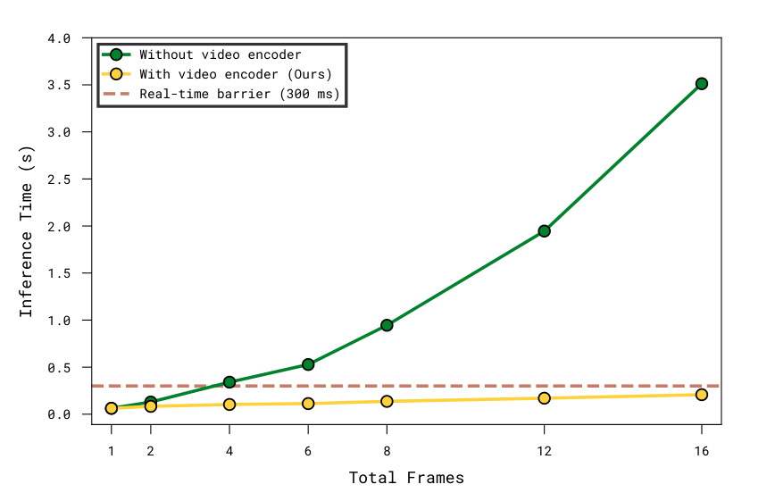
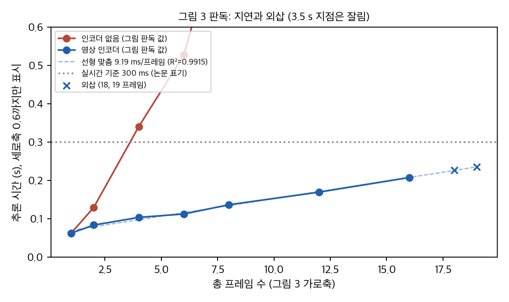
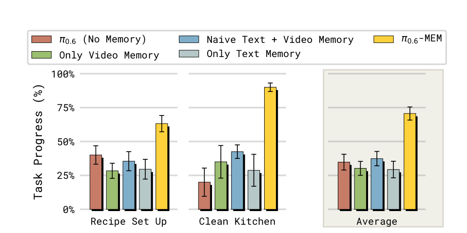
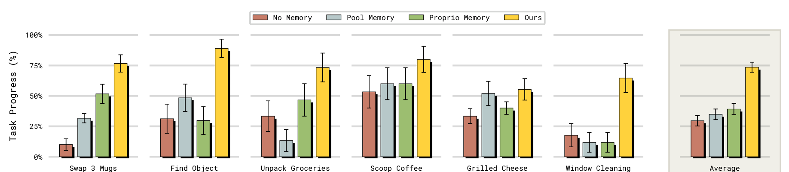
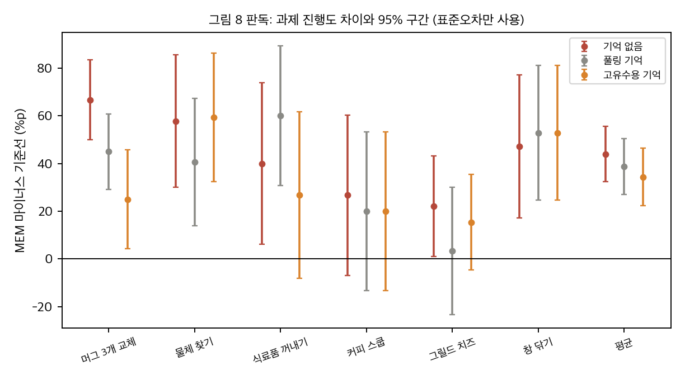
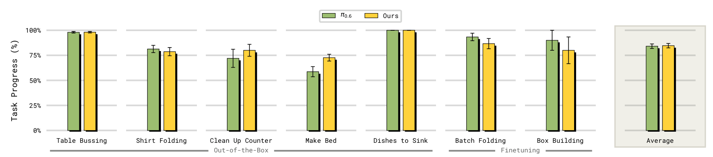
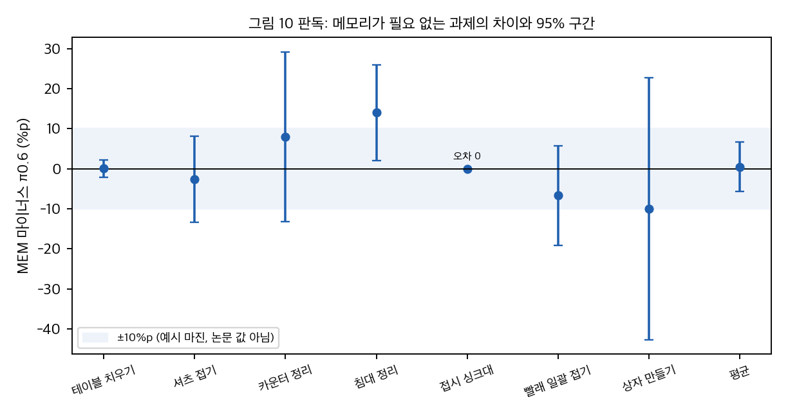
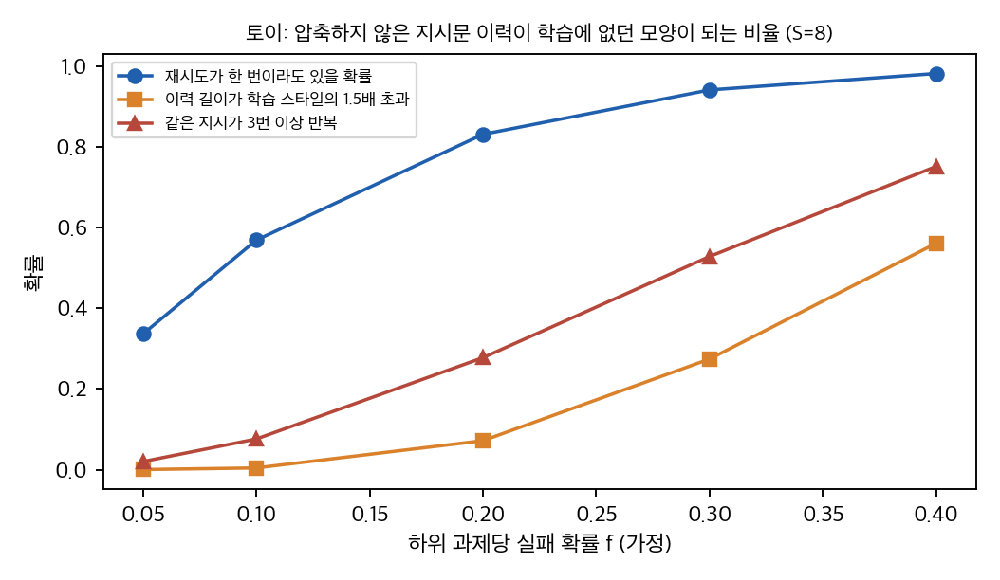

> **논문:** Torne, Pertsch 외. *MEM: Multi-Scale Embodied Memory for Vision Language Action Models.* CoRL 2026 스포트라이트(공식 채택 목록 확인), arXiv:2603.03596 (v2, 2026-03-08).
> 논문은 CC BY 4.0이고 그래프에는 출처를 붙였습니다(© Torne 외, CC BY 4.0, 출처 arXiv:2603.03596). 사진이 들어간 그림은 쓰지 않았습니다. 공식 코드는 확인하지 못했습니다.

---

## 논문이 묻는 것

기억을 한 가지 표현으로 만들면 길이나 정밀도 중 하나를 포기해야 합니다. 저자들은 기억을 두 척도로 나눕니다. 단기는 ViT 안에서 시간 방향 어텐션으로 최근 관측을 압축하는 **영상 인코더**(새 학습 파라미터 없음)이고, 장기는 고수준 정책이 하위 과제 지시와 함께 갱신하는 **자연어 기억**입니다. π0.6(Gemma3-4B, 860M 액션 전문가) 위에서 최대 15분 과제인 레시피 준비와 부엌 청소를 수행한다고 보고합니다.

논문에는 표가 없고 결과가 모두 막대 그림입니다. 이 글은 PDF 벡터에서 막대 높이와 오차 막대 끝을 읽은 값(그림 판독 값)을 씁니다. 오차 막대는 본문이 "평균 ± 표준오차"라고 적은 것을 따랐고, 시행 수는 값이 정수 비율이 되는 n에서 복원한 가정입니다.

## 지연: 인코더 쪽은 프레임 수에 선형

논문 그림 3 (도표만, © Torne 외, CC BY 4.0, 출처 arXiv:2603.03596). 프레임 수별 추론 시간, H100 1장, 카메라 4개.

읽은 값으로 인코더 없음은 4프레임에서 0.341 s로 논문이 그은 300 ms를 넘고 16프레임에서 3.512 s입니다. 영상 인코더는 16프레임에서 0.208 s이고 선형 맞춤이 9.19 ms/프레임(R² 0.992)입니다. 사후학습이 쓰는 18프레임은 그림 3의 가로축(16까지) 밖이어서 선형 외삽으로 0.23 s 안팎입니다(외삽 값).

그래프: 그림 3의 두 곡선을 벡터에서 읽은 값과 인코더 쪽 선형 맞춤, 18·19프레임 외삽. 인코더 없음 곡선은 세로축 0.6에서 잘렸습니다.

## 그림 6: 장기 과제

논문 그림 6 (도표만, © Torne 외, CC BY 4.0, 출처 arXiv:2603.03596).

MEM은 네 변형보다 레시피에서 +23~+35%p, 부엌 청소에서 +48~+70%p 높습니다. 정규 근사에서 p ≤ 0.011이고, 롤아웃 단위를 가정한 Welch(부엌 청소 n = 10, 레시피 n = 5 또는 10)에서도 p ≤ 0.034로 방향과 순위가 같습니다. 두 가지는 읽기 쉬워지도록 짚어 둡니다.

- 평균 막대는 두 칸의 단순 평균이 아닙니다. MEM은 (63.2 + 90.0)/2 = 76.6인데 막대는 70.6이고, 다섯 조건에서 부엌 청소의 가중치가 0.26–0.28로 역산됩니다. 가중치 정의는 본문에 없습니다.
- 레시피 오차 막대를 50회 롤아웃의 표준오차로 보면, 점수가 [0, 1]에 있는 한 가능한 값보다 큰 SD가 두 조건에서 필요합니다(최댓값의 1.03배, 1.12배). 5개 레시피 평균에 대한 오차라면 설명됩니다(가능성, 저자 확인 필요).

## 그림 8: 핵심 기억 과제

논문 그림 8 (그래프 부분만, © Torne 외, CC BY 4.0, 출처 arXiv:2603.03596). 사진 패널은 제외했습니다.

그래프: 그림 8의 과제 진행도 차이와 95% 구간(표준오차만 사용한 정규 근사). 값은 그림 판독 값입니다.

평균과 머그 3개 교체, 물체 찾기, 창 닦기에서 MEM이 모든 기준선보다 유의하게 높습니다. 커피 스쿱(p 0.12–0.24)과 그릴드 치즈(풀링 기억 대비 +3.4%p, p = 0.80)는 이 오차 막대에서 구분되지 않습니다. 오차 막대가 표본 SD 기반 표준오차라고 보면 식료품 꺼내기 15, 커피 스쿱 15, 창 닦기 17(네 조건 모두)이 이진 성공의 시행 수와 정수로 맞습니다(시행 수 n 가정). 본문의 "10회"는 그림 6 설정에 대한 서술이고 그림 8–10의 시행 수는 적혀 있지 않습니다. 이 시행 수에서 식료품 꺼내기의 MEM 대 기억 없음은 Fisher p = 0.066(정규 근사 0.021)입니다.

본문이 "기억 없음"의 우연 수준으로 적은 25%(물체 찾기)와 50%(커피)는 막대 31.3%(5/16 가정)와 53.3%(8/15 가정)와 이항 검정으로 구분되지 않습니다(p 0.57, 1.0).

## 그림 9: 사전학습 효과

사후학습에서만 인코더를 넣은 변형 대비 MEM은 평균 +22.6%p(p = 0.0003)이고 창 닦기 +47.1%p(p = 0.002)만 개별 칸에서 유의합니다. 나머지 다섯 과제는 방향이 모두 양이지만 오차 막대로는 구분되지 않습니다. 그림 9의 MEM 막대는 그림 8의 MEM 막대와 같은 값입니다(차이 0.01%p 이하).

## 그림 10: 기억이 필요 없는 과제

논문 그림 10 (그래프 부분만, © Torne 외, CC BY 4.0, 출처 arXiv:2603.03596). 사진은 제외했습니다.

그래프: 그림 10 일곱 과제와 평균 막대의 차이와 95% 구간(표준오차만 사용). 파란 띠는 예시 마진 ±10%p이며 논문 값이 아닙니다.

평균 막대는 84.6 대 84.1(차이 +0.5%p, 95% 구간 −5.7 ~ +6.7)로 가깝습니다. 과제별로는 부호가 양 3, 음 3, 0 하나이고 침대 정리 +14.0%p(구간 +2.0 ~ +26.0)만 0을 제외합니다. 시행 수는 복원할 수 있는 두 칸이 빨래 일괄 접기 45, 상자 만들기 10(가정)이고, 90% 기준에서 Fisher로 구분되는 최소 하락은 n = 10에서 60%p, n = 45에서 20%p입니다. 그래서 "π0.6과 맞먹는다"는 서술은 평균 막대에서는 구간이 좁아 지지되지만, 과제별로 ±10%p 안이라는 동등성은 이 자료로 확인되지 않습니다.

## 설계를 작은 토이로 확인하기

**시간 어텐션과 K = 1 동일성.** 논문은 새 파라미터 없이 시간 어텐션을 더하고 e(0) = 0인 사인 시간 임베딩을 쓰므로 K = 1이면 원래 ViT 출력과 정확히 같다고 적습니다. 작은 층(차원 32, 토큰 9)에서 읽기 세 가지를 비교했습니다. 시간 마스크가 자기 시점을 포함하는 덧셈형은 K = 1에서 평균 출력 크기 0.129 대비 최대 1.25, 부록 식 3의 합성형은 0.27 차이가 나고, 자기 시점을 제외하는 덧셈형은 0입니다. 표준 사인-코사인 임베딩은 t = 0에서 코사인 성분이 1이라 e(0) = 0에는 변형이 필요합니다. 즉 동일성에는 마스크 규약이 필요하고 본문은 이를 정하지 않습니다. 구현하는 쪽이 골라야 하는 서술되지 않은 부분입니다.

**압축하지 않은 지시문 이력의 분포 이동.** 학습 데이터가 하위 과제를 한 번씩만 말하고 추론에서는 재시도로 같은 지시가 반복된다는 논문의 설명을 산술로 옮겼습니다. 하위 과제당 실패 확률 f에서 8개 하위 과제 중 재시도가 한 번이라도 생길 확률은 f = 0.1에서 0.57, 0.2에서 0.83입니다(f와 하위 과제 수는 가정).

그래프: 하위 과제당 실패 확률 f에 따라 압축하지 않은 지시문 이력이 학습 스타일에서 벗어날 확률(8개 하위 과제, 가정). 설명의 크기를 산술로 보인 것이며 naive 변형이 낮은 원인을 입증하지는 않습니다.

## 논문에 없어서 확인하지 못한 것

- 그림 7–10의 시행 수와 오차 막대 정의, 모델 학습 시드 반복 여부. 젓가락 집기(그림 7)는 시행 수에 따라 Fisher p가 0.02–0.39입니다.
- 요약용 LLM의 이름과 프롬프트, 요약 품질. 상위 몇 층에서 과거 토큰을 버리는지, 고수준 정책의 갱신 주기와 지연.
- 본문 "unseen objects"와 부록 "seen recipes"처럼 평가 범위를 가리키는 서술이 다릅니다.
- 가중치, 코드, 데이터 공개 계획. 논문 v1과 v2는 본문과 그림이 같고 참고문헌 하나(CronusVLA)가 추가되었습니다.

## 정리

- 설계는 일관되고(단기는 선형 지연의 영상 인코더, 장기는 압축된 요약), 그림 6과 평균 막대 기준으로 방향은 분명합니다.
- 과제별 비교는 시행 수 15–17 수준에서 큰 차이만 확인되고, 그림 6 평균 막대의 가중치와 레시피 오차 막대의 단위는 저자 확인이 필요합니다.
- "기억이 필요 없는 과제에서 π0.6과 동등"은 평균에서 지지되고 과제별로는 확인되지 않습니다.
- 구현할 때는 시간 어텐션 마스크 규약과 과거 토큰을 버리는 층을 직접 정해야 합니다.

자세한 재계산과 주장별 판정은 함께 올린 분석 노트(01–04)와 통합 리포트에 있습니다.

## 자료

- [통합 리포트 PDF](report/report_public.pdf)
- [01. 논문 분석: MEM (arXiv:2603.03596)](analysis/01_paper_analysis.md)
- [02. 선행연구와 관련 자료](analysis/02_prior_work.md)
- [03. 수치 재계산과 해석](analysis/03_analysis.md)
- [04. 주장 검증과 구현 가능성](analysis/04_claim_verification.md)
