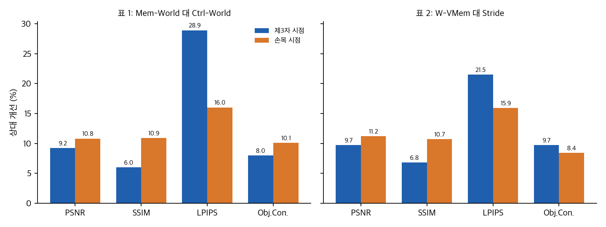
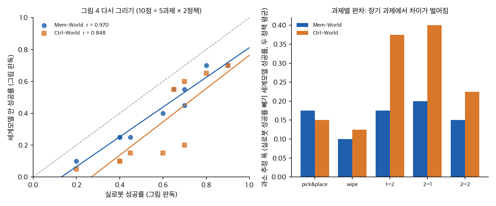
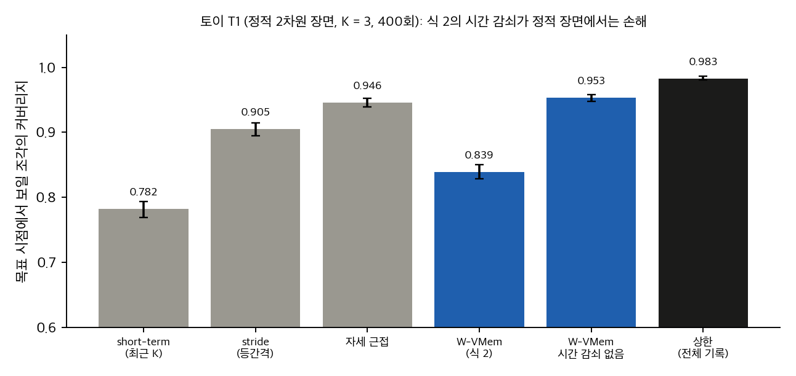

# 03. 수치 재계산과 해석

모든 값은 `analysis/recompute.py`(결과 `recompute_results.json`)와 `analysis/toy_retrieval.py`(결과 `toy_retrieval_results.json`)로 다시 계산했습니다. 논문은 평가 시행 수, 분산, 신뢰구간을 쓰지 않으므로 가정은 각 절에 밝혔습니다. 그림 4와 5의 값은 **그림 판독 값**입니다. 번호 V1–V12는 재계산 항목, K1–K12는 일관성 검사, T1은 토이입니다. 주장 판정(C1–C10)은 `04`에 있습니다.

## 1. 표 1 재계산 (V1)

개선 폭(큰 쪽이 좋은 지표는 차이, LPIPS는 감소량)과 상대 개선입니다.

| 비교 | 지표 | 절대 | 상대 |
|---|---|---|---|
| 제3자, Mem-World 대 Ctrl-World | PSNR | +2.13 dB | 9.2% |
| | SSIM | +0.050 | 6.0% |
| | LPIPS | −0.022 | 28.9% |
| | Obj. Con. | +0.046 | 8.0% |
| 손목, Mem-World 대 Ctrl-World | PSNR | +1.87 dB | 10.8% |
| | SSIM | +0.068 | 10.9% |
| | LPIPS | −0.045 | 16.0% |
| | Obj. Con. | +0.048 | 10.1% |
| 제3자, Mem-World 대 Cosmos Predict 2.5 | PSNR | +2.50 dB | 11.0% |

그래프: 표 1·2의 상대 개선(%). 논문 수치를 우리가 다시 계산해 그린 것입니다.

**"손목 시점에서 특히 크다"(§4.1)는 서술.** 절대 개선은 SSIM(+0.068 대 +0.050), LPIPS(−0.045 대 −0.022), Obj. Con.(+0.048 대 +0.046)에서 손목이 크고 PSNR(+1.87 대 +2.13 dB)에서는 제3자가 큽니다. 상대 개선은 PSNR·SSIM·Obj. Con.에서 손목이 약간 크고(10.8 대 9.2, 10.9 대 6.0, 10.1 대 8.0), LPIPS에서는 제3자가 큽니다(28.9 대 16.0). 즉 지표에 따라 방향이 갈립니다. 손목 시점의 기준선 성능이 낮아 같은 절대 개선도 큰 비율이 되는 점을 감안해야 합니다.

## 2. 표 2와 표 1의 정합성 (V2)

- W-VMem 대 Stride의 PSNR 개선은 제3자 +2.20, 손목 +1.91 dB로, 표 1의 Mem-World 대 Ctrl-World(+2.13, +1.87)와 거의 같습니다. 표 1의 Mem-World는 W-VMem 문맥으로 학습한 모델이고 표 2의 W-VMem은 무작위 문맥으로 학습한 기본 모델에 검색만 바꾼 것이라, 두 비교가 거의 같은 폭이라는 점은 개선의 대부분이 "검색 규칙"에서 온다는 서술과 맞습니다.
- 두 결과의 차이(표 1 Mem-World − 표 2 W-VMem)는 제3자 +0.52, 손목 +0.24 dB입니다. W-VMem 문맥으로 학습한 효과가 이 정도입니다.
- 표 1 Ctrl-World − 표 2 Stride = +0.59 (제3자), +0.28 dB (손목). Ctrl-World의 자세 조건 등이 Stride보다 도움이 된다고 읽을 수 있습니다. 표 2의 "Stride"가 Ctrl-World의 전체 메모리를 뜻하지 않는다는 점(K3)과 함께 읽어야 합니다.
- 표 2에서 Short-term 대 W-VMem: 손목 PSNR +3.93 dB(26.1%), 제3자 +3.53 dB(16.6%). 짧은 문맥 기준선이 가장 약하고, 손목 시점에서 격차가 큽니다.

## 3. PSNR 개선의 분산 민감도 (V3)

논문은 34개 궤적의 평균만 보고합니다. 쌍 차이의 표준편차 s를 모르므로 "p < 0.05가 되려면 s가 얼마여야 하는가"를 거꾸로 계산했습니다(n = 34, 쌍체 t 검정 가정).

| 비교 | 평균 차이 | p ≥ 0.05가 되는 쌍 SD |
|---|---|---|
| 제3자 PSNR, Mem-World 대 Ctrl-World | +2.13 dB | 6.1 dB 초과 |
| 손목 PSNR, Mem-World 대 Ctrl-World | +1.87 dB | 5.4 dB 초과 |
| 제3자 PSNR, W-VMem 대 Stride | +2.20 dB | 6.3 dB 초과 |
| 손목 PSNR, W-VMem 대 Stride | +1.91 dB | 5.5 dB 초과 |

궤적별 PSNR 차이의 SD가 5–6 dB를 넘지 않으면 개선은 유의합니다. 같은 궤적에서 두 모델을 비교하는 쌍 구조라 SD가 이보다 작을 가능성이 높지만, 이것은 가정이며 논문에서 확인되지 않습니다. 34개 궤적이 기억 효과가 커 보이도록 고른 부분집합이라는 점은 별도 문제입니다(`04` C1).

## 4. 그림 4: 판독과 재현 (V4, V5)

그림 4의 점을 그림에서 읽었고, 읽은 값이 그림에 적힌 회귀식과 상관계수를 정확히 재현하는지 검사했습니다.

| 과제 | 정책 | 실로봇 | Mem-World | Ctrl-World |
|---|---|---|---|---|
| pick&place | π0 | 0.70 | 0.55 | 0.60 |
| pick&place | π0.5 | 0.90 | 0.70 | 0.70† |
| wipe table | π0 | 0.65 | 0.55 | 0.55† |
| wipe table | π0.5 | 0.80 | 0.70 | 0.65 |
| pick 1 to 2 | π0 | 0.40 | 0.25 | 0.10 |
| pick 1 to 2 | π0.5 | 0.60 | 0.40 | 0.15 |
| pick 2 to 1 | π0 | 0.40 | 0.25 | 0.10 |
| pick 2 to 1 | π0.5 | 0.70 | 0.45 | 0.20 |
| pick 2 to 2 | π0 | 0.20 | 0.10 | 0.05 |
| pick 2 to 2 | π0.5 | 0.45 | 0.25 | 0.15 |

† 그림에서 Mem-World 점 뒤에 가려져 보이지 않는 점입니다. 그림의 회귀식으로 역산했습니다(아래).

- **Mem-World.** 읽은 10점의 피어슨 r = 0.9704, 기울기 0.934, 절편 −0.122로 그림 4의 표기(0.9704, 0.934, −0.122)와 모두 일치합니다. 이 일치는 읽은 값이 맞다는 강한 확인입니다. 읽은 값 모두가 0.05의 배수이며 이것은 셀당 시행 수 20과 맞습니다(아래 V9, 시행 수 20은 논문에 없는 가정).
- **Ctrl-World.** 가려진 두 점을 풀어야 합니다. 그림의 회귀식(기울기 1.046, 절편 −0.282, r = 0.8476)을 정확히 재현하는 해는 π0 wipe = 0.55, π0.5 pick&place = 0.70뿐이었고(0.05 격자 탐색), 이는 두 점이 Mem-World 점과 같은 값이라는 뜻입니다. 따라서 짧은 과제에서 두 세계모델은 10셀 중 2셀에서 같은 값입니다(관측 가능한 값 그대로).
- **p값.** 읽은 점 10개로 계산하면 Mem-World p = 3.2×10⁻⁶(그림은 "0.000"), Ctrl-World p = 0.0020(그림 0.002)입니다. 그림 4의 p값은 **점 10개를 독립으로 본** 값과 같습니다. 본문의 "five tasks"(§4.2)는 점 10개(5과제 × 2정책)와 다른 표현입니다(K5).
- **연결: 그림 5.** 그림 5의 "기본 정책" 성공률 0.60, 0.70, 0.45는 그림 4의 π0.5 실로봇 값(pick 1 to 2, pick 2 to 1, pick 2 to 2)과 일치합니다. 두 그림의 데이터가 같은 실로봇 평가를 쓴다는 정합성 확인입니다.

그래프: 그림 4를 판독 값으로 다시 그린 산점도(왼쪽)와 과제별 평균 편차(오른쪽). 우리가 그린 그래프이며 논문 그림이 아닙니다.

## 5. 상관 차이를 얼마나 믿을 수 있나 (V6–V9)

r = 0.9704 대 0.8476. 상대 차이 14.5%(= 0.9704/0.8476 − 1)는 절대로 0.123입니다(K8).

| 검사 | Mem-World | Ctrl-World | 비고 |
|---|---|---|---|
| 피어슨 r (10점) | 0.970 | 0.848 | 재현됨 (V4, V5) |
| r의 95% 구간 (Fisher, 10점을 독립으로 가정) | [0.876, 0.993] | [0.467, 0.963] | 겹침 |
| 과제 평균 r (n = 5) | 0.982 (p = 0.003) | 0.918 (p = 0.028) | 점 수가 5로 줄면 두 상관의 차이가 작아짐 |
| 정책별 r (n = 5) | π0 0.991, π0.5 0.964 | π0 0.944, π0.5 0.875 | 두 정책 모두 Mem-World가 높음 |
| 스피어만 ρ | 0.960 | 0.975 | **Ctrl-World가 약간 높음** |
| 켄달 τ | 0.892 | 0.930 | 같은 방향 |
| 같은 과제에서 두 정책 순서 | 5/5 일치 | 5/5 일치 | 실로봇은 5과제 모두 π0.5 > π0 |
| 평균 과소 추정 (실로봇 − 세계모델) | 0.160 | 0.255 | 세계모델이 실로봇보다 높은 점은 두 모델 모두 0개 |
| 과소 추정의 SD | 0.052 | 0.140 | |

**종속 상관의 차이 검정 (V6).** 두 세계모델이 같은 실로봇 값에 대한 상관이라 독립이 아닙니다. 두 세계모델 값 사이의 상관은 0.931입니다. Meng–Rosenthal–Rubin 검정에서 z = 2.75, p = 0.006입니다(점 10개를 독립으로 가정하므로 낙관적).

**과제 단위 부트스트랩 (V8).** 과제 5개를 복원추출(두 정책 점을 함께 가져감)하면 상관 차이 r_Mem − r_Ctrl의 평균이 0.115, 95% 구간이 [0.017, 0.219]이고 차이 ≤ 0이 나온 비율이 1.4%입니다. 과제 하나씩 빼면 Mem-World r은 0.957–0.984, Ctrl-World r은 0.777–0.903이라 어느 과제를 빼도 Mem-World가 높습니다.

**차이는 어디서 오나 (V7b).** 짧은 과제 4점에서는 두 모델의 평균 과소 추정이 0.138로 같고, r은 오히려 Ctrl-World가 높습니다(0.990 대 0.911). 긴 과제 6점에서는 과소 추정이 Mem-World 0.175, Ctrl-World 0.333이고 r은 Mem-World가 높습니다(0.993 대 0.957). 곧 Pearson 차이는 **긴 과제에서 Ctrl-World의 수준 하락**(0.33)에서 옵니다. 정책의 순위를 맞히는 능력(스피어만, 켄달, 과제 안 순서)은 이 10점에서 구분되지 않습니다. 논문 서술("긴 과제에서의 성능 하락이 약한 상관의 원인")과 같은 방향이며, 이 데이터가 말하는 것은 "정책 간 순서"보다 "과제 난이도에 따른 절대 수준의 보존"입니다.

**잡음만으로 생기는 차이 (V9).** 두 세계모델의 참 성공률이 같고(실로봇 − 0 또는 −0.15), 모든 셀이 n = 20의 이항 측정이라고 가정하고 20,000회 모의했습니다(시행 수 20은 가정).
- r 차이가 관측값 0.123 이상일 확률은 약 11%, 절대값 기준 약 23%입니다. 즉 측정 잡음만으로도 이 정도 차이가 열 번에 한 번 정도는 생깁니다.
- 참 관계가 완전한 선형이어도 n = 20 측정의 r 평균은 약 0.83이고, 관측된 Mem-World r ≥ 0.970은 약 0.5%입니다. 관측된 상관이 이 가정에서 기대되는 값보다 높습니다. 가능한 설명은 (1) 실로봇과 세계모델이 같은 초기 관측에서 시작하는 짝 설계로 잡음이 줄어든 경우, (2) 시행 수가 20보다 큰 경우, (3) 점이 서로 독립이 아닌 경우입니다. 평가 시행 수와 초기 조건 공유 방식은 논문에 없어 저자 확인이 필요합니다.

**해석.** 읽은 점이 그림의 회귀식을 정확히 재현하므로 상관 수치 자체는 일관됩니다. "더 신뢰할 수 있는 평가"라는 결론은 (1) 점 10개이고 과제 5개, 정책 2개, (2) 같은 과제의 점은 독립이 아니며, (3) 차이가 긴 과제 3개의 수준 편차에 집중되고, (4) 시행 수가 보고되지 않았다는 조건 아래에서 "방향은 맞고 크기는 불확실"입니다. 과제 단위 부트스트랩 구간이 0을 간신히 벗어나는 정도입니다.

## 6. 그림 5: 정책 개선 (V10)

셀당 시행 수 20을 가정합니다(값이 모두 0.05의 배수라서. 논문은 시행 수를 쓰지 않습니다). 그림 5 판독 값입니다.

| 과제 | 기본 | 미세 조정 | 차이 | Fisher p (양측) |
|---|---|---|---|---|
| pick 1 to 2 | 12/20 | 15/20 | +15 pp | 0.50 |
| pick 2 to 1 | 14/20 | 17/20 | +15 pp | 0.45 |
| pick 2 to 2 | 9/20 | 11/20 | +10 pp | 0.75 |
| 풀링 | 35/60 (58.3%) | 43/60 (71.7%) | +13.3 pp | 0.18 |

- 평균 58% → 72%는 정확한 값으로 58.3% → 71.7%(+13.3 pp)이며 반올림하면 +14 pp로 보입니다(K9).
- 풀링 Wilson 95% 구간: 기본 [45.7, 69.9]%, 미세 조정 [59.2, 81.5]%. 겹칩니다.
- 이 시행 수(과제당 20, 풀링 60)에서 80% 검정력으로 구분할 수 있는 최소 차이는 약 36.5 pp(과제당), 약 23.5 pp(풀링)입니다. 관측된 +13 pp는 이 검정으로는 구분되지 않는 크기입니다. 같은 초기 조건을 쓰는 짝 설계라면 McNemar 검정이 더 강하지만 짝 정보가 없습니다.
- **통계 외 설계.** (1) 대조군(같은 수의 실로봇 시연, 필터 없는 합성 데이터, Ctrl-World 합성 데이터)이 없어 개선이 "Mem-World의 일관성" 덕인지 "20–30개 추가 데이터" 덕인지 갈리지 않습니다. (2) 성공 표지는 사람이 붙인 세계모델 안 성공이라 세계모델의 오판정(환각된 성공)이 훈련 데이터에 들어갈 수 있습니다. (3) 200개 중 20–30개를 남겼다는 서술이 "성공을 모두 남겼다"면 세계모델 안 성공률은 10–15%이고, 그림 4의 π0.5 긴 과제 Mem-World 성공률 0.25–0.45(기본 정책)보다 낮습니다. "새 물체 배치"라서 다를 수 있고 "20–30개 이하로 표본 추출"일 수도 있어 서술만으로 판단할 수 없습니다(K12).

## 7. 식 2의 수치 성질 (V11)

λ_min = 0.1, H = 0.3 × T_max에서 시간 감쇠 계수 λ_min + (1 − λ_min)·2^(−(T−t)/H)는 다음과 같습니다.

| 타임스텝의 나이 (T−t)/T_max | 0 | 0.1 | 0.3 | 0.5 | 0.7 | 1.0 |
|---|---|---|---|---|---|---|
| 계수 | 1.000 | 0.814 | 0.550 | 0.383 | 0.279 | 0.189 |

- 가장 오래된 기록과 가장 최근 기록의 비율이 약 5.3배(1 / 0.189)입니다. 조작 표지 m_s의 효과는 ln(e + 1)/ln(e) = 1.313배로 **최대 31%**입니다. 깊이 항 1/(1+d)는 d = 0.2–2에서 0.83–0.33으로 이보다 훨씬 크게 변합니다(깊이의 단위는 논문에 없음).
- 곧 식 2에서 과제 관련성(m_s)은 부차적인 가중이고, 시간 감쇠와 깊이가 순위를 좌우합니다. "과제 관련 영역을 강조한다"는 효과가 실제로 쓰이는지는 절제 없이는 알 수 없습니다(`04` C4).
- 20스텝 롤아웃에서 T_max가 롤아웃 길이라면 H = 6스텝(= 6초, 스텝 1초 가정)이고 초반 기록은 감쇠 계수 0.19–0.3입니다. 첫 프레임에서 한 번 본 물체를 18스텝 뒤에 다시 쓰는 재방문 상황은 감쇠가 가장 불리한 경우입니다(토이 T1에서 확인).

## 8. 규모 산술 (V12)

- 학습 궤적 11K는 DROID 95,599개의 11.5%입니다.
- 8 H100 × 약 2일 = 약 384 H100 시간(2일 = 48시간 가정). 정책 평가용 도메인 적응은 4 H100에서 세계모델 5K 스텝, 정책 20K 스텝입니다(시간 미기재).
- 20스텝 × 1초 = 20초(스텝 길이 1초는 가정. 논문에 청크 길이와 프레임율이 없음, K7).
- 실로봇 후학습 에피소드는 5과제 × 50 = 250개입니다.

## 9. 토이 T1: 손목 카메라 재방문에서의 검색 규칙 (`analysis/toy_retrieval.py`)

**무엇을 보는가.** 설계가 의도한 상황(손목 카메라가 일부 가려지고 처음 구역으로 돌아오는 장면)에서 W-VMem 검색(식 2의 기하항 + 시간 감쇠 + NMS)이 최근 프레임, 등간격(stride), 자세 근접 검색보다 "목표 시점에서 보일 장면 조각"을 더 많이 덮는가. **이것은 논문 수치의 재현이 아니며** 2차원 정적 장면, 시야각 70도, 조각 300개, T = 20, K ∈ {2, 3, 4}, 400회 모의라는 단순한 설정입니다(가정은 스크립트 머리말).

| K | short-term | stride | 자세 근접 | W-VMem (식 2) | W-VMem, 시간 감쇠 없음 | 상한 |
|---|---|---|---|---|---|---|
| 2 | 0.730 | 0.863 | 0.893 | 0.790 | 0.935 | 0.983 |
| 3 | 0.782 | 0.905 | 0.946 | 0.839 | 0.953 | 0.983 |
| 4 | 0.807 | 0.930 | 0.957 | 0.874 | 0.963 | 0.983 |

그래프: 토이 T1, K = 3의 평균 커버리지와 95% 구간 (400회).

**읽는 법.**
1. 식 2의 시간 감쇠는 이 정적 장면에서 커버리지를 낮춥니다(K = 3에서 W-VMem 0.839, 감쇠를 뺀 W-VMem 0.953; 쌍 차이 −0.114, 95% 구간 [−0.124, −0.104]). 오래전에 본 구역을 다시 볼 때 최근성 가중은 불리합니다. 반대로 물체가 움직이는 장면에서는 최근 기록이 더 정확하므로 감쇠가 이득일 수 있습니다. 이 토이는 동적 장면을 다루지 않아 그 가능성은 판단하지 못합니다.
2. 시간 감쇠를 뺀 기하 검색(0.953)은 자세 근접 검색(0.946)과 거의 같습니다. 이 단순 장면에서는 카메라 자세 근접이 이미 좋은 대용입니다. 기하 검색이 자세 검색보다 크게 나아지는 조건은 시야 가림이 더 심하거나 시야각이 좁은 경우일 수 있으나 이 모의에서는 확인하지 못했습니다.
3. 등간격과 최근 K 방식은 둘 다 아래입니다. 이것은 표 2의 순서(Short-term < Stride < W-VMem)와 방향이 같습니다.
4. 한계: 정적 장면, 2차원, 가림을 중앙 40%로 단순화, 자세 근접의 정의는 우리의 선택, m_s 표지는 없음, 생성 프레임의 환각 전파는 없음. 논문의 표 2 순서를 설명한다기보다, **표 2에 자세 근접 검색 행이 없다**는 점(C3)과 **시간 감쇠의 효과를 절제 없이는 알 수 없다**는 점(C4)을 확인하는 용도입니다.

## 10. 본문 일관성 검사 (K1–K12)

| 번호 | 위치 | 관찰 | 영향 |
|---|---|---|---|
| K1 | §4 학습 설정, 5쪽 | "…the temporal half-life H is set to 0.3 × Tmax, the We fine-tune only the temporal attention layers…" 문장 조각이 남아 있음. v1–v3 모두 동일. 뒤에 올 설정이 있었는지 알 수 없음 | 낮음 (설정 누락 가능성) |
| K2 | 식 2 대 알고리즘 1 | H가 행동 청크 길이(식 1, 알고리즘 1)와 시간 반감기(식 2)로, T가 상호작용 스텝 수(알고리즘 1)와 최신 타임스텝(식 2)으로 겹쳐 쓰임. T_max 정의 없음. 단위 없음 | 재구현 시 모호 |
| K3 | 표 2 | "Stride [1, 2]"가 Ctrl-World와 EVAC의 메모리로 표기됨. Ctrl-World의 자세 조건 주입 부분이 이 기준선에 포함되는지 본문에서 확인되지 않음 | 기준선 해석 |
| K4 | §1 대 §3.2 | §1은 서펠이 "생성 시각, 병합 시각, 방향, 깊이, 조작 물체 플래그"를 유지한다고 쓰고, §3.2는 s = (p, n, r, t, m)으로 병합 시각·깊이가 없음. 깊이는 렌더링 시 계산 값 | 낮음 |
| K5 | §4.2 대 그림 4 | 본문 "across the five tasks (r = 0.97, p < 0.001)"이지만 p값은 점 10개(5 × 2)에서 나옴. 그림의 "p-value = 0.000"은 p < 0.0005 표기 | 중간 |
| K6 | 식 2, 알고리즘 1 | 식 2는 서펠 단위 점수인데 알고리즘 줄 5는 타임스텝 단위 점수. 합산 방식, NMS 기준·임계값, K 값, 렌더링 해상도, 서펠 병합 임계값이 본문에 없음 | 재구현 불가 수준의 누락 |
| K7 | §4.1 | "20 steps, producing 20-second trajectories": 스텝 길이 1초가 암시됨. 행동 청크 길이 H와 프레임율은 본문에 없음 | 낮음 |
| K8 | 초록, §1, §4.2 | "14.5%"는 상관의 상대 증가(0.9704/0.8476)이고 절대 차이는 0.123. 초록에는 상대/절대 구분이 없음 | 해석 |
| K9 | §4.3 대 그림 5 | "58%에서 72%"는 정확한 값 58.3 → 71.7(+13.3 pp)의 반올림. 과제별로는 +15, +15, +10 | 낮음 |
| K10 | §4.1, 4.2 | "supplementary materials"를 세 곳(시간 비용과 150개 궤적 평가, 파라미터 절제, 과제 세부)에서 가리키지만 arXiv PDF 12쪽에 없음 | 확인 불가 항목 |
| K11 | 그림 5 대 그림 4 | 기본 정책 성공률 0.60, 0.70, 0.45가 그림 4 π0.5 실로봇 값과 일치 | 정합 (문제 없음) |
| K12 | §4.3 | "200 trajectories per task and retain 20–30 successful" : 성공 전부를 남긴 것인지 일부 추출인지 불명. 전부라면 세계모델 안 성공률 10–15%이고 그림 4의 0.25–0.45와 차이 | 해석 |

## 11. 종합

- **확인된 것.** 표 1·2의 개선 방향과 크기가 서로 일관되고(V2), 그림 4의 회귀·상관 수치는 읽은 값으로 정확히 재현되며(V4, V5), 그림 4와 그림 5의 실로봇 값이 같습니다(K11).
- **구분되지 않는 것.** r 0.97 대 0.85는 방향은 맞으나 점 10개, 종속, 시행 수 미기재 속에서 크기가 불확실합니다(V6, V8, V9). 정책 간 순서는 두 세계모델 모두 같습니다. 58% → 72%는 이 시행 수에서 통계적으로 구분되지 않습니다(V10).
- **알 수 없는 것.** 새 구성 요소(시간 감쇠, 조작 표지, 손목 전용 갱신, 타임스텝별 렌더링)의 개별 기여, 학습·평가 궤적의 겹침, 검색의 내부 설정(K, NMS, 렌더링)은 본문만으로 확인할 수 없습니다.
