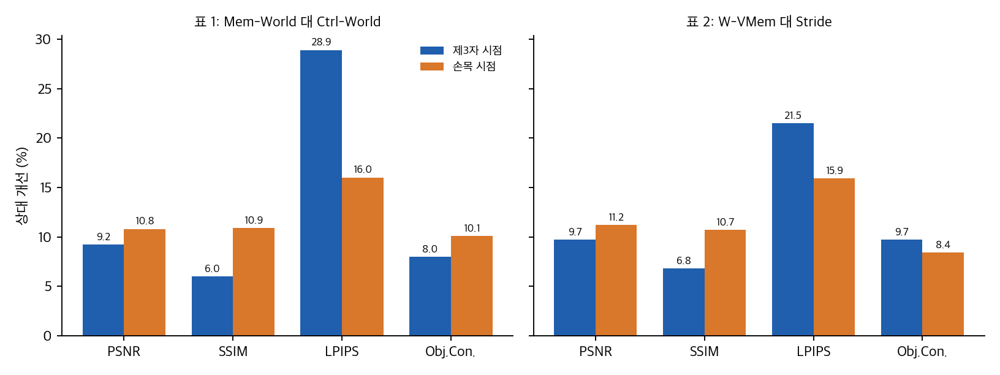
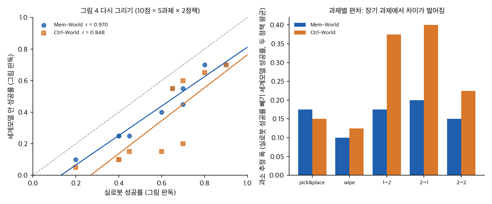
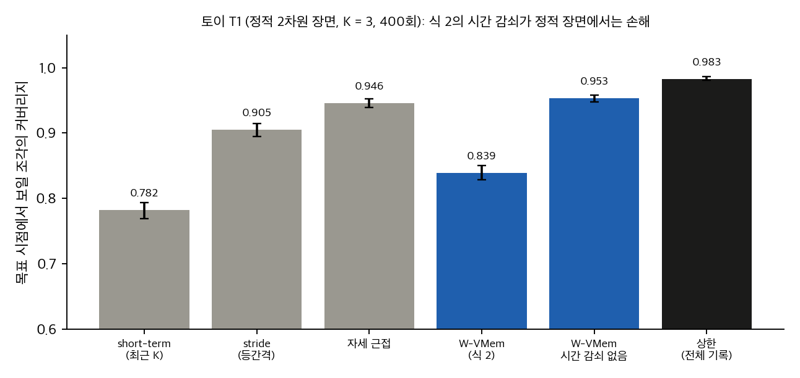

> **논문:** Zirui Zheng, Jiaqian Yu, Xiongfeng Peng, Jun Shi, Mingyi Li, Chao Zhang, Weiming Li, Dong Wang, Huchuan Lu, Xu Jia. *Mem-World: Memory-Augmented Action-Conditioned World Models for Persistent Robot Manipulation.* CoRL 2026 구두 발표, arXiv:2606.18960 (v3, 2026-09-15).
> 공식 코드와 프로젝트 페이지는 찾지 못했습니다(2026-11-24 확인). 논문은 arXiv 비독점 배포 라이선스라서 논문 그림은 싣지 않았고, 이 글의 그림은 모두 우리가 그린 그래프입니다.

## 논문이 묻는 것

행동을 넣으면 다음 영상을 만들어 주는 세계모델은 로봇 정책을 실험실 밖에서 평가하고 합성 데이터를 만드는 데 쓰입니다. 손목 카메라는 정보가 많지만 엔드이펙터나 물체에 자주 가려지고 빠르게 움직입니다. 자기회귀 롤아웃이 길어지면 모델은 한 번 본 물체를 잊거나 다시 그립니다.

Mem-World는 Ctrl-World 위에 **W-VMem**을 붙입니다. 손목 카메라로 본 장면을 서펠(작은 표면 조각)에 묶어 두고, 다음 행동 청크에서 순기구학으로 손목 카메라 자세를 구한 뒤 그 자세에서 보일 과거 프레임을 점수로 골라 조건으로 넣습니다. 점수는 기하(깊이와 법선), 조작 물체 표지, 시간 감쇠를 곱한 값이고, 점수가 높은 프레임에서 중복을 NMS로 걷어 냅니다. 논문은 세 가지를 주장합니다. 기억을 시험하도록 고른 재생 궤적에서 더 일관적이고, 세계모델 안 정책 성공률이 실로봇과 더 잘 맞으며(상관 14.5% 향상), 세계모델이 만든 성공 궤적으로 정책을 미세조정하면 긴 과제 성공률이 58%에서 72%로 오릅니다.

## 이 글에서 확인한 것

**표 1과 표 2의 개선은 서로 일관됩니다.** PSNR 개선은 표 1의 Mem-World 대 Ctrl-World에서 제3자 시점 +2.13 dB, 손목 시점 +1.87 dB이고, 표 2의 W-VMem 대 Stride에서 +2.20, +1.91 dB입니다. 평가 세트는 저자가 기억 효과가 드러나도록 고른 34개 궤적이고 분산은 보고되지 않았습니다. 궤적별 PSNR 차이의 표준편차가 약 5–6 dB를 넘지 않으면 이 개선은 쌍체 t 검정에서 유의합니다(우리의 민감도 계산, 쌍 표준편차는 가정). "손목 시점에서 특히 크다"는 서술은 지표에 따라 갈립니다. 상대 개선은 SSIM에서 손목 10.9%, 제3자 6.0%이고 LPIPS에서는 손목 16.0%, 제3자 28.9%입니다.

*그림 1. 표 1·2의 값에서 우리가 계산한 상대 개선입니다. 왼쪽은 Mem-World 대 Ctrl-World, 오른쪽은 W-VMem 대 Stride입니다.*

**그림 4의 읽은 점이 적힌 회귀식을 정확히 재현합니다.** 그림 4의 점 10개(5과제 × 2정책)를 읽으면(그림 판독 값) Mem-World의 피어슨 r = 0.9704, 기울기 0.934, 절편 −0.122가 그림의 표기와 일치합니다. Ctrl-World는 점 두 개가 Mem-World 점 뒤에 가려져 있어서 그림의 회귀식으로 역산했고, 그 결과 r = 0.8476, 기울기 1.046, 절편 −0.282가 정확히 나옵니다. 그림 5의 기본 정책 성공률(0.60, 0.70, 0.45)도 그림 4의 π0.5 실로봇 값과 같습니다. 값이 모두 0.05의 배수라서 셀당 시행 수를 20으로 가정했습니다(논문은 시행 수를 쓰지 않습니다).

*그림 2. 그림 4를 판독 값으로 다시 그린 산점도(왼쪽)와 과제별 평균 편차(오른쪽)입니다. 논문 그림이 아니라 우리가 그린 그래프입니다.*

**상관 차이는 정책 순서보다 긴 과제의 수준 편차에서 옵니다.** r 0.97 대 0.85는 상대 14.5%, 절대 0.123의 차이입니다. 읽은 값으로 보면 스피어만 순위 상관은 Mem-World 0.960, Ctrl-World 0.975로 구분되지 않고, 같은 과제의 두 정책 순서는 두 모델 모두 5/5를 맞힙니다. 짧은 과제 4점에서 평균 과소 추정(실로봇 − 세계모델)은 둘 다 0.138이고, 긴 과제 6점에서는 Mem-World 0.175, Ctrl-World 0.333입니다. 논문의 설명(긴 과제에서의 성능 하락이 약한 상관의 원인)과 같은 방향이며, 이 데이터가 보여 주는 것은 "정책 순서"보다 "과제 난이도에 따른 절대 수준의 보존"입니다. 차이의 크기는 점 10개와 5개 과제, 시행 수 미기재 속에서 불확실합니다. 종속 상관 검정은 p = 0.006이고 과제 단위 부트스트랩 95% 구간은 [0.017, 0.219]이지만 둘 다 점 10개를 독립으로 본 근사입니다. 두 세계모델이 같은 참 관계를 갖고 셀당 20회로 측정한다고 가정한 모의에서도 이만큼의 차이가 약 11% 확률로 나옵니다. 같은 가정에서 Mem-World의 r ≥ 0.97은 약 0.5%로 드물어서, 실로봇과 세계모델이 같은 초기 관측을 공유하는 짝 설계이거나 시행 수가 20보다 큰 경우일 가능성이 있습니다. 저자 확인이 필요합니다.

**정책 개선 58% 대 72%는 이 시행 수에서 구분되지 않습니다.** 그림 5의 판독 값(셀당 20회 가정)에서 과제별 Fisher 검정은 p = 0.45–0.75이고, 세 과제를 풀링한 35/60 대 43/60은 p = 0.18입니다. 정확한 평균은 58.3%에서 71.7%(+13.3 포인트)이고 반올림하면 14포인트로 보입니다. 같은 수의 실데이터, 필터 없는 합성 데이터, 다른 세계모델의 합성 데이터와 비교한 대조군이 본문에 없어서 개선이 Mem-World의 일관성 덕인지 추가 데이터 20–30개 덕인지 나눌 수 없습니다. 또 "200개를 만들어 성공 20–30개를 남겼다"가 성공 전부를 남긴 것이라면 세계모델 안 성공률은 10–15%여서 그림 4의 긴 과제 성공률 0.25–0.45와 차이가 있는데, 서술만으로는 어느 쪽인지 알 수 없습니다.

**새 요소 각각의 기여는 본문에서 확인되지 않습니다.** 표 2는 Short-term, Stride, W-VMem을 비교하고, 자세 근접 검색이나 VMem 원형 행은 없습니다. 시간 감쇠, 조작 표지, 손목 전용 갱신, 타임스텝별 렌더링의 절제도 본문에 없습니다. 식 2에서 조작 표지는 최대 ln(e+1)/ln(e) = 1.31배만 더하고 시간 감쇠는 0.19–1배, 깊이 항은 더 크게 변합니다. W-VMem의 출발점인 VMem의 공개 코드(MIT)를 정적으로 읽어 보면 서펠마다 타임스텝 목록을 두고 `cos / (1 + depth)`로 투표하는 구조, 평균 목표 자세에서의 렌더링, 자세 거리 기준의 NMS, 서펠 병합이 이미 있습니다. 논문이 새로 한 것은 타임스텝별 따로 렌더링, 시간 감쇠, 조작 표지, 손목 전용 갱신, 순기구학 자세 계산입니다. 이 다섯 가지에 대한 개별 비교가 있으면 설계의 근거가 훨씬 단단해질 것입니다.

**토이: 정적 재방문에서는 시간 감쇠가 손해였습니다.** 논문 수치의 재현이 아니라 설계가 의도한 상황에서 검색 규칙을 비교한 작은 모의입니다(2차원 정적 장면, 시야각 70도, 조각 300개, 20스텝, 이력 3프레임 선택, 400회). 목표 시점에서 보일 조각의 커버리지는 최근 프레임 0.782, 등간격 0.905, 자세 근접 0.946, 식 2의 W-VMem 0.839, 시간 감쇠를 뺀 W-VMem 0.953입니다. 이 설정에서는 자세 근접이 강한 기준선이었고 시간 감쇠가 커버리지를 낮췄습니다. 움직이는 물체가 있는 장면, 생성 프레임의 환각 전파는 다루지 않아서 감쇠가 도움이 되는 영역은 이 토이로 판단하지 못합니다.

*그림 3. 토이 T1의 K = 3 결과입니다. 막대는 400회 평균, 오차 막대는 95% 구간입니다.*

**본문 일관성.** 학습 설정 문단에 문장 조각이 남아 있고(v1–v3 동일), 식 2와 알고리즘 1에서 H와 T가 다른 뜻으로 겹쳐 쓰입니다. K(상위 개수), NMS 기준과 임계값, 렌더링 해상도, 깊이 스케일 정렬은 본문에 없습니다. "supplementary materials"를 세 곳에서 가리키지만 arXiv PDF 12쪽에는 보충 자료가 없습니다.

## 버전

v1(2026-06-17), v2(2026-06-18), v3(2026-09-15)의 본문과 그림을 비교했습니다. v1에서 v2로 저자 소속 표기가 바뀌었고, v3의 본문 변경은 날짜뿐입니다. 숫자, 식, 그림은 세 판본에서 같습니다.

## 이 맥에서 재현할 수 있을까

- **논문 수치의 재현: 불가능합니다.** 영상 지표는 8 H100 약 2일의 학습과 코드·평가 궤적 목록이 필요하고, 정책 평가와 개선은 Franka 실로봇, 4 H100 후학습, 250 에피소드 수집과 사람 판정이 필요합니다.
- **검색 모듈 단독 구현: 가능합니다.** 점군과 손목 자세 열을 입력으로 numpy나 torch에서 돌릴 수 있습니다. 공개 VMem의 구조를 참고하면 신규 코드는 타임스텝별 렌더링과 식 2 점수 정도입니다(추정 3–5일, 측정 전).
- **소형 세계모델 축소판: 조건부입니다.** 저해상도 합성 장면은 MPS에서 가능하지만 논문 수치와 직접 비교할 수 없습니다(추정 2–4주).

## 라이선스와 공개 범위

- 논문은 arXiv 비독점 배포 라이선스입니다(CC가 아닙니다). 그래서 논문 그림은 싣지 않았습니다.
- 공식 코드와 프로젝트 페이지는 찾지 못했습니다. VMem 공개 저장소는 정적으로 읽기만 했고 실행하거나 복사하지 않았습니다.
- 가중치와 데이터셋은 받지 않았습니다. 그림에서 읽은 값과 가정한 시행 수는 본문에 그대로 밝혔고, 공개되는 분석 문서와 스크립트에서 다시 계산할 수 있습니다.

## 정리

Mem-World는 손목 카메라 세계모델에 기하 기반의 이력 선택을 붙이는 명확한 아이디어이고, 표 1·2와 그림 4의 수치는 서로 일관됩니다. 다만 실로봇과의 상관 향상은 방향은 맞지만 정책 순서보다 긴 과제의 수준 편차에서 오고, 크기는 점 10개와 시행 수 미기재 속에서 확정하기 어렵습니다. 정책 개선은 대조군이 없고, 새 요소 각각의 기여를 가를 절제는 본문에 없습니다. 보충 자료나 코드가 공개되면 K, NMS, 렌더링 설정과 평가 궤적 목록으로 이 확인을 이어 갈 수 있습니다. 논문의 수치를 우리 평가로 옮기려면 시행 수, 짝 설계 여부, 과제 군집을 먼저 정해야 합니다.

## 자료

- [통합 리포트 PDF](report/report_public.pdf)
- [01. 논문 분석: Mem-World (arXiv:2606.18960)](analysis/01_paper_analysis.md)
- [02. 선행연구와 구성 요소 출처](analysis/02_prior_work.md)
- [03. 수치 재계산과 해석](analysis/03_analysis.md)
- [04. 주장 검증과 구현 가능성 (공식 코드 없음)](analysis/04_claim_verification.md)
