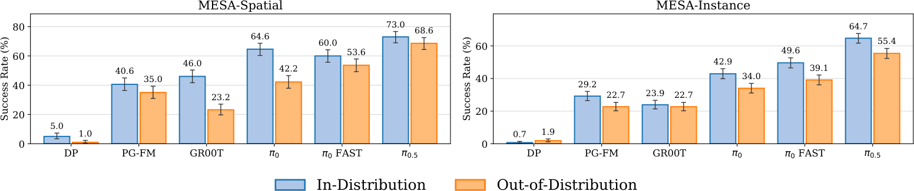
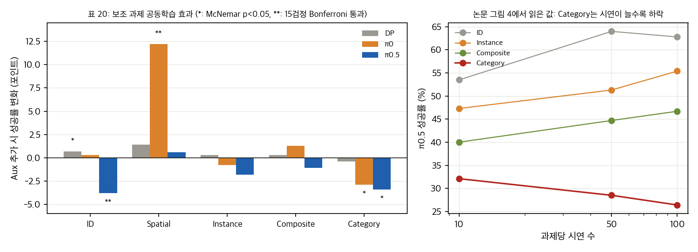
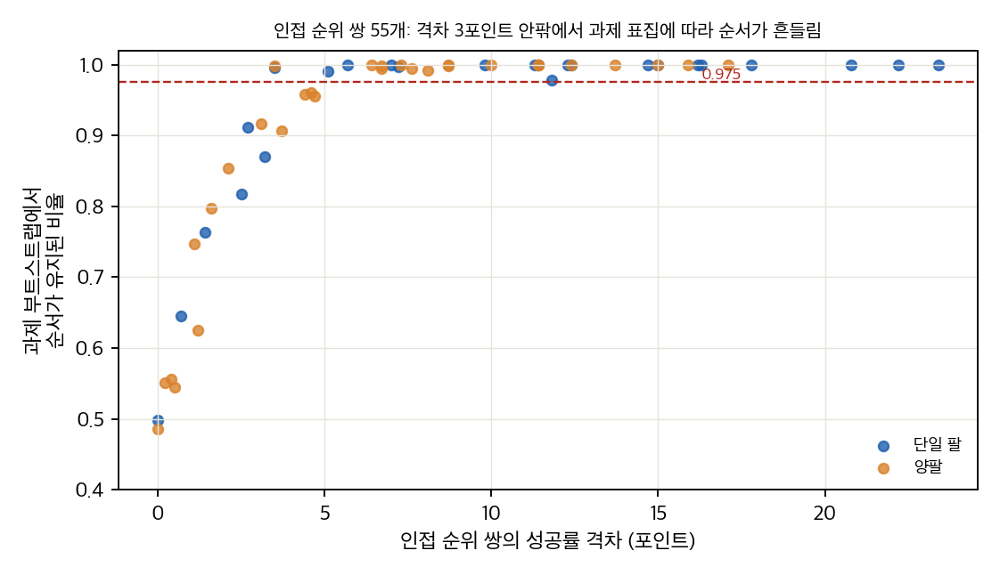
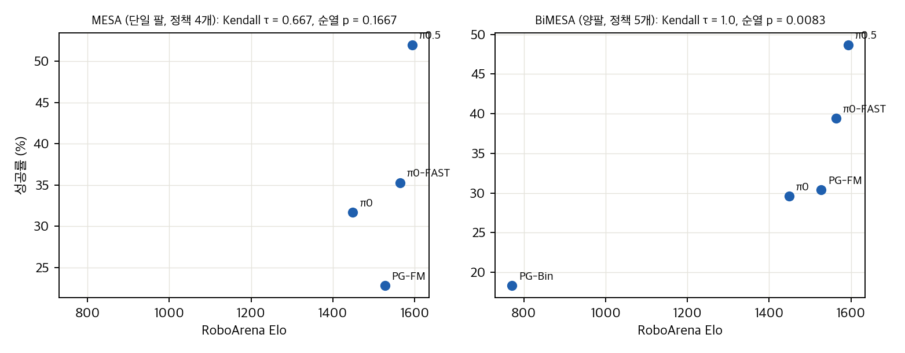
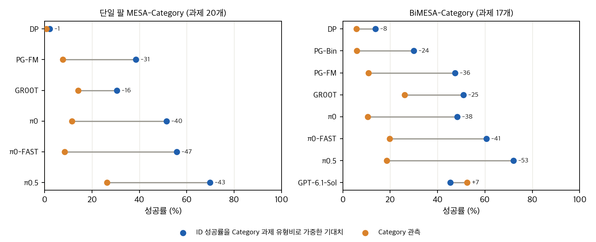
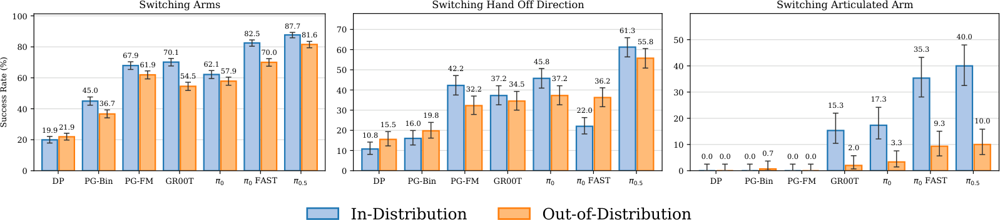

> **논문:** Albert Wilcox 외. *MESA: An Evaluation Framework for Compositional, Semantic, and Spatial Generalization in Robotics.* CoRL 2026 포스터, arXiv:2611.05567 (v1, 2026-11-03). 공식 코드는 GitHub pairlab/mesa-env(MIT)에 있습니다. 이 글의 그림은 논문 그림 두 장(출처 표기)과 우리가 그린 그래프입니다.

## 논문이 하는 일

MESA는 언어 조건 테이블탑 조작 정책의 일반화를 축별로 나눠 재는 시뮬레이션 벤치마크입니다. 학습 세트 하나(단일 팔 70과제 7,000시연, 양팔 57과제 6,833시연)와 평가 스위트 다섯 개(ID, 공간, 인스턴스, 조합, 범주)로 이루어지고, 시연은 MimicGen을 확장한 MESA-Gen으로 만듭니다. 기준선 일곱 개에서 가장 높은 π0.5가 단일 팔 52.0%, 양팔 48.7%입니다. 이 값은 다섯 스위트의 단순 평균이고, 과제 수로 가중하면 54.7%와 57.5%입니다.

## 표는 맞습니다

부록의 과제별 성공률 표를 모두 파싱해 합치면 표 2의 스위트 평균 70칸이 모두 반올림 오차 안에서 맞습니다. 95% Wilson 구간도 70칸이 맞고, 언어 따르기율 L = S/(S + D)에서 분모를 정수로 복원해도 모든 칸이 구간과 맞습니다. 그림 3의 ID 대응 막대도 같은 지시문의 ID 과제를 찾아 평균을 내면 그대로 재현됩니다.

*그림 3 (논문 원문). © 저자, CC BY 4.0, 출처 arXiv:2611.05567.*

공간 이동에서 GR00T(−22.8)와 π0(−22.4)가 크게 떨어지고 π0.5(−4.4)는 덜 떨어집니다. 다만 이 스위트는 10과제 500롤아웃이고 목적 객체가 세 종류뿐이라, "VLM의 공간 사전이 보존돼서"라는 설명은 시험하지 않은 가설입니다.

## 서술이 표와 어긋나는 곳

§5.4는 π0.5에서 보조 과제 공동학습의 유의한 변화가 없다고 쓰지만, 표 20에서 ID는 −3.8포인트(p < 0.001), Category는 −3.4포인트(p = 0.04)입니다. 15개 검정 중 p ≤ 0.05가 5개이고 Bonferroni를 통과하는 것은 π0 Spatial +12.2와 π0.5 ID −3.8 둘입니다. 또 이 실험은 학습 데이터를 두 배로 늘리고 스텝은 같게 해서, ID 과제가 덜 학습된 효과와 다양성 효과를 가를 수 없습니다.

*그래프 (우리가 그림). 왼쪽은 표 20, 오른쪽은 논문 그림 4에서 읽은 π0.5 값입니다. Category는 시연이 늘수록 32.1 → 28.5 → 26.4로 떨어집니다(10 대 100시연, p = 0.005).*

## 순위는 어디까지 믿을 수 있나

논문의 구간과 짝지은 McNemar는 한 체크포인트의 롤아웃 변동만 담습니다(부록 E.6). 같은 과제 집합을 모델이 공유하므로 과제를 복원추출해 봤습니다. 인접 순위 쌍 55개 중 19개가 97.5% 미만으로만 유지됩니다. π0.5가 1위라는 결론과 10포인트 이상의 격차는 안정적이지만, 격차 3포인트 이내의 중위권은 흔들립니다. 양팔에서 π0가 PG-FM보다 낮다는 "사전학습이 일률적으로 전이하지 않는다"는 해석은 격차가 0.8포인트이고 과제 표집에서 순서가 유지된 비율이 78.9%입니다.

*그래프 (우리가 그림). 점 하나가 인접 순위 쌍 하나입니다(단일 팔 25개, 양팔 30개). 점선은 97.5%입니다.*

*그래프 (우리가 그림). 표 5의 RoboArena와의 순위 일치는 모델 4개(단일 팔, Kendall τ = 0.67, 정확 순열 p = 0.17)와 5개(양팔, τ = 1.0, p = 0.008)에 기댑니다. 양팔은 Elo 771인 PG-Bin 이상치 의존이고 제외하면 p = 0.042입니다.*

## 범주 하락과 과제 유형

범주 이동에서 모든 파인튜닝 모델이 크게 떨어집니다. 과제 유형(집기·놓기, 핸드오프, 관절체)이 스위트마다 달라 생기는 착시인지 보려고, ID 유형별 성공률을 범주 스위트의 유형 구성으로 가중해 기대치를 만들었습니다. 범주 스위트는 단순 집기·놓기가 많아 기대치가 오히려 높은데도 π0.5는 단일 팔 69.8 → 26.4, 양팔 72.0 → 18.6으로 떨어집니다. 제로샷 GPT-6.1-Sol 에이전트는 45.4 → 52.4로 구간 안에서 유지됩니다.

*그래프 (우리가 그림). 파랑은 ID 성공률을 범주 스위트의 과제 유형 구성으로 가중한 기대치, 주황은 관측입니다.*

양팔 BiMESA-Spatial의 그림 5도 같은 방식으로 표에서 재현됩니다. 관절체는 ID에서 π0.5 40.0 → 10.0으로 가장 크게 떨어지지만, 그 조건은 과제 세 개(150롤아웃)입니다.

*그림 5 (논문 원문). © 저자, CC BY 4.0, 출처 arXiv:2611.05567.*

## 공식 코드와 논문의 차이

평가 서버의 구조(카메라, 재계획 5스텝, 과제당 평가 변형 50개, 공간 분할 범위, 평가 세트 크기)는 논문과 맞습니다. 다음은 다릅니다.

- 스텝 한도가 500에서 끝나지 않고 하위 과제를 달성할 때마다 300씩 늘어납니다(최대 1,400). 논문 본문과 부록 F에는 없습니다.
- 분산 과제 완료는 에피소드 어느 순간이든 한 번 충족되면 기록되고 성공 롤아웃에도 남습니다. 분산 목표 열거는 대상 객체를 다른 곳으로 옮기는 목표와 자기 위에 놓기 같은 항까지 포함합니다. 언어 따르기율을 계산하는 코드는 저장소에 없습니다.
- MESA-70 학습 목록이 71과제 7,015시연(논문 70과제 7,000)이고, 구 LeRobot v2.1 보조 데이터에 보류 Composite 과제 2개가 들어 있었다고 문서가 경고합니다.
- 비-이어붙이기 MimicGen 생성기의 시작점 최적화 호출이 저장소에 정의되지 않은 함수를 가리킵니다(정적 판단, 실행하지 않음).

## 재현에 대해

정책 평가 수치를 새로 만들지는 않았습니다. 기준선 학습은 H100 2장 21시간이 필요하고, 평가 harness는 자산 약 13 GB와 별도 설치가 필요합니다. 이 글의 모든 수치는 논문 표의 재계산과 공식 저장소의 정적 읽기입니다. 롤아웃 단위 로그가 공개되어 있지 않아 논문의 짝지은 McNemar는 재현하지 못했고, 비짝지음 근사와 과제 부트스트랩으로 대신했습니다. 재계산 스크립트와 결과는 함께 공개한 자료에 있습니다.

## 자료

- [통합 리포트 PDF](report/report_public.pdf)
- [01. 논문 분석: MESA (arXiv:2611.05567)](analysis/01_paper_analysis.md)
- [02. 선행연구와 코드 저장소](analysis/02_prior_work.md)
- [03. 수치 재계산과 주장 판정](analysis/03_analysis.md)
- [04. 공식 코드 대조와 구현 가능성](analysis/04_code_verification.md)
