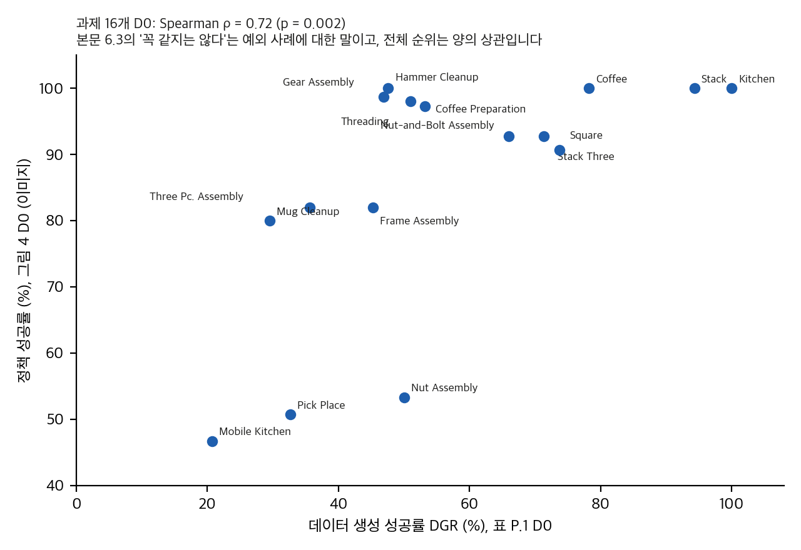
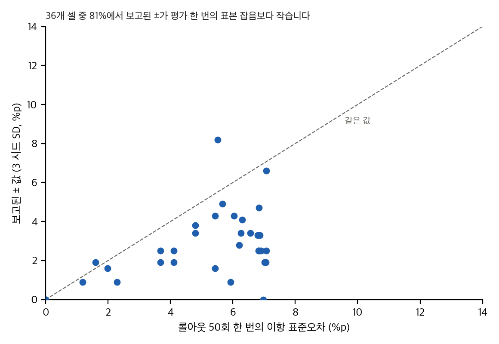
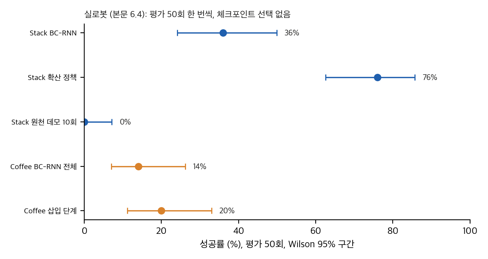
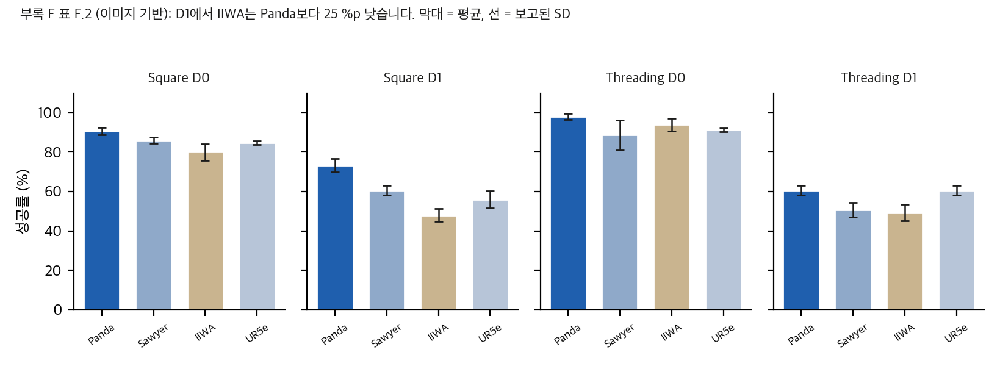

> **논문:** Ajay Mandlekar, Soroush Nasiriany, Bowen Wen, Iretiayo Akinola, Yashraj Narang, Linxi Fan, Yuke Zhu, Dieter Fox. *MimicGen: A Data Generation System for Scalable Robot Learning using Human Demonstrations.* CoRL 2023 (PMLR v229), arXiv:2310.17596 (v1, 2023-10-26).
> 공식 코드(NVlabs/mimicgen)는 정적으로만 읽었고 실행하지 않았습니다. 논문 그림은 싣지 않고, 우리가 표 값으로 그린 그래프만 씁니다. 논문 라이선스는 arXiv non-exclusive입니다.

## 논문이 묻는 것

로봇 모방학습은 사람 시연이 많을수록 좋아지지만, 시연을 모으는 데 사람 시간이 듭니다. MimicGen은 질문을 바꿉니다. **사람 시연 10개로 새 장면에서 쓸 수 있는 성공 시연 1000개를 자동으로 만들 수 있을까요?**

방법은 세 단계입니다.

1. 시연을 **객체 중심 하위과제**로 나눕니다. 예를 들어 커피 준비에서는 "머그 잡기, 머그를 기계에 놓기, 커피 포드 잡기, 포드 넣기"입니다. 각 하위과제는 한 객체의 좌표계 기준 동작입니다.
2. 새 장면에서 하위과제마다 원천 시연 하나를 고르고, 그 객체 자세에 맞게 엔드이펙터 목표 자세 열을 강체 변환합니다. 식은 **C'_t = O'_0 (O_0)⁻¹ C_t**입니다.
3. 변환된 세그먼트를 보간으로 이어 시뮬레이터에서 실행하고, 과제가 성공한 시도만 저장합니다.

정책 구조는 바뀌지 않습니다. 정책은 그냥 BC-RNN입니다. 바뀌는 것은 데이터입니다.

## 이 글에서 확인한 것

**변환 식과 코드는 맞습니다.** 무작위 1000개 사례에서 객체 좌표계 상대 자세 보존 오차는 2 × 10⁻¹⁵입니다. 공식 코드의 두 단계 계산도 같은 식입니다. 곱하는 순서를 바꾸면 모든 사례에서 깨집니다.

**코드 기본값과 논문 설명이 다른 곳이 있습니다.**

- 보간 시작점: 논문은 "현재 엔드이펙터 자세"에서 보간한다고 씁니다. 코드 기본값은 "직전 하위과제의 마지막 목표 자세"입니다. 논문 실험이 어느 쪽인지는 본문에 없습니다.
- 하위과제 경계: 논문 부록에 없는 **무작위 오프셋 5–20 스텝**이 시도마다 들어갑니다. 생성률에 영향을 줄 수 있는 설정입니다.
- 성공 판정: 코드는 에피소드 중 한 번이라도 성공 상태가 되면 저장합니다. 논문은 모든 세그먼트 실행 후 성공을 확인한다고 씁니다.

**결과 수치는 대체로 맞지만, 몇 곳은 어긋납니다.** 그림 4의 표 값을 부록 표와 맞춰 보았습니다. 31개 검사 중 30개가 맞았고, 틀린 것은 Mobile Kitchen의 원천 성공률(본문 2.7%, 표 Q.1 6.7%) 하나입니다. 부록 T의 "생성률 편차 0.6% 이하"는 Square D0에서 0.7이라 맞지 않습니다.

*그래프: 과제 16개의 D0 데이터 생성 성공률(가로)과 정책 성공률(세로). 값은 논문 표에서 옮겼습니다. 순위 상관은 ρ = 0.72입니다. 본문이 말하는 "꼭 같지는 않다"는 예외 사례의 이야기이고, 전체 경향은 양의 상관입니다.*

## 시뮬 결과의 ±

논문 표는 시뮬 성공률을 **세 시드에서 체크포인트 최댓값**으로 보고합니다. 체크포인트마다 롤아웃은 50회입니다. 표의 ±가 무엇인지는 정의되어 있지 않습니다.

롤아웃 50회 한 번의 이항 표준오차는 성공률 90%에서 약 4 %p, 50%에서 약 7 %p입니다. 그런데 36개 셀 중 29개에서 보고된 SD가 이 값보다 작습니다. 체크포인트 최댓값을 고르면 위로 치우치고, ±는 그 변동을 다 담지 못합니다.

*그래프: 가로는 롤아웃 50회 한 번의 이항 표준오차, 세로는 논문 표의 ± 값입니다. 대각선 위쪽이면 보고된 ±가 평가 잡음보다 크다는 뜻입니다. 대부분 점이 아래에 있습니다.*

**결론:** 큰 차이(원천 대 생성 데이터)는 이 문제와 상관없이 확실합니다. 10 %p 안팎의 차이는 체크포인트 선택과 ± 정의에 따라 달라질 수 있습니다.

## 실로봇 결과

실로봇에서는 마지막 체크포인트를 평가 50회 했으므로 선택 편향이 없습니다. Stack 과제에서 확산 정책은 76%(38/50), BC-RNN은 36%(18/50)입니다. 두 값의 Fisher 검정은 p = 1.1 × 10⁻⁴입니다. 원천 10개로 학습한 정책의 0%(0/50)와도 차이가 확실합니다. 다만 Wilson 95% 구간은 BC-RNN이 24–50%, 확산 정책이 63–86%로 넓습니다.

*그래프: 실로봇 Stack과 Coffee의 성공률과 Wilson 95% 구간. 평가 50회 한 번씩입니다.*

## 로봇 팔이 바뀌면

논문은 Panda에서 만든 원천으로 Sawyer, IIWA, UR5e용 데이터를 만들었고, D0 정책 성공률이 80–91%로 "매우 비슷하다"고 씁니다. 범위는 맞습니다. 하지만 세 시드 SD를 가정하면 IIWA와 Panda의 Square D0 차이는 10.7 %p(p = 0.03)입니다. D1에서 IIWA는 Panda보다 25 %p 낮습니다(p = 0.0008). 본문은 이 차이를 설명하지 않습니다.

*그래프: 표 F.2의 로봇 팔별 성공률. 막대는 평균, 선은 보고된 SD입니다.*

## 숫자 규모

본문은 "50K 이상의 시연, 18개 과제"라고 씁니다. 본문 표는 **16개 과제, 36개 변형**이고, 변형마다 1000개씩이면 36,000개입니다. 50K를 채우려면 부록의 추가 생성분이 필요하지만, 논문은 합계를 적지 않습니다. 공식 저장소의 로봇 과제 설정은 12개이고, Factory 3개와 Mobile Kitchen은 저장소에 없습니다.

## 이 맥에서 할 수 있는 것

- **할 수 있는 것 (조건부):** 로봇 시뮬레이션 과제 하나(예: Square D0)의 데이터 생성 파이프라인을 CPU로 돌려 생성 성공률을 재는 것. 설치와 렌더링 확인이 먼저 필요합니다.
- **하기 어려운 것:** BC-RNN 학습 전체(논문은 GPU를 씁니다), 36개 변형의 생성 시간(시도 수는 약 112,600회인데 한 번의 시간을 아직 재지 않았습니다).
- **할 수 없는 것:** Factory 과제(Isaac Gym, CUDA), Mobile Kitchen(공식 코드 없음), 실로봇.

## 열린 질문

1. 논문 실험은 보간을 현재 자세에서 시작했습니까, 직전 목표 자세에서 시작했습니까?
2. 하위과제 경계의 무작위 오프셋은 실험에 썼습니까?
3. 성공 판정은 궤적 중 한 번이라도인가요, 마지막 스텝인가요?
4. 표의 ±는 무엇입니까?

이 질문들이 답을 받으면 데이터 생성률과 정책 성능의 차이를 더 정확히 읽을 수 있습니다. 재현 실험은 이 글에서 하지 않았습니다.

## 자료

- [통합 리포트 PDF](report/report_public.pdf)
- [01. 논문 분석: MimicGen](analysis/01_paper_analysis.md)
- [02. 선행연구, 가까운 대안, 자료와 저장소](analysis/02_prior_work.md)
- [03. 재계산, 일관성 검사, 토이 검증](analysis/03_analysis.md)
- [04. 논문과 공식 코드 대조: MimicGen](analysis/04_code_verification.md)
