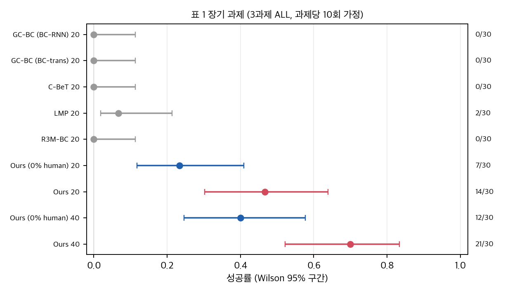
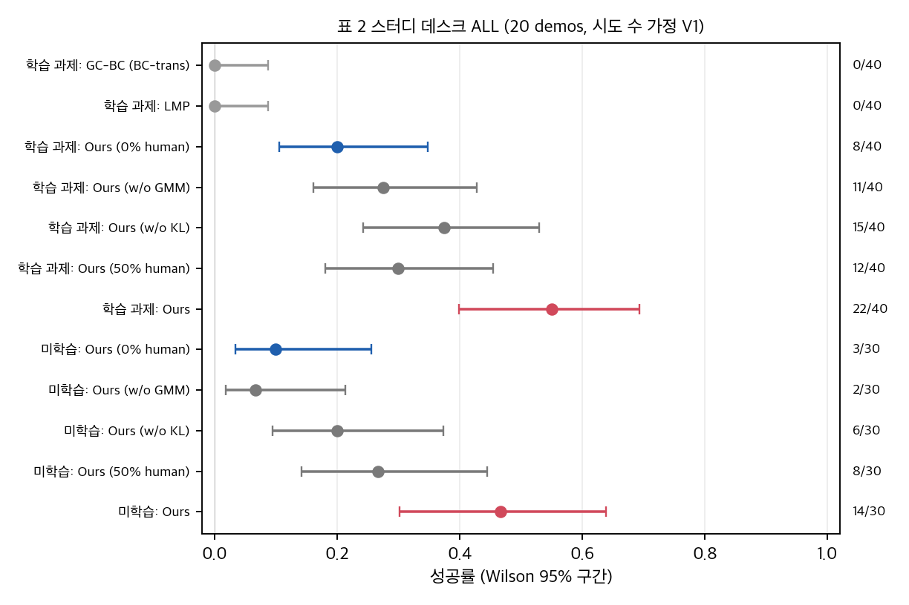
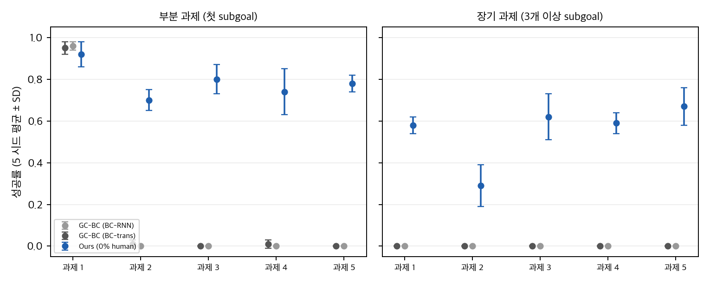

> **논문:** Chen Wang, Linxi Fan, Jiankai Sun, Ruohan Zhang, Li Fei-Fei, Danfei Xu, Yuke Zhu, Anima Anandkumar. *MimicPlay: Long-Horizon Imitation Learning by Watching Human Play.* CoRL 2023 (PMLR v229, pp. 201–221), arXiv:2302.12422 (v2, 2023-10-13).
> 공식 코드는 GitHub j96w/MimicPlay(MIT)에 있습니다. 이 글의 그래프는 논문 표 값을 다시 계산해 우리가 그렸습니다. 논문 그림은 넣지 않았습니다(arXiv 비독점 배포 라이선스).

## 논문이 묻는 것

긴 과제를 로봇에게 가르치려면 시연이 많이 필요합니다. 로봇을 원격 조작해 모은 play 데이터는 과제 하나당 몇 시간이 듭니다. MimicPlay는 다른 자리에서 비용을 줄입니다. **사람이 손으로 목표 없이 노는 영상**에서 "다음에 손이 어디로 가는가"의 3D 궤적을 배우는 계획기를 만들고, 로봇은 시연 20–40개로 그 계획을 따르는 정책만 배웁니다.

사람 play를 로봇 행동이 아니라 **3D 손 궤적**으로 바꾸는 것이 핵심입니다. 손 궤적은 사람과 로봇의 몸 차이에 덜 묶입니다. 논문은 10분의 사람 play가 로봇 원격 조작 약 3시간에 해당한다고 씁니다.

## 구조

- **1단계 (계획기):** 사람 영상과 목표 프레임을 넣으면 잠재 계획을 만들고, 그 계획에서 미래 3D 손 궤적을 GMM(혼합 가우시안, K = 5)으로 예측합니다. 사람과 로봇 영상의 특징 분포를 맞추는 KL 항을 더합니다.
- **2단계 (정책):** 손목 카메라, 고유감각, 동결된 계획을 토큰으로 묶어 트랜스포머에 넣고 GMM으로 행동을 냅니다.
- **추론:** 과제 영상(사람 또는 로봇)을 목표 프레임으로 한 장씩 넘기면 계획이 따라옵니다.

## 우리가 다시 계산한 것

논문 표의 실로봇 값은 시도 수가 없습니다. 같은 논문의 v1에 쓰인 분수 표로 과제당 10회가 확인되었습니다. 그래서 구간은 과제당 10회 가정에서 계산했습니다.

*그림: 논문 표 1 장기 과제 ALL을 Wilson 95% 구간으로 다시 그렸습니다. 과제 3개 x 10회 가정. 우리가 그린 그래프입니다.*

- 주방 장기 과제 **40시연**: Ours 21/30, Ours (0% human) 12/30. 차이 30%p, p = 0.04.
- 같은 과제 **20시연**: 14/30 대 7/30. 차이 23%p, p = 0.10. 방향은 맞지만 유의하지 않습니다.
- 기준선(LMP, C-BeT, R3M-BC)과의 차이는 대부분 p < 0.001입니다.

스터디 데스크 절제 실험(표 2)에서는 GMM 제거의 효과가 가장 뚜렷했습니다.

*그림: 논문 표 2 스터디 데스크 ALL을 Wilson 95% 구간으로 다시 그렸습니다. 학습 과제 40회, 미학습 30회 가정. 우리가 그린 그래프입니다.*

- **GMM 제거:** 미학습 과제에서 0.07(전체 0.47), p = 0.001.
- **KL 항 제거:** 학습 과제에서 0.38(전체 0.55), p = 0.18. 방향만 맞고 유의하지 않습니다.
- **사람 데이터 절반:** 학습 과제에서 0.30, p = 0.04.

시뮬레이션(부록 C, LIBERO)에서는 장기 과제 평균이 0.55인데, 기준선 두 개가 모두 0.00입니다. 기준선이 C-BeT, LMP, R3M 없이 두 개뿐이라는 점을 함께 봐야 합니다.

*그림: 논문 표 4(LIBERO, 5 시드 평균 ± SD)를 과제별로 다시 그렸습니다. 우리가 그린 그래프입니다.*

## 공식 코드와 논문의 차이

공식 저장소(MIT, 2024-04-23 마지막 push)를 얕게 복제해 정적으로만 읽었습니다. 실행하거나 설치하지 않았습니다.

- **KL 정렬 항이 없습니다.** 논문의 핵심 항(λ = 1000)이 공개 코드에 없습니다.
- **3D 삼각측량 코드가 없습니다.** 사람 데이터 처리 스크립트는 2D 손 검출까지만 있습니다.
- **목표 간격이 다릅니다.** 논문은 목표를 10–30초 뒤 프레임에서 고르고, 코드 기본값은 그보다 짧은 간격입니다.
- **학습 설정이 다릅니다.** 배치와 에폭, 감쇠 설정이 논문 표와 맞지 않습니다.
- **CUDA 호출이 32곳입니다.** 맥에서 돌리려면 장치 중립으로 고쳐야 합니다.
- **시뮬 평가 설정은 같습니다.** 100회 시도, 최대 2000 스텝으로 논문과 맞습니다.

## 이 맥에서 할 수 있는 것

- **실로봇 실험은 불가능합니다.** Franka 제어 스택, 원격 조작 장치, 사람 play 수집 장치가 저장소에 없습니다.
- **공식 학습은 조건부입니다.** MPS 이식 후 학습 시간을 재 봐야 합니다. 시간은 아직 측정하지 않았습니다.
- **시뮬 평가는 조건부입니다.** 설치와 체크포인트 다운로드가 필요합니다.
- **축소판은 가능합니다.** 잠재 계획과 GMM 헤드, KL 정렬 효과를 작은 합성 데이터로 확인할 수 있습니다.

## 남은 질문

- 실로봇 시도 수를 늘리면 20시연 결과가 유의해지는가. 논문의 원자료가 없어 확인할 수 없습니다.
- 사람 영상과 로봇 영상의 영역 차이를 KL 항이 실제로 줄이는가. 공식 코드에 없어서 확인할 수 없습니다.
- 그림 4의 사람 프롬프트와 로봇 프롬프트 비교는 수치 표가 없습니다.

분석 문서 전체(재계산 스크립트, 주장 판정 C1–C19, 코드 대조 D1–D13)는 `analysis/` 폴더에 있습니다.

## 자료

- [통합 리포트 PDF](report/report_public.pdf)
- [01. 논문 분석: MimicPlay](analysis/01_paper_analysis.md)
- [02. 선행연구와 관련 저장소](analysis/02_prior_work.md)
- [03. 수치 재계산, 일관성 검사, 주장 판정](analysis/03_analysis.md)
- [04. 공식 코드 대조와 구현 가능성](analysis/04_code_verification.md)
