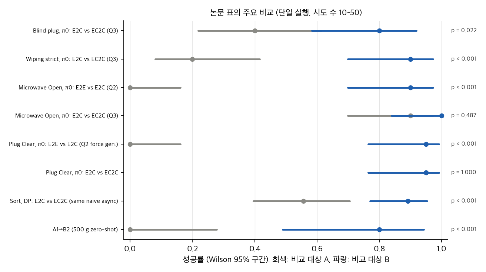

> **논문:** Cuijie Xu 외 (Tsinghua University 외). *Mind the Gap: Rethinking I/O Design for Contact-Rich Visuomotor Policy Learning.* CoRL 2026 포스터, arXiv:2602.08776 (v2, 2026-09-15).
> 공식 코드는 아직 없습니다. 프로젝트 페이지에 "Code (Coming Soon)"로 적혀 있습니다. 이 글은 논문 표의 수치를 다시 계산해서 읽은 결과입니다. 논문 그림은 쓰지 않았습니다(arXiv non-exclusive 라이선스).

## 한 줄 요약

명령(리더)과 실행(팔로워)을 둘 다 정책 입력에 넣으면 힘이 필요한 과제가 좋아집니다. 다만 이득은 과제마다 다르고, 논문 표의 일부 비교는 조건이 섞여 있습니다.

## 무엇을 바꿨나

원격조작 로그에는 로봇이 실제로 간 위치 E와 조작자가 보낸 명령 C가 같이 남습니다. 기존 방법은 둘 중 하나만 씁니다.

- **E2E:** 실행 상태를 입력으로, 실행을 출력으로 씁니다. 접촉에서 버튼을 누르거나 그립을 세게 쥐는 명령 오프셋이 사라집니다.
- **E2C:** 명령을 출력으로 씁니다. 명령은 보존되지만, 명령이 실제로 실행됐는지(접촉이 있었는지)는 알 수 없습니다.
- **EC2C:** E와 C 이력을 입력하고 미래 C를 출력합니다. 명령과 실행의 차이 ε = C − E가 정책에 보입니다.

추론 지연에는 확정된 명령 접두부를 조건으로 넣는 inpainting을 씁니다. 학습 목표는 바꾸지 않습니다.

## 재계산 결과

그림: 논문 표 2, 3, 5의 주요 비교를 Wilson 95% 구간으로 나타낸 우리가 그린 그래프. 단일 실행이고 시도 수는 10–50입니다. p는 Fisher 정확 검정(양측)입니다.

- **힘 생성 (E2E 대 E2C):** 마이크로웨이브 버튼은 0/20에서 18/20으로, Clear 플러그는 0/20에서 19/20으로 좋아집니다(π0, p < 0.001). 가장 분명한 결과입니다.
- **접촉 타이밍 (E2C 대 EC2C):** 닦기(엄격 성공 4/20에서 18/20, p < 0.001)와 Blind 플러그(8/20에서 16/20, p = 0.02)에서 좋아집니다. 마이크로웨이브와 Clear 플러그에서는 차이가 없습니다.
- **무게 분류:** Diffusion Policy에서 같은 추론 방식으로 비교하면 20/36에서 41/46으로 좋아집니다(p < 0.001). π0 결과는 EC2C만 inpainting으로 실행했기 때문에, 입출력 효과와 추론 방식 효과가 섞여 있습니다.
- **지연:** 400 ms에서 성공은 40/50에서 45/50으로 올라가지만 p = 0.26으로 유의하지 않습니다. 부드러움(jerk)은 1.28에서 0.88로 줄었는데, 표준편차 없이 평균만 있습니다.
- **페이로드 500 g:** 제로샷 전이에서 0/10에서 8/10으로 좋아집니다(p = 0.001). 시도 10회, 페이로드 1종, 하드웨어 1계열이라는 한계가 있습니다.

## 읽으면서 걸리는 것

1. **통계 근거가 얇습니다.** 학습 seed를 여러 번 돌렸다는 말이 없고, 신뢰구간도 없습니다. 작은 차이는 학습 변동과 구분할 수 없습니다.
2. **"거의 무작위"라는 주장은 일부만 맞습니다.** 무게 분류에서 E2E는 0.5에 가깝지만, π0 E2C는 62%입니다(p = 0.14).
3. **d_max와 DP 학습 설정이 없습니다.** 재현하려면 값을 정해서 기록해야 합니다.
4. **Table 6의 100 ms 행이 두 방법에서 똑같습니다.** 설명이 없습니다.

## 구현 가능성

방법 자체는 쉽습니다. 입력 인코더에 명령 이력과 마스크를 붙이는 변경이고, 손실과 샘플러는 그대로입니다. 그러나 논문 수치를 그대로 재현하려면 π0 학습(A100 전제), 저비용 양팔 로봇, 힘 측정 장치가 필요합니다. 공식 코드가 공개되기 전까지는 정확한 재현이 어렵습니다.

## 정리

이 논문은 "명령과 실행을 둘 다 보라"는 질문을 잘 던졌습니다. 힘 생성과 접촉 타이밍에서는 근거가 강합니다. 반면 동적 과제와 지연 실험의 근거는 아직 약하고, 공식 코드와 seed 반복이 나오면 다시 확인할 가치가 있습니다.

## 자료

- [통합 리포트 PDF](report/report_public.pdf)
- [01. 논문 분석: Mind the Gap: Rethinking I/O Design for Contact-Rich Visuomotor Policy Learning](analysis/01_paper_analysis.md)
- [02. 선행연구와 관련 자료](analysis/02_prior_work.md)
- [03. 재계산과 일관성 검사](analysis/03_analysis.md)
- [04. 주장 검증 (공식 코드 없음)](analysis/04_claim_verification.md)
