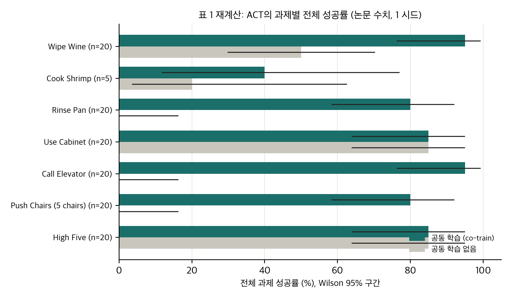

> **논문:** Fu, Zhao, Finn. *Mobile ALOHA: Learning Bimanual Mobile Manipulation with Low-Cost Whole-Body Teleoperation.* arXiv:2401.02117 (v1). CoRL 2024 (PMLR v270).
> 논문 그림은 arXiv 비독점 배포 라이선스라서 싣지 않았습니다. 그림과 영상은 [프로젝트 페이지](https://mobile-aloha.github.io)에서 볼 수 있습니다. 아래 그래프는 논문 표 1의 수치로 직접 그렸습니다. 공식 코드는 MIT 라이선스입니다.

## 한 줄 요약

이동 기지 위에 팔 두 쌍을 얹고, 허리를 줄로 묶어 **몸 전체로 텔레오퍼레이션**하는 저가 장비를 만들었습니다. 정적 양팔 데이터와 함께 학습하면 이동 조작 성공률이 크게 오른다고 보고합니다. 방법은 단순합니다. 다만 본문의 평균 향상 수치는 표와 맞지 않아서 표 값을 직접 다시 계산해 봤습니다.

## 1. 장비: 허리를 줄로 묶은 텔레오퍼레이터

ALOHA 팔 두 쌍은 탁상 조작에 쓰기에는 좋지만 이동이 안 됩니다. 논문은 이 팔을 AgileX Tracer 기지 위에 올렸습니다. 조작자는 양손으로 리더 팔을 잡고, 허리는 기지에 줄로 묶입니다. 기지를 움직이려면 사람이 직접 바퀴를 뒤로 끕니다. 기지 바퀴는 토크를 끄면 마찰이 작아서 끌 수 있고, 굴림 저항은 약 13 N입니다.

예를 들어 두 짝 문 캐비닛을 열 때 사람은 자연스럽게 뒤로 물러서며 팔을 벌립니다. 기지와 팔을 따로 조종하면 이런 동작이 잘 나오지 않습니다. 허리를 묶으면 몸이 움직이는 대로 기지가 따라가서, 이 동작을 그대로 데이터에 담을 수 있습니다.

장비 비용은 약 3.2만 달러입니다 (기지 7,000달러 포함). 논문은 PR2나 TIAGo가 20만 달러를 넘는다고 비교합니다.

*그림: 논문 표 1의 과제별 전체 성공률 (ACT). 막대는 공동 학습 여부별 값, 선은 Wilson 95% 구간입니다. 과제당 평가 20회이고 쿡 쉬림프만 5회입니다. 논문 수치로 직접 그렸습니다.*

## 2. 학습: 정적 ALOHA 데이터 825개를 함께 쓴다

이동 조작 데이터는 모으기 어렵습니다. 논문은 탁상 ALOHA 데이터 825 에피소드를 같이 씁니다. 두 데이터는 기지 움직임이 달라서 **기지 행동은 0으로 채우고**, 관절 행동은 같은 차원으로 맞춥니다. 배치는 두 데이터셋에서 같은 확률로 뽑습니다.

정책은 ACT, Diffusion Policy, VINN 세 가지를 시험했습니다. Diffusion Policy와 ACT는 공동 학습으로 나아졌고, VINN은 Wipe Wine에서 오히려 5%p 떨어지는 등 결과가 엇갈렸습니다.

## 3. 숫자를 다시 계산하니

표 1은 과제 7개의 ACT 결과입니다. 공동 학습이 있을 때와 없을 때의 차이는 다음과 같습니다.

| 과제 | 공동 학습 | 없음 | 차이 |
|---|---|---|---|
| Wipe Wine | 95 | 50 | +45 |
| Cook Shrimp | 40 | 20 | +20 |
| Rinse Pan | 80 | 0 | +80 |
| Use Cabinet | 85 | 85 | 0 |
| Call Elevator | 95 | 0 | +95 |
| Push Chairs | 80 | 0 | +80 |
| High Five | 85 | 85 | 0 |

그런데 본문 서론은 "평균 34%p 절대 향상"이라고 씁니다. 표에서 다시 계산하면 **평균 향상은 45.7%p**이고, 34.3%는 공동 학습 없음의 평균 성공률입니다. 초록의 "최대 90%p"도 표의 최대 향상 95%p와 맞지 않습니다. 두 숫자 모두 결론의 방향을 바꾸지는 않지만, 독자가 효과를 과소평가하게 만듭니다.

하위 과제 성공률을 정수 횟수로 설명할 수 있는지도 확인했습니다. 논문 6절 정의대로 하위 과제 분모는 직전 성공 수이고, 전체는 하위 과제의 곱입니다. 대부분은 정수 사슬로 맞았습니다. 한 행만 맞지 않았습니다. **Push Chairs (5 의자) 공동 학습 행**입니다. 4번째 의자 85%는 20회 중 17회인데, 5번째 의자 89%를 만족하는 정수 해는 15/17 = 88.2%뿐입니다. 그러면 전체는 75%가 되어 표의 80%와 5%p 어긋납니다.

과제마다 신뢰구간이 넓습니다. 20회 평가에서 95%는 하한이 76%이고, 0%는 상한이 16%입니다. 그래서 차이가 큰 과제 (Rinse Pan, Call Elevator, Push Chairs)만 확실하다고 볼 수 있습니다. Wipe Wine (50 → 95%)은 Holm 보정 후 p ≈ 0.01입니다. 논문은 시드 수를 쓰지 않았습니다.

## 4. 공식 코드는 논문과 같은가

공식 저장소 `mobile-aloha`와 `act-plus-plus`는 MIT 라이선스입니다. 얕게 복제해서 코드만 읽었습니다.

- **맞는 것:** 정책 구조 (인코더 4, 디코더 7, 헤드 8), 정규화 통계는 모바일 데이터만, 16차원 행동, 과제별 에피소드 길이, 카메라 3대.
- **다른 것:** 공동 학습 비율이 과제마다 다릅니다. Use Cabinet은 정적 데이터 20%, Call Elevator는 11%, High Five는 25%입니다. 논문은 모든 과제에서 50%라고 씁니다. 공식 설정은 논문에 없는 보조 시연도 씁니다 (캐비닛 손잡이 200, 냄비 잡기 200, 엘리베이터 1200과 버튼 800 에피소드 등).
- **기지 레이블:** 논문은 Tracer CAN에서 기록한다고 씁니다. 코드는 **바퀴 엔코더로 계산한 측정 속도**를 학습 레이블로 씁니다. 명령 속도가 아니라 측정 속도를 배우는 셈입니다.
- **숨은 상수:** 기지 지연 13 스텝 (하드코딩), 기지 레이블 5프레임 평활, 시간 앙상블 감쇠 k = 0.01. 논문에는 없습니다.
- **이식 장벽:** `.cuda()` 호출이 47곳입니다. 맥에서 돌리려면 장치 인자로 바꿔야 합니다.

## 5. 하드웨어 설명도 내부적으로 맞지 않는다

본문은 배터리를 1.26 kWh라고 쓰는데, 그림 2의 사양표는 1620 Wh라고 씁니다. 당기는 힘도 본문은 1.5 m 높이에서 100 N이라고 하고, 그림 2는 100 cm라고 씁니다. 카메라는 본문에서 50 Hz, 부록에서 30 fps입니다. 공식 코드의 기록 루프는 50 Hz입니다 (`FPS = 50`). 그러니 기록 루프와 카메라 프레임레트는 따로 봐야 합니다.

## 6. 구현 가능성 (맥 기준)

- **실로봇 재현: 불가.** 팔 네 개, 기지, 카메라 세 대, ROS 1 환경이 필요합니다.
- **학습 재현: 조건부.** 데이터 (프로젝트 페이지 링크)는 크기를 확인하지 않았습니다. 논문은 학습 장치와 시간을 쓰지 않았습니다. 데이터를 받은 뒤 MPS 이식과 학습 시간을 재고 판단합니다.
- **CPU로 가능한 것:** 표 재계산과 정수 검사, 기지 레이블 지연 토이 같은 작은 numpy 실험.

## 7. 정리

Mobile ALOHA는 장비 설계와 공동 학습 레시피가 깔끔한 논문입니다. 하지만 숫자를 옮길 때 실수가 있습니다. 평균 향상 34%p는 45.7%p가 맞고, 초록의 90%p는 95%p입니다. 공동 학습 비율과 보조 데이터, 기지 레이블 출처는 논문 본문만 읽어서는 알 수 없습니다. 재현을 하려면 공식 코드의 설정을 함께 봐야 합니다.

*분석 근거: 논문 본문과 부록 (arXiv v1 및 PMLR v270 PDF), 공식 저장소 두 개의 정적 읽기 (MIT, 2024년 1월 커밋). 실행과 데이터 다운로드는 하지 않았습니다.*

## 자료

- [통합 리포트 PDF](report/report_public.pdf)
- [01. 논문 분석: Mobile ALOHA](analysis/01_paper_analysis.md)
- [02. 선행연구, 구성 요소별 출처, 코드와 프로젝트 페이지](analysis/02_prior_work.md)
- [03. 수치 재계산과 일관성 검사](analysis/03_analysis.md)
- [04. 코드 대조: 논문 ↔ 공식 코드 (정적 읽기)](analysis/04_code_verification.md)
