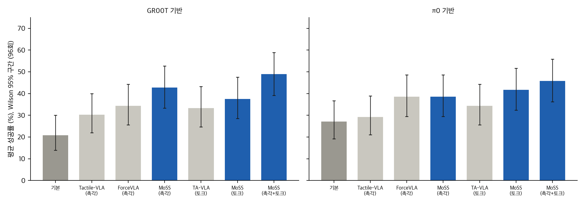
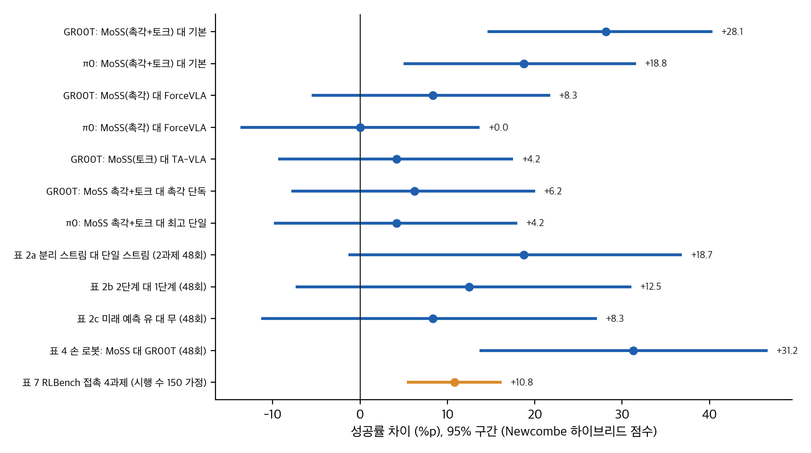
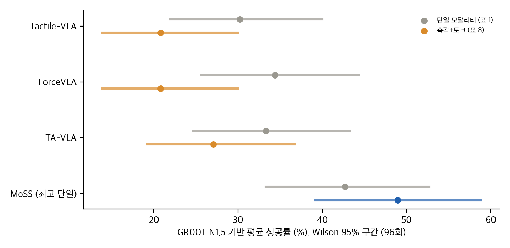

# 03. 수치 재계산, 일관성 검사, 구조 토이

`analysis/recompute.py`(numpy, scipy, statsmodels, 수 초)가 표 1, 2, 3, 4, 6, 7, 8, 9를 옮겨 적고 아래 V 항목을 계산합니다. 결과는 `analysis/recompute_results.json`에 있습니다. 학습이나 실험은 하지 않았습니다.

**전제.**

- 시행 수는 부록 A.1의 값을 씁니다: 플랫폼 I 과제당 **24회**(방법·모델 조합마다 4과제 = 96회), 손 로봇 과제당 24회. 표 9의 하위 열은 Unstack 12회, Board Erase 8회, Plug 8회입니다.
- 표 7(RLBench)은 시행 수가 적혀 있지 않습니다. 18개 값이 모두 1/150 격자 위에 있어 **과제당 150회를 가정**했습니다(`03` V14). 이 가정이 바뀌면 p 값이 달라지므로 민감도를 함께 적었습니다.
- 모든 시행을 독립으로 보고 Fisher 정확 검정, Wilson 구간, 과제별 층화 CMH, Holm 보정을 썼습니다. 같은 초기 조건을 방법 사이에 짝지었는지 논문에 서술이 없어 쌍체 검정은 쓰지 않았습니다. 짝지었다면 위 검정은 보수적입니다.
- 시드 수, 학습 반복, 평가 순서는 논문에 없습니다. 아래 p 값은 평가 시행의 이항 변동만 반영합니다.

## 1. 표 1

### 1.1 격자와 평균 (V1, V2)

- **V1.** 표 1의 56개 과제 칸이 모두 k/24 × 100(소수 첫째 자리 반올림)과 맞습니다(24회, 정수 성공 횟수로 복원됨).
- **V2.** 14개 행의 평균 중 11개는 정수 성공 횟수의 합/96과 같습니다. 3개(π0 ForceVLA 38.6, π0 MoSS 촉각 38.6, π0 MoSS 촉각+토크 45.9)는 정확한 값이 38.54, 38.54, 45.83이고, **반올림된 네 칸 값의 평균**(38.55, 38.55, 45.85)을 다시 반올림하면 보고값과 같습니다. 표의 평균은 칸 값(반올림 후)의 평균으로 계산된 것으로 읽힙니다. 차이는 0.1 %p 이내입니다.
- π0 기본의 보고 평균 27.1(v2)은 칸 합 26/96 = 27.08과 맞습니다. v1의 26.1은 맞지 않았습니다(K2).

### 1.2 ± 값 (V3)

- 표 1 캡션(v2)은 "standard deviation computed over all trials"입니다. 14개 행 중 13개의 ± 값은 **이항 표준오차** √(p(1−p)/96)(n = 96)과 소수 첫째 자리까지 같습니다. 즉 이 값은 평균의 표준오차이고, 시행 한 번의 결과(0 또는 1)의 표준편차(약 40–50 %p)가 아닙니다. 한 칸(GR00T + TA-VLA, 33.3 ± 4.7)은 공식 값이 4.8입니다(K5).
- 해석: ± 값은 평균의 이항 불확실성만 나타냅니다. 시드나 학습 반복 변동은 포함하지 않습니다.

### 1.3 본문 서술 수치 (V6)

본문의 개선 폭 서술은 모두 표와 맞습니다: GR00T 평균 +28.2(49.0 − 20.8), Unstack Cup +37.5, Board Erase +29.2, 표 2의 +20.9, +16.7, +8.4, PnP Egg 66.7 대 54.2. 단위는 %p입니다(본문은 "%").

### 1.4 구간과 검정 (V7, V15)

Wilson 95% 구간(96회): GR00T 기본 [13.9, 30.0], MoSS 촉각+토크 [39.2, 58.8]. π0 기본 [19.2, 36.7], MoSS 촉각+토크 [36.2, 55.8].

| 비교 (96회 대 96회) | 차이 %p | 95% 구간 (Newcombe) | Fisher p | 과제 층화 CMH p |
|---|---|---|---|---|
| GR00T: MoSS 촉각+토크 대 기본 (47 대 20) | +28.1 | [+14.7, +40.2] | 7e-5 | 4e-5 |
| GR00T: MoSS 촉각 대 기본 (41 대 20) | +21.9 | | 0.0018 | 0.0010 |
| GR00T: MoSS 토크 대 기본 (36 대 20) | +16.7 | | 0.017 | 0.014 |
| π0: MoSS 촉각+토크 대 기본 (44 대 26) | +18.8 | [+5.1, +31.4] | 0.011 | 0.008 |
| π0: MoSS 촉각 대 기본 (37 대 26) | +11.5 | | 0.12 | 0.11 |
| π0: MoSS 토크 대 기본 (40 대 26) | +14.6 | | 0.048 | 0.038 |
| GR00T: MoSS 촉각 대 ForceVLA (41 대 33) | +8.3 | [−5.4, +21.6] | 0.30 | 0.28 |
| GR00T: MoSS 촉각 대 Tactile-VLA (41 대 29) | +12.5 | | 0.099 | 0.086 |
| GR00T: MoSS 토크 대 TA-VLA (36 대 32) | +4.2 | [−9.2, +17.4] | 0.65 | 0.65 |
| GR00T: MoSS 촉각+토크 대 ForceVLA 촉각 (47 대 33) | +14.6 | [+0.7, +27.7] | 0.057 | 0.048 |
| π0: MoSS 촉각 대 ForceVLA (37 대 37) | 0.0 | [−13.5, +13.5] | 1.0 | 0.88 |
| π0: MoSS 토크 대 TA-VLA (40 대 33) | +7.3 | | 0.37 | 0.35 |
| π0: MoSS 촉각 대 Tactile-VLA (37 대 28) | +9.4 | | 0.22 | 0.20 |

- **기본 대비 개선:** 촉각+토크 구성은 두 베이스 모두에서 확실합니다(p = 7e-5, 0.011). 단일 모달리티 구성은 GR00T에서 확실하고 π0 촉각은 아닙니다(p = 0.12).
- **기준선 대비 개선:** 같은 모달리티 쌍에서 MoSS의 평균은 대부분 높지만(GR00T +4.2–12.5, π0 0.0–9.4 %p) 개별 쌍은 95% 구간이 0을 포함합니다. 최고 기준선(ForceVLA 촉각)과 비교한 MoSS 촉각+토크는 GR00T에서 +14.6 %p, Fisher p = 0.057, CMH 0.048입니다. 이 비교는 모달리티 구성이 다르므로(MoSS 두 개, 기준선 한 개) "구성 전체 대 최고 단일 기준선" 비교입니다.
- **과제별(24회, 8개 비교)**: MoSS 촉각+토크 대 기본의 Fisher p는 0.014(GR00T Unstack, 13/24 대 4/24)–0.49이고, Holm(8개) 보정 후 최소값이 0.12입니다. 과제 하나만으로 구분되는 비교는 없습니다. 모든 과제에서 MoSS가 같거나 높습니다(8/8, 부호 방향).

### 1.5 같은 모달리티 칸별 비교 (V8)

기준선 세 방법 × 두 베이스 × 네 과제 = 24칸에서 MoSS가 같은 모달리티 기준선보다 **높음 22, 같음 1, 낮음 1**입니다(GR00T 12/0/0, π0 10/1/1). 평균 차이는 GR00T +12.5(대 Tactile-VLA), +8.3(ForceVLA), +4.2(TA-VLA), π0 +9.4, 0.0, +7.3입니다. 본문 "consistently outperforms"(§4.2)는 칸 수 기준으로는 맞고, π0 촉각의 ForceVLA와는 평균이 같습니다(38.6 대 38.6).

### 1.6 상보적 이득 (V9)

| 비교 | 성공 횟수 | 차이 %p | Fisher p |
|---|---|---|---|
| GR00T: MoSS 촉각+토크 대 촉각 단독 | 47 대 41 | +6.2 | 0.47 |
| GR00T: MoSS 촉각+토크 대 토크 단독 | 47 대 36 | +11.5 | 0.14 |
| π0: MoSS 촉각+토크 대 촉각 단독 | 44 대 37 | +7.3 | 0.38 |
| π0: MoSS 촉각+토크 대 토크 단독 | 44 대 40 | +4.2 | 0.66 |
| 두 베이스 합쳐 최고 단일 대비 (CMH) | 91 대 81 (192회) | OR 1.23 | 0.36 |

- 8개 (베이스 × 과제) 칸에서 촉각+토크는 어느 칸에서도 해당 베이스의 최고 단일보다 낮지 않습니다(4칸 같음, 4칸 높음: GR00T Unstack +8.4, Board +8.3, π0 PnP +4.2, Board +4.1). 방향은 "추가 모달리티가 손해를 주지 않는다"에 일관되지만, 크기는 현재 시행 수로 구분되지 않습니다.
- 기준선이 모달리티를 더하면 떨어진다는 서술(그림 1, 표 8)도 방향은 일관됩니다(세 기준선 모두 평균 하락). 하락의 Fisher p는 Tactile-VLA 0.19, ForceVLA 0.052, TA-VLA 0.43입니다. MoSS 촉각+토크는 세 기준선의 촉각+토크 칸보다 확실히 높습니다(p = 7e-5, 7e-5, 0.003).

## 2. 표 8 (V4)

- 표 8의 평균과 변화 값을 칸 값에서 다시 계산했습니다. Tactile-VLA(20.9, −9.3), TA-VLA(27.1, −6.2), MoSS(49.0, +6.3)와 칸별 변화는 모두 맞습니다(MoSS의 괄호 값은 칸별로 더 높은 단일 모달리티와의 차이와 같습니다).
- **ForceVLA 촉각+토크 행:** 네 칸(25.0, 33.3, 20.8, 4.2)은 성공 횟수 6, 8, 5, 1(합 20/96)이고 평균은 20.8인데, 표 8과 그림 1은 **21.9**, 괄호 변화는 **−12.5**입니다. 칸 값으로 계산하면 평균 20.8, 변화 −13.6입니다(K1). 두 판본에서 같습니다.

## 3. 표 9와 표 1의 일치 (V5)

표 9의 하위 열(Unstack Small 12회, Big 12회, PnP 24회, Board Low/Middle/High 8회, Plug 충전기별 8회)은 모두 해당 격자 위에 있습니다(126칸, 불일치 0). 하위 열의 가중 평균은 표 1의 과제 칸 56개와 모두 일치하고, 평균 열도 14행 모두 표 1과 같습니다. 표 9와 표 1 사이의 불일치는 찾지 못했습니다.

## 4. 절제, λ, 지연

### 4.1 표 2 절제 (V10, 24회 × 2과제)

| 부표 | Unstack (차이, Fisher p) | PnP Egg | 두 과제 합산 (48회) p | CMH p |
|---|---|---|---|---|
| (a) 분리 대 단일 스트림 | +20.8 (13 대 8), 0.24 | +16.7 (16 대 12), 0.38 | 0.10 | 0.10 |
| (b) 2단계 대 1단계 | +16.7 (13 대 9), 0.39 | +8.3 (16 대 14), 0.77 | 0.31 | 0.30 |
| (c) 미래 예측 유 대 무 | +8.3 (13 대 11), 0.77 | +8.3 (16 대 14), 0.77 | 0.54 | 0.54 |

세 부표 모두 12칸 중 같은 방향이지만(개선 방향 6/6), 구간이 0을 포함합니다(합산 차이 +18.7 [−1.2, +36.7], +12.5 [−7.2, +30.9], +8.3 [−11.2, +27.0]). 논문의 "significantly outperforms"(§4.3 표 2a 서술)와 "critical"(표 2b 서술)은 이 시행 수에서 통계적으로 확인되는 표현이 아닙니다(K12).

### 4.2 표 6 λ_phy (V11)

Unstack 54.2/50.0/29.2 = 13/12/7(24), PnP 66.7/58.3/41.7 = 16/14/10. λ = 0.1 대 1.0은 Unstack p = 0.14, PnP p = 0.15이고 두 과제 합산(29/48 대 17/48)은 p = 0.024입니다. 0.1 대 0.5는 p = 1.0, 0.77입니다. "0.1–0.5 구간에서 견고"는 이 시행 수에서 두 값을 구분할 수 없다는 뜻이고, 1.0에서의 하락은 합산에서만 구분됩니다. v1의 PnP 열은 18, 16, 10(/24)이었고 v2에서 16, 14, 10으로 바뀌었습니다(K3).

### 4.3 표 3 지연 (V12)

비율은 22.4/21.0 = 1.067(보고 1.06), 21.9/21.0 = 1.043(1.04), 23.4/21.0 = 1.114(1.11)이고 차이 23.4 − 21.0 = 2.4 ms는 맞습니다. 촉각 행만 반올림 값이 다릅니다(1.07 대 1.06). 표시된 ms가 반올림된 값일 가능성이 있습니다(K7).

## 5. 손 로봇과 RLBench

### 5.1 표 4 (V13, 24회)

| 과제 | GR00T N1.5 | + MoSS | 차이 | Fisher p |
|---|---|---|---|---|
| Pick Paper | 62.5 (15/24) | 83.3 (20/24) | +20.8 | 0.19 (Holm 0.19) |
| Sort by Weight | 54.2 (13/24) | 95.8 (23/24) | +41.7 | 0.0018 (Holm 0.0036) |
| 합산 (48회) | 58.3 | 89.6 | +31.2 [+13.9, +46.5] | 0.0009 |

평균 58.4는 반올림 값의 평균(58.35)이고 성공 횟수로는 58.33입니다(K8). Sort by Weight의 기본 모델 13/24의 Wilson 95% 구간은 [35.1, 72.1], MoSS 23/24는 [79.8, 99.3]입니다. 과제 설정에서 0, 1, 2개 팩 중 어느 것이 "무겁다"인지 본문에 없어(부록 A.1) 우연 수준(좌우 선택만 맞히는 경우 50%)과 비교할 기준이 불명합니다. 비교 대상이 GR00T N1.5 기본 하나라 기준선 대비 이득은 확인할 수 없습니다.

### 5.2 표 7 RLBench (V14, 과제당 150회 가정)

- 18개 값이 모두 150의 정수 성공 횟수 격자 위에 있습니다(예: 9.3 = 14/150, 47.3 = 71/150). 평균은 모두 다시 계산되고 보고값과 같습니다(접촉 27.3 → 38.2, 비접촉 46.8 → 47.1, 전체 38.1 → 43.1; 정확한 값 38.15 → 43.11).
- 접촉 민감 4과제를 합친 비교(229/600 대 164/600, +10.8 %p, 구간 [+5.5, +16.1])는 150회 가정에서 p = 8e-5입니다. 시행 수 가정을 50, 100, 300으로 바꾸면 p = 0.033, 0.0012, 2e-8로 바뀌지만 방향과 유의 여부는 같습니다.
- 과제별(Fisher, Holm 9개): Move Hanger 29.3 → 45.3 p = 0.006 (Holm 0.053), Push Button 36.0 → 50.7 p = 0.014 (Holm 0.11), Lamp On p = 0.061 (Holm 0.43), Open Window p = 0.84. 비접촉 5과제 합산 p = 0.96.
- 이 시뮬 표에서도 비교는 GR00T N1.5 기본 하나뿐이며 기준선 방법은 없습니다. 힘 신호 사용 시 "모든 접촉 과제"가 아니라 네 과제 중 둘에서 큰 차이입니다.

## 6. 검정력

95% 구간과 80% 검정력 기준(양측 α = 0.05, arcsine 근사)에서 두 방법을 구분할 수 있는 최소 차이는 과제당 24회에서 약 36–39 %p, 96회에서 약 20 %p, 192회에서 약 14 %p입니다(V15). GR00T 촉각 MoSS 대 ForceVLA(34.4 대 42.7)를 80% 검정력으로 구분하려면 방법당 약 540회, MoSS 촉각 대 촉각+토크(42.7 대 49.0)는 약 980회가 필요합니다. 기본 대비 큰 차이(20.8 대 49.0)는 방법당 약 44회면 충분합니다. 이 표의 일차 결과(기본 대비)는 시행 수가 충분하고, 방법끼리의 순위와 상보성 주장은 현재 시행 수로 정해지지 않습니다.

## 7. 일관성 검사 (K)

| 번호 | 내용 | 위치 | 결과 |
|---|---|---|---|
| K1 | ForceVLA 촉각+토크 평균 21.9 | 표 8, 그림 1, 부록 D.2 | 네 칸 값에서 계산한 평균은 20.8, 변화는 −13.6. 표·그림의 21.9/−12.5와 다릅니다. v1과 v2에서 같습니다. 저자 확인 필요 |
| K2 | π0 기본 평균 | 표 1, 표 9 | v1 26.1, v2 27.1. v2는 칸 합과 일치 |
| K3 | λ 표 PnP 열 | v1 표 5 대 v2 표 6 | 18/24, 16/24 → 16/24, 14/24로 변경. v2 값은 표 1과 맞음 |
| K4 | 표 9 π0 + MoSS(토크) Big | v1 41.6 → v2 41.7 | 5/12 = 41.67이므로 v2가 반올림과 맞음 |
| K5 | ± 값 | 표 1 | 13/14행은 n = 96 이항 표준오차와 같음. GR00T + TA-VLA는 계산값 4.8, 보고 4.7 |
| K6 | 표 2 기본 설정이 어느 모달리티인가 | 표 2 | 기본 값(54.2/66.7)은 표 1의 촉각+토크 행과 같음. 캡션에 모달리티 구성이 없음 |
| K7 | 지연 비율 | 표 3 | 촉각 행 22.4/21.0 = 1.067 → 보고 1.06 |
| K8 | 표 4 평균 | 표 4 | 58.4는 반올림 칸 평균, 성공 횟수는 58.33 |
| K9 | 평균 계산 방식 | 표 1 | π0의 세 행은 반올림 칸 값의 평균으로 계산된 것과 맞음 |
| K10 | 다중 신호 범위 | 초록, §1 | 초록(v2)은 "tactile, force, and torque"를 쓰지만 같은 모델에서 함께 쓴 조합은 촉각+토크뿐. 힘은 다른 로봇에서 단독 사용 |
| K11 | "consistently outperforms" | §4.2 | 24칸 중 22칸 높음, 1칸 같음, 1칸 낮음 (V8) |
| K12 | "significantly", "critical" | §4.3 | 시행 수 24 × 2과제에서 p = 0.10–0.54 (V10) |
| K13 | 배치 크기 | v1 16 → v2 32 | 표의 성공률은 같음 |
| K14 | 평가 체크포인트 | v1 "final checkpoint" | v2에는 없음. 어느 체크포인트로 평가했는지 v2에서 확인 불가 |
| K15 | 그림 4, 8 | §4.3, 부록 B.2 | 한 시행의 어텐션 곡선과 한 롤아웃의 예측 곡선. 예측 오차 수치, 평균 곡선, 시행 수 없음 |
| K16 | 기준선 학습 조건 | §4.1 | GR00T + Tactile-VLA만 VLM 학습. 파라미터 수, 추가 모듈 크기 미기재 |
| K17 | 표 9 대 표 1 | 부록 D.3 | 126칸 격자, 56칸 과제 평균 모두 일치 (불일치 0) |
| K18 | 표 7 격자 | 부록 D.1 | 18값 모두 1/150 격자. 평균 모두 재계산과 일치 |
| K19 | 표 6, 표 2의 시행 수 | 부록 B.1, §4.3 | 두 과제 24회. λ 표는 v1에서 "x / 24" 형식이었으므로 24회가 확인됨 |
| K20 | Sort by Weight 라벨 | 부록 A.1 | 0/1/2 팩 중 "무겁다"의 경계가 없음 |

## 8. 토이: 동결된 행동 스트림은 센서 스트림 영향에서 격리되는가 (T1)

`analysis/toy_joint_attention.py`(numpy, 1초 미만, 이미 실행했고 결과는 `analysis/toy_joint_attention_results.json`)는 논문 §3.1–3.2의 구조적 성질 하나만 봅니다. 1단계는 행동 전문가 파라미터를 동결하지만, 공동 어텐션은 모든 스트림의 K, V를 한 소프트맥스에 넣으므로 행동 스트림의 **출력**은 센서 토큰에 따라 달라집니다. 한 층, 한 헤드, 무작위 가중치(D = 64, 행동 토큰 16개, 200 시드)에서 무작위 초기화 센서 토큰을 붙였을 때 행동 출력의 상대 변화는 다음과 같습니다.

| 센서 토큰 수 | 센서 토큰이 받는 어텐션 질량 | 행동 출력의 상대 변화 | 센서 V를 0으로 초기화했을 때 |
|---|---|---|---|
| 1 | 0.06 | 0.23 | 0.08 |
| 4 | 0.20 | 0.46 | 0.21 |
| 16 | 0.50 | 0.73 | 0.50 |
| 64 | 0.80 | 0.93 | 0.79 |

- 해석 가능한 것은 구조뿐입니다. 파라미터를 동결해도 행동 출력은 센서 토큰 수에 따라 크게 바뀌고, V를 0으로 초기화해도 소프트맥스 재정규화 때문에 변화가 남습니다. 행동 쿼리가 센서 키를 보지 못하게 막는 마스크(또는 게이트)만 이를 0으로 만듭니다. 이 논문의 "bidirectional" 설계(§3.1)에서 1단계의 의미는 "행동 파라미터 보존"이지 "행동 경로의 격리"가 아닙니다.
- 한계: 무작위 가중치와 정규 입력만 썼고, 실제 사전학습 가중치에서의 크기는 모릅니다. 센서 토큰 수와 H도 논문에 없습니다. 2단계의 이득이 이 효과의 완화에서 온다는 증거도 아닙니다(표 2b는 두 과제 p = 0.31).
- 다른 토이(학습 포함)는 실행하지 않았습니다.
