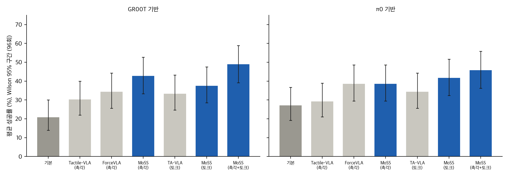
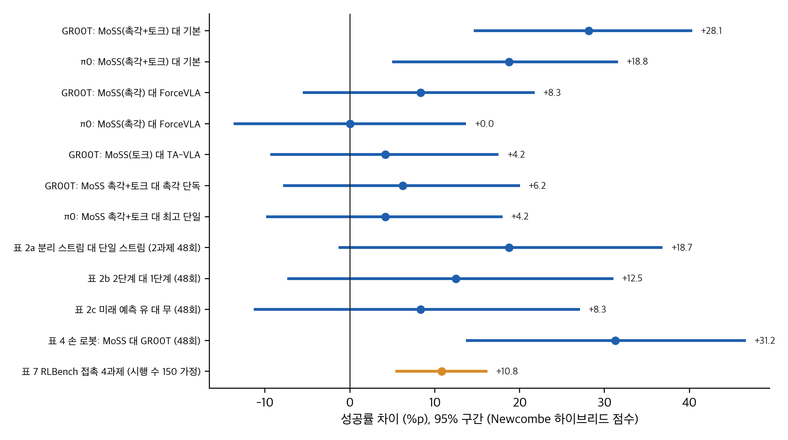
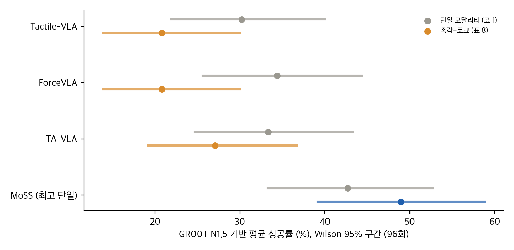

> **논문:** Jimin Lee, Huiwon Jang, Myungkyu Koo, Jungwoo Park, Jinwoo Shin. *Modular Sensory Stream for Integrating Physical Feedback in Vision-Language-Action Models.* CoRL 2026 포스터, arXiv:2604.23272 (v2, 2026-09-11).
> 공식 코드는 아직 없습니다(프로젝트 페이지 "Code (Coming Soon)"). 논문은 arXiv 비독점 배포 라이선스라서 논문 그림은 싣지 않고, 우리가 그린 그래프만 실었습니다.

## 논문이 묻는 것

VLA에 촉각이나 토크 같은 물리 신호를 넣는 연구는 대개 신호 하나를 다룹니다. 논문은 신호를 더 얹을수록 성능이 쌓이게 하는 방법을 묻습니다. MoSS는 세 가지를 제안합니다.

1. **모듈형 센서 스트림.** 사전학습된 행동 전문가(DiT) 구조를 거울로 복제한 스트림을 센서마다 무작위 초기화로 붙이고, 층마다 모든 스트림의 Q, K, V를 이어 붙여 한 번의 어텐션을 계산합니다.
2. **2단계 학습.** 1단계는 행동 전문가를 동결하고 새 스트림만, 2단계는 전체를 학습합니다.
3. **미래 신호 예측.** 각 센서 스트림이 과거 신호로 행동 구간 동안의 미래 신호를 flow matching으로 예측합니다(λ = 0.1).

Franka 팔(AnySkin 촉각 30차원, 관절 토크 7차원)에서 GR00T N1.5와 π0에 적용해 네 과제(과제당 24회)를 평가하고, 평균 성공률이 GR00T 20.8 → 49.0, π0 27.1 → 45.9로 오른다고 보고합니다. v2는 손 로봇 두 과제(표 4)와 RLBench 아홉 과제(표 7)를 더했습니다.

## 이 글에서 확인한 것

**1. 베이스 대비 개선은 시행 수로도 확실합니다.** 표 1을 성공 횟수로 되돌리면(과제당 24회, 방법마다 96회) 촉각+토크 MoSS 대 기본은 GR00T에서 47/96 대 20/96(+28.1 %p, Fisher p = 7e-5), π0에서 44/96 대 26/96(+18.8 %p, p = 0.011)입니다. 과제 하나씩 보면 24회라서 Holm 보정 후 모든 비교가 구분되지 않습니다(최소 0.12).

**2. 기준선과의 차이는 방향이 일관되지만 개별 쌍은 구분되지 않습니다.** 같은 모달리티 칸 24개에서 MoSS는 22칸 높고 1칸 같고 1칸 낮습니다. 평균 차이는 +0–12.5 %p이고, 예컨대 GR00T에서 MoSS 촉각 대 ForceVLA는 +8.3 %p(95% 구간 −5.4–+21.6, p = 0.30)입니다. 모달리티 구성이 다른 비교(MoSS 촉각+토크 대 ForceVLA 촉각)는 +14.6 %p, p = 0.057입니다. 80% 검정력으로 +8 %p를 구분하려면 방법당 약 540회가 필요합니다(시행 독립 가정, 정규 근사).

**3. "모달리티를 더할수록 쌓인다"는 방향이 일관되고, 크기는 구분되지 않습니다.** 촉각+토크 대 촉각 단독은 GR00T +6.2 %p(p = 0.47), π0 +7.3 %p(p = 0.38)입니다. 여덟 개 (베이스 × 과제) 칸 어디서도 촉각+토크가 최고 단일 구성보다 낮지 않습니다(4칸 같음, 4칸 높음). 반대편의 서술, 즉 기준선이 모달리티를 더하면 떨어진다는 점도 세 기준선 모두 평균이 내려가는 방향이지만 p = 0.19, 0.052, 0.43입니다.

**4. 표 8의 한 평균은 칸 값과 다릅니다.** ForceVLA의 촉각+토크 행은 네 칸이 25.0, 33.3, 20.8, 4.2(성공 6, 8, 5, 1회)인데 평균은 21.9로 적혀 있고, 칸 값에서 계산하면 20.8입니다. 변화 값도 −12.5와 −13.6로 다릅니다. v1과 v2에서 같고 그림 1에도 21.9가 쓰였습니다. 저자 확인이 필요합니다. 위 그래프는 칸 합(20/96)을 썼습니다.

**5. 절제 세 건은 방향이 모두 같지만 시행 수가 작습니다.** 표 2는 두 과제 × 24회입니다. 분리 스트림 대 단일 스트림 합산 p = 0.10, 2단계 대 1단계 0.31, 미래 예측 유 대 무 0.54입니다. 본문의 "significantly outperforms"는 이 시행 수에서 확인되는 표현이 아닙니다. λ_phy는 0.1과 0.5를 구분할 수 없고(p = 1.0, 0.77), 0.1 대 1.0은 두 과제를 합쳤을 때만 구분됩니다(p = 0.024).

**6. 손 로봇과 시뮬에서도 방향이 맞습니다.** Sort by Weight는 54.2 → 95.8(13/24 → 23/24, p = 0.0018), Pick Paper는 62.5 → 83.3(p = 0.19)입니다. RLBench 표 7은 시행 수가 적혀 있지 않은데 값이 모두 1/150 격자 위에 있어 과제당 150회를 가정하면, 접촉 민감 네 과제 합산이 27.3 → 38.2(p = 8e-5)이고 비접촉 다섯 과제는 46.8 → 47.1(p = 0.96)입니다. 두 표 모두 비교 대상은 GR00T 기본 하나입니다.

**7. v1과 v2 사이에 바뀐 것.** π0 기본 평균 26.1 → 27.1(v2가 칸 합과 일치), 배치 크기 16 → 32, 부록 λ 표의 PnP Egg 열(18/24, 16/24 → 16/24, 14/24), 평가 체크포인트 문장 삭제, 초록의 "force" 추가입니다. 표 1의 나머지 칸은 두 판본에서 같습니다.

## 구조에 대한 한 가지 관찰

1단계에서 행동 전문가의 파라미터를 동결해도, 공동 어텐션은 모든 스트림의 K, V를 한 소프트맥스에 넣기 때문에 행동 스트림의 출력은 센서 토큰에 따라 달라집니다. 무작위 가중치(D = 64, 행동 토큰 16개)의 작은 시뮬레이션에서, 무작위 센서 토큰 16개를 붙이면 행동 출력이 상대적으로 0.73만큼 바뀌고, 센서 쪽 V를 0으로 초기화해도 0.50이 남았습니다. 행동 쿼리가 센서 키를 보지 못하게 막는 마스크만 이 영향을 없앱니다. 이것은 구조의 성질을 보인 것이고 실제 사전학습 가중치에서의 크기는 모릅니다. 센서 토큰 수와 행동 청크 길이도 논문에 없습니다.

## 읽을 때 유의할 점

- 과제당 24회는 방법 사이의 순위를 정하기에 작습니다. 두 방법을 구분하는 최소 차이는 방법당 96회에서 약 20 %p입니다.
- 이득이 물리 신호에서 오는지 추가 파라미터에서 오는지를 가르는 통제(센서 제거·섞기, 파라미터를 맞춘 기준선)가 논문에 없습니다. 어텐션 그림(그림 4)은 한 시행의 곡선입니다.
- 센서 인코더, 토큰 수, 스트림 크기, 학습 GPU, 기준선 적응 방식이 본문에 없어 코드 공개 전에는 구조를 그대로 옮기기 어렵습니다.
- "여러 물리 신호를 동시에 통합"한 조합은 촉각+토크입니다. 힘 신호는 손 로봇에서 단독으로 쓰였습니다.

## 재계산 자료

분석 문서(01–04), 재계산 스크립트와 결과, 구조 시뮬레이션 스크립트, 공개용 리포트를 함께 올립니다. 재계산은 표 값과 부록 A.1의 시행 수에서 출발했고, 표 7의 시행 수(150)는 값의 격자에서 가정한 값입니다.

## 자료

- [통합 리포트 PDF](report/report_public.pdf)
- [01. 논문 분석: MoSS (Modular Sensory Stream)](analysis/01_paper_analysis.md)
- [02. 선행연구와 관련 저장소](analysis/02_prior_work.md)
- [03. 수치 재계산, 일관성 검사, 구조 토이](analysis/03_analysis.md)
- [04. 주장 검증과 구현 가능성](analysis/04_claim_verification.md)
