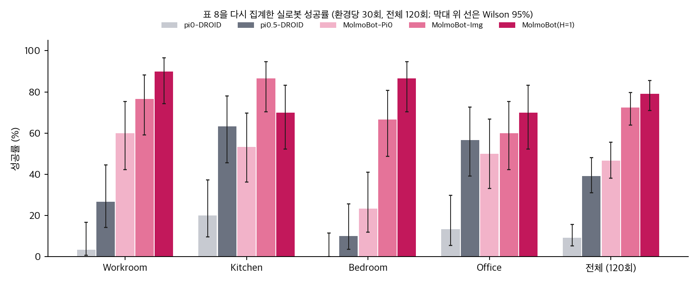
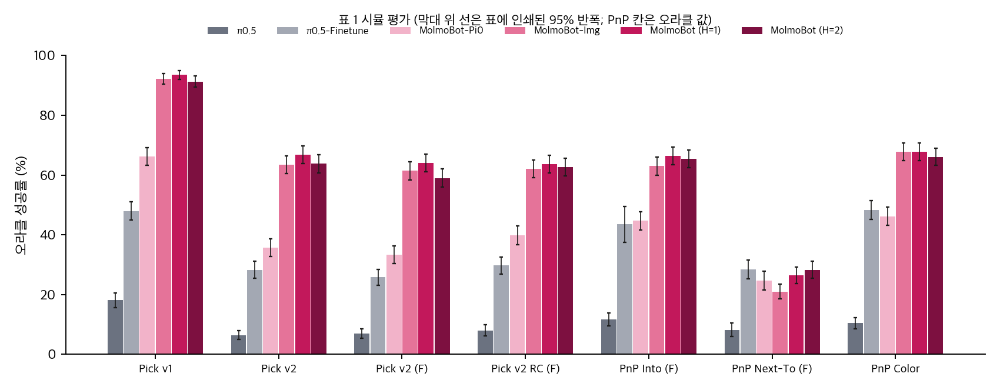
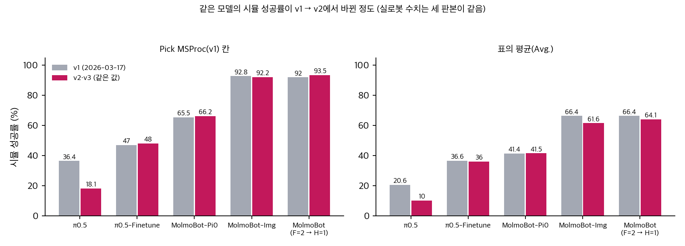

# 01. 논문 분석: MolmoB0T (arXiv:2603.16861)

*MolmoB0T: Large-Scale Simulation Enables Zero-Shot Manipulation* (Deshpande, Guru, Hendrix, Jauhri 외 22명, Allen Institute for AI, University of Washington, UCLA, TU Darmstadt, Princeton). 이하 인용은 v3(2026-11-08)의 절, 표, 그림 번호입니다. 표기는 논문 철자(MolmoBot)를 따릅니다.

## 0. 판본, 학회, 라이선스

| 판본 | 제출일 | 쪽수 | 주요 내용 |
|---|---|---|---|
| v1 | 2026-03-17 | 30 | 최초. 프레임 수 표기가 F=2, F=3(v3의 H=1, H=2). 데이터 1.8M 에피소드, 5,817 h, 299.3M 프레임. 시뮬 평가는 칸마다 200회(Pick MSProc만 1000회)이고 구간 표기 없음 |
| v2 | 2026-03-26 | 33 | 데이터 1.7M, 5,704 h, 295.2M 프레임으로 정정(Door-open 99.3k → 79.0k). 시뮬 평가를 1000회로 다시 돌리고 95% 반폭과 오라클/종료 시 성공률을 함께 보고. SIMPLER-DROID, LIBERO-DROID 부록 추가. 생성 처리량 문구 변경 |
| v3 | 2026-11-08 | 30 | CoRL 2026 형식(10th CoRL, Austin). 초록에 "tabletop manipulation에서 state-of-the-art"와 "articulated and mobile manipulation으로의 확장 시연"을 명시. 표 이름 정리(Pick MSProc → Pick v1, Pick Classic → Pick v2), 표 10과 표 12(컴퓨트 맞춤 이력 실험) 추가, 한계 문단 확대, 저자 기여 절 삭제 |

- **실로봇 수치는 세 판본이 같습니다.** MolmoBot 79.2%(120회), MolmoBot-Pi0 46.7%, π0.5-DROID 39.2%, 문 열기 4/9 잡기, 2/9 열기입니다.
- **시뮬 수치는 v1에서 v2로 바뀌었고 v2와 v3는 같습니다.** 예: π0.5 Pick MSProc 36.4 → 18.1, 표 평균 20.6 → 10.0. 기준선 시뮬 값이 크게 달라진 반면 MolmoBot 계열은 1–5 pp 안에서 움직였습니다(`03` V16, 그래프 아래). 판본 사이 변경 사유는 본문에 적혀 있지 않습니다. 저자에게 확인이 필요합니다.
- **v1 → v2에서 데이터 통계도 바뀌었습니다.** Door-open이 99.3k에서 79.0k 에피소드(−20.4%), 542 h에서 429 h로 줄었습니다. 총 에피소드 1.77M → 1.75M, 생성 처리량은 "에피소드당 GPU시간 1,024, 4,500 GPU시간, 인간 대비 4배"에서 "660(v3는 평균 260, 최대 660), 6,500 GPU시간, 2.6배"로 바뀌었습니다(`03` V9).
- **학회.** 프로젝트 페이지가 "CoRL 2026"을 적고, 논문 첫 쪽에 "10th Conference on Robot Learning (CoRL 2026), Austin TX"가 있으며, 저장소의 `conferences/corl2026/papers.json`(corl.org 공식 채택 목록, 수집일 2026-11-14)에서 **구두 발표**(세션 O3 Data, simulation and evaluation, 11월 9일 월요일, 포스터 196 병행)로 확인했습니다.
- **라이선스.** arXiv abs 페이지의 "view license"는 `http://arxiv.org/licenses/nonexclusive-distrib/1.0/`(arXiv 비독점 배포 라이선스)를 가리킵니다. CC BY가 아닙니다. 원문 PDF에서 ©, copyright, All rights reserved 표기는 찾지 못했습니다. 이 저장소는 논문 그림을 공개본에 넣지 않습니다.
- **분량.** v3 PDF는 30쪽, 23.2 MB입니다.

## 1. 문제와 주장

초록과 §1의 주장은 다섯 가지입니다.

1. 시뮬레이션만으로는 부족하다는 통념과 달리, **충분히 크고 다양한 합성 데이터로 실제 로봇에 영샷 전이**가 된다(초록, §1).
2. **MolmoBot-Engine**(MolmoSpaces 위의 절차적 데이터 생성)과 **MolmoBot-Data**(1.7M 전문가 궤적, 5,704 h, 8개 과제, 2개 로봇)를 공개한다(§3, 표 3).
3. 정책 세 종류(MolmoBot, MolmoBot-Pi0, MolmoBot-SPOC)로 **Franka FR3(DROID 구성) 탁상 pick-and-place에서 79.2%(120회)로 π0.5-DROID 39.2%를 넘는다**(§5.1.1, 그림 4).
4. **같은 π0 구조를 쓴 MolmoBot-Pi0**가 π0-DROID보다 높으므로 "성능 차이는 데이터에서 온다"(§1, §5.1.1).
5. 데이터 규모와 물체 클래스 다양성은 시뮬에서 효과가 있고, 실제에서는 규모 쪽이 더 뚜렷하며, **환경 수는 영향이 작다**(§5.3, 그림 5).

범위는 강체와 관절체 조작이며, 접촉이 많은 과제와 변형체는 한계로 적습니다(결론). 실로봇 문 열기는 Rainbow RB-Y1에서 9회 시도가 전부입니다(표 9).

## 2. 방법

### 2.1 MolmoBot-Engine (§3, 부록 A)

- **환경.** MolmoSpaces의 사전 생성 실내 장면(논문은 "200k 이상"이라 적음)에서 에피소드마다 장면 하나를 쓰고, 조작 대상 물체와 수납 물체를 추가합니다. 물체는 iTHOR와 Objaverse에서 크기와 수밀 메시로 거릅니다(§3.1).
- **무작위화 세 축.** 환경(조명 수·위치·종류·세기·색·그림자, 텍스처, 마찰·관성·관절 감쇠), 행동(초기 관절 + 행동에 비례하는 잡음), 카메라(내외부 파라미터)입니다(§3.1, 부록 A.1–A.2).
- **행동 잡음.** TCP 변위의 0.1배를 표준편차로 하는 절단 가우시안을 ±2 cm(위치), ±0.1 rad(회전)로 자르고 자코비안 의사역으로 관절에 보냅니다. 초기 관절은 Franka는 `[0.025, …, 0.175]` rad, RB-Y1 팔은 `[0.05, 0.05, 0.075, …, 0.175]` rad를 균일 분포로 흔듭니다(부록 A.1). 시뮬 평가에서는 잡음을 끕니다.
- **카메라.** Franka는 손목(ZED Mini 유사), 고정 어깨, 무작위 외부 3종(ZED2 유사 둘, GoPro 유사 하나)의 5개를 생성하고, 이번 학습에는 **손목 + 무작위 외부 하나**만 씁니다(A.2.1). 해상도는 624 × 352입니다. RB-Y1은 머리, 좌우 손목 3개 모두 씁니다(A.2.2).
- **전문가.** Franka는 IK 보간, RB-Y1은 CuRobo입니다. 파지는 MolmoSpaces-Grasp의 사전 계산 후보를 점수로 정렬하고 충돌과 IK 가능성으로 거릅니다. 단계(PREGRASP → GRASP → LIFT → PREPLACE → PLACE → POSTPLACE → STOW)별로 계획하며, 실수를 감지하면 첫 단계부터 다시 하고 재시도가 3회를 넘으면 버립니다(A.4). 재시도가 회복 데이터가 됩니다.
- **성공 기준.** Pick은 지지 표면에서 떨어져 1 cm 이상 올라갈 것. PnP-into는 무게의 50% 이상이 수납 물체에 실리고 수납 물체가 10 cm 이상 움직이거나 45° 이상 돌지 않을 것. Next-to는 XY 표면 간 거리가 [0, 5] cm. Open과 Open-door는 관절 범위의 67% 이상입니다(A.3). v1에서는 Next-to가 [0, 25] cm, Open이 15%였습니다. v2에서 현재 값으로 바뀌었습니다.
- **데이터 규모(표 3).** 1.75M 에피소드(표의 행 합), 5,704 h, 평균 11.7 s. Franka PnP 554.2k(2,638 h), Franka Pick 781.8k(1,042 h)가 대부분입니다. 비용은 A100 100장으로 에피소드 평균 260(최대 660)/GPU시간, 전체 약 6,500 GPU시간이며 "상용 클라우드 단가로 $0.01–0.02/궤적, 로봇 1시간당 $2–5"입니다(A.7).

### 2.2 정책 세 종류 (§4, 그림 3)

| 정책 | 구조 | 학습 |
|---|---|---|
| **MolmoBot** (플래그십) | Molmo2-4B(SigLIP2 비전 인코더 + Qwen3 계열 LLM). **DiT 행동 헤드가 LLM과 같은 층 수**이고 층마다 해당 VLM 층 특징에 교차 주의. 고유감각은 특징 공간으로 사영해 VLM 특징열 뒤에 붙임. 행동 16개를 예측하고 8개 실행 | 배치 1024, 200k 스텝(정적), 100k(이동). 비전 인코더 고정. 흐름 매칭 시각 8개를 샘플마다 병렬 지도(`Multi-Timestep`). 샘플링 가중: 재시도 3×, 성공 파지 2×, 완료 행동 2× |
| **MolmoBot (H=1), (H=2)** | 위 모델 + 과거 관측 1개 또는 2개(D = 8 스텝 ≈ 0.5 s 간격) | MolmoBot-Img에서 50k 스텝 추가 학습 |
| **MolmoBot-Pi0** | π0 구조 그대로(PaliGemma 3B + 흐름 매칭 행동 전문가), openpi 코드 | 200k 스텝, 배치 1024, 학습률 5e-5, 워밍업 1k, 비전 인코더 고정. 나머지는 기본값 |
| **MolmoBot-SPOC** | SPOC 계열 Transformer 디코더(학습 가능 108M). SigLIP2 패치 토큰 + SigLIP 텍스트 + 고유감각. 행동은 [1%, 99%] 분위수로 자르고 256개 분위수 빈으로 이산화, 빈마다 교차 엔트로피, 양방향 병렬 디코더 | 학습 설정은 논문에 없음 |

선택적 **점 조건화**(첫 프레임 + 정규화 2D 좌표)는 RB-Y1 모델과 SPOC에서만 쓰고 DROID 모델은 쓰지 않습니다(B.1). 데이터 혼합은 표 5(Franka: Pick 20, PnP 고정 높이 10, PnP 무작위 높이 35, Next-to 20, Color 15%)와 표 6(RB-Y1)입니다. 이미지 증강은 ColorJitter, GaussianBlur, RandomPosterize, RandomSharpness, RandomGrayscale입니다(B.3). 행동 표현은 DROID 모델이 절대 관절 위치, RB-Y1이 팔과 토르소의 변화량(B.4, B.5)입니다.

## 3. 실험과 수치

### 3.1 실로봇 Franka(DROID), 표 8, 그림 4

- 4개 환경(Workroom, Kitchen, Bedroom, Office) × 과제 10개 × 3회 = 정책당 **120회**(Office는 다른 기관). 다섯 정책: MolmoBot(H=1), MolmoBot-Img, MolmoBot-Pi0, π0.5-DROID, π0-DROID.
- 성공은 900스텝 안에 대상이 수납 물체에 안정적으로 놓여 "합리적 시간" 유지된 경우이고, 위험 행동(고속 충돌)은 실패입니다(C.1).
- 결과(표 8 셀 합, `03` V1): **MolmoBot 95/120 = 79.2%**, MolmoBot-Img 87/120 = 72.5%, MolmoBot-Pi0 56/120 = 46.7%, π0.5-DROID 47/120 = 39.2%, π0-DROID 11/120 = 9.2%. 그림 4의 오차 막대는 층화 부트스트랩 95%입니다.
- 환경별로 정책 순위가 일정하지 않습니다. Kitchen에서 MolmoBot(H=1) 70%는 π0.5-DROID 63%와 비슷하고 MolmoBot-Img 87%보다 낮습니다. Bedroom은 π0.5-DROID가 10%입니다.

### 3.2 RB-Y1 (§5.1.2, 표 2, 표 9)

- **실로봇 문 열기.** 문 3개(전부 당기는 문)에 3회씩 총 9회: 손잡이 잡기 4/9, 열기 2/9. 하드웨어 오류가 6개 시도에 표시되어 있습니다. 두 문(Door 1, 3)은 손잡이가 오른쪽에 있어 학습 데이터에서 드문 구성이라 잡기가 어려웠다고 설명합니다(C.2). 시뮬 대 실제 비교는 없고, RB-Y1에는 비교할 일반 정책이 없어 정량 비교를 하지 않았다고 적습니다.
- **시뮬(표 2, 시행 수 미기재).** MB Multitask: Pick 44.8, PnP Into 22.5, Open 25.2, Open-door 70.2. MB Door 전문가는 Open-door 77.7. MB-SPOC Rigid는 10.5/1.8, MB-SPOC Artic.는 21.8/58.8입니다. v1은 "Pick, Open, Door-open 2,000회, PnP 1,000회, 한 번에 8스텝(0.8 s) 실행"이라 적었고 v3에는 시행 수가 없습니다.

### 3.3 시뮬 평가 (§5.2.1, 표 1, 표 10)

- 보류된 절차 생성 집에서 평가합니다. Pick v1(MSProc 계열 소수 클래스), Pick v2(Objaverse), (F)는 Filament 렌더러, RC는 무작위 외부 카메라, PnP Into/Next-To/Color입니다. 캡션은 "과제당 1000회 평균"입니다.
- 평균(7칸, PnP는 오라클): π0.5 10.0, π0.5-Finetune 36.0, StereoVLA 1.7, LAP-VLA 4.8(표기), X-VLA 1.2, **MolmoBot-Pi0 41.5, MolmoBot-Img 61.6, MolmoBot(H=1) 64.1, MolmoBot(H=2) 62.4**.
- π0.5-Finetune은 MolmoBot-Data에서 15k 스텝 미세조정한 시뮬 적응 기준선입니다. StereoVLA는 정면 카메라가 필요해 관련 칸이 N/A(0으로 계산)이고, C.3은 카메라를 옮기고 대상이 안 보이는 에피소드를 뺀 92개(Pick v2)와 91개(Pick v2 (F))로 평가했다고 적습니다.
- 흥미로운 칸: PnP Next-To에서 이력 모델(H=1, H=2)이 MolmoBot-Img보다 5.4, 7.3 pp 높고(`03` V7, 1000회 가정 시 p = 0.0045, 0.00015), 다른 칸에서는 차이가 작습니다. π0.5-Finetune은 Next-To 오라클 28.4로 최고 수준입니다.

### 3.4 데이터 절제 (§5.3, 그림 5, 부록 C.6)

MolmoBot-Img를 **pick 과제에만**, 24k 스텝, 배치 512로 처음부터 학습한 점마다 맞춤 데이터(최대 50k 궤적)를 만듭니다. 실로봇은 Workroom에서 6개 물체 × 5회(본문 §5.3)로 한 점 30회입니다(부록 C.6은 "세 그룹의 물체 세 개씩, 물체당 5회"라 적어 45회로도 읽힙니다. `03` K5). 그림에서 읽은 값:

| 축 | 실로봇 (그림 판독) | 시뮬 Pick v2 (그림 판독) | 논문 해석 |
|---|---|---|---|
| 궤적 수 10k → 25k → 50k (5k 환경, 12.4k 물체) | 약 22 → 53 → 80% | 약 14 → 29 → 31% | 예측 가능한 증가(특히 실제) |
| 물체 클래스 10 → 25 → 50 → 100 (50k 궤적) | 약 25 → 67 → 64 → 60% | 약 25 → 22 → 27 → 37% | 시뮬은 증가, 실제는 곧 포화 |
| 환경 50 → 100 → 5k → 50k (50k 궤적) | 약 70 → 70 → 80 → 63% | 약 37 → 34 → 30 → 38% | 환경 수는 영향이 작음 |

### 3.5 모델 절제와 이력 (부록 C.7, C.8, 그림 8, 표 12)

- 흐름 시각 수 T ∈ {1, 2, 4, 8}: 시뮬 Pick v2는 T와 함께 증가(약 20 → 38%)하고, 실제 30회는 T=4에서 최고(약 76%)이며 비단조입니다.
- 행동 표현: 실제에서 절대 관절 위치가 변화량보다 높고(약 76 대 47%), 시뮬은 비슷합니다(약 66%).
- 이력 모델은 MolmoBot-Img에서 50k 스텝 더 학습했습니다. 컴퓨트를 맞추려고 MolmoBot-Img+(추가 50k 스텝)를 Workroom 30회로 평가했습니다: Img 76.7, Img+ 83.3, H=1 90.0, H=2 76.7(95% 반폭 ±10.0, ±13.3, ±6.7, ±13.3). 저자도 "이력의 이득 일부가 추가 학습에서 올 수 있다"고 적습니다(`03` V10).

### 3.6 외부 벤치마크 (부록 C.9, 표 13, 표 14)

SIMPLER와 LIBERO-Object의 로봇을 DROID 플랫폼으로 바꿔 재구현했고 정책은 미세조정하지 않았습니다. SIMPLER 4개 과제에서 MolmoBot-Img만 Carrot→Plate 45.8%(= 11/24)이고 나머지는 0%입니다. LIBERO-Object 방해물 없음 평균은 MolmoBot-Img 36.6%, MolmoBot-Pi0 3.8%, π0.5-DROID 2.4%, π0-DROID 0.2%이며, 방해물이 있으면 8%, 0.8%, 1%, 0%로 내려갑니다. 저자는 이 벤치마크들이 "특정 자산과 장면 구성에 대한 친숙도"를 재므로 일반 정책 평가에는 부적합하다고 해석합니다.

## 4. 한계와 주장 대 근거의 간격

저자가 적은 한계: 정확히 시뮬 가능한 강체·관절체로 한정, RB-Y1은 비교 기준선이 없음, "실제 배치에는 목표 환경 데이터, 온폴리시 실패와 개입이 필요할 수 있음"(결론). 분석에서 본 간격은 다음과 같습니다(자세한 수치는 `03`).

1. **"성능 차이는 데이터가 만든다"(§1, MolmoBot-Pi0 대 π0-DROID).** 두 정책은 구조가 같지만 행동 표현(절대 관절 위치 대 DROID 관절 속도), 학습 데이터, 사전학습 초기화(PaliGemma에서 시작 대 π0 사전학습 후 DROID 미세조정), 카메라 구성이 다릅니다. 데이터가 전부라고 분리해 확인하는 대조는 없습니다(`03` C3).
2. **실로봇 120회 비교의 구간.** 그림 4의 막대는 "과제를 고정하고 시도만 다시 뽑는" 층화 부트스트랩이라 Wilson보다 좁습니다(MolmoBot ±4.6 대 ±7.2 pp). 큰 차이(79.2 대 39.2)의 결론은 바뀌지 않지만, MolmoBot(H=1) 대 MolmoBot-Img(p = 0.29)와 MolmoBot-Pi0 대 π0.5-DROID(p = 0.30)는 구분되지 않습니다(`03` V2).
3. **카메라 통제(C.5).** 표 11의 Kitchen 열은 표 8의 Kitchen 행과 같은 시도입니다. "카메라를 제한하면 기준선이 크게 오른다"는 서술은 환경 효과와 섞입니다. Kitchen은 π0.5-DROID가 63%, 나머지 세 환경은 31%입니다(`03` V4).
4. **환경 수 절제(그림 5(c)).** 30회 가정 시 5k 대 50k는 p = 0.25이고, 80% 검정력으로 구분할 수 있는 차이는 약 27–34 pp입니다. "영향이 작다"는 영향이 없다는 증거가 아니라 검출 한계 안의 차이로 읽는 편이 정확합니다(`03` V11).
5. **문 열기.** 2/9(Wilson 6–55%)는 "확장 시연"의 근거로는 약합니다. 하드웨어 오류가 6개 시도에 있습니다(`03` V13).
6. **본문과 표의 수치 어긋남.** 같은 값이 서술마다 다르게 적힌 곳이 여럿 있습니다(π0.5-DROID 실제 39.2 대 31.3, MolmoBot-Pi0 46.5 대 46.7, 시뮬 평균 41.5 대 41.8, 표 1 LAP-VLA 평균 등). 정리는 `03` §3.
