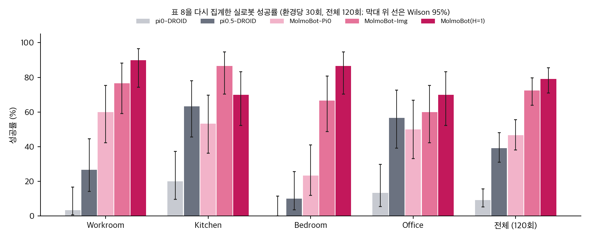
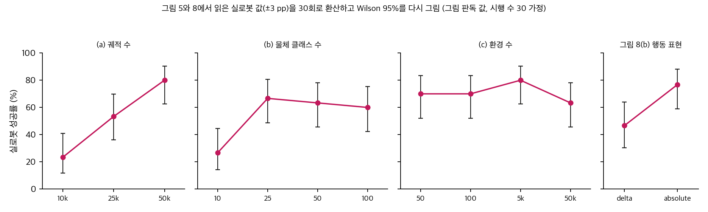
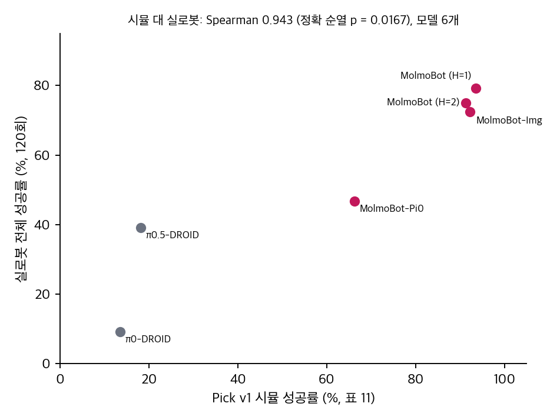
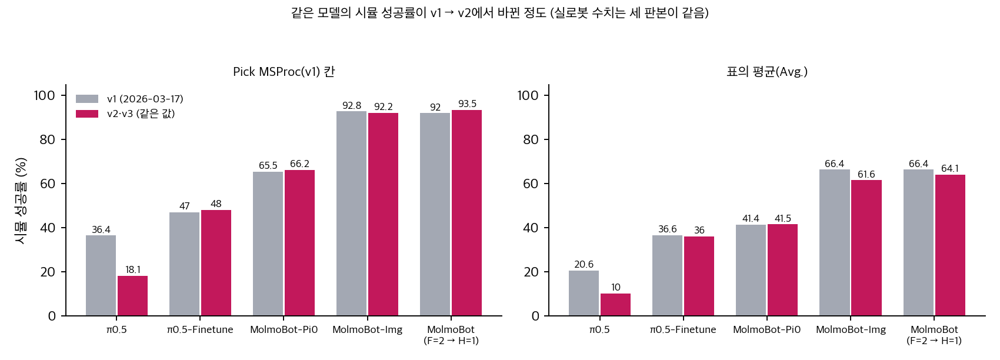

# 03. 수치 재계산과 일관성 검사

논문이 표와 본문에 보고한 수치를 옮겨 적고 다시 계산했습니다. 스크립트는 `analysis/recompute.py`(결과 `analysis/recompute_results.json`, numpy와 scipy, 수 초)입니다. 재현 실험은 하지 않았고, 이 장은 보고된 숫자의 산술, 구간, 검정, 표 사이 일관성만 다룹니다.

**표기.** V는 수치 재계산, K는 표·본문 사이 일관성, C는 주장 판정입니다. 시행 수가 논문에 없는 곳은 문장 안에 가정을 적었습니다. 그림에서 읽은 값은 "(그림 판독)"이라 표시했고 ±3 pp 정도의 판독 오차가 있습니다. 구간은 별도 표기가 없으면 Wilson 95%, 비율 검정은 양측 Fisher 정확 검정입니다.

## 1. 실로봇 DROID 120회

### V1. 표 8 다시 집계

표 8의 셀(40 과제 × 3회) 정책별 환경 합은 표의 환경 평균(정수 %)과 모두 일치했고(불일치 0건), 전체 합은 다음과 같습니다.

| 정책 | 성공/120 | % | Wilson 95% | 환경별 성공/30 (Workroom, Kitchen, Bedroom, Office) |
|---|---|---|---|---|
| MolmoBot (H=1) | 95 | 79.2 | 71.1–85.5 | 27, 21, 26, 21 |
| MolmoBot-Img | 87 | 72.5 | 63.9–79.7 | 23, 26, 20, 18 |
| MolmoBot-Pi0 | 56 | 46.7 | 38.0–55.6 | 18, 16, 7, 15 |
| π0.5-DROID | 47 | 39.2 | 30.9–48.1 | 8, 19, 3, 17 |
| π0-DROID | 11 | 9.2 | 5.2–15.7 | 1, 6, 0, 4 |

### V2. 정책 쌍 검정

| 비교 | 합(120회) | Fisher p | 과제 단위 쌍체 Wilcoxon p (40 과제) | 과제별 우세 |
|---|---|---|---|---|
| MolmoBot(H=1) 대 π0.5-DROID | 95 대 47 | 3.6e-10 | 1.0e-4 | 28 대 4 (동률 8) |
| MolmoBot-Img 대 π0.5-DROID | 87 대 47 | 3.1e-7 | 8.4e-5 | 25 대 3 |
| MolmoBot(H=1) 대 MolmoBot-Img | 95 대 87 | 0.29 | 0.31 | 14 대 9 |
| MolmoBot-Img 대 MolmoBot-Pi0 | 87 대 56 | 7.2e-5 | 2.6e-3 | 18 대 6 |
| MolmoBot-Pi0 대 π0.5-DROID | 56 대 47 | 0.30 | 0.27 | 15 대 13 |
| MolmoBot-Pi0 대 π0-DROID | 56 대 11 | 6.4e-11 | 1.5e-5 | 24 대 1 |

MolmoBot 계열이 π0.5-DROID보다 높다는 결론은 비쌍과 쌍체 검정 모두에서 확실합니다. 논문의 "MolmoBot-Pi0는 경쟁적(competitive)"은 π0.5-DROID와 구분되지 않는다(p = 0.30)는 뜻으로 읽힙니다. MolmoBot(H=1) 대 MolmoBot-Img는 구분되지 않습니다(95 대 87, p = 0.29). 과제 안의 시도가 3회뿐이고 과제가 40개라서, 같은 물체와 수납 물체가 여러 과제에 나옵니다. 위 p는 이 군집을 완전히 반영하지는 않습니다.

### V3. 그림 4와 표 12의 구간 방법

캡션의 "층화 부트스트랩"을 "과제(층) 안에서 3회를 다시 뽑는" 방식으로 구현해 보았습니다(표 8 셀에서 과제별 성공률을 고정). 결과는 다음과 같습니다.

- 표 12(Workroom 10 과제)의 95% 반폭을 **그대로 재현**했습니다: MolmoBot(H=1) 6.7(표 ±6.7), MolmoBot-Img 10.0(표 ±10.0). 같은 방법이 쓰였다고 읽는 것이 자연스럽습니다.
- 같은 방법으로 120회 전체의 반폭은 MolmoBot(H=1) 4.6, MolmoBot-Img 5.0, MolmoBot-Pi0 5.0, π0.5-DROID 5.8, π0-DROID 3.8 pp입니다. 120회를 독립으로 본 Wilson 반폭은 7.2, 7.9, 8.8, 8.6, 5.2 pp입니다.
- 층화 부트스트랩은 "이 40개 과제를 고정하고 시도 운만 다시 뽑는" 구간이라 과제를 다시 뽑는 불확실성은 들어 있지 않고, 과제당 3회여서 0/3 또는 3/3인 과제의 분산이 0이 됩니다. 구간이 좁은 것은 방법의 성격이며, 79.2 대 39.2의 결론에는 영향이 없습니다. 그림 4의 구간을 Wilson과 직접 비교할 때는 이 차이를 감안해야 합니다.

### V4. 표 11의 Kitchen 열은 표 8의 Kitchen 행과 같은 시도입니다

표 11의 "Kitchen" 열(π0 20.0, π0.5 63.3, MolmoBot-Pi0 53.3, MolmoBot-Img 86.6, MolmoBot(H=1) 70.0)은 표 8 Kitchen 행의 30회 합(6, 19, 16, 26, 21 / 30)과 모두 같고, "All-Scene Avg"는 표 8 전체 합(9.2, 39.2, 46.7, 72.5, 79.2)과 같습니다. C.5는 Kitchen 30회를 "DROID 스타일 어깨 카메라로 거른" 부분집합이라고 설명합니다.

그러면 "카메라를 제한하면 기준선이 크게 오르는 반면 MolmoBot은 변화가 작다"는 서술(C.5)은 **Kitchen 대 전체**의 비교이므로 환경 효과가 섞입니다. 같은 표 8에서 Kitchen을 뺀 90회와 비교하면 다음과 같습니다.

| 정책 | Kitchen(30) | 나머지 세 환경(90) | Fisher p |
|---|---|---|---|
| π0.5-DROID | 19/30 = 63.3% | 28/90 = 31.1% | 0.0024 |
| π0-DROID | 6/30 = 20.0% | 5/90 = 5.6% | 0.028 |
| MolmoBot-Img | 26/30 = 86.7% | 61/90 = 67.8% | 0.059 |
| MolmoBot-Pi0 | 16/30 = 53.3% | 40/90 = 44.4% | 0.41 |
| MolmoBot(H=1) | 21/30 = 70.0% | 74/90 = 82.2% | 0.19 |

기준선에게 Kitchen이 쉬운 환경이라는 사실은 보이지만, 카메라 제한과 환경이 분리되지 않았습니다. 같은 환경에서 카메라를 무작위로 한 평가가 있어야 C.5의 서술을 확인할 수 있습니다(`04` §3 참고: 코드의 평가 설정은 카메라 선택을 벤치마크 JSON에서 읽습니다).

### V5. π0.5-DROID의 "31.3%"

C.3은 "실제 평가에서 MolmoBot(H=1) 79.2%, π0.5-DROID 31.3%"라고 씁니다. 초록, 표 8, 표 11은 39.2%입니다. v1과 v2의 시뮬 표에는 "Real" 열이 있었고 π0.5의 값이 31.3이었습니다. 이 값은 π0.5-DROID의 **Kitchen을 뺀 세 환경 평균(27, 10, 57 → 31.3)**과 같습니다. 관측된 일치일 뿐이며, 어떤 집계에서 나온 값인지는 저자 확인이 필요합니다. v3는 "Real" 열을 지웠지만 표 1 캡션의 "with real-world results from Fig. 4"와 C.3의 31.3% 문장이 남아 있습니다(K3, K14).

## 2. 시뮬 평가 표 1

### V6. 평균 열 재계산

각 모델의 7칸 평균(PnP는 오라클 값 기준)을 다시 구했습니다.

| 모델 | 인쇄 | 오라클 기준 재계산 | 종료 시 기준 재계산 |
|---|---|---|---|
| π0.5 | 10.0 | 9.97 | 8.57 |
| π0.5-Finetune | 36.0 | 36.00 | 31.83 |
| StereoVLA (N/A는 0) | 1.7 | 1.71 | 1.71 |
| LAP-VLA | **4.8** | **5.86** | 4.87 |
| X-VLA | 1.2 | 1.17 | 0.99 |
| MolmoBot-Pi0 | 41.5 | 41.51 | 38.07 |
| MolmoBot-Img | 61.6 | 61.57 | 58.70 |
| MolmoBot (H=1) | 64.1 | 64.09 | 60.84 |
| MolmoBot (H=2) | 62.4 | 62.37 | 58.90 |

LAP-VLA만 오라클 기준과 다릅니다. 인쇄된 4.8은 PnP 칸을 종료 시 값으로 넣은 평균(4.87, 소수 첫째 자리 절삭)에 가깝고 오라클 기준 평균은 5.9입니다. 나머지 8개 행은 오라클 기준입니다. v1의 LAP-VLA 평균 3.7은 오라클 기준과 맞았으므로 v2에서 행을 다시 채울 때의 기준 차이로 보입니다(가능성). 순위에는 영향이 없습니다.

### V7. 칸별 쌍 비교 (시행 수 1000 가정)

구간 반폭에서 거꾸로 구한 시행 수(V8)가 대부분 약 1000이어서, 1000회씩으로 가정한 비쌍 z 검정을 썼습니다. 비교는 28개이며 다중 비교 보정은 하지 않았습니다.

| 칸 | H=1 대 Img | H=2 대 Img | MolmoBot-Pi0 대 π0.5-Finetune |
|---|---|---|---|
| Pick v1 | +1.3 (p = 0.26) | −0.9 (0.46) | +18.2 (< 1e-15) |
| Pick v2 | +3.3 (0.12) | +0.3 (0.89) | +7.4 (3.9e-4) |
| Pick v2 (F) | +2.6 (0.23) | −2.4 (0.27) | +7.5 (2.4e-4) |
| Pick v2 RC (F) | +1.6 (0.46) | +0.6 (0.78) | +10.1 (2.1e-6) |
| PnP Into (F) | +3.4 (0.11) | +2.4 (0.26) | +1.2 (0.59) |
| PnP Next-To (F) | **+5.4 (0.0045)** | **+7.3 (1.5e-4)** | −3.7 (0.061) |
| PnP Color | 0.0 (1.0) | −1.7 (0.42) | −2.1 (0.35) |

- 이력 모델이 MolmoBot-Img보다 확실히 높은 칸은 **PnP Next-To 하나**입니다(오라클). 7칸 평균의 차이(64.1, 62.4 대 61.6)는 이 칸에서 대부분 나옵니다. 컴퓨트를 맞춘 Img+ 실험(V10)은 실제 30회라 이 차이를 가르지 못합니다.
- MolmoBot-Img의 Next-To 오라클 21.0은 MolmoBot-Pi0 24.7보다 낮습니다(p = 0.049, 가정). 다른 칸에서는 반대로 Img가 18–28 pp 높습니다.
- MolmoBot-Pi0 대 π0.5-Finetune: 두 정책 모두 MolmoBot-Data로 학습한 시뮬 적응 모델입니다. Pick 계열에서는 MolmoBot-Pi0가 높고(+7–18 pp), PnP는 같거나(Into, Color) π0.5-Finetune이 약간 높습니다(Next-To). 논문의 "π0.5-Finetune과 경쟁적"은 PnP에서 더 잘 맞습니다.

### V8. 칸마다 시행 수가 같은가 (반폭 역산과 정수 가능성)

정규 근사 반폭 h = 1.96 · √(p(1−p)/n)에서 n = 1.96²·p(1−p)/h²를 구했습니다(p, h의 반올림 때문에 약 ±5% 오차).

- Pick 칸과 MolmoBot 계열의 PnP 칸은 거의 모두 n ≈ 940–1040으로, 캡션의 1000회와 맞습니다.
- 다른 칸은 다릅니다: π0.5-Finetune PnP Into **n ≈ 262–267**(43.5, 37.4), π0.5 PnP Next-To **약 600**, LAP-VLA PnP Next-To **약 290**, X-VLA와 MolmoBot-Pi0의 PnP Next-To 약 700–880, StereoVLA Pick v1 **약 350**.
- LAP-VLA의 PnP 값은 소수 둘째 자리까지 적혀 있습니다(3.81/1.59, 6.48/3.41). 두 값이 모두 k/n의 반올림이 되는 n을 찾으면, Into 칸은 **n = 630**(24/630, 10/630), Next-To 칸은 **n = 293**(19/293, 10/293)이 각각 유일했습니다(범위 550–700, 250–340). n = 1000에서는 이 네 값이 모두 불가능합니다(예: 3.81%는 38.1/1000).
- π0.5-Finetune PnP Into의 n은 246, 262, 278 중 하나가 가능합니다(범위 240–290).
- StereoVLA의 Pick v2는 4.3 = 4/92(C.3의 필터 뒤 92개와 일치), Pick v2 (F)는 1.1 = 1/91(91개와 일치)이지만 표의 반폭은 ±1.5와 ±1.0입니다. n = 92, 91에서 Wilson 반폭은 4.5와 2.9 pp이므로 표의 반폭은 더 큰 n을 가정한 값처럼 보입니다.
- 정수 가능성으로 본 Table 10의 "200 에피소드": Pick v2 행에는 66.8, 35.7처럼 0.5의 배수가 아닌 값이 있어 n = 200에서는 가능하지 않습니다(K4).

해석 가능성: 렌더링 실패나 필터로 칸마다 유효 에피소드가 다를 수 있습니다. 캡션과 표에 유효 에피소드 수를 적어 주면 구간을 같은 기준으로 읽을 수 있습니다.

## 3. 일관성 검사 (K)

| 번호 | 위치 | 관측 | 비고 |
|---|---|---|---|
| K1 | C.3 본문 대 표 1 | "π0.5 평균 10.1%"(표 10.0, 재계산 9.97), "MolmoBot-Pi0 41.8%"(표 41.5, 재계산 41.51), "Pick v2 RC에서 우리 모델 40–66%"(표 39.8–63.7), "π0.5 변형 8–30%"(표 8.0–29.7, 일치) | 41.8은 v1 표의 PnP Next-To MolmoBot-Pi0 값과 같은 숫자입니다(관측). 어느 값을 가리키는지는 저자 확인이 필요합니다 |
| K2 | 초록 대 표 8 | 서론은 "MolmoBot-Pi0 46.5%", 표 8 합 56/120 = 46.67%, 표 11 46.7 | 반올림 차이 0.2 pp이지만 v1·v2 서론은 46.7이었습니다 |
| K3 | C.3 | "실제 평가에서 π0.5-DROID 31.3%" 대 초록·표 8·표 11의 39.2% | V5 |
| K4 | 표 1 캡션 대 표 10 | 캡션 "과제당 1000회", 표 10은 Pick v2 계열과 PnP Next-To·Color에 200 에피소드, PnP Into 행 없음 | 반폭과 정수 가능성은 약 1000(V8). v1은 200회였고 v2에서 1000회로 바뀌었습니다 |
| K5 | §5.3 대 C.6 | §5.3은 "6개 물체 × 5회", C.6은 "세 그룹의 물체 세 개씩, 물체당 5회" | 30회 또는 45회. 그림 5의 막대는 n = 30에 해당합니다(K15) |
| K6 | §5.3 본문 대 그림 | §5.3 환경 수와 규모를 설명하며 "예측 가능한 증가(특히 실제)", C.7 "3개 벤치마크에서 절대 표현이 낫다"는데 그림 8(b)는 한 환경(Workroom)과 시뮬 한 설정 | 그림 8(b) 실제 값(판독) 47 대 76은 p = 0.033(30회 가정) |
| K7 | A.7 "약 12TB" | Hugging Face 데이터셋 파일 크기 합은 약 10.3 TB(저장 용량 필드 8.87 TB) | 단위가 "로봇 경험"이라 저장 용량과 같은 양인지 불명 |
| K8 | 표 11 | 86.67%가 86.6, 36.67%가 36.6으로 절삭 표기 | 표 8의 합(26/30, 11/30)과 같음 |
| K9 | 표 3 합 | 에피소드 행 합 1,750.0k(표 "1.7M"), 시간 합 5,703(표 5,704), 평균 길이 11.73 s(표 11.7) | 1.75M은 반올림 경계 |
| K10 | A.7 처리량 | V9 | |
| K11 | RB-Y1 제어 주기 | v3 본문은 Franka 15 Hz만 적음. 표 3의 프레임 수(v2)로 RB-Y1은 약 10 Hz, 공식 평가 설정도 100 ms | 서술 누락 |
| K12 | 문 열기 표 9 | v1의 Door 3 시도 3 실패 원인 "Incorrect gripper orientation"이 v3에서 "Grasping failure"로 바뀜 | 원인 설명 변경 |
| K13 | Open 성공 기준 | v1 "관절 범위 15% 이상", v2·v3 "67% 이상". 그런데 RB-Y1 시뮬 표(Open 25.2%)는 세 판본이 같음 | 기준이 바뀐 것인지 서술만 바뀐 것인지 확인 필요 |
| K14 | 표 1 캡션 | "with real-world results from Fig. 4"이지만 표에 실제 열이 없음 | v2 표의 "Real" 열 삭제 흔적 |
| K15 | 그림 5의 오차 막대 | 캡션은 "Clopper-Pearson", 실제 점의 막대는 위아래 대칭(80%에서 약 ±14 pp) | 대칭이면 정규 근사(n = 30에서 ±14.3)와 일치. 정확 구간은 비대칭(61–92) (그림 판독) |
| K16 | PnP Color 렌더러 | v2 본문 "PnP 변형은 모두 Filament", v3 표 10은 PnP-Color가 MuJoCo | v2에서 v3로 표기 변경 |

### V9. 데이터 통계와 처리량 (표 3, A.7)

- 표 3의 에피소드 평균 길이 × 에피소드 수로 구한 시간은 모든 행에서 표의 시간과 ±6 h 이내로 맞습니다(Franka PnP 2,632 대 2,638 h가 가장 큰 차이).
- v2 표 1의 프레임 수로 환산한 프레임률은 Franka가 15 fps(14.9–15.2), RB-Y1이 약 10 fps(9.9–11.6)입니다. 총 프레임 295.1M은 표의 295.2M과 맞습니다.
- 처리량: A100 100장, 평균 에피소드 길이 11.7 s에서 평균 260 에피소드/GPU시간이면 84.5 로봇시간/시간, 최대 660이면 214.5입니다. 논문은 "88 시간 이상"이라 적습니다. 88은 에피소드 평균 약 271/GPU시간에 해당하고, 전체 1.75M 에피소드와 6,500 GPU시간의 비(269)와 맞습니다. v2는 "660 에피소드/GPU시간 ... 88시간"이어서 660이면 214가 되었는데 v3가 평균 260/최대 660으로 정리했습니다.
- "인간 시연자 대비 2.6배": 로봇시간 88/시간을 "시연자 100명이 실시간의 1/3로 일하는 33.3 로봇시간/시간"과 나누면 2.64로 맞습니다(v1은 130/33.3 = 3.9 ≈ 4배).
- 비용: 궤적당 $0.01–0.02를 로봇 1시간(= 3,600/11.7 = 308 궤적)으로 환산하면 $3.1–6.2입니다. 논문은 $2–5입니다. 두 서술은 같은 크기이지만 환산은 정확히 일치하지 않습니다. A100 단가는 논문에 없습니다.
- v1에서 에피소드당 GPU시간 1,024는 130 h/h와 맞지 않았고(1,024면 336), 에피소드 1.8M/4,500 GPU시간(= 400)과 130(= 397)이 서로 맞았습니다.

### V10. 표 12, 표 13, 표 14

- 표 12(30회): Img 23/30, Img+ 25/30, H=1 27/30, H=2 23/30. H=1 대 Img+ p = 0.71, H=1 대 Img p = 0.30, Img+ 대 Img p = 0.75. 이력의 이득은 이 규모에서 추가 학습 효과와 구분되지 않습니다(저자도 같은 취지로 적음).
- 표 13: 45.8% = 11/24. 시행 수 24는 원래 SIMPLER 구성과 같은 규모입니다. 평균 11.5 = (45.8 + 0 + 0 + 0)/4.
- 표 14: 평균 8.0/36.6(MolmoBot-Img), 0.8/3.8(MolmoBot-Pi0), 1.0/2.4(π0.5-DROID), 0/0.2(π0-DROID)은 모두 표의 값과 같고, 모든 칸이 2의 배수여서 칸당 50회로 보입니다(가정). 방해물 없음 평균 36.6% 대 3.8%(MolmoBot-Img 대 MolmoBot-Pi0, 500회씩 가정)는 p ≈ 4e-42입니다. 방해물이 있을 때의 순위는 MolmoBot-Img > π0.5-DROID(1.0) > MolmoBot-Pi0(0.8) > π0-DROID이고 실제 순위(MolmoBot-Pi0 > π0.5-DROID)와 다르지만 차이가 매우 작습니다(500회에서 1.0% 대 0.8%).

## 4. 데이터 절제와 시뮬-실제 상관

### V11. 그림 5와 8 판독 (시행 수 30 가정)

그림에서 읽은 실로봇 값을 30회의 정수로 바꿔 Fisher 검정을 했습니다(그림 판독, n = 45일 때의 값도 병기).

| 비교 | k/30 | p (n = 30) | p (n = 45) |
|---|---|---|---|
| 궤적 수 10k 대 50k | 7 대 24 | 2.3e-5 | 6e-8 |
| 궤적 수 10k 대 25k | 7 대 16 | 0.033 | 0.0044 |
| 궤적 수 25k 대 50k | 16 대 24 | 0.054 | 0.013 |
| 물체 클래스 10 대 25 | 8 대 20 | 0.0040 | 1.1e-4 |
| 물체 클래스 25 대 100 | 20 대 18 | 0.79 | 0.66 |
| 환경 5k 대 50k | 24 대 19 | 0.25 | 0.10 |
| 환경 50 대 50k | 21 대 19 | 0.78 | 0.50 |
| 그림 8(b) 델타 대 절대 | 14 대 23 | 0.033 | |
| 그림 8(a) T=4 대 T=8 | 23 대 19 | 0.40 | |

- 궤적 수 효과는 실제에서 10k 대 50k가 뚜렷합니다.
- 물체 클래스는 10 → 25에서 크게 오르고(p = 0.004) 25–100은 평평합니다(p ≥ 0.66). "곧 포화"라는 서술과 맞고, 10개 클래스 점은 학습 분포 밖 물체(사과, 드라이버)로 평가 물체 목록을 바꾼 설정이라는 점이 C.6에 적혀 있어 점 사이를 같은 기준으로 보기 어렵습니다.
- 환경 수는 5k 대 50k가 p = 0.25(30회)입니다. 두 점을 80% 검정력으로 가르려면 약 27–34 pp 이상의 차이가 필요합니다(n = 30, 기준 50–70%). "영향이 작다"는 이 크기보다 작은 효과의 부재가 아니라 검출 한계 안에서의 관측입니다.
- 같은 설정의 점이 그림 사이에서 맞는지 확인했습니다. (b)의 100 클래스(실제 60, 시뮬 37), (c)의 50k 환경(63, 38), 그림 8(a)의 T=8(63, 38)이 같은 구성을 가리키는 것으로 보이며 값이 일치합니다. (a)의 50k 궤적(80, 31)과 (c)의 5k 환경(80, 30)도 같습니다(그림 판독).
- 그림 5의 시뮬 오차 막대가 (a)(b)에서 ±5–6 pp, (c)에서 ±2 pp로 보여 점마다 시행 수가 같지 않아 보입니다(그림 판독, 표 10은 Pick v2를 200회로 적음).

### V12. 시뮬과 실제의 순위 일치

C.9와 §5.2.1은 시뮬 평가가 "실제 성능과 검증된 상관"을 유지한다고 적지만 상관 계수는 제시하지 않습니다. 보고된 값으로 계산했습니다.

| 비교 | 모델 수 | Spearman | 정확 순열 p | Pearson (p) |
|---|---|---|---|---|
| Pick v1 시뮬(표 11) 대 실로봇 전체(표 8) | 6 | 0.943 | 0.017 | 0.93 (0.007) |
| 시뮬 평균(표 1) 대 실로봇 전체 | 5 | 1.000 | 0.017 | 0.93 (0.02) |
| Pick v1 시뮬 대 Kitchen 30회 | 7 (SPOC 포함) | 0.750 | 0.066 | 0.66 (0.11) |

순위는 Img와 H=2의 자리가 바뀐 것 하나만 다릅니다(시뮬은 Img 92.2 > H=2 91.3, 실제는 H=2 75.0 > Img 72.5). 모델이 5–6개이고 그중 4개가 MolmoBot-Data로 학습한 같은 계열이므로, 이 상관은 "MolmoBot-Data로 학습했는가"와 "시뮬/실제 성공률"이 함께 움직이는 것을 크게 반영합니다. 서로 다른 데이터로 학습한 정책을 같은 시뮬에서 순위 매기는 근거로는 자유도가 작습니다. 또 시뮬 평가가 MolmoBot-Data와 같은 생성기와 렌더러(MuJoCo, Filament)를 쓰므로, 시뮬 대 실제 상관이 높은 것과 시뮬 평가가 독립 척도인 것은 다른 이야기입니다.

### V13. RB-Y1 (표 2, 표 9)

- 실로봇 문 열기: 잡기 4/9(Wilson 19–73%), 열기 2/9(6–55%). 문별로는 Door 2에서 3/3, Door 1·3에서 1/6이 잡기에 성공했고 Fisher p = 0.048입니다(9회, 표 9). 열기 2회 모두 하드웨어 오류가 열기 단계에서 났던 시도입니다(표 9 †).
- 표 2(시행 수 미기재, v1 값 2000/1000 가정): Wilson 반폭 0.8–2.6 pp. MB Door 77.7 대 MB Multitask 70.2(Open-door)는 p = 6.5e-8, MB Multitask 25.2 대 MB-SPOC Artic. 21.8(Open)은 p = 0.011, MB Multitask 70.2 대 MB-SPOC Artic. 58.8(Open-door)은 p = 5e-14입니다. 시행 수 가정이 맞다면 격차는 모두 우연으로 보기 어렵지만, 시뮬 한 번, 학습 한 번의 결과입니다.

### V14. SPOC 파라미터 수 (정적 계산)

코드의 `SpocGoalCondLlamaModelConfigXXL`은 24층, dim 512, 헤드 32, SwiGLU 은닉 1536(2/3 × 4 × 512를 256의 배수로 올림)입니다. 블록당 자기 주의 4·512² + 교차 주의 4·512² + FFN 3·512·1536 ≈ 4.46M이므로 24층은 약 107M(norm, 임베딩, 병렬 디코더 제외, 교차 주의가 모든 블록에 있다고 가정)입니다. 논문의 108M과 맞습니다. 코드 주석은 "~150M"이라 적혀 있어 주석이 오래된 것으로 보입니다.

### V15. 혼합 비율과 시간 한도

표 5, 표 6의 비율 합은 모두 100%이고 공식 README의 비율(0.35, 0.2, 0.1, 0.2, 0.15)은 표 5와 같습니다. 정책 주기 66 ms에서 303스텝은 20.0 s, 606스텝은 40.0 s로 C.3과 맞습니다(주기가 200 ms이면 60.6 s, 121.2 s. `04` D12).

### V16. v1에서 v2로 바뀐 시뮬 수치

같은 모델의 시뮬 평균이 판본 사이에 달라진 정도입니다(v2와 v3는 같음).

| 모델 | Pick MSProc(v1) 칸 v1 → v2 | 표 평균 v1 → v2 | 비고 |
|---|---|---|---|
| π0.5 | 36.4 → 18.1 | 20.6 → 10.0 | 모든 칸에서 감소, Next-To 35.5 → 8.2 |
| π0.5-Finetune | 47.0 → 48.0 | 36.6 → 36.0 | |
| MolmoBot-Pi0 | 65.5 → 66.2 | 41.4 → 41.5 | Next-To 41.8 → 24.7 |
| MolmoBot-Img | 92.8 → 92.2 | 66.4 → 61.6 | Next-To 47.5 → 21.0 |
| MolmoBot (F=2 → H=1) | 92.0 → 93.5 | 66.4 → 64.1 | Next-To 55.0 → 26.4 |

- Next-To 칸이 모든 모델에서 크게 낮아진 것은 v2에서 성공 기준이 [0, 25] cm에서 [0, 5] cm로 바뀐 것과 맞습니다(A.3). 판본 설명에는 이 변경이 적혀 있지 않습니다.
- π0.5(제로샷)의 시뮬 값이 크게 낮아진 이유는 본문에 없습니다. 평가 에피소드 수 변경(200 → 1000)과 평가 설정 변경이 함께 있었는지는 알 수 없습니다. 이 변경으로 "MolmoBot 대 π0.5" 시뮬 격차(v1: 66.4 대 20.6 → v2: 64.1 대 10.0)가 커졌습니다. 저자 확인이 필요합니다.

### V17. 학습 샘플 수 대 데이터 프레임 수

MolmoBot-DROID는 배치 1024로 200k 스텝, 즉 2.05억 샘플을 보고(이력 모델은 5,120만 샘플 추가), 공식 README의 데이터 혼합은 Pick 20%, PnP 45%(= 35 + 10), Next-to 20%, Color 15%입니다. v2 표 1의 Franka 프레임 수(Pick 56.9M, PnP 143.9M, Next-to 54.7M, Color 7.5M, 합 263.0M)로 나누면 다음과 같습니다.

| 과제 | 샘플 / 프레임 |
|---|---|
| Pick | 0.72 |
| PnP | 0.64 |
| Next-to | 0.75 |
| Color | **4.1** |
| 전체 Franka | 0.78 |

README가 쓰는 데이터 분할(part)이 전체 중 일부라면 비율은 더 큽니다(사용 비율은 알 수 없음). 대부분의 과제에서 생성한 프레임을 한 번도 다 쓰지 못하는 규모로 학습하고, Color 데이터는 약 4번 반복됩니다. §5.3의 "데이터 규모가 늘면 성능이 오른다"는 절제(10k–50k 궤적)와 달리 최종 모델 학습은 데이터를 다 쓰기 전에 스텝이 끝나는 구성입니다. 스텝 수를 늘려도 되는지(더 많은 에폭이 도움이 되는지)는 논문에 없습니다.

## 5. 주장 판정 (C)

| 번호 | 주장 (위치) | 근거 | 판정 |
|---|---|---|---|
| C1 | MolmoBot 79.2% 대 π0.5-DROID 39.2%, 두 배 이상 (초록, §5.1.1, 결론) | 95/120 대 47/120, Fisher p = 3.6e-10, 과제 쌍체 p = 1e-4 (V2) | **지지** (한 플랫폼 계열, 4개 환경, 정책 선정 편향 미확인) |
| C2 | MolmoBot-Pi0는 π0.5-DROID와 경쟁적 (§5.1.1) | 56 대 47, p = 0.30 (V2) | **지지** ("같은 수준", 구분 안 됨) |
| C3 | 같은 구조에서 성능 차이는 데이터가 만든다 (§1, §5.1.1) | 행동 표현, 초기화, 데이터, 카메라가 함께 다름. 분리 대조 없음 | **부분** |
| C4 | MolmoBot 계열이 시뮬에서 모든 기준선을 모든 과제에서 앞선다 (§5.2.1) | PnP Next-To에서 π0.5-Finetune 28.4가 MolmoBot-Img 21.0, MolmoBot-Pi0 24.7보다 높음. 같은 문단에서 저자가 인정 (V7) | **부분** (Next-To 제외 시 지지) |
| C5 | 이력 입력(H=1)이 도움이 된다 | 실제는 Img+(컴퓨트 맞춤) 대비 p = 0.71, 시뮬은 Next-To만 유의 (V7, V10) | **지지 안 됨** (Next-To 한정) |
| C6 | 절대 관절 위치 행동이 실제 전이에 더 낫다 (C.7) | 14 대 23/30(그림 판독), p = 0.033, 시뮬 동일. 한 환경 | **방향만** |
| C7 | 궤적 수를 늘리면 성능이 예측 가능하게 오른다 (§5.3) | 실제 7 → 24/30(그림 판독), p = 2e-5 | **지지** (pick 한 과제, 구성 3점) |
| C8 | 환경 수는 영향이 작다 (§5.3) | 5k 대 50k p = 0.25, 검출 한계 약 27–34 pp | **판정 불가** (검정력 부족) |
| C9 | 물체 클래스 다양성은 시뮬에서만 효과 (§5.3) | 실제 10 → 25에서 상승, 25–100 평평. 시뮬은 100개에서만 상승 | **지지** (10개 점은 평가 물체 목록이 다름) |
| C10 | 시뮬 평가가 실제와 검증된 상관을 유지 (C.9) | 모델 5–6개, ρ = 0.94, p = 0.017. Kitchen만이면 ρ = 0.75, p = 0.066 (V12) | **부분** (상관 계수 미제시, 모델 수 적음) |
| C11 | 카메라 제한 시 기준선이 크게 오르고 MolmoBot은 작다 (C.5) | Kitchen 대 전체 비교라 환경 효과가 섞임 (V4) | **판정 불가** |
| C12 | 문 열기 제로샷 전이 (초록, §5.1.2) | 잡기 4/9, 열기 2/9, 하드웨어 오류 6개 시도 (V13) | **약함** ("확장 시연" 수준) |
| C13 | 로봇 1시간당 $2–5, 궤적당 $0.01–0.02, 인간 대비 2.6배 (A.7) | 산술은 같은 크기(V9). 단가 근거 없음 | **산술 일치, 근거 미확인** |
| C14 | 외부 벤치마크에서도 순위가 유지된다 (C.9) | 방해물 없음에서는 유지, 방해물 있음에서는 MolmoBot-Pi0와 π0.5-DROID 순서가 실제와 반대(차이 0.2 pp) (V10) | **부분** |
| C15 | MolmoBot-SPOC는 108M, 엣지 배치에 적합 (§4.2) | 파라미터 수는 코드로 맞음(V14). 지연 시간, 메모리 측정은 없음 | **수치 일치, 적합성은 측정 없음** |
| C16 | MolmoBot-Engine이 순수 시뮬 데이터로 일반 영샷을 가능케 한다 (초록, 결론) | 탁상 pick-and-place 120회, RB-Y1 9회. 결론이 "목표 환경 데이터가 필요할 수 있음"이라 범위를 좁힘 | **범위 한정하에 지지** |
