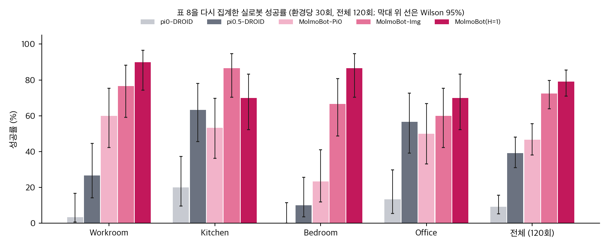
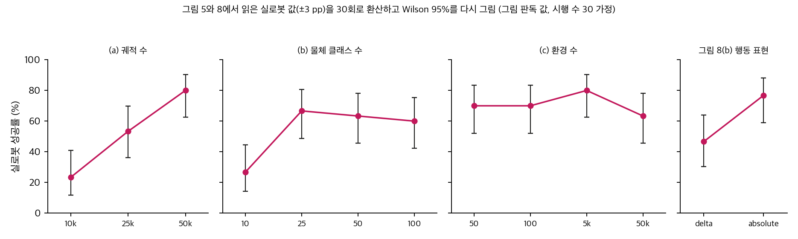
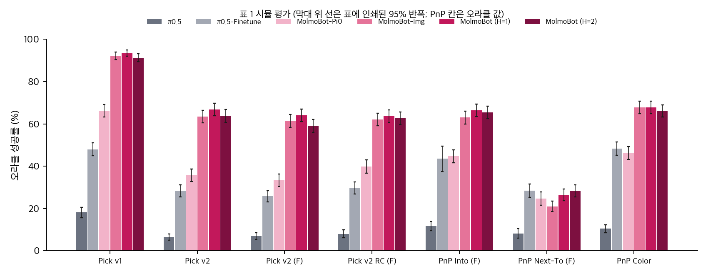
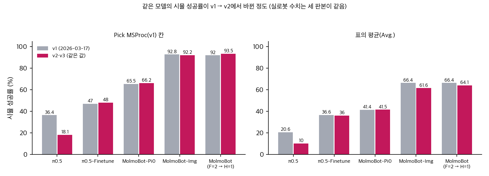
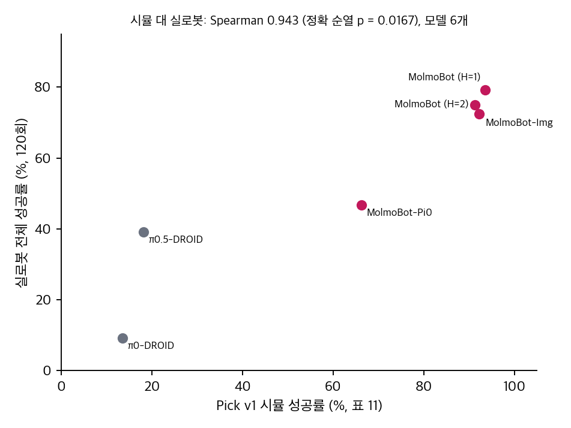

> **논문:** Abhay Deshpande 외 25명. *MolmoB0T: Large-Scale Simulation Enables Zero-Shot Manipulation.* CoRL 2026 구두 발표, arXiv:2603.16861 (v3, 2026-11-08).
> 공식 코드는 GitHub allenai/MolmoBot(Apache-2.0)에 있습니다. 논문 라이선스는 arXiv 비독점 배포라서 이 글에는 논문 그림을 넣지 않았고, 그래프는 모두 논문의 표를 다시 계산해 우리가 그린 것입니다.

## 논문이 묻는 것

실제 로봇 정책을 키우는 흔한 방법은 사람이 모은 시연을 더 많이 모으는 것입니다. 이 논문은 반대쪽을 묻습니다. 시뮬레이션에서 전문가 플래너가 만든 시연 170만 개(5,704시간, 2개 로봇, 8개 과제)로만 정책을 학습하면 **실제 로봇 미세조정 없이** 전이될까요? 데이터 생성기 MolmoBot-Engine과 데이터셋 MolmoBot-Data, 정책 세 종류(MolmoBot, MolmoBot-Pi0, MolmoBot-SPOC)를 모두 공개합니다.

핵심 수치는 Franka 탁상 pick-and-place 실로봇 120회에서 MolmoBot 79.2%, π0.5-DROID 39.2%입니다. 이 글은 그 수치와 그 주변의 표, 절제, 코드를 다시 계산하고 읽은 결과입니다.

## 이 글에서 확인한 것

**1. 실로봇 격차는 확실합니다.** 표 8의 셀(40 과제 × 3회)을 다시 합치면 MolmoBot(H=1) 95/120, MolmoBot-Img 87/120, MolmoBot-Pi0 56/120, π0.5-DROID 47/120, π0-DROID 11/120입니다. MolmoBot 대 π0.5-DROID는 Fisher p = 3.6e-10이고 과제 단위 쌍체 검정에서도 p = 1e-4입니다. 반면 MolmoBot-Pi0 대 π0.5-DROID는 56 대 47, p = 0.30이라 "경쟁적"은 "구분되지 않는다"에 가깝고, MolmoBot(H=1) 대 MolmoBot-Img도 p = 0.29입니다.

*그래프 (우리가 그림). 표 8의 셀을 환경별(30회)과 전체(120회)로 합치고 Wilson 95% 구간을 그렸습니다.*

그림 4의 오차 막대는 층화 부트스트랩입니다. 같은 방법을 구현하면 표 12의 반폭(±6.7, ±10.0)이 그대로 나오므로 방법 자체는 일관됩니다. 다만 "과제를 고정하고 시도만 다시 뽑는" 구간이라 Wilson보다 좁아서(MolmoBot ±4.6 대 ±7.2 pp) 두 구간을 직접 비교할 때는 이 차이를 감안해야 합니다.

**2. 카메라 통제 서술은 환경 효과와 섞였습니다.** 부록 C.5는 어깨 카메라로 거른 Kitchen 30회에서 기준선이 크게 오르고 MolmoBot은 덜 오른다고 씁니다. 표 11의 Kitchen 열은 표 8의 Kitchen 행과 같은 값입니다(예: π0.5-DROID 19/30). 같은 표 8에서 Kitchen을 뺀 90회와 비교하면 π0.5-DROID는 63.3% 대 31.1%(p = 0.0024), MolmoBot(H=1)은 70.0% 대 82.2%(p = 0.19)입니다. Kitchen이 기준선에게 쉬운 환경이라는 사실은 보이지만, 카메라 제한과 환경이 분리되지 않았습니다. 본문 C.3의 "π0.5-DROID 31.3%"는 초록과 표 8의 39.2%와 다르고, 이 값은 Kitchen을 뺀 세 환경의 평균(27, 10, 57%)과 같습니다. 어떤 집계에서 나온 값인지는 저자 확인이 필요합니다.

**3. 환경 수가 영향이 작다는 결론은 검출 한계 안에 있습니다.** 그림 5(c)에서 읽은 실로봇 값(그림 판독, 한 점 30회 가정)으로 5k 대 50k 환경을 비교하면 24/30 대 19/30, p = 0.25입니다. 두 점을 80% 검정력으로 가르려면 약 27–34 pp 이상의 차이가 필요합니다. 반면 궤적 수 10k 대 50k는 7/30 대 24/30(p = 2e-5)로 뚜렷하고, 물체 클래스는 10 → 25에서 오른 뒤 평평합니다(p = 0.004, 이후 p ≥ 0.66). 한 점의 시행 수는 본문이 6개 물체 × 5회(30회), 부록 C.6이 세 그룹 × 물체 세 개 × 5회(45회)로 적어 서로 다르게 읽힙니다.

*그래프 (우리가 그림). 논문 그림 5와 8의 실로봇 값을 ±3 pp 정도로 읽어 30회의 정수로 바꾸고 Wilson 95%를 다시 그렸습니다(그림 판독 값, 시행 수 30 가정).*

**4. 표 1에서 칸마다 시행 수가 같지 않아 보입니다.** 캡션은 "과제당 1000회"인데 부록 표 10은 200 에피소드를 적고, 반폭에서 거꾸로 구한 시행 수는 대부분 약 1000이지만 일부 칸은 다릅니다. LAP-VLA의 PnP 칸은 소수 둘째 자리까지 적혀 있어(3.81/1.59, 6.48/3.41) 가능한 시행 수가 각각 630과 293으로 좁혀지고, π0.5-Finetune의 PnP Into는 약 262로 역산됩니다. LAP-VLA 행의 평균 4.8은 오라클 기준으로 다시 계산하면 5.9이고 PnP 칸을 종료 시 성공률로 넣은 평균(4.87)과 가깝습니다. 순위에는 영향이 없지만 유효 에피소드 수를 표에 적어 주면 구간을 같은 기준으로 읽을 수 있습니다.

*그래프 (우리가 그림). 표 1의 오라클 성공률과 표에 인쇄된 95% 반폭입니다.*

이력 입력 모델(H=1, H=2)이 MolmoBot-Img보다 확실히 높은 칸은 PnP Next-To 하나입니다(+5.4, +7.3 pp, 1000회 가정 시 p = 0.0045, 0.00015). 컴퓨트를 맞춘 MolmoBot-Img+ 실험(표 12)은 실제 30회라서 이 차이를 가르지 못합니다(H=1 대 Img+ p = 0.71).

**5. v1에서 v2로 시뮬 기준선이 바뀌었습니다.** 실로봇 수치는 세 판본이 같지만 시뮬 표는 v1과 v2가 다릅니다. π0.5의 시뮬 평균이 20.6에서 10.0으로 내려갔고, MolmoBot 평균은 66.4에서 64.1로 움직였습니다. Next-To 칸이 모든 모델에서 크게 낮아진 것은 부록 A.3의 성공 기준이 [0, 25] cm에서 [0, 5] cm로 바뀐 것과 맞습니다. 판본 사이 변경 사유는 본문에 적혀 있지 않아 저자 확인이 필요합니다.

*그래프 (우리가 그림). v1과 v2·v3 표에서 같은 모델의 Pick MSProc(v1) 칸과 평균입니다.*

**6. 시뮬과 실제의 순위는 잘 맞지만 근거가 얇습니다.** 논문은 시뮬 평가가 실제와 "검증된 상관"이 있다고 쓰지만 계수는 제시하지 않습니다. 보고된 값으로 계산하면 Pick v1 시뮬과 실로봇 전체의 Spearman은 0.94(모델 6개, 정확 순열 p = 0.017)입니다. 모델 6개 중 4개가 같은 MolmoBot-Data로 학습한 계열이고 시뮬 평가가 생성기와 같은 시뮬레이터 계열이므로, 서로 다른 데이터로 학습한 정책의 순위를 맞추는 근거로는 자유도가 작습니다.

*그래프 (우리가 그림). 표 11의 Pick v1 시뮬 성공률과 표 8의 실로봇 전체 성공률입니다.*

**7. 최종 학습은 생성 데이터를 한 번도 다 쓰지 못합니다.** 200k 스텝 × 배치 1024는 2.05억 샘플이고, 공식 README의 혼합 비율로 나누면 Franka 프레임 대비 Pick 0.72, PnP 0.64, Next-To 0.75, Color 4.1배입니다(v2 표의 프레임 수 기준, 사용한 데이터 분할이 일부라면 더 큼). 스텝을 늘리거나 생성량을 늘릴 때의 효과는 논문에 없습니다.

## 공식 코드와 논문

저장소는 Apache-2.0이고 공개 모델 9종과 데이터(ODC-BY, 약 10.3 TB)가 있습니다. 코드를 실행하지 않고 읽어 논문과 대조했습니다(커밋 be82891).

- **맞는 것.** 층마다 교차 주의하는 DiT 헤드 구조, 이력 간격 8스텝, Franka 데이터 혼합 비율(20/10/35/20/15%), 이미지 증강 목록, 데이터 생성의 잡음 상수(MolmoSpaces 설정 파일), MolmoBot-Pi0의 학습 설정, MolmoBot-SPOC의 파라미터 수(계산 약 107M, 논문 108M)입니다.
- **논문에 없는 설정.** 최적화 설정(행동 헤드 학습률 1e-4, LLM 1e-5, LLM도 미세조정), 학습 카메라 선택 규칙(먼 카메라를 50% 확률로 선택), 정규화(1%, 99% 분위수)입니다.
- **평가 경로의 설정.** 스텝당 최대 관절 변화 0.2 rad로 비례 축소하는 상한(시뮬과 실로봇 모두), 그리퍼 출력의 이진화(MolmoBot)와 연속값(MolmoBot-Pi0), MolmoBot-Pi0는 예측 청크를 끝까지 실행(MolmoBot은 16개 중 8개)합니다. 정책 주기는 평가 설정 파일에 66 ms와 200 ms가 모두 있어, 200 ms이면 303스텝이 60.6초가 됩니다. 표 1을 만든 설정이 어느 쪽인지는 코드만으로 확인되지 않습니다.
- **차이.** RB-Y1 행동 공간은 논문의 6-DoF 토르소 변화량 서술보다 단순하고(토르소 1차원 절대값), 프레임 샘플링 가중치는 "재시도 3×"가 실패 파지의 해제 구간 바닥 가중치이고 실패한 파지 자체는 0.5×로 낮춥니다.

## 한계와 확인할 것

- 실로봇 근거는 DROID 계열 Franka의 탁상 pick-and-place 120회이고, RB-Y1 문 열기는 9회(잡기 4, 열기 2, 하드웨어 오류 6회)입니다. 저자도 목표 환경 데이터가 필요할 수 있다고 적습니다.
- MolmoBot-Pi0 대 π0-DROID의 차이를 "데이터가 만든다"고 읽으려면 행동 표현, 초기화, 카메라 구성이 함께 달라진 점을 분리해야 합니다.
- 그림 판독 값과 가정한 시행 수(30회, 1000회)를 쓴 결과는 문장 안에 밝혔습니다. 저자 확인이 필요한 항목은 표 1의 유효 에피소드 수, 31.3%의 집계, 시뮬 기준선 변경 사유, Open 성공 기준(v1 15%, v2·v3 67%인데 RB-Y1 Open 25.2는 세 판본이 같음)입니다.
- 코드는 읽기만 했고 실행하지 않았습니다. 가중치와 데이터는 받지 않았습니다.

## 자료

- [통합 리포트 PDF](report/report_public.pdf)
- [01. 논문 분석: MolmoB0T (arXiv:2603.16861)](analysis/01_paper_analysis.md)
- [02. 선행연구, 관련 저장소, 자원](analysis/02_prior_work.md)
- [03. 수치 재계산과 일관성 검사](analysis/03_analysis.md)
- [04. 공식 코드 대조와 구현 가능성](analysis/04_code_verification.md)
