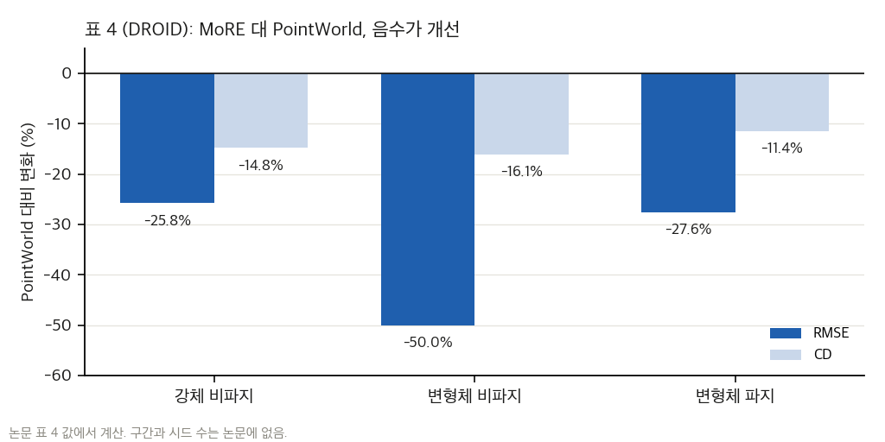
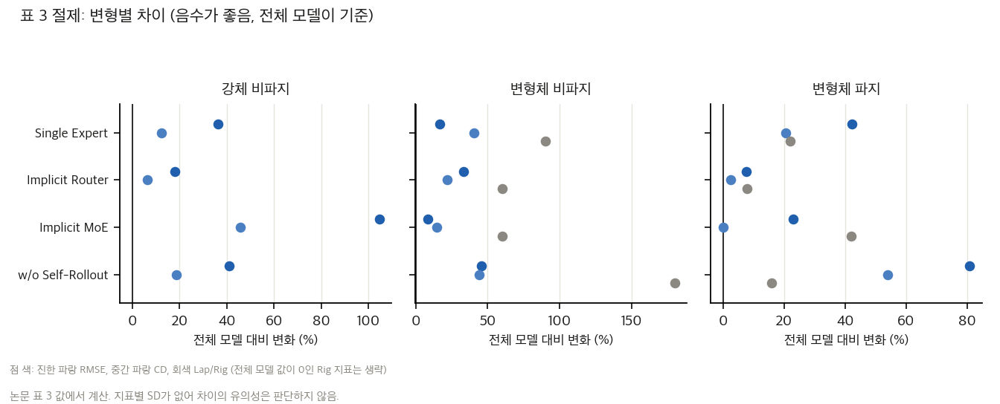
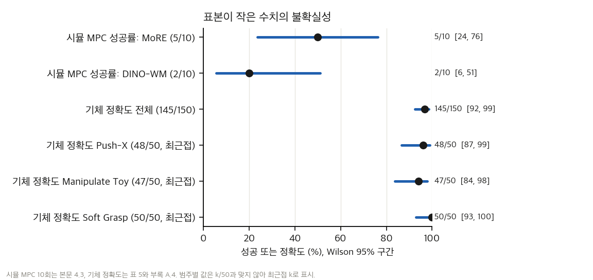

> **논문:** Ziyu Zhu, Shaowei Liu, Albert J. Zhai, Henry Che, Wei-Chiu Ma, Shenlong Wang. *MoRE: Mixture-of-Experts for Multi-Physics Robotic World Models.* CoRL 2026 Spotlight, arXiv:2611.25336 (v1, 2026-11-19).
> 공식 코드는 GitHub AlwaySleepy/MoRE-WM에 있습니다(LICENSE 파일 없음). 이 글의 그림은 모두 논문 표 값으로 우리가 그린 것입니다. 논문 그림은 쓰지 않았습니다.

## 논문이 묻는 것

로봇 세계 모델은 행동 뒤에 물체가 어떻게 움직일지 예측해야 합니다. 3D 모델은 강체와 변형체를 함께 다루기 어렵습니다. 한 예측기가 두 가지 물리를 모두 맞추려 하면 어느 쪽도 잘 안 됩니다.

MoRE는 상호작용을 **체제**로 나눕니다. 강체 비파지, 변형체 비파지, 변형체 파지 세 가지입니다. 체제마다 운동 전문가를 두고, 게이트가 하나를 고릅니다. 입력은 물체 점군과 툴 점군으로 된 행동, 8 스텝 이력입니다. 출력은 3 스텝 뒤의 물체 점군입니다.

## 이 글에서 확인한 것

**1. 공식 코드의 라우팅은 논문과 다릅니다.** 논문 §4.3은 테스트 시 특권 상호작용 라벨을 쓰지 않는다고 씁니다. 공식 코드의 평가와 학습은 데이터셋의 물성 라벨로 전문가를 고릅니다. 학습 가능한 게이트는 교차 엔트로피 손실이 총손실에 들어가지 않아 학습되지 않습니다. 그러니 표 5의 96.7% 라우팅 정확도는 공개 코드로는 확인되지 않습니다(실행 없이 코드를 읽은 결과).

**2. DROID에서 PointWorld보다 낫다는 방향은 맞습니다.** 변형체 비파지 RMSE는 0.028에서 0.014로 50% 줄었습니다. 세 칸 모두 낮습니다. 다만 표준편차와 평가 표본이 없고, 두 방법의 학습 데이터와 평가 점 선택이 다릅니다.

*그래프: 논문 표 4 값에서 우리가 계산한 PointWorld 대비 변화. 구간과 시드 수는 논문에 없습니다.*

**3. 시뮬 MPC의 "50% 대 20%"는 10회 시험입니다.** 5/10 대 2/10의 Fisher 검정 p는 0.35입니다. 구간이 크게 겹칩니다. 1군당 약 39회가 있어야 이 차이를 80% 검정력으로 찾습니다. DINO-WM보다 낫다는 결론은 이 실험으로는 지지되지 않습니다.

**4. 절제는 방향이 맞지만 크기를 모릅니다.** 전체 모델이 대부분의 지표에서 가장 좋습니다. 암묵 MoE는 변형체 파지 CD에서 전체 모델과 같습니다(0.039). 그래서 "모든 체제에서 나쁘다"는 서술은 이 칸과 맞지 않습니다. 표준편차가 없어 2% 안쪽 차이는 반올림과 구별되지 않습니다.

*그래프: 논문 표 3 값에서 우리가 계산한 변형별 차이(전체 모델 기준). 지표별 표준편차가 없어 유의성은 판단하지 않았습니다.*

**5. 표본이 작은 수치는 불확실합니다.** 표 5의 범주별 정확도(95.4%, 94.9%, 99.8%)는 범주당 50회라면 정수 횟수가 되어야 하는데 그렇지 않습니다. 전체 96.7%는 145/150과 맞습니다. 전체의 Wilson 95% 구간은 92–99%입니다.

*그래프: 시뮬 MPC 10회와 표 5 정확도의 Wilson 95% 구간. 범주별 값은 k/50과 맞지 않아 최근접 k로 표시했습니다.*

**6. 데이터 규모와 혼합 비율이 맞지 않습니다.** 본문의 시뮬 약 20K와 실 약 7K를 더하면 27K입니다. 프로젝트 페이지는 38.7K라고 씁니다. 부록은 시뮬과 실을 1:1로 섞는다고 쓰지만, 공식 코드 기본 설정은 소스별 가중치를 씁니다.

## 구현 가능성

- **이 맥(M4 Pro, MPS, CUDA 없음)에서 논문 규모 재현은 불가능합니다.** 공식 코드는 `.cuda()`가 하드코딩되어 있고 PointNet2 CUDA 확장이 필요합니다. 데이터는 약 10.6 GB입니다. 실로봇과 시뮬 MPC도 필요합니다.
- **공식 체크포인트의 소량 평가는 조건부입니다.** MPS로 포팅하면 3–5일로 추정합니다. 그래도 평가는 특권 라벨로 라우팅하므로 §4.3 주장을 확인하지는 못합니다.
- **라우팅 설계를 축소판으로 검증하는 것은 가능합니다.** 학습 가능한 게이트를 실제로 학습시키고, 특권 라벨 라우팅과 비교하는 실험입니다. 1–2주로 추정합니다.

## 남은 질문

저자에게 물을 것은 세 가지입니다. 표 2와 4의 테스트 라우팅이 특권 라벨인지, 표 5의 정확도가 무엇을 재고 분모가 무엇인지, 학습 가능한 게이트를 학습하는 버전이 있는지입니다.

## 자료

- [통합 리포트 PDF](report/report_public.pdf)
- [01. 논문 분석: MoRE (arXiv:2611.25336)](analysis/01_paper_analysis.md)
- [02. 선행연구와 공식 저장소](analysis/02_prior_work.md)
- [03. 재계산과 일관성 검사](analysis/03_analysis.md)
- [04. 공식 코드 대조와 구현 가능성](analysis/04_code_verification.md)
