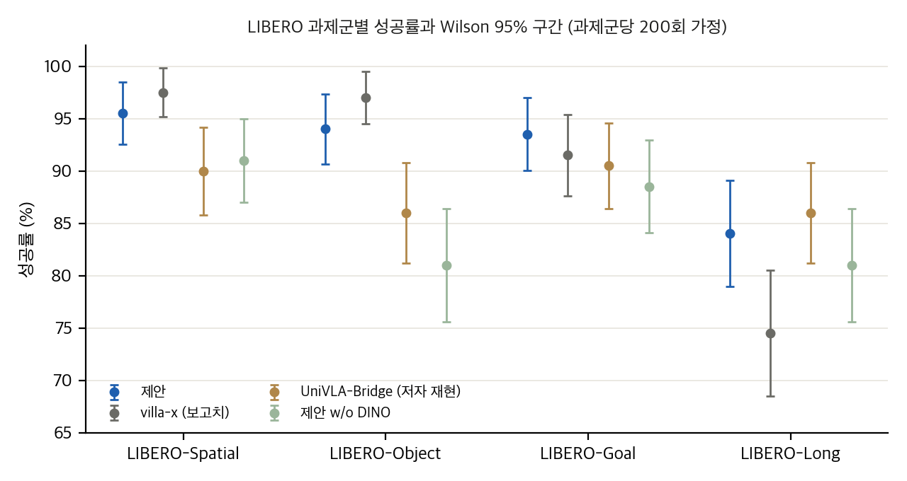
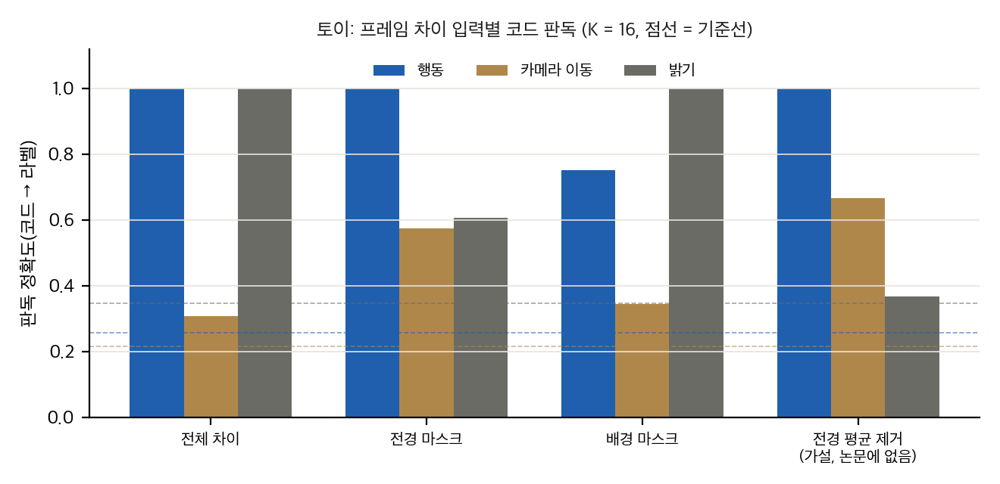

> **논문:** Xu, Zhang, Wang, Wang, Yu. *Motion-Focused Latent Action Enables Cross-Embodiment VLA Training from Human EgoVideos.* IROS 2026(채택), arXiv:2606.18955 (v2).
> 논문 그림은 라이선스(arXiv 비독점 배포) 때문에 싣지 않았습니다. 이 글의 그래프는 논문 표의 수치와 직접 만든 토이로 그렸습니다. 공식 코드는 GitHub에 있습니다(Apache-2.0, 커밋 `fd614f7`).

## 한 줄 요약

사람 1인칭 영상에서 **움직임만 담는** 이산 잠재 행동을 만들고, 그 토큰으로 VLM을 사전학습한 뒤, 소량의 시연으로 미세조정하는 방법입니다. 손 마스크로 행동 경로와 배경 경로를 나누는 것이 핵심입니다. 논문은 LIBERO 평균 91.8, RoboTwin 67.7, 실물 3과제에서 기준선을 앞선다고 보고합니다.

## 1. 표는 맞다, 헤드라인 차이는 작다

논문 표의 평균은 모두 다시 계산해도 맞습니다. 그러나 차이를 검정하면 그림이 달라집니다.

- **LIBERO:** 91.8은 villa-x 90.1보다 1.6점 높지만 Fisher p = 0.30로 유의하지 않습니다. 과제군별로는 Long에서만 차이가 뚜렷합니다(p = 0.026).
- **RoboTwin:** 67.7은 π0(65.2, p = 0.26)과 UniVLA(63.6, Holm 보정 p = 0.12)와 구별되지 않습니다. "comparable"은 맞고 "앞선다"는 근거가 약합니다.
- **실물:** 46/60 대 23/60으로 크지만 과제당 20회를 가정한 값이고 시드가 보고되지 않았습니다.

LIBERO 과제군별 성공률과 Wilson 95% 구간(과제군당 200회 가정).

## 2. 기준선 하나는 원 논문보다 약하게 재현되었다

UniVLA(Bridge) 행은 저자가 재현한 값(88.1)입니다. UniVLA 원 논문의 Bridge 행은 92.5입니다. 또한 LIBERO 기준선 칸 가운데 200회 가정에서 정수가 되지 않는 칸이 17개 있어, 다른 평가 프로토콜에서 가져온 값으로 보입니다. 공정한 비교에는 같은 프로토콜로 다시 돌린 기준선이 필요합니다.

## 3. "사람 영상만"은 헤드라인 실험과 맞지 않는다

초록은 사람 영상만으로 사전학습한다고 씁니다. 그런데 헤드라인인 LIBERO 실험은 BridgeV2 **로봇** 3인칭 영상으로 잠재 행동과 VLM을 사전학습했습니다. 사람 영상은 RoboTwin과 실물에서 씁니다. "약 50 궤적"도 과제당 수치이며, LIBERO는 군당 500개입니다.

## 4. 움직임 분리는 직접 검증되지 않았다

마스크 없는 학습, 전체 재구성 경로 제거, 배경 경로 제거 ablation이 없습니다. 공개 코드에서 전체 재구성 경로는 마스크 없이 전역 MSE로 학습됩니다. 그래서 행동 코드가 배경이나 카메라 이동을 설명하는 통로가 생깁니다.

잠재 행동 토이로 이를 확인했습니다. 프레임 차이에 에이전트 움직임과 함께 밝기 변화와 카메라 이동을 넣었습니다.

토이: 입력별 코드 판독. 전체 차이는 밝기를 완전히 담고, 전경 마스크는 밝기를 0.61까지 줄이지만 카메라 정보는 0.58로 남습니다(기준선 0.22).

이 결과는 토이이고 k-means로 이산화했습니다. VQ-VAE 학습 결과를 대신하지 않습니다. 그래도 "마스크가 움직임만 남긴다"는 가정이 카메라 이동에는 성립하지 않는다는 점은 보여 줍니다.

## 5. 코드에서 확인한 차이

- **쌍 간격:** 논문은 1초 간격이라고 씁니다. 코드의 기본 창 크기 10은 쌍 간격 9프레임입니다. 영상 fps가 9가 아니면 1초가 아닙니다.
- **증강과 마스크:** 코드는 이미지에만 크기 0.9 자르기를 적용하고 마스크는 자르지 않습니다(마스크 증강이 주석 처리됨). 면적 0.9 자르기에서 이미지와 마스크는 가장자리에서 최대 약 12 px(224 기준) 어긋날 수 있습니다.
- **LIBERO 시점:** 논문은 3인칭만 쓴다고 하지만 코드의 기본 경로는 손목 카메라의 DINOv2 특징을 항상 씁니다.
- **미세조정 기본값:** 기본 설정은 VLM을 동결하고 LoRA를 쓰지 않습니다. 논문의 주 설정(VLM LoRA)과 다릅니다.

## 6. 재현 가능성

공식 코드는 공개되어 있지만 실행 경로가 CUDA를 전제합니다(`.cuda()` 하드코딩, flash-attn). 마스크 생성 파이프라인(SAM2, RoboEngine)과 학습된 체크포인트는 공개되지 않았습니다. 일반 노트북 한 대에서는 공식 재현이 어렵고, 서버에서도 GPU 2–4장과 마스크 생성이 필요합니다. 핵심 구조를 다시 구현하는 것은 중간 난이도입니다.

## 7. 정리

움직임만 담는 잠재 행동이라는 방향은 설득력이 있습니다. 하지만 논문의 증거는 아직 세 가지가 부족합니다. 분리 효과를 직접 재는 ablation, 시드 반복, 같은 프로토콜의 기준선입니다. 이 세 가지가 채워지면 결론을 더 강하게 말할 수 있습니다.

---

*분석 문서, 재계산 스크립트, 토이 코드는 저장소의 `analysis/`에 있습니다.*

## 자료

- [통합 리포트 PDF](report/report_public.pdf)
- [01. 논문 분석: Motion-Focused Latent Action](analysis/01_paper_analysis.md)
- [02. 선행연구와 관계](analysis/02_prior_work.md)
- [03. 수치 재계산, 유의성, 유도와 toy 검증](analysis/03_analysis.md)
- [04. 코드 대조와 주장 검증](analysis/04_code_verification.md)
