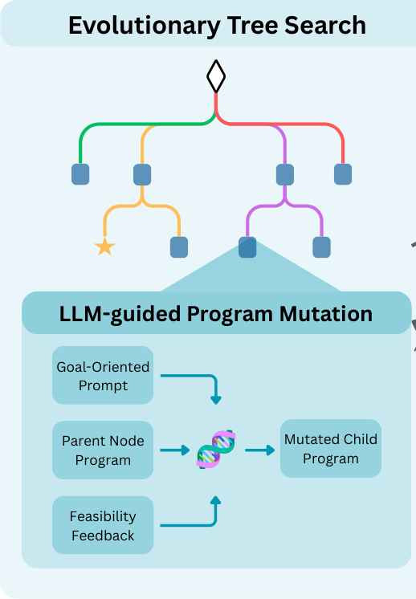
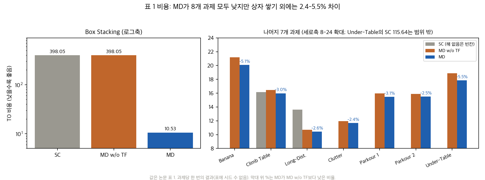
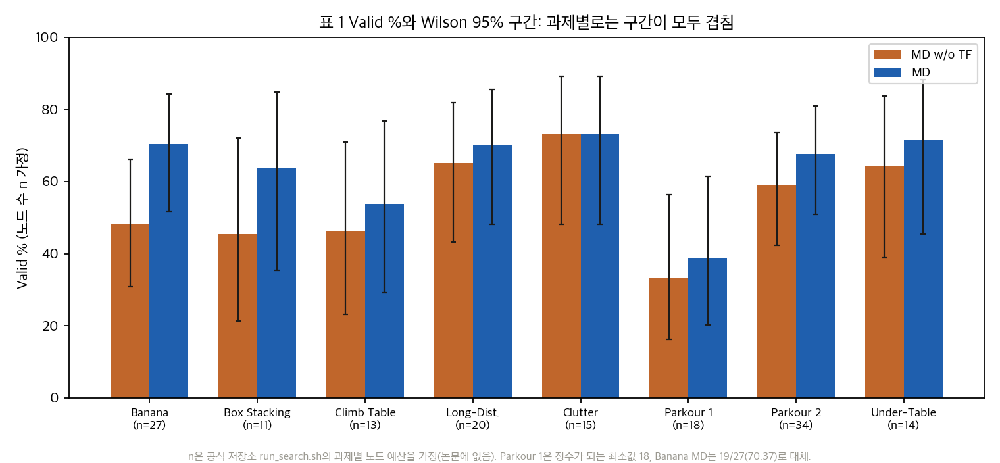
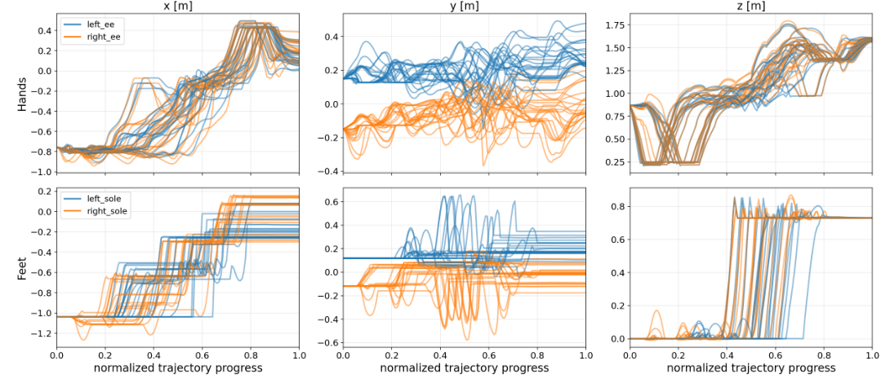
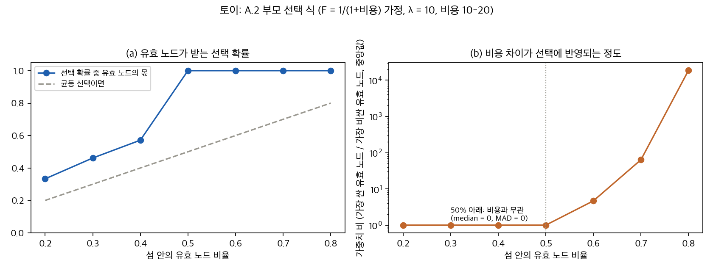

> **논문:** Ilyass Taouil, Michal Ciebielski, Shafeef Omar, Haizhou Zhao, Angela Dai, Aaron M. Johnson, Majid Khadiv. *MotionDisco: Motion Discovery for Extreme Humanoid Loco-Manipulation.* CoRL 2026 포스터, arXiv:2606.06139 (v1, 2026-06-04).
> 공식 코드는 GitHub Atarilab/motiondisco(Apache-2.0)에 있습니다. 이 글의 그림은 논문 그림 세 장(출처 표기, 시뮬레이션 도식과 렌더만)과 우리가 그린 그래프입니다.

## 논문이 묻는 것

휴머노이드가 상자를 옮기고, 테이블에 올라가고, 장애물을 밀며 걷는 긴 동작은 접촉 모드의 순서가 조합적으로 늘어납니다. 많은 방법이 사람 동작을 리타게팅하거나 원격조종 데이터를 씁니다. MotionDisco는 사람 데이터 없이 접촉 계획을 **탐색으로** 찾습니다.

접근은 이렇습니다. 후보 접촉 계획을 짧은 파이썬 프로그램으로 쓰고, LLM(Claude Opus 4.7)이 그 프로그램을 변이시킵니다. 각 후보는 먼저 순차 기구학 검사(KSO)를 받고, 통과하면 접촉 명시적 궤적 최적화(TO)를 받습니다. 비용과 실패 지점이 점수와 텍스트 피드백으로 LLM에 돌아갑니다. 탐색 골격은 ShinkaEvolve의 섬(island) 모형입니다. 찾은 궤적은 RL 추종 정책으로 학습해 실제 휴머노이드에 영 샷으로 올립니다.

*그림 2의 왼쪽 패널 (논문 원문, 오른쪽 렌더 패널은 잘라냄). © 저자, CC BY 4.0, 출처 arXiv:2606.06139.*

## 이 글에서 확인한 것

논문의 정량 결과는 표 1 하나입니다. 여덟 과제에서 단일 LLM 호출(SC), 텍스트 피드백 없는 탐색(MD w/o TF), 전체(MD)를 비교합니다. 표를 다시 계산하고, 공식 코드를 정적으로 읽어 대조했습니다(코드는 실행하지 않았습니다).

**1. 비용은 모든 과제에서 MD가 낮습니다. 다만 상자 쌓기를 뺀 일곱 과제의 차이는 2.4–5.5%입니다.** MD가 w/o TF보다 낮은 과제는 8개 모두입니다(부호 검정 양측 p = 0.0078, 과제를 독립으로 본 경우). 상자 쌓기는 398.05에서 10.53으로 37.8배 낮고, 이 과제의 w/o TF 비용은 SC 비용과 소수점까지 같습니다. 나머지 일곱 과제의 평균 차이는 3.5%이고, 표에는 시드 수나 구간이 없어 이 크기가 실행 사이 변동보다 큰지는 표만으로 알 수 없습니다.

*우리가 그린 그래프. 값은 논문 표 1입니다. 막대 위 %는 MD가 MD w/o TF보다 낮은 비율입니다.*

**2. Valid %의 분모와 탐색 예산이 본문에 없습니다.** 공식 저장소의 `run_search.sh`에는 과제별 노드 예산(Banana 27, Box 11, Climb 13, Long-Dist. 20, Clutter 15, Parkour 1 40, Parkour 2 34, Under-Table 14)이 있습니다. 이 값을 분모로 놓으면 표 1 Valid % 16칸 중 13칸이 소수 둘째 자리 이하를 버린 값으로 정확히 재현됩니다(예: 7/11 = 63.636…이 63.63). 이 분모로 맞지 않는 칸은 Banana MD 70.30(19/27 = 70.37)과 Parkour 1의 두 칸입니다. Parkour 1은 n = 40에서는 정수가 되지 않고 n = 18이면 33.33 = 6/18, 38.88 = 7/18이 됩니다. 어느 쪽이 논문 실험의 값인지는 저자 확인이 필요합니다.

**3. Valid %의 우위는 방향이 일관되지만 이 표만으로는 확정되지 않습니다.** 8개 중 7개에서 MD가 높고 1개(Clutter)는 같습니다. 위의 예산을 분모로 가정해(노드 수 n 가정) 성공 수를 복원하면 합계가 54.6%에서 64.5%로 오르고, 층화 Mantel-Haenszel 오즈비는 1.54(95% 구간 0.96–2.46, p = 0.077)입니다. 같은 트리의 노드는 독립이 아니므로 유효 표본을 1/2, 1/4로 줄이면 p = 0.22, 0.40입니다. 과제별 차이는 노드 1–3개 수준입니다(Banana 6개).

*우리가 그린 그래프. n은 공식 저장소의 과제별 예산을 가정한 값(논문에 없음)이고 Parkour 1은 18, Banana MD는 19/27로 대체했습니다.*

**4. SC는 8개 과제 중 4개에서만 해를 찾았습니다.** Wilson 95% 구간은 21.5–78.5%이고, MD의 8/8과 비교한 Fisher 정확 검정은 p = 0.077입니다(과제당 한 번의 결과로 보이는 경우). w/o TF는 Climb Table에서 SC보다 비용이 높습니다(16.47 대 16.16). 같은 예산만큼 독립 호출한 최선(best-of-n)과의 비교는 표에 없습니다.

**5. 논문과 공식 코드의 지표 정의가 다릅니다.** 논문의 "유효"는 KSO 통과와 TO 수렴이지만, 코드의 집계 스크립트는 "TO가 실행되었는가"(수렴 여부 무관)로 셉니다. "첫 유효해 시간"은 코드에서 첫 번째 LLM 평가가 끝난 시점부터 재며, 장면당 약 20분의 솔버 컴파일을 뺍니다. 비용은 논문 식 5가 정규화 없는 합인데 코드는 노드 수와 모드 수로 나눈 값입니다. 점수는 `1/(1+비용)`이고 TO 수렴 여부를 보지 않습니다. 논문 본문에는 이 정의들이 없어 표 1의 각 열이 어느 정의로 계산됐는지 독자가 확인하기 어렵습니다.

**6. 공식 프리셋이 논문의 설명과 다릅니다.** 논문 부록은 변이 확률 diff 0.6, full 0.3, crossover 0.1과 LLM 새로움 판정을 쓴다고 하고, 모든 LLM 구성요소가 Opus 4.7이라고 합니다. 코드의 `run_search.sh`는 변이 0.5/0.5(crossover 없음), 모델 문자열 `claude-opus-5-5`를 쓰고, LLM 새로움 판정은 `novelty_llm_models`가 설정돼야 켜지는데 기본 설정에는 없습니다. 공식 저장소는 논문 게시 5개월 뒤의 단일 커밋이어서, 코드의 값이 논문 실험 시점의 값이라고 단정할 수 없습니다. 텍스트 피드백(TF)도 논문은 "가장 긴 실현 가능 접두부" 한 줄(식 6)로 설명하지만 코드는 제약 위반의 어휘 번역, 걸음 수 보정, 파지 진단, 수리 시도까지 있습니다.

**7. 실로봇 결과는 정성적입니다.** 본문은 "모든 시도한 과제에서 여러 번 연속 성공"이라고 쓰지만 시행 수와 성공률, 추종 정책의 학습 설정은 없습니다. 부록의 실로봇 그림은 다섯 과제이고 Banana, Box Stacking, Parkour 1은 그림이 없습니다. Parkour Pick & Place 2의 목표는 부록 B.1(바닥에 내려놓기), 그림 7 캡션(먼 테이블), 부록 A.1 프롬프트(높은 테이블)에서 다르게 서술됩니다. 같은 과제의 서술인지는 저자 확인이 필요합니다.

*그림 3의 위쪽 그래프 (논문 원문, 아래 렌더는 잘라냄). © 저자, CC BY 4.0, 출처 arXiv:2606.06139. 다양성은 이 그림 한 장으로 정성적으로만 보입니다.*

## 토이: 부모 선택식은 유효 노드 비율 0.5에서 성질이 바뀝니다

부록 A.2의 부모 선택 가중치는 `σ(λ(F − α)/m) · 1/(1+o)`입니다(α는 섬 점수의 중앙값, m은 MAD와 ε 중 큰 값). 점수 F의 정의와 λ는 논문에 없어서 공식 코드 값(F = 1/(1+비용), 유효하지 않으면 0, λ = 10)을 가정하고, 식을 그대로 옮겨 섬 노드 40개로 시험했습니다(코드를 실행한 것이 아닙니다).

*우리가 그린 그래프(식 옮김, 가정 기반). (a) 선택 확률 중 유효 노드의 몫, (b) 가장 싼 유효 노드와 가장 비싼 유효 노드의 가중치 비(중앙값).*

유효 노드가 섬의 절반 미만이면 중앙값과 MAD가 0이 되어 m이 ε로 떨어지고, 비용이 10인 노드와 20인 노드가 같은 가중치 1을 받습니다. 절반을 넘으면 가중치 비가 4.7(0.6)에서 약 1.9×10⁴(0.8)까지 급격히 커집니다. 즉 선택 압력이 유효 비율에 따라 "없음"에서 "매우 강함"으로 바뀝니다. 공식 예산 11–40노드를 네 섬에 나누면 섬당 노드가 2–10개라 통계가 더 불안정할 수 있습니다. 이것은 식의 동작이지 탐색 성능이 낮다는 증거가 아닙니다.

## 구현 가능성

- **전체 재현은 이 맥(Apple M4 Pro, CUDA 없음)에서 불가능합니다.** 추종 정책 RL 학습과 실로봇이 필요하고, 학습 설정은 본문에 없으며 저장소에도 추종 학습·배포 코드가 없습니다.
- **공식 탐색 파이프라인은 조건부입니다.** 솔버는 CPU라 GPU는 필요 없지만, 새 conda 환경과 acados/moto 빌드, LLM API 호출, 임베딩 서버가 필요하고 장면당 컴파일 약 20분이 걸립니다. 평가 시간은 표 1의 시간 열에서 독립·순차 가정으로 추정하면 과제당 13–142분입니다.
- **표 재계산과 부모 선택식 토이는 가능하고 끝냈습니다.** 탐색 루프의 축소 재구현(2차원 접촉 계획 장난감, 스크립트 변이)은 1–2주 규모로 추정합니다(측정 전).

## 정리

MotionDisco는 "이산 접촉 계획은 LLM이 프로그램으로, 연속 평가는 최적화기가" 하는 분업을 휴머노이드 loco-manipulation에 적용한 사례이고, 공식 코드가 공개된 점이 가치입니다. 표 1은 방향이 일관된 비교입니다. 다만 Valid %의 분모와 탐색 예산, 비용 이득의 크기와 변동, 지표 정의가 본문에 없어 이 표만으로는 효과의 크기를 판단하기 어렵습니다. 코드의 지표와 프리셋이 논문 설명과 다른 부분(유효, 시간, 비용, 피드백의 폭, 모델, 변이 확률)은 저자 확인이 필요합니다. 재계산과 토이의 스크립트, 결과, 분석 문서는 함께 올렸습니다.

## 자료

- [통합 리포트 PDF](report/report_public.pdf)
- [01. 논문 분석: MotionDisco (arXiv:2606.06139)](analysis/01_paper_analysis.md)
- [02. 선행연구와 관련 저장소](analysis/02_prior_work.md)
- [03. 수치 재계산, 일관성 검사, 토이, 주장 판정](analysis/03_analysis.md)
- [04. 공식 코드 대조와 구현 가능성](analysis/04_code_verification.md)
