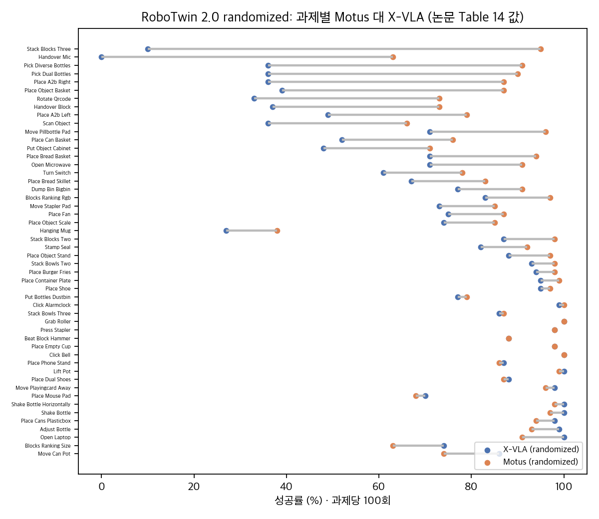
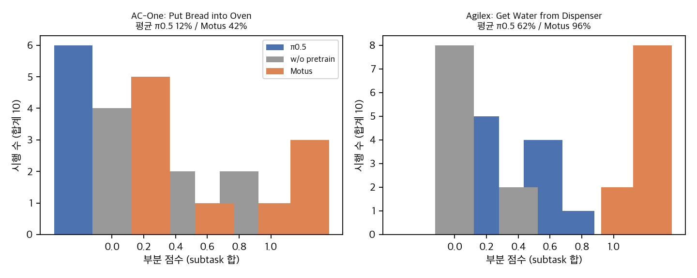
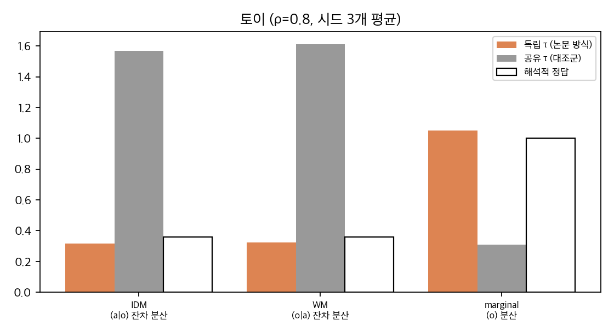

> **논문:** Hongzhe Bi, Hengkai Tan 외 14인. *Motus: A Unified Latent Action World Model.* arXiv:2512.13030 (v2, 2025-12-25). CVPR 2026 포스터.
> 공식 코드는 GitHub thu-ml/Motus (Apache-2.0)에 있습니다. 이 글의 그래프는 논문 표 수치로 다시 그렸습니다. 논문 그림은 쓰지 않았습니다 (arXiv 비배타 라이선스).

## 질문

로봇 기반 모델은 지금 다섯 가지를 따로 학습합니다. 행동을 내는 정책 (VLA), 행동을 받아 다음 장면을 예측하는 세계 모델, 장면 변화에서 행동을 거꾸로 추정하는 역동역학 (IDM), 영상 생성, 그리고 영상과 행동을 함께 예측하는 모델입니다. 저자들은 이것을 하나로 묶을 수 있는지, 그리고 행동 라벨이 없는 영상을 행동 사전학습에 쓸 수 있는지를 묻습니다.

## 설계

- **세 전문가:** 영상 생성 (Wan 2.2 5B), 시각-언어 이해 (Qwen3-VL-2B), 행동 전문가. 세 전문가의 self-attention을 이어 붙이는 "Tri-model Joint Attention"으로 연결합니다.
- **독립 타임스텝:** 영상과 행동에 서로 다른 노이즈 수준을 줍니다 (UniDiffuser 계열). 추론 때 어느 쪽을 깨끗하게 두느냐에 따라 세계 모델, IDM, 정책, 영상 생성, 결합 예측이 됩니다.
- **잠재 행동:** 광학 흐름을 계산하고 VAE로 14차원에 압축합니다. 라벨 없는 영상에서도 "델타 행동" 같은 표현을 얻는 것이 목적입니다.
- **세 단계 학습:** 영상 학습 → 잠재 행동 사전학습 (VLM 동결) → 대상 로봇 미세조정.

## 실험 결과 (재계산)

RoboTwin 2.0 시뮬레이션은 과제 50개, 청정과 무작위 두 설정입니다. 과제별 Motus와 X-VLA 성공률을 그렸습니다.

그래프: RoboTwin 2.0 무작위 설정의 과제별 성공률 (논문 Table 14 값). 회색 선이 두 값의 차이입니다.

| 방법 | 청정 | 무작위 |
|---|---|---|
| π0.5 | 42.98 | 43.84 |
| X-VLA | 72.88 | 72.84 |
| 사전학습 없음 | 77.56 | 77.00 |
| Stage 1만 | 82.26 | 81.86 |
| Motus | 88.66 | 87.02 |

재계산으로 확인한 것과 다시 봐야 할 것은 다음과 같습니다.

- **"+45% over π0.5"는 청정 설정 기준입니다.** 청정 차이는 +45.7점입니다. 무작위 차이는 +43.2점입니다. 공식 README는 무작위 수치 87.02에 45%를 붙입니다.
- **Table 2의 오기.** 본문 Table 2의 사전학습 없음 청정 값 (72.8)과 Stage 1 청정 값 (82.86)은 Table 14, Fig. 6과 다릅니다.
- **사전학습의 효과는 뚜렷합니다.** 사전학습 없음과 Motus의 차이는 무작위에서 +10.0점이고 과제 쌍체 검정에서 p≈3e-5입니다.
- **잠재 행동 단계의 추가 효과는 약합니다.** Stage 1과 Motus의 차이는 무작위에서 +5.2점입니다. 과제 t 검정 p=0.047이지만 순위 검정 p=0.14, 부호 검정 p=0.88입니다. 시드 반복이 없어서 시드 간 분산은 알 수 없습니다.

실세계 결과 (AC-One, Agilex-Aloha-2, 부분 성공률)는 평균이 맞습니다. AC-One은 14.8에서 63.2로, Agilex는 48.6에서 59.3으로 올랐습니다. 초록의 "+11~48%"는 절대 점수 차입니다.

그래프: 논문 Table 4·5의 부분 점수 분포를 시행 10회로 되돌린 값. Agilex Get Water에서만 차이가 통계적으로 뒷받침됩니다 (Mann-Whitney p=0.001, AC-One Put Bread는 p=0.26).

## 코드와 논문의 차이

공식 저장소 (커밋 88f6fe3)를 정적으로 읽었습니다. 실행하지 않았습니다.

- 세 전문가 구조, 손실 가중치, rectified flow 목표, 추론 10 스텝은 논문과 맞습니다.
- **잠재 행동 VAE가 없습니다.** 광학 흐름, DC-AE 기반 VAE, 식 (2)의 손실은 저장소에 없습니다. 로더는 미리 계산된 14차원 라벨을 읽습니다.
- **모드 전환 API가 없습니다.** 공식 추론은 영상과 행동을 함께 복원하는 모드 하나입니다.
- **시간 샘플링이 논문 설명과 다릅니다.** 이산 균등 샘플에 shift 5를 준 스케줄입니다. 설정 파일의 logit-normal 항목은 학습 경로에서 호출되지 않습니다.
- **토큰 균형 주장과 숫자가 다릅니다.** 공식 실세계 설정에서 영상 토큰은 약 360개, 행동 토큰은 약 53개입니다.

## 토이로 본 독립 타임스텝

두 변수 가우시안 (상관 0.8)에서 같은 구조의 작은 모델을 두 방식으로 학습했습니다.

그래프: 시드 3개 평균. 독립 타임스텝 모델은 조건부 IDM과 WM의 잔차 분산을 참값 (0.36) 근처 (0.32)로 맞춥니다. 공유 타임스텝 대조군은 1.6이 됩니다.

이 토이는 메커니즘만 보여 줍니다. 고차원 영상과 실제 로봇 데이터에서 같은 결과가 나오는지는 알 수 없습니다.

## 구현 가능성

이 맥 (Apple M4 Pro, CUDA 없음)에서 논문 결과를 재현하는 것은 불가능합니다. 학습은 GPU 약 1.8만 시간이 필요하고, RoboTwin 평가에는 GPU와 시뮬레이터가 필요합니다. 설계 요소 (독립 타임스텝 학습, 모드 샘플링, 토큰 구조)를 소형 합성 데이터로 옮기는 것은 가능합니다. 잠재 행동 VAE를 다시 짜려면 광학 흐름 가중치를 받아야 하므로 별도 확인이 필요합니다.

## 남은 질문

- 시드를 여러 번 돌렸을 때 Stage 2 효과가 유지되는가?
- RoboTwin은 사전학습 데이터 (Level 3)에 들어 있습니다. 기준선도 같은 데이터로 사전학습했다면 격차는 얼마인가?
- 영상과 행동의 토큰 비율을 논문 설명대로 맞추면 성능이 오르는가?

## 자료

- [통합 리포트 PDF](report/report_public.pdf)
- [Motus: A Unified Latent Action World Model (arXiv:2512.13030) 논문 분석](analysis/01_paper_analysis.md)
- [Motus 선행연구와 관련 자료](analysis/02_prior_work.md)
- [Motus: 표 재계산, 정합성 검사, CPU 토이](analysis/03_analysis.md)
- [Motus: 논문과 공식 코드 대조 (04)](analysis/04_code_verification.md)
