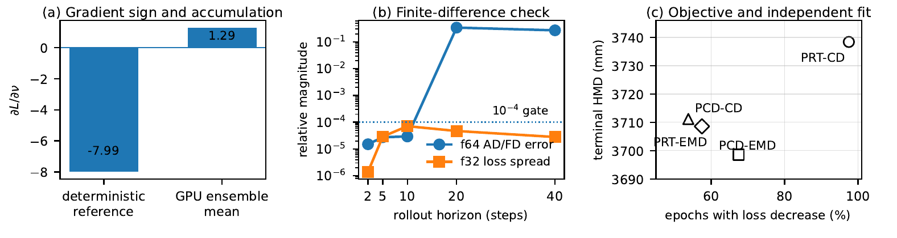
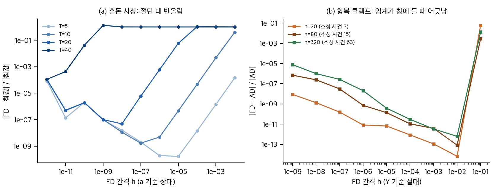
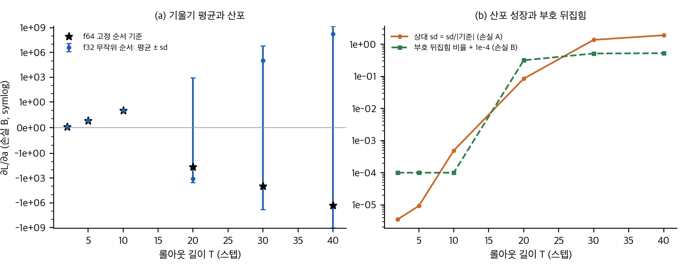
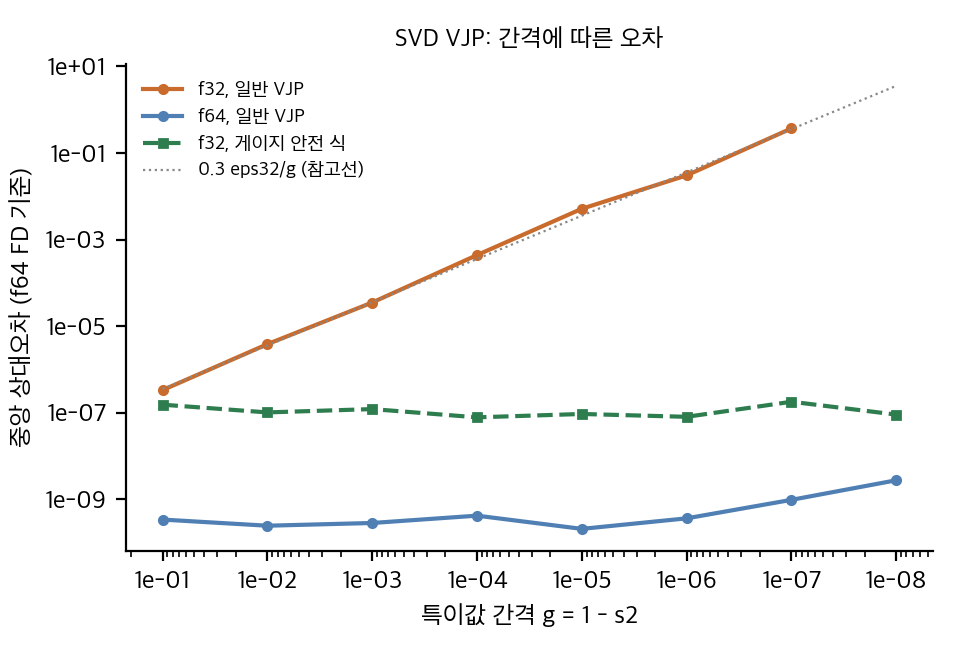
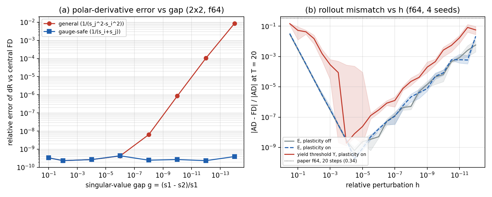

# 미분 가능 시뮬레이터의 기울기를 믿을 수 있는가

로봇이 흙, 반죽, 모래 같은 재료를 다룰 때 시뮬레이터의 재료 상수를 실제 관측에 맞추려면 기울기가 필요합니다. 기울기는 수백 스텝의 접촉 롤아웃을 거꾸로 따라 계산됩니다. 이 기울기는 얼마나 믿을 수 있을까요?

이번 IROS 2026 워크숍 논문(arXiv:2609.34666)은 Taichi 기반 MLS-MPM 식별 두 개로 이 질문을 봅니다. 탄소성 재료(DPSI)와 입상 땅파기(DDBot)입니다. 이 글은 논문 수치를 다시 계산하고, 핵심 효과를 CPU toy로 확인한 결과입니다. 재현은 하지 않았습니다. 공식 코드가 없고, GPU가 필요하기 때문입니다.

## 논문이 보인 세 가지

1. **누적 순서:** GPU의 원자 덧셈 순서가 긴 롤아웃의 기울기 부호를 바꿨다고 보고합니다. 앙상블 평균 +1.29와 결정론 기준 −7.99를 비교합니다.
2. **유한차분 검사:** 2 스텝에서는 f64 AD와 FD가 맞지만, 20 스텝에서 최악 상대 불일치가 0.34로 뜁니다.
3. **관측·손실 설계:** 가장 자주 손실을 줄이는 목적함수가 독립 평가(높이 지도 거리)에서 가장 좋지는 않았습니다.

논문 Fig. 2. (a) 결정론 기준과 GPU 앙상블 평균, (b) DPSI f64 AD/FD 최악 오차와 f32 손실 산포, (c) 목적함수별 강하 비율과 독립 HMD. © 저자, CC BY 4.0. 출처 https://arxiv.org/abs/2609.34666

## 다시 계산한 결과

- 입자 218 → 876에서 표면 셀은 89 → 151입니다. 새 입자의 93%와 89%가 이미 채워진 셀로 떨어집니다. 논문 값과 같습니다.
- 비트 예산 식으로 DDBot의 27,440 입자 리덕션을 계산하면 f64 이후 23비트 여유가 남습니다. 맞습니다.
- 강하 횟수 78/80 대 43/80의 Fisher 검정 p는 약 2·10⁻¹¹입니다. 다만 80 에폭은 독립 표본이 아니므로 이 p값은 과대입니다.
- 평균 HMD 차이는 1.1%이고 반복 분산이 없습니다. 순위 역전을 주장할 근거가 약합니다.

## 가장 큰 공백: 0.34의 원인

논문은 f64에서 AD와 FD가 20 스텝에서 0.34만큼 어긋난다고 보고합니다. 그런데 이 논문은 손으로 쓴 SVD 역전파를 씁니다. 이 식이 틀렸을 수도, FD 섭동이 임계를 넘었을 수도 있습니다. 두 가능성을 나누는 실험은 없습니다.

또 Table II의 "f32 손실 산포"는 10 스텝에서 최대이고 40 스텝에서 줄어듭니다. "길수록 빨리 커진다"는 주장과 맞지 않습니다. f64 판정에 f32 산포를 쓴 것도 기준이 맞지 않습니다.

toy로 보면 항복 분기가 바뀌는 불연속은 FD를 계단형으로 깨뜨립니다. 임계가 중심 차분 창 안에 들어올 때만 어긋나고, 롤아웃이 길어져 사건이 많아질수록 그런 일이 생길 가능성이 커집니다. 손으로 쓴 SVD 역전파는 특이값 간격이 f64 반올림 수준이어야 0.34를 만들 수 있어서 가능성이 낮습니다.

직접 계산(toy). (a) 혼돈 사상 x_(k+1) = 3.9 x_k(1−x_k)의 FD 상대오차 U 곡선(T = 5–40). (b) 항복 클램프에서 FD와 AD의 차이: 임계가 창에 들 때만 계단형으로 커짐.

## 누적 순서와 기울기 부호

긴 롤아웃에서 기울기의 상대 산포는 스텝마다 약 1.6배씩 자랍니다(리아푸노프 모형과 맞음). toy에서 f32 무작위 순서는 20 스텝부터 기울기 부호를 뒤집고, 30 스텝 이후에는 부호가 거의 무작위입니다. 결정론 누적은 같은 입력에 같은 결과를 주지만, 긴 롤아웃 기울기가 참값이라는 보장은 주지 않습니다. 고정소수점 정수 합은 셔플에 대해 비트 동일했지만, 같은 롤아웃에서 f64 순차 합보다 기울기가 덜 정확했습니다(20 스텝 상대오차 3·10⁻⁶ 대 2·10⁻¹⁰, 40비트 고정소수점). int64로 구현하면 이 설정은 29 스텝에서 넘칩니다.

직접 계산(toy). (a) 기울기 평균 ± sd(f32 무작위 순서)와 f64 기준. (b) 상대 sd의 성장과 부호 뒤집힘 비율. 입자 2000개, 실행 400회.

## SVD 역전파는 어떻게 안정시킬까

특이값이 가까우면 SVD 역전파의 F 항이 1/간격으로 커집니다. 그런데 손실이 극분해 인자(UVᵀ)에만 의존하면, 두 antisymmetric 항이 서로 반대라서 F 항이 상쇄됩니다. 그러면 gA = U(A∘G)Vᵀ, G_ij = 1/(s_i+s_j)로 쓸 수 있습니다. toy에서 일반 식은 간격 1e-7에서 f32 상대오차가 37%지만, 이 식은 간격 1e-8까지 1e-7 수준입니다.

직접 계산(toy). 특이값 간격에 따른 SVD 역전파의 중앙 상대오차(f64 FD 기준). 게이지 안전 식은 간격에 무관합니다.

## 2D 축소 구현으로 0.34 원인 나누기

논문 코드가 없어 재현은 할 수 없습니다. 대신 같은 질문을 작은 모형으로 시험했습니다. 2차원 MLS-MPM을 numpy로 짜고(입자 400개, 격자 40×40, 40 스텝), 기울기를 손으로 전진 접선으로 전파했습니다. 정상 간격에서 전진 접선은 중심 차분과 1e-9 수준으로 맞았습니다.

섭동하는 매개변수에 따라 결과가 달랐습니다. 탄성 계수 E를 섭동하면 불일치는 섭동 크기의 제곱에 비례해 줄어드는 전형적인 FD 절단 오차입니다. 항복 임계를 섭동하면 20 스텝 불일치가 0.015에서 0.15 사이가 됩니다. 섭동이 입자의 항복 분기를 바꾸는 순간 FD가 계단처럼 어긋나고, 분기가 바뀌지 않는 작은 섭동에서는 사라집니다. 값의 크기와 40 스텝에서 평탄한 패턴은 논문과 같은 자릿수입니다. 다만 논문은 어떤 매개변수를 섭동했는지 밝히지 않아서, 원인을 확정하지는 못합니다.

손으로 쓴 SVD 항은 영향이 작았습니다. 특이값 간격이 반올림 수준이 아닌 입자에서는 일반 식과 안정 식의 차이가 1e-15 수준이었습니다. 정확히 F = I이거나 간격이 0으로 반올림되는 입자가 있는 설정에서만 일반 식이 0/0으로 NaN을 냈습니다. 논문은 유한한 0.34를 보고했으므로, 이 모형에서는 SVD 간격보다 FD 섭동 쪽이 더 그럴듯합니다.

직접 계산(toy). (a) 극분해 미분의 상대 오차 대 특이값 간격(f64, 중심 차분 기준). (b) T = 20의 상대 불일치 대 섭동 크기(시드 중앙값, 음영은 사분위 범위). 점선은 논문의 f64 20 스텝 0.34입니다.

## 구현할 수 있을까

공식 재현은 불가능합니다. 코드가 공개되지 않았고, 논문 규모(27,440 입자, 311 스텝, 69 작업)는 CUDA GPU 11 GiB 이상이 필요합니다. 이 맥에서는 논문 규모를 돌릴 수 없습니다.

아이디어를 옮기는 것은 쉽습니다. 누적 순서 검사, FD 사다리, 안전한 SVD 식은 작은 numpy 코드로 확인할 수 있습니다. 2D MLS-MPM을 직접 짜고 전진 접선을 검사하는 것은 축소 모형(입자 400개)으로 해 보았고, 전체 실험은 CPU에서 2분 안에 끝났습니다. 역방향 VJP와 논문 규모의 3차원 재현은 아직 하지 않았습니다.

자세한 분석과 toy 코드는 `analysis/`와 `report/`에 있습니다. 게시 판단과 재현 계획은 작성자가 따로 정리합니다.

## 자료

- [통합 리포트 PDF](report/report_public.pdf)
- [01. 논문 분석: 미분 가능 MPM 최적화의 수치 신뢰도](analysis/01_paper_analysis.md)
- [02. 선행연구와 관계](analysis/02_prior_work.md)
- [03. 유도, 재계산, toy 검증](analysis/03_analysis.md)
- [04. 주장 검증과 구현 가능성 (공식 코드 없음)](analysis/04_claim_verification.md)
