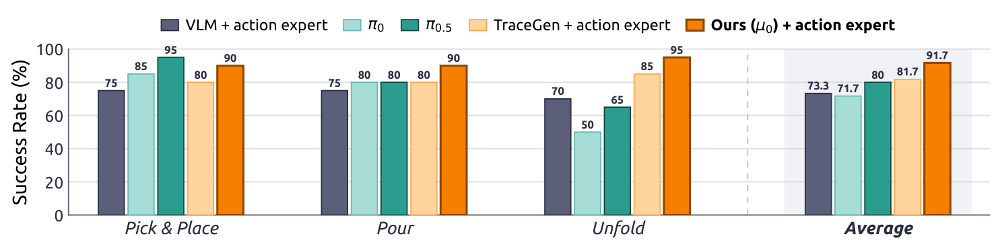

# 01. 논문 분석: μ0 (arXiv:2606.13769)

*μ0: A Scalable 3D Interaction-Trace World Model* (Seungjae Lee*, Yoonkyo Jung*, Jusuk Lee, Jonghun Shin, Amir Hossein Shahidzadeh, Yao-Chih Lee, H. Jin Kim, Jia-Bin Huang†, Furong Huang†; University of Maryland, Seoul National University, All Purpose AI). 학회는 **CoRL 2026 포스터**입니다(CoRL 2026 공식 채택 목록의 포스터 세션, arXiv 댓글 "Accepted to CoRL 2026", 본문 1쪽 각주 "10th Conference on Robot Learning (CoRL 2026), Austin TX"). 분석 대상은 **arXiv v3(2026-10-20 제출)**이고 본문 PDF는 27쪽입니다. 원문은 `paper/paper.pdf`, 텍스트는 `paper/paper.txt`입니다. 절, 식, 표, 그림 번호는 v3 기준입니다. 분석일 2026-11-26.

## 0. 버전 기록과 차이

| 버전 | 제출일 (UTC) | 크기 | 주요 차이 |
|---|---|---|---|
| v1 | 2026-06-11 | 5,247 KB | 최초. 본문 표 1, 2와 그림 6의 값은 v3와 같음. 부록 D.2 평가 세트 정의(129 슬롯), A.6 계산 비용, A.7 사전학습 데이터 표, D.4 배포 비용, D.6 장기 과제, E.4 강건성, 표 10(완전 디코딩 트레이스, 고정 게이트) 없음 |
| v2 | 2026-06-15 | 5,228 KB | 참고문헌 정리(Trokens 인용 추가, 순서 변경), A.4 문구 "DINO가 놓친" → "의미 군집이 놓친", B.1에서 VLM 파라미터 그룹 0.1배 학습률과 기울기 절단 문장 삭제 |
| v3 | 2026-10-20 | 5,031 KB | CoRL 양식. 부록 A.6, A.7, D.1–D.4, D.6, E.2(표 10), E.4 추가. 본문에 평가 세트 설명(§4.1)과 지연·파라미터 비교(§4.2) 추가. 표 12의 값 10.675를 10.625로 바꿈. VLM 기준선 파라미터 칸이 "?"에서 "N/A"로 바뀜 |

- 표 1, 표 2, 그림 6, 표 9–12(옛 표 6–8)의 숫자는 세 버전에서 같습니다. 예외는 200M 머리 w/o Trace 값 하나입니다(v1과 v2 10.675%, v3 10.625%). 숫자 토큰 집합 비교로 확인했습니다(`analysis/recompute.py`는 수치 검사, 버전 비교는 텍스트 비교).
- v1과 v2의 B.1은 "VLM 파라미터 그룹에 0.1배 학습률"이라고 쓰면서 C.1과 §3.4는 VLM을 동결한다고 썼습니다. v3 B.1은 "VLM과 SigLIP 탑은 동결, 트레이스 전문가 등은 무작위 초기화"로 정리했고 기울기 절단 10, 2 GPU(GPU당 6)를 다시 적었습니다.
- 표 12의 10.675%는 시행 수가 400이든 800이든 정수 성공 수로 나타낼 수 없는 값이고(`03` V14), v3의 10.625%는 800회(예: 2시드)에서 정수입니다.

## 1. 한 문단 요약

로봇 학습에서 행동 라벨이 붙은 데이터는 적고 비디오는 많다는 점에서 출발합니다. 픽셀 예측(비디오 생성)은 외형 복원에 용량을 쓰고, 행동 예측(VLA)은 로봇마다 다르다는 것입니다. 중간 표현으로 **상호작용 지점(물체, 도구, 손, 접촉 부위)의 미래 3D 궤적**을 예측합니다. (1) TraceExtract 데이터 엔진이 사람과 로봇 영상에서 DINOv2 군집으로 키포인트를 고르고, VGGT와 TAPIP3D로 전역 정렬된 3D 궤적을 만들고, 궤적 가속도로 영상을 사건 단위로 잘라 VLM 캡션을 붙입니다. (2) μ0는 SmolVLM2-2.2B 앞 20층(동결)에 20층 트레이스 전문가를 붙인 모델(2.59B)로, 질의 키포인트마다 10개 B-spline 제어점을 flow matching으로 생성합니다. (3) 사전학습된 μ0를 동결하고 부분 디노이징(4스텝 중 1스텝)의 은닉 특징을 행동 전문가에 게이트 교차 주의로 넣어 로봇 행동을 만듭니다. 평가는 궤적 예측(129 슬롯, 표 1), RoboCasa365 8과제(표 2), UR3 실로봇 3과제(그림 6)입니다.

## 2. 문제 설정과 방법

### 2.1 TraceExtract (§2, 부록 A)

| 단계 | 내용 | 근거 |
|---|---|---|
| 의미 키포인트 | DINOv2 패치 특징을 개체 군집으로 묶고(군집 ID는 인접 프레임 이분 매칭으로 전파), 개체마다 보이는 패치 면적에 비례한 할당량으로 키포인트를 뽑고 개체 마스크 안에서 최원점 샘플링 | §2.1, A.1 |
| 이동 필터 | 깊이를 λz = 0.1로 가중한 궤적 지름 d_i가 τm = √((H/20)² + (W/20)²)를 넘으면 "움직임" | A.2 |
| 전역-국소 3D 복원 | VGGT를 희소 앵커 프레임(최대 T_sparse)에 한 번, 고정 길이 조각마다 조밀하게 돌리고, 조각 포즈를 앵커에 SE(3)로 정렬(식 1). 내부 파라미터는 앵커 평균 하나를 공유 | A.3 |
| 점진 3D 추적 | 첫 조각은 TAPIP3D, 이후 조각은 이전 조각 마지막 세계 좌표를 질의로 전파 | A.4 |
| 기준 카메라 투영 | 조각마다 기준 카메라로 되돌려 화면 정렬 3D 궤적 T_ref. 호 길이 재매개변수화로 사람과 로봇의 속도 차를 줄임 | §2.2 |
| 사건 캡션 | 궤적 가속도를 Savitzky–Golay로 평활, 정점 사이 최저점을 경계로 잘라 사건 단위를 만들고(식 2), VLM이 시작·중간·끝 프레임(+선택 마스크, 에피소드 설명)으로 구조화 캡션, 텍스트 LLM이 인접 캡션을 창으로 병합 | §2.3, A.5 |
| 출력 | 튜플 D_TE = {I_t, l_c, Q_t, T_ref^{t-h:t+H}} | §2.4 |

규모(부록 A.7, 표 3): EgoDex 51.8K 에피소드·4.1M 프레임, EgoVerse 3.4K·2.7M, Agibot 123K·3.7M, DROID 25.4K·2.5M, 합계 203.6K 에피소드·13.0M 프레임·15.7 TB(원본 저장). 사람 52%, 로봇 48%, 영상 길이로는 약 23일입니다. 처리 속도는 단일 GPU에서 2.4–3.3 프레임/초이고 전체 약 1.2K GPU 시간입니다(A.6). 서론은 "기존 3D 트레이스 데이터보다 약 8배"라고 쓰는데(§1) 비교 대상 크기는 본문에 없습니다.

### 2.2 μ0 모델 (§3, 부록 B, C)

- **백본(§3.1, B.1).** SmolVLM2-2.2B의 텍스트 디코더 앞 20층(동결)이 RGB(512×512)와 지시문을 받아 KV 캐시를 만듭니다. 선택 입력인 깊이는 Turbo 컬러맵 RGB로 바꿔 별도 학습 가능한 패치 스템을 거쳐 SigLIP 깊은 층을 RGB와 공유합니다. 트레이스 전문가는 20층, 폭 0.5배(1024), 두 층마다 자기 주의를 섞고 나머지는 VLM KV 캐시를 교차 주의합니다.
- **질의 토큰(§3.2, B.2).** 키포인트마다 (과거 궤적 8스텝, 현재 앵커, 미래 제어점 10개)를 토큰 2개(이력 1, 미래 1)로 만들고, 그룹 임베딩, 이력/미래 세그먼트 임베딩, 현재 (u, v)의 푸리에 특징(영초기화 MLP)을 더하고, 키포인트 위치에서 뽑은 동결 DINO-base 특징을 2층 MLP로 융합합니다(식 5). 모든 토큰의 RoPE 위치를 접두 끝 인덱스로 고정해 키포인트 순서에 대한 등변성을 유지합니다.
- **타깃(B.2).** 앵커를 뺀 뒤 축별 95퍼센타일 s∆로 나누고(식 3), H = 32 스텝 미래를 3차 B-spline 제어점 D = 10개로 행 가중 능형 최소제곱(λ_bsp = 0.2, 이웃 제어점 차분 정규화, |P| ≤ 1.5 절단)으로 적합합니다(식 4). 제어점이 유효한 미래 스텝이 D개 미만이면 흐름 손실에서 뺍니다.
- **학습(§3.3, B.3).** 선형 경로 P^τ = τ ε + (1 − τ) P*, 속도 v = ε − P*를 맞추는 MSE(식 6, 7). adaLN-Zero로 τ를 주입합니다. 보조 손실로 키포인트별 H차원 유효성 로짓의 BCE(식 8)와 같은 DINO 군집 안의 쌍 거리가 제어점 축에서 변하지 않도록 하는 강성 손실(식 9). 합 L = L_flow + λ_done L_done + λ_rig L_rig(식 10, 가중치 값은 본문에 없음). 추론은 4스텝 오일러입니다.
- **옵티마이저(B.1, C.1).** AdamW, 학습률 1e-4, 가중치 감쇠 1e-10, 기울기 절단 10, 2×10⁵ 스텝, 유효 배치 24(GPU 2개, GPU당 6), 키포인트 수 N은 [1, 256]에서 균등 추출. 이력은 확률 0.5로 전체를, 0.3으로 키포인트별로 삭제하고, 깊이는 확률 0.7로 생략합니다.
- **행동 전문가(§3.4, B.4).** μ0 전체를 동결합니다. 순수 잡음 제어점에서 4스텝 오일러의 첫 스텝만 실행해 트레이스 전문가의 중간 은닉 상태 z_trace를 얻고, 마지막 층 VLM 특징 z에 게이트 교차 주의 z_guided = z + σ(g)·CA(LN(z), LN(W_proj z_trace))로 더합니다(식 11, g는 0으로 초기화한 스칼라). 행동 전문가는 π0.5의 자기 주의 구조를 따르고 그리퍼 카메라(DINOv2), 고유감각, 언어를 접두로 받아 flow matching으로 행동 청크를 냅니다(식 12).

## 3. 실험 결과

### 3.1 궤적 예측 (§4.1, 표 1, 부록 표 4)

평가 세트는 사전학습에서 제외한 5개 출처(사람 30, Mobile ALOHA 30, Franka 30, UR3 30, VIMA-Bench 9 클립 = 129 슬롯, 슬롯당 16 키포인트)입니다(D.2). 모든 방법이 같은 질의 키포인트를 받고, 지표는 움직이는 점만 대상으로, 정규화 (u, v, z) 공간에서 계산합니다(D.1). top-1은 한 표본의 오차, top-5는 다섯 표본 중 최소 오차입니다.

| 묶음 | 비교 방법 | μ0가 가장 좋은 칸 (표 1, 18칸) |
|---|---|---|
| 2D | Gemini 3.1 Pro, Gemini 3 Flash, GPT-5.5, Track2Act, Hamster | 10 / 18 (top-5 9칸 전부, top-1 9칸 중 1칸) |
| 3D | 3DFlowAction, Dream2Flow, TraceGen | 18 / 18 |

- 지연: μ0 0.29 s (A6000, D.1), Track2Act 0.85 s, Hamster 14.4 s, VLM API 38–78 s, Dream2Flow 106.8 s (표 1). 서론의 "다음으로 빠른 2D 기준선보다 2.9배 빠름"은 0.85/0.29 = 2.93입니다.
- Fréchet 거리는 표 4에 있고 같은 순위입니다. 파라미터는 μ0 2.59B, Hamster 13.5B, Dream2Flow 11.3B, TraceGen 0.67B, Track2Act 0.47B, 3DFlowAction 2.04B입니다.

### 3.2 RoboCasa365 시뮬레이션 (§4.2, 표 2, 표 6, 표 7)

PandaOmron 이동 조작기, 8개 원자 과제, 과제당 시연 100개(총 800), 과제당 50 롤아웃입니다(D.5). 모든 사전학습 방법은 백본을 동결하고 행동 전문가만 같은 데이터, 같은 스텝(50,000), 같은 배치(32)로 학습합니다(표 6). 평균 성공률(%): Diffusion Policy 22.75, π0 25.25, π0.5 42.0, TraceGen + 행동 전문가 23.0, **μ0 + 행동 전문가 30.25**. 본문은 π0.5가 평균에서 더 강하다고 인정하고 "데이터 규모가 맞지 않은 비교"라고 설명합니다(§4.2). 장기 과제 3개(표 7, 50 롤아웃)에서는 μ0가 π0 대비 5/7 부분과제에서 같거나 높고 π0.5에는 대부분 뒤집니다(D.6).

### 3.3 UR3 실로봇 (§4.2, 그림 6, 부록 D.7, 표 8)

과제 세 개(Pick <object> into Sink, Pour Almonds into <object>, Unfold Towel), 시연 90/80/50개, 과제당 20 롤아웃. 그림 6의 값(그림 판독 값)은 아래와 같고, 본문은 평균 91.7%가 π0보다 20.0, π0.5보다 11.7, VLM + 행동 전문가보다 18.4, TraceGen보다 10.0 포인트 높다고 씁니다.

| 방법 | Pick & Place | Pour | Unfold | 평균 |
|---|---|---|---|---|
| VLM + 행동 전문가 | 75 | 75 | 70 | 73.3 |
| π0 | 85 | 80 | 50 | 71.7 |
| π0.5 | 95 | 80 | 65 | 80.0 |
| TraceGen + 행동 전문가 | 80 | 80 | 85 | 81.7 |
| μ0 + 행동 전문가 | 90 | 90 | 95 | 91.7 |

*그림 6 (논문 원문). © 저자, CC BY 4.0, 출처 arXiv:2606.13769 (v3). 막대 값은 그림에 적힌 숫자입니다.*

### 3.4 절제와 규모 (부록 E)

- **표 9 (top-5 DTW, T = 8/16/32).** "Full μ0" 0.127/0.187/0.223, B-spline 없음 0.156/0.222/0.258, DINO 없음 0.139/0.193/0.230, 강성 손실 없음 0.138/0.193/0.227. 입력 쪽에서 깊이+이력 포함 0.107/0.160/0.203, 깊이 없음 0.112/0.168/0.207, 이력 없음 0.126/0.183/0.224, 깊이·이력 모두 없음 0.127/0.187/0.223. "Full μ0"의 값은 표 1의 3D μ0 행과 같습니다(`03` V13).
- **표 10.** 완전 디코딩 트레이스 조건 29.5%, 게이트를 σ(g) = 0.5, 0.25로 고정하면 26.0%, 25.0%(학습 게이트 30.25%). 학습된 게이트는 0.481–0.500에 수렴합니다(E.2).
- **표 11, 12.** 모델 342M → 568M → 2.59B에서 top-5 DTW가 단조 감소, 데이터 5% → 20% → 100%에서 감소(T = 8의 5% 대 20%만 0.134 → 0.138로 반대). 행동 머리 200M은 트레이스 없음 10.625% 대 25.625%, 400M은 28.25% 대 30.25%.
- **E.4.** 캡션 단어 41% 교란 시 지표 2.9–3.3% 악화, 키포인트 30% 삭제·흔들기 시 1.2–4.1% 악화. 정책 입력 트레이스에 σ = 0.05 잡음을 넣으면 30.25 → 27.5%.

## 4. 한계 (논문 §6)

트레이스 구성 단계(군집, 3D 복원, 추적, 캡션)의 오류를 물려받고, 힘, 촉각, 접촉 모드를 모델링하지 않으며, 행동 전문가 평가는 탁상 조작과 적은 로봇·과제에 한정되고, 이동 조작기, 손가락 손, 장기 과제 검증은 앞으로의 일이라고 씁니다.

## 5. 주장과 근거의 간격 (분석)

1. **궤적 예측 우위는 top-5(표본 다섯 개 중 최소)에서 크고 top-1에서는 비슷합니다.** 2D에서 top-1 아홉 칸 중 여덟 칸은 다른 방법이 앞서고, 앞서는 방법 쪽 차이는 0.001–0.043입니다(`03` V6). top-5/top-1 비율은 μ0 2D 0.67, VLM 기준선 0.84–0.89라서 표본 다양성이 top-5 이득의 큰 부분으로 보입니다(`03` V7).
2. **μ0의 표 1 수치는 깊이와 이력이 없는 설정입니다.** 표 9에서 "Full μ0"는 깊이·이력 모두 없음과 같은 값이고, 이 설정이 가장 낮은 성능 행입니다. 깊이와 이력을 쓰면 top-5 DTW가 0.020/0.027/0.020 더 낮습니다.
3. **시뮬레이션 우위는 π0 대비 5.0포인트이고 신뢰구간이 0을 포함합니다.** 풀링 400회 대 400회 Fisher p = 0.13, 과제 8개 중 7개에서 앞서지만 부호 검정 p = 0.07입니다. π0.5는 11.75포인트 높고 p = 0.0007입니다(`03` V2).
4. **실로봇 평균 91.7%는 π0.5, TraceGen과 방향은 같으나 시행 60회로는 구간이 겹칩니다.** 시행 수 가정 아래 p = 0.11, 0.18입니다(`03` V4).
5. **트레이스 특징의 이득은 머리 크기에 따라 다릅니다.** 400M 머리에서는 30.25 대 28.25(p ≈ 0.4–0.6), 200M 머리에서는 25.6 대 10.6입니다(`03` V14).
6. **게이트는 초기값 근처에 머뭅니다.** σ(0) = 0.5이고 학습 후 0.481–0.500입니다. 본문 B.4는 "약한 주입 영역에서 시작"한다고 쓰는데 초기값이 중간값입니다(`04` D3).
7. **다운스트림 정책의 질의 점은 고정 20×20 격자입니다**(공개 코드). 서론의 "고정 격자의 한계"와 대비되는 설정이고, 본문에는 그림 3의 "Fixed query Point" 라벨만 있습니다(`04` D1).
